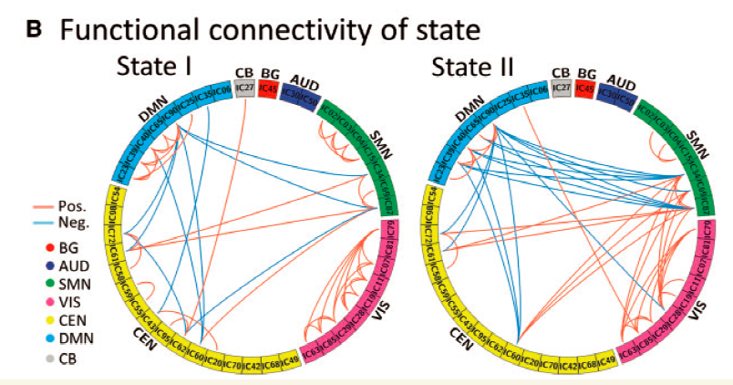

When features relate in a network where every node has a position along a circle (e.g. brain regions in functional connectivity or genomic loci in gene fusion), a **circular connection layout** (Circos link plot) connects pairs with ribbons or arcs whose colour encodes positive (red) or negative (blue) correlation, grouped by functional networks or chromosomes \[1\]. `circlize::circos.link()` drives the reference; this tutorial reproduces a 7-network functional connectivity layout with in-page simulated regions and arc links:

## Example

{fig-alt="Circos Connectivity & Fusion Links DEMO" fig-align="center" width="70%"}

## Setup

-   System Requirements: Cross-platform (Linux/MacOS/Windows)

-   Programming language: R

-   Dependent packages: `circlize`

```{r packages setup, message=FALSE, warning=FALSE, output=FALSE}
suppressPackageStartupMessages({
  library(circlize)
})
```

```{r}
sessioninfo::session_info("attached")
```

## Data Preparation

28 regions distributed across 7 functional networks (Basal Ganglia, Auditory, Sensorimotor, Visual, Cognitive Executive, Cerebellar, Default Mode), with a functional connectivity matrix where the top 5% strongest absolute correlations are retained as links (red for positive, blue for negative):

```{r load data}
suppressPackageStartupMessages({library(circlize)})
set.seed(45268)
nets <- c("Basal Ganglia", "Auditory", "Sensorimotor", "Visual",
          "Executive", "Cerebellar", "Default Mode")
n_reg <- 28
reg_net <- rep(nets, each = 4)
regions <- sprintf("R%02d", 1:n_reg)
names(reg_net) <- regions

## functional connectivity matrix
fc <- matrix(rnorm(n_reg * n_reg, 0, 0.3), n_reg, n_reg,
             dimnames = list(regions, regions))
diag(fc) <- 0
fc[lower.tri(fc)] <- t(fc)[lower.tri(fc)]
## plant strong links within networks and between Executive/Default Mode
for (i in seq_len(n_reg)) {
  for (j in seq_len(n_reg)) {
    if (reg_net[i] == reg_net[j] && i != j) fc[i, j] <- fc[i, j] + rnorm(1, 0.7, 0.2)
  }
}
fc <- pmin(pmax(fc, -1), 1)

## extract top 5% strongest links
th <- quantile(abs(fc[upper.tri(fc)]), 0.95)
links <- which(abs(fc) > th & upper.tri(fc), arr.ind = TRUE)
link_df <- data.frame(
  region1 = regions[links[, 1]],
  region2 = regions[links[, 2]],
  val = fc[links])
link_df$col <- ifelse(link_df$val > 0, "#B2182B99", "#2166AC99")
```

## Visualization

### 1. The Circos Link Plot

The reference's layout: outer sector ring coloured by the seven functional networks, inner link ribbons connecting region pairs with red/blue transparency:

```{r}
#| label: fig-1.1CircosLink
#| fig-cap: "Circular connectivity layout for 28 brain regions across 7 functional networks: outer sectors coloured by network, inner ribbons show the top 5% strongest functional connections (red = positive, blue = negative)."
#| out.width: "80%"
#| fig-width: 7.5
#| fig-height: 7.5

net_col <- setNames(RColorBrewer::brewer.pal(7, "Paired"), nets)
reg_col <- net_col[reg_net]

circos.clear()
circos.par(gap.degree = 2, cell.padding = c(0, 0, 0, 0))
circos.initialize(factors = factor(regions, levels = regions),
                  xlim = matrix(c(rep(0, n_reg), rep(1, n_reg)), ncol = 2))
circos.track(ylim = c(0, 1), track.height = 0.08,
             panel.fun = function(x, y) {
               nm <- CELL_META$sector.index
               circos.rect(CELL_META$xcenter - 0.4, 0, CELL_META$xcenter + 0.4, 1,
                           col = reg_col[nm], border = NA)
               circos.text(CELL_META$xcenter, 1.2, nm, cex = 0.6,
                           facing = "clockwise", adj = c(0, 0.5))
             })
for (k in seq_len(nrow(link_df))) {
  r1 <- link_df$region1[k]; r2 <- link_df$region2[k]
  circos.link(r1, 0.5, r2, 0.5, col = link_df$col[k], lwd = 1.2)
}
legend("bottomleft", inset = c(0.02, 0.02), legend = nets, pch = 15,
       col = net_col, bty = "n", cex = 0.8, title = "Networks")
circos.clear()
```

### 2. Grouped Chord Diagram Alternative

When individual region links are too dense, grouping the links by network into a **chord diagram** summarizes the inter-network communication flow:

```{r}
#| label: fig-2.1CircosChord
#| fig-cap: "Inter-network chord diagram summarizing connection counts between the seven functional networks: chord thickness encodes connection volume, colours match the network palette."
#| out.width: "80%"
#| fig-width: 7.5
#| fig-height: 7.5

net_mat <- matrix(0, 7, 7, dimnames = list(nets, nets))
for (k in seq_len(nrow(link_df))) {
  n1 <- reg_net[link_df$region1[k]]
  n2 <- reg_net[link_df$region2[k]]
  net_mat[n1, n2] <- net_mat[n1, n2] + 1
  if (n1 != n2) net_mat[n2, n1] <- net_mat[n2, n1] + 1
}
circos.clear()
chordDiagram(net_mat, grid.col = net_col, transparency = 0.35,
             annotationTrack = "grid", preAllocateTracks = 1)
circos.trackPlotRegion(track.index = 1, panel.fun = function(x, y) {
  xlim = CELL_META$xlim
  ylim = CELL_META$ylim
  sector.name = CELL_META$sector.index
  circos.text(mean(xlim), ylim[1], sector.name, facing = "clockwise",
              niceFacing = TRUE, adj = c(0, 0.5), cex = 0.8)
}, bg.border = NA)
circos.clear()
```

::: callout-tip
**Practice tips**

-   Filter links by a top-percentile threshold (`quantile(abs(fc), 0.95)`) before plotting — drawing every possible pairwise connection turns the centre into an opaque black web.
-   Encode sign in colour (red positive, blue negative) and transparency (`#99` alpha) so crossing ribbons remain distinguishable.
-   Group by region complexity or anatomical network (`circlize::circos.initialize`) and keep track heights modest (0.08-0.12) so links dominate the visual space.
-   When node counts exceed ~30, switch from individual region links to a network-level chord diagram (`chordDiagram()`) to keep the flow interpretable.
-   `circos.clear()` after every circos render — leftover sector state corrupts subsequent plots.
:::

## Application

::: {#fig-CircosApplications1}
{fig-alt="Circos Connectivity & Fusion Links" fig-align="center" width="70%"}

Circos connectivity & fusion links
:::

The circular link grammar fits any pairwise network with node positions: gene fusions (genomic coordinates), transcription factor regulon networks, or microbial co-occurrence networks — wherever spatial or network order matters.

## Reference

\[1\] Xiaofan Lu, et al. FigureYa: A Standardized Visualization Framework for Enhancing Biomedical Data Interpretation and Research Efficiency. iMetaMed. 2025. doi:10.1002/imm3.70005
