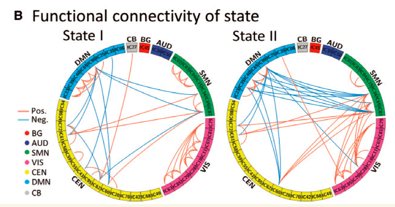

当特征在环上有序形成网络（如功能连接中的脑区或基因组融合中的基因座）时，**圆形连接版式**（Circos link plot）用带状弧或曲线连接成对特征，颜色编码正（红）或负（蓝）相关，并按功能网络或染色体分组 \[1\]。`circlize::circos.link()` 驱动参考；本教程在页内模拟区域与弧链接上复现 7 网络功能连接版式：

## Example

{fig-alt="Circos 关联与融合连接图 DEMO" fig-align="center" width="60%"}

## Setup

-   系统要求：跨平台（Linux/MacOS/Windows）

-   编程语言：R

-   依赖包：`circlize`

```{r packages setup, message=FALSE, warning=FALSE, output=FALSE}
suppressPackageStartupMessages({
  library(circlize)
})
```

```{r}
sessioninfo::session_info("attached")
```

## 数据准备

分布在 7 个功能网络（基底神经节、听觉、感觉运动、视觉、认知执行、小脑、默认模式）中的 28 个区域，带函数连接矩阵——保留绝对值最强的前 5% 相关作为链接（正连接红、负连接蓝）：

```{r load data}
suppressPackageStartupMessages({library(circlize)})
set.seed(45268)
nets <- c("Basal Ganglia", "Auditory", "Sensorimotor", "Visual",
          "Executive", "Cerebellar", "Default Mode")
n_reg <- 28
reg_net <- rep(nets, each = 4)
regions <- sprintf("R%02d", 1:n_reg)
names(reg_net) <- regions

## functional connectivity matrix
fc <- matrix(rnorm(n_reg * n_reg, 0, 0.3), n_reg, n_reg,
             dimnames = list(regions, regions))
diag(fc) <- 0
fc[lower.tri(fc)] <- t(fc)[lower.tri(fc)]
## plant strong links within networks and between Executive/Default Mode
for (i in seq_len(n_reg)) {
  for (j in seq_len(n_reg)) {
    if (reg_net[i] == reg_net[j] && i != j) fc[i, j] <- fc[i, j] + rnorm(1, 0.7, 0.2)
  }
}
fc <- pmin(pmax(fc, -1), 1)

## extract top 5% strongest links
th <- quantile(abs(fc[upper.tri(fc)]), 0.95)
links <- which(abs(fc) > th & upper.tri(fc), arr.ind = TRUE)
link_df <- data.frame(
  region1 = regions[links[, 1]],
  region2 = regions[links[, 2]],
  val = fc[links])
link_df$col <- ifelse(link_df$val > 0, "#B2182B99", "#2166AC99")
```

## Visualization

### Circos 链接图

参考的外层版式：外部扇区环按七个功能网络着色、内部链接带用红/蓝透明度连接区域对：

```{r}
#| label: fig-1.1CircosLink
#| fig-cap: "28 个脑区跨 7 个功能网络的圆形连接版式：外扇区按网络着色、内带显示最强 5% 功能连接（红 = 正、蓝 = 负）。"
#| out.width: "80%"
#| fig-width: 7.5
#| fig-height: 7.5

net_col <- setNames(RColorBrewer::brewer.pal(7, "Paired"), nets)
reg_col <- net_col[reg_net]

circos.clear()
circos.par(gap.degree = 2, cell.padding = c(0, 0, 0, 0))
circos.initialize(factors = factor(regions, levels = regions),
                  xlim = matrix(c(rep(0, n_reg), rep(1, n_reg)), ncol = 2))
circos.track(ylim = c(0, 1), track.height = 0.08,
             panel.fun = function(x, y) {
               nm <- CELL_META$sector.index
               circos.rect(CELL_META$xcenter - 0.4, 0, CELL_META$xcenter + 0.4, 1,
                           col = reg_col[nm], border = NA)
               circos.text(CELL_META$xcenter, 1.2, nm, cex = 0.6,
                           facing = "clockwise", adj = c(0, 0.5))
             })
for (k in seq_len(nrow(link_df))) {
  r1 <- link_df$region1[k]; r2 <- link_df$region2[k]
  circos.link(r1, 0.5, r2, 0.5, col = link_df$col[k], lwd = 1.2)
}
legend("bottomleft", inset = c(0.02, 0.02), legend = nets, pch = 15,
       col = net_col, bty = "n", cex = 0.8, title = "Networks")
circos.clear()
```

### 分组弦图替代方案

当单区域链接过密时，按网络对链接分组的**弦图**可总结网络间通讯流：

```{r}
#| label: fig-2.1CircosChord
#| fig-cap: "总结 7 个功能网络间连接计数的网络间弦图：弦厚度编码连接量、颜色与网络调色板一致。"
#| out.width: "80%"
#| fig-width: 7.5
#| fig-height: 7.5

net_mat <- matrix(0, 7, 7, dimnames = list(nets, nets))
for (k in seq_len(nrow(link_df))) {
  n1 <- reg_net[link_df$region1[k]]
  n2 <- reg_net[link_df$region2[k]]
  net_mat[n1, n2] <- net_mat[n1, n2] + 1
  if (n1 != n2) net_mat[n2, n1] <- net_mat[n2, n1] + 1
}
circos.clear()
chordDiagram(net_mat, grid.col = net_col, transparency = 0.35,
             annotationTrack = "grid", preAllocateTracks = 1)
circos.trackPlotRegion(track.index = 1, panel.fun = function(x, y) {
  xlim = CELL_META$xlim
  ylim = CELL_META$ylim
  sector.name = CELL_META$sector.index
  circos.text(mean(xlim), ylim[1], sector.name, facing = "clockwise",
              niceFacing = TRUE, adj = c(0, 0.5), cex = 0.8)
}, bg.border = NA)
circos.clear()
```


## 应用场景

::: {{#fig-CircosApplications1}}
{fig-alt="Circos 关联与融合连接图" fig-align="center" width="60%"}

Circos 关联与融合连接图
:::

圆形连接语法适用于任何带节点位置的成对网络：基因融合（基因组坐标）、转录因子 regulon 网络、或微生物共现网络——凡空间或网络顺序重要处。

## 参考文献

\[1\] Xiaofan Lu, et al. FigureYa: A Standardized Visualization Framework for Enhancing Biomedical Data Interpretation and Research Efficiency. iMetaMed. 2025. doi:10.1002/imm3.70005
