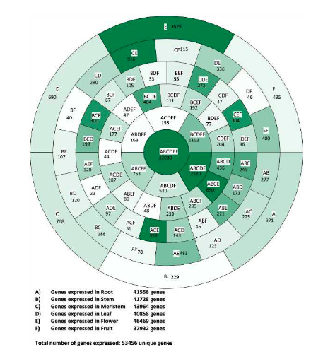

Beyond four or five sets a classic Venn diagram stops being readable. The reference replaces it with a **polar stacked bar**: every region (A, AB, ABC, ..., ABCDEF) is one equal-width wedge, wedges are grouped into concentric rings by how many sets they involve (`nchar` of the region name), fill intensity encodes the gene count on a white→forest-green ramp, and each wedge carries its region name + count — the centre wedge (ABCDEF) is the shared core \[1\]. Overlaps come from `ggVennDiagram::process_region_data()` (in the lockfile); the rendering is plain ggplot2 `coord_polar`:

## Example

{fig-alt="Circular Venn Region Chart DEMO" fig-align="center" width="70%"}

## Setup

-   System Requirements: Cross-platform (Linux/MacOS/Windows)

-   Programming language: R

-   Dependent packages: `ggVennDiagram`; `ggplot2`; `dplyr`

```{r packages setup, message=FALSE, warning=FALSE, output=FALSE}
suppressPackageStartupMessages({
  library(ggplot2); library(ggVennDiagram)
})
```

```{r}
sessioninfo::session_info("attached")
```

## Data Preparation

Six simulated organ-expression gene sets (A-F) drawn from a 32k-gene universe with a planted shared core: 20k genes expressed everywhere, plus per-set and per-pair enrichment, so the region counts resemble the reference's profile (huge ABCDEF centre, moderate pairwise wedges, thin specific rings). `process_region_data(Venn(...))` returns every region with its member sets and count:

```{r load data}
suppressPackageStartupMessages({library(ggplot2); library(ggVennDiagram)})
set.seed(40237)
universe <- sprintf("GENE%05d", 1:32000)
sets <- lapply(LETTERS[1:6], function(l) {
  sample(universe, 24000, replace = FALSE)
})
names(sets) <- LETTERS[1:6]
## plant the shared core: same 20000 genes in every set
core <- sample(universe, 20000)
for (i in seq_along(sets)) {
  sets[[i]] <- unique(c(core, sample(setdiff(universe, core), 4000)))
}
set <- as.data.frame(process_region_data(Venn(sets)))
dt_all <- set[, c("count", "name")]
colnames(dt_all) <- c("num", "name")
## region names like "A..B..C" -> "A\B\C"
dt_all$name <- gsub("\\.\\.", "\\\\", dt_all$name)
head(dt_all, 3)
```

## Visualization

### 1. Rings by Region Complexity

Every region gets the same y value so each wedge occupies equal angle; wedges are stacked into rings by `nchar(name)` (1 = specific genes, 6 = the shared core), filled by gene count, and labelled with region + count. Counts above 1000 are capped at 1000 for the fill so the huge core does not wash out every other wedge — the reference's exact trick:

```{r}
#| label: fig-1.1CircosVenn
#| fig-cap: "Circular Venn region chart for 6 simulated organ-expression sets: wedges grouped into rings by region complexity (innermost = ABCDEF shared core, outer = set-specific), fill = gene count capped at 1000, labels give region and count."
#| out.width: "80%"
#| fig-width: 8
#| fig-height: 8

dt_all$value <- 100
dt_all$level <- nchar(dt_all$name)
dt_all$level <- factor(dt_all$level, levels = rev(seq_len(max(dt_all$level))))
dt_all_final <- do.call(rbind, lapply(levels(dt_all$level), function(i)
  subset(dt_all, level == i)))
dt_all_final$label <- paste0(dt_all_final$name, "\n", dt_all_final$num)
dt_all_final$plot_num <- pmin(dt_all_final$num, 1000)

p <- ggplot(dt_all_final, aes(x = level, y = value, fill = plot_num)) +
  geom_bar(stat = "identity", position = "fill", width = 1, colour = "black") +
  scale_fill_gradientn(colours = c("white", "forestgreen")) +
  geom_text(aes(label = label), color = "black", size = 3.2,
            position = position_fill(vjust = 0.5)) +
  coord_polar(theta = "y", direction = -1) +
  theme_bw() +
  theme(legend.position = "none",
        panel.grid = element_blank(),
        axis.ticks = element_blank(),
        axis.text = element_blank(),
        axis.title = element_blank(),
        panel.border = element_blank())
p
```

### 2. Same Chart from Raw Overlap Counts

If the overlaps already exist (the reference's Supplemental-Table route: one column per region, first row = count), skip `ggVennDiagram` and feed the counts straight in — the same figure from a two-column `name/num` table:

```{r}
#| label: fig-2.1CircosVennCounts
#| fig-cap: "Circular Venn chart built directly from a name/count table (the reference's easy_input route): region wedges ordered by complexity rings, labels every other wedge to avoid crowding."
#| out.width: "80%"
#| fig-width: 8
#| fig-height: 8

counts_tab <- dt_all_final[, c("name", "num")]
counts_tab$value <- 100
counts_tab$level <- factor(nchar(counts_tab$name),
                           levels = rev(seq_len(max(nchar(counts_tab$name)))))
counts_tab$plot_num <- pmin(counts_tab$num, 1000)
## thin out labels: one per pair of wedges within each ring
counts_tab$label <- ifelse(seq_len(nrow(counts_tab)) %% 2 == 1,
                           paste0(counts_tab$name, "\n", counts_tab$num), "")

ggplot(counts_tab, aes(x = level, y = value, fill = plot_num)) +
  geom_bar(stat = "identity", position = "fill", width = 1, colour = "black") +
  scale_fill_gradientn(colours = c("white", "forestgreen")) +
  geom_text(aes(label = label), color = "black", size = 3,
            position = position_fill(vjust = 0.5)) +
  coord_polar(theta = "y", direction = -1) +
  theme_bw() +
  theme(legend.position = "none",
        panel.grid = element_blank(),
        axis.ticks = element_blank(),
        axis.text = element_blank(),
        axis.title = element_blank(),
        panel.border = element_blank())
```

::: callout-tip
**Practice tips**

-   Cap the fill variable (`pmin(num, 1000)`): the shared-core wedge is often 10-100× any other region, and an uncapped ramp turns every other wedge white.
-   Keep every wedge the **same angular width** (`value = 100`, `position = "fill"`) — the geometry encodes set membership, not counts; counts live in the fill and the label.
-   Order wedges by region complexity (`nchar(name)`) so rings read inside-out: shared core → pairs → specific genes.
-   Label every other wedge when a ring has dozens of regions (`%% 2` thinning); the pattern plus the fill carries the skipped ones.
-   A backslash-separated region name is the convention (`A\B` = genes in A but not B) — state it in the caption, or readers will parse `A\B` as a subtraction gone wrong.
:::

## Application

::: {#fig-CircosVennApplications1}
{fig-alt="Circular Venn Region Chart" fig-align="center" width="70%"}

Circular Venn region chart
:::

Any many-set membership breakdown fits: DEG overlaps across six comparisons, pathway memberships across gene-set libraries, or feature presence across pipeline versions — wherever a Venn diagram would need more than four ellipses.

## Reference

\[1\] Xiaofan Lu, et al. FigureYa: A Standardized Visualization Framework for Enhancing Biomedical Data Interpretation and Research Efficiency. iMetaMed. 2025. doi:10.1002/imm3.70005
