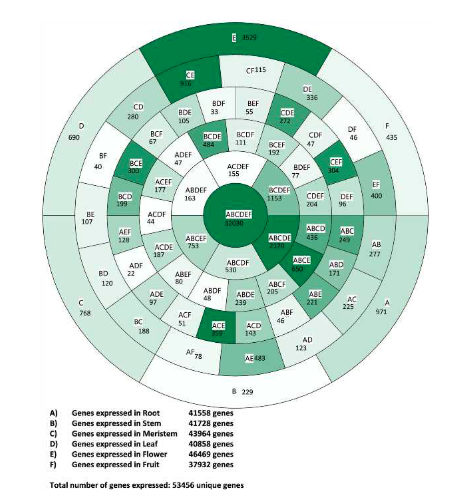

超过四五套集合后经典 Venn 图就不可读了。参考文档换成**极坐标堆叠条**：每个区域（A、AB、ABC、……、ABCDEF）一个等宽扇区、按涉及集合数（区域名的 `nchar`）分组成同心环、填充强度以白→森林绿编码基因数、每个扇区自带区域名 + 计数——圆心（ABCDEF）是共享核心 \[1\]。overlap 用 `ggVennDiagram::process_region_data()`（已入锁）求取；渲染是朴素 ggplot2 `coord_polar`：

## Example

{fig-alt="环形 Venn 区域图 DEMO" fig-align="center" width="60%"}

## Setup

-   系统要求：跨平台（Linux/MacOS/Windows）

-   编程语言：R

-   依赖包：`ggVennDiagram`; `ggplot2`; `dplyr`

```{r packages setup, message=FALSE, warning=FALSE, output=FALSE}
suppressPackageStartupMessages({
  library(ggplot2); library(ggVennDiagram)
})
```

```{r}
sessioninfo::session_info("attached")
```

## 数据准备

六套模拟器官表达基因集（A-F）取自 3.2 万基因宇宙、植入共享核心：2 万个基因到处表达、另有逐集合与逐对富集，使区域计数接近参考的形态（巨大 ABCDEF 圆心、中等的成对扇区、纤细的特异环）。`process_region_data(Venn(...))` 返回每个区域及其成员集合与计数：

```{r load data}
suppressPackageStartupMessages({library(ggplot2); library(ggVennDiagram)})
set.seed(40237)
universe <- sprintf("GENE%05d", 1:32000)
sets <- lapply(LETTERS[1:6], function(l) {
  sample(universe, 24000, replace = FALSE)
})
names(sets) <- LETTERS[1:6]
## plant the shared core: same 20000 genes in every set
core <- sample(universe, 20000)
for (i in seq_along(sets)) {
  sets[[i]] <- unique(c(core, sample(setdiff(universe, core), 4000)))
}
set <- as.data.frame(process_region_data(Venn(sets)))
dt_all <- set[, c("count", "name")]
colnames(dt_all) <- c("num", "name")
## region names like "A..B..C" -> "A\B\C"
dt_all$name <- gsub("\\.\\.", "\\\\", dt_all$name)
head(dt_all, 3)
```

## Visualization

### 按区域复杂度分环

每个区域取相同的 y 值使扇区等角；扇区按 `nchar(name)` 堆叠成环（1 = 特异基因、6 = 共享核心）、按基因数填色并标注区域 + 计数。超过 1000 的计数在填色时截断为 1000，避免巨大的核心把其他扇区洗白——参考的原味技巧：

```{r}
#| label: fig-1.1CircosVenn
#| fig-cap: "6 套模拟器官表达基因集的环形 Venn 区域图：扇区按区域复杂度分环（最内 = ABCDEF 共享核心、外 = 集合特异）、填充 = 截断到 1000 的基因数、标签给出区域与计数。"
#| out.width: "80%"
#| fig-width: 8
#| fig-height: 8

dt_all$value <- 100
dt_all$level <- nchar(dt_all$name)
dt_all$level <- factor(dt_all$level, levels = rev(seq_len(max(dt_all$level))))
dt_all_final <- do.call(rbind, lapply(levels(dt_all$level), function(i)
  subset(dt_all, level == i)))
dt_all_final$label <- paste0(dt_all_final$name, "\n", dt_all_final$num)
dt_all_final$plot_num <- pmin(dt_all_final$num, 1000)

p <- ggplot(dt_all_final, aes(x = level, y = value, fill = plot_num)) +
  geom_bar(stat = "identity", position = "fill", width = 1, colour = "black") +
  scale_fill_gradientn(colours = c("white", "forestgreen")) +
  geom_text(aes(label = label), color = "black", size = 3.2,
            position = position_fill(vjust = 0.5)) +
  coord_polar(theta = "y", direction = -1) +
  theme_bw() +
  theme(legend.position = "none",
        panel.grid = element_blank(),
        axis.ticks = element_blank(),
        axis.text = element_blank(),
        axis.title = element_blank(),
        panel.border = element_blank())
p
```

### 从原始 overlap 计数直接作图

若 overlap 已存在（参考的附表路线：每区域一列、首行计数），跳过 `ggVennDiagram` 直接输入——同一张图改由两列 name/num 表驱动：

```{r}
#| label: fig-2.1CircosVennCounts
#| fig-cap: "由 name/num 表直接构建的环形 Venn 图（参考的 easy_input 路线）：复杂度环内排列区域扇区、隔一标注以免拥挤。"
#| out.width: "80%"
#| fig-width: 8
#| fig-height: 8

counts_tab <- dt_all_final[, c("name", "num")]
counts_tab$value <- 100
counts_tab$level <- factor(nchar(counts_tab$name),
                           levels = rev(seq_len(max(nchar(counts_tab$name)))))
counts_tab$plot_num <- pmin(counts_tab$num, 1000)
## thin out labels: one per pair of wedges within each ring
counts_tab$label <- ifelse(seq_len(nrow(counts_tab)) %% 2 == 1,
                           paste0(counts_tab$name, "\n", counts_tab$num), "")

ggplot(counts_tab, aes(x = level, y = value, fill = plot_num)) +
  geom_bar(stat = "identity", position = "fill", width = 1, colour = "black") +
  scale_fill_gradientn(colours = c("white", "forestgreen")) +
  geom_text(aes(label = label), color = "black", size = 3,
            position = position_fill(vjust = 0.5)) +
  coord_polar(theta = "y", direction = -1) +
  theme_bw() +
  theme(legend.position = "none",
        panel.grid = element_blank(),
        axis.ticks = element_blank(),
        axis.text = element_blank(),
        axis.title = element_blank(),
        panel.border = element_blank())
```


## 应用场景

::: {{#fig-CircosVennApplications1}}
{fig-alt="环形 Venn 区域图" fig-align="center" width="60%"}

环形 Venn 区域图
:::

任何多集合成员分解都适用：六个比较的 DEG overlap、跨基因集库的通路成员、或跨管线版本的特征存在性——凡 Venn 需要超过四个椭圆处。

## 参考文献

\[1\] Xiaofan Lu, et al. FigureYa: A Standardized Visualization Framework for Enhancing Biomedical Data Interpretation and Research Efficiency. iMetaMed. 2025. doi:10.1002/imm3.70005
