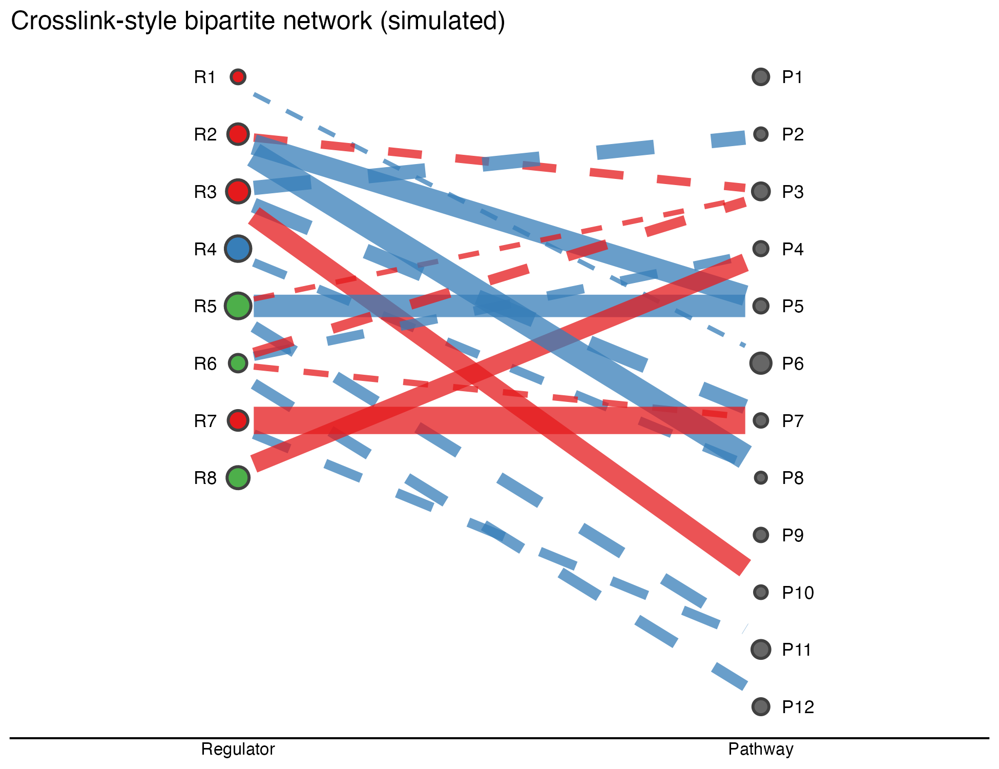

The `crosslink` package draws **column-based bipartite/multipartite networks**: nodes stacked in labelled vertical columns, edges shrunk so they never touch the node points, and every visual property (node size/fill, edge colour/linetype/width) driven by data columns \[1\]. The package is GitHub-only, so this tutorial re-implements its `columnCross2()` core in ~30 lines of ggplot2 on the reference's own CSV schema (`easy_input_nodes.csv` / `easy_input_edges.csv`):

## Example

{fig-alt="Crosslink Bipartite Network DEMO" fig-align="center" width="60%"}

## Setup

-   System Requirements: Cross-platform (Linux/MacOS/Windows)

-   Programming language: R

-   Dependent packages: `ggplot2`; `dplyr`

```{r packages setup, message=FALSE, warning=FALSE, output=FALSE}
suppressPackageStartupMessages({
  library(ggplot2)
  library(dplyr)
})
```

```{r}
sessioninfo::session_info("attached")
```

## Data Preparation

Eight m6A regulators × 12 target pathways with 18 edges: edge colour encodes the sign of a simulated correlation, linetype its strength class, width its magnitude; node size encodes a feature. The column x positions and per-column node stacking follow the reference's `columns` argument:

```{r load data}
suppressPackageStartupMessages({library(ggplot2); library(dplyr)})
set.seed(19901)
## nodes: two columns of m6A regulators and their target pathways
nodes <- data.frame(
  id = c(paste0("R", 1:8), paste0("P", 1:12)),
  type = c(rep("Regulator", 8), rep("Pathway", 12)),
  size = c(runif(8, 2, 5), runif(12, 1.5, 4)),
  color = c(sample(c("#E41A1C", "#377EB8", "#4DAF4A"), 8, TRUE),
            rep("grey40", 12)))
edges <- data.frame(
  source = sample(nodes$id[nodes$type == "Regulator"], 18, TRUE),
  target = sample(nodes$id[nodes$type == "Pathway"], 18, TRUE),
  cor = runif(18, -1, 1)) %>%
  mutate(color = ifelse(cor > 0, "#E41A1C", "#377EB8"),
         linetype = ifelse(abs(cor) > 0.6, "solid", "dashed"),
         width = 0.18 + abs(cor) * 0.55)
## columnCross2 core: nodes stacked per column, edges shrunk at both ends
col_x <- c(Regulator = 1, Pathway = 3)
nodes <- nodes %>%
  group_by(type) %>%
  mutate(y = seq(1, 1 - (n() - 1) * 0.12, length.out = n()),
         x = col_x[type]) %>% ungroup()
edge_geo <- edges %>%
  left_join(nodes, by = c("source" = "id"), suffix = c("", ".src")) %>%
  left_join(nodes, by = c("target" = "id"), suffix = c("", ".tgt")) %>%
  mutate(shrink = 0.06,
         x1 = x + shrink, x2 = x.tgt - shrink,
         y1 = y + (y.tgt - y) * shrink, y2 = y + (y.tgt - y) * (1 - shrink))
```

## Visualization

### 1. Column-Network with Data-Driven Encodings

The ggplot2 re-implementation: two labelled node columns, edges shrunk 6% at both ends, red/blue = positive/negative correlation, solid/dashed = strong/weak, node size = feature, node fill = identity colour — the same grammar the reference drives from CSV columns:

```{r}
#| label: fig-1.1Crosslink
#| fig-cap: "Crosslink-style bipartite network of 8 simulated regulators and 12 pathways: nodes stacked in two labelled columns with size/fill encodings, edges shrunk at both ends coloured by correlation sign and typed by strength."
#| out.width: "80%"
#| warning: false
#| message: false
#| fig-width: 6.5
#| fig-height: 5

ggplot(edge_geo) +
  geom_segment(aes(x = x1, y = y1, xend = x2, yend = y2,
                   colour = color, linetype = linetype, linewidth = width),
               alpha = 0.75, show.legend = FALSE) +
  geom_point(data = nodes, aes(x, y, fill = color, size = size),
             shape = 21, colour = "grey25", stroke = 1, show.legend = FALSE) +
  geom_text(data = nodes, aes(x = x + ifelse(type == "Regulator", -0.08, 0.08), y, label = id),
            size = 3, hjust = ifelse(nodes$type == "Regulator", 1, 0)) +
  scale_colour_identity() + scale_fill_identity() +
  scale_linetype_identity() + scale_size_identity() +
  scale_x_continuous(limits = c(0.3, 3.7), breaks = col_x, labels = names(col_x)) +
  labs(x = NULL, y = NULL, title = "Crosslink-style bipartite network (simulated)") +
  theme_classic(base_size = 10) +
  theme(axis.line.y = element_blank(), axis.text.y = element_blank(),
        axis.ticks = element_blank())
```

::: callout-tip
**Practice tips**

-   Shrink edges **at both ends** (`x1 = x + shrink, x2 = x.tgt - shrink`, same for y) — unshrunk segments touch the node circles and the network reads as a hairball.
-   Put edge aesthetics in `geom_segment(aes(...))`, not the global `ggplot(aes(...))` — global aes propagate to `geom_point`, whose data has no edge columns and errors out.
-   `scale_colour_identity()`/`scale_fill_identity()` consume the literal hex colours stored in the CSV columns — the reference's trick for letting data files own the palette.
:::

## Applications

::: {#fig-CrossLinkApplications1}
{fig-alt="Column bipartite network" fig-align="center" width="60%"}

Column bipartite network
:::

The column-network grammar fits any ID-to-ID relation table: TF→target, drug→target, miRNA→pathway, or cell-type→ligand-receptor pairs.

## Reference

\[1\] Xiaofan Lu, et al. FigureYa: A Standardized Visualization Framework for Enhancing Biomedical Data Interpretation and Research Efficiency. iMetaMed. 2025. doi:10.1002/imm3.70005

\[2\} zzwch. crosslink: an R package for customizable column-based network layouts (GitHub-only, vendored by the reference). <https://github.com/zzwch/crosslink>