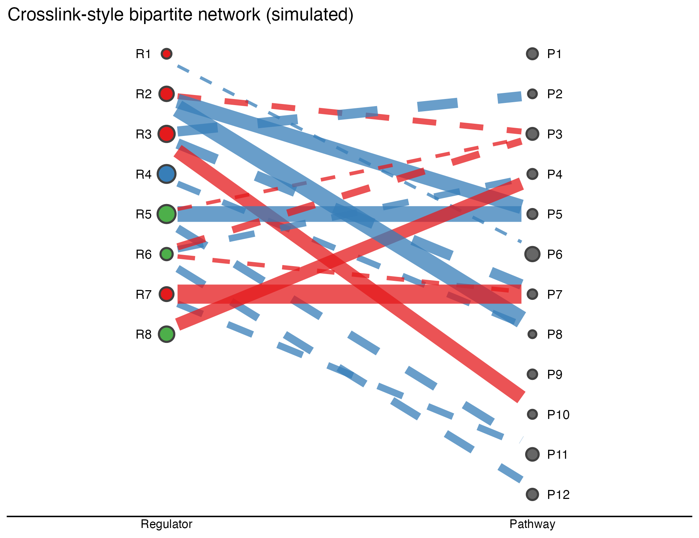

`crosslink` 包绘制**列式二部/多部网络**：节点堆叠在带标签的竖直列中、边收缩到不接触节点圆点、所有视觉属性（节点大小/填充、边颜色/线型/宽度）由数据列驱动 \[1\]。该包仅存于 GitHub，本教程在参考自己的 CSV schema（`easy_input_nodes.csv` / `easy_input_edges.csv`）上用约 30 行 ggplot2 重实现其 `columnCross2()` 核心：

## Example

{fig-alt="crosslink 双列网络 DEMO" fig-align="center" width="60%"}

## Setup

-   系统要求：跨平台（Linux/MacOS/Windows）

-   编程语言：R

-   依赖包：`ggplot2`; `dplyr`

```{r packages setup, message=FALSE, warning=FALSE, output=FALSE}
suppressPackageStartupMessages({
  library(ggplot2)
  library(dplyr)
})
```

```{r}
sessioninfo::session_info("attached")
```

## 数据准备

8 个 m6A 调控因子 × 12 个靶通路、18 条边：边颜色编码模拟相关的符号、线型编码强度类别、宽度编码幅度；节点大小编码某特征。列 x 位置与逐列节点堆叠遵循参考的 `columns` 参数：

```{r load data}
suppressPackageStartupMessages({library(ggplot2); library(dplyr)})
set.seed(19901)
## nodes: two columns of m6A regulators and their target pathways
nodes <- data.frame(
  id = c(paste0("R", 1:8), paste0("P", 1:12)),
  type = c(rep("Regulator", 8), rep("Pathway", 12)),
  size = c(runif(8, 2, 5), runif(12, 1.5, 4)),
  color = c(sample(c("#E41A1C", "#377EB8", "#4DAF4A"), 8, TRUE),
            rep("grey40", 12)))
edges <- data.frame(
  source = sample(nodes$id[nodes$type == "Regulator"], 18, TRUE),
  target = sample(nodes$id[nodes$type == "Pathway"], 18, TRUE),
  cor = runif(18, -1, 1)) %>%
  mutate(color = ifelse(cor > 0, "#E41A1C", "#377EB8"),
         linetype = ifelse(abs(cor) > 0.6, "solid", "dashed"),
         width = 0.18 + abs(cor) * 0.55)
## columnCross2 core: nodes stacked per column, edges shrunk at both ends
col_x <- c(Regulator = 1, Pathway = 3)
nodes <- nodes %>%
  group_by(type) %>%
  mutate(y = seq(1, 1 - (n() - 1) * 0.12, length.out = n()),
         x = col_x[type]) %>% ungroup()
edge_geo <- edges %>%
  left_join(nodes, by = c("source" = "id"), suffix = c("", ".src")) %>%
  left_join(nodes, by = c("target" = "id"), suffix = c("", ".tgt")) %>%
  mutate(shrink = 0.06,
         x1 = x + shrink, x2 = x.tgt - shrink,
         y1 = y + (y.tgt - y) * shrink, y2 = y + (y.tgt - y) * (1 - shrink))
```

## Visualization

### 数据驱动的列网络

ggplot2 重实现：两条带标签的节点列、两端收缩 6% 的边、红/蓝 = 相关正负、实/虚 = 强弱、节点大小 = 特征、节点填充 = 身份颜色——与参考由 CSV 列驱动的语法一致：

```{r}
#| label: fig-1.1Crosslink
#| fig-cap: "8 个模拟调控因子与 12 条通路的 crosslink 风格双列网络：节点堆叠在两条带标签的列中、大小/填充编码、边两端收缩并按相关符号着色、按强度分线型。"
#| out.width: "80%"
#| warning: false
#| message: false
#| fig-width: 6.5
#| fig-height: 5

ggplot(edge_geo) +
  geom_segment(aes(x = x1, y = y1, xend = x2, yend = y2,
                   colour = color, linetype = linetype, linewidth = width),
               alpha = 0.75, show.legend = FALSE) +
  geom_point(data = nodes, aes(x, y, fill = color, size = size),
             shape = 21, colour = "grey25", stroke = 1, show.legend = FALSE) +
  geom_text(data = nodes, aes(x = x + ifelse(type == "Regulator", -0.08, 0.08), y, label = id),
            size = 3, hjust = ifelse(nodes$type == "Regulator", 1, 0)) +
  scale_colour_identity() + scale_fill_identity() +
  scale_linetype_identity() + scale_size_identity() +
  scale_x_continuous(limits = c(0.3, 3.7), breaks = col_x, labels = names(col_x)) +
  labs(x = NULL, y = NULL, title = "Crosslink-style bipartite network (simulated)") +
  theme_classic(base_size = 10) +
  theme(axis.line.y = element_blank(), axis.text.y = element_blank(),
        axis.ticks = element_blank())
```


::: callout-tip
**实践提示**

-   边**两端都要收缩**（`x1 = x + shrink, x2 = x.tgt - shrink`，y 同理）——不收缩的线段会碰到节点圆，网络读起来就是毛线球。
-   边的 aesthics 放在 `geom_segment(aes(...))` 里，不要放全局 `ggplot(aes(...))`——全局 aes 会传给 `geom_point`，其数据没有边列会直接报错。
-   `scale_colour_identity()`/`scale_fill_identity()` 直接消费 CSV 列里的字面量十六进制色——这正是参考文档让数据文件自带调色板的技巧。
:::

## 应用场景

::: {#fig-CrossLinkApplications1}
{fig-alt="列式二部网络" fig-align="center" width="60%"}

列式二部网络
:::

列网络语法适用于任何 ID 对 ID 关系表：TF→靶、药物→靶、miRNA→通路、或细胞类型→配受体对。

## 参考文献

\[1\] Xiaofan Lu, et al. FigureYa: A Standardized Visualization Framework for Enhancing Biomedical Data Interpretation and Research Efficiency. iMetaMed. 2025. doi:10.1002/imm3.70005

\[2\} zzwch. crosslink: an R package for customizable column-based network layouts (GitHub-only, vendored by the reference). <https://github.com/zzwch/crosslink>