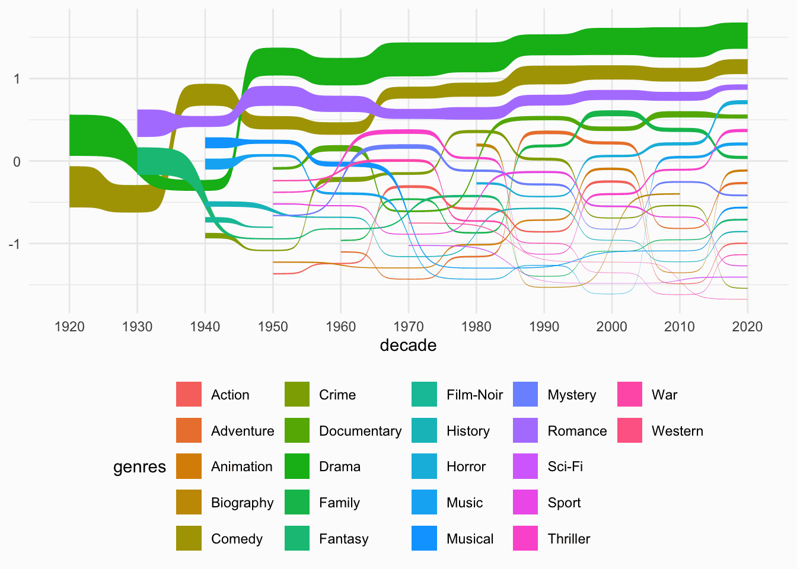
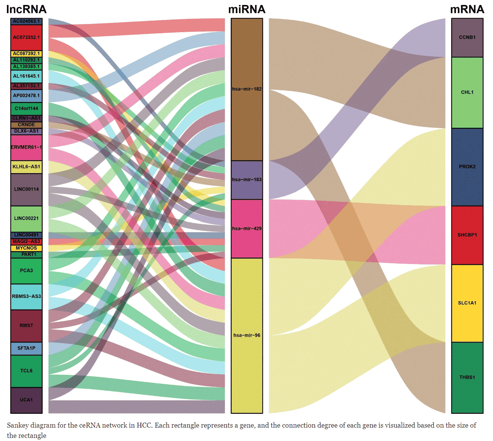

A [Sankey diagram](https://www.data-to-viz.com/graph/sankey.html) allows to study flows. Entities (nodes) are represented by rectangles or text. Arrows or arcs are used to show flows between them. In `R`, the `networkD3` package is the best way to build them.

## Example

{fig-alt="Sankey DEMO" fig-align="center" width="60%"}

This chart visualizes the **genre distribution of summer movies** over decades using a Sankey bump chart. It highlights the three most common genres (Drama, Comedy, and Romance) and shows how their prevalence has changed over time.

## Setup

-   System Requirements: Cross-platform (Linux/MacOS/Windows)

-   Programming Language: R

-   Dependencies: `ggplot2`, `networkD3`, `dplyr`, `readxl`, `webshot`, `tidyverse`, `openxlsx`, `ggalluvial`

```{r packages setup, message=FALSE, warning=FALSE, output=FALSE}
# Install packages
if (!requireNamespace("ggplot2", quietly = TRUE)) {
  install.packages("ggplot2")
}
if (!requireNamespace("networkD3", quietly = TRUE)) {
  install.packages("networkD3")
}
if (!requireNamespace("dplyr", quietly = TRUE)) {
  install.packages("dplyr")
}
if (!requireNamespace("readxl", quietly = TRUE)) {
  install.packages("readxl")
}
if (!requireNamespace("webshot", quietly = TRUE)) {
  install.packages("webshot")
}
if (!requireNamespace("tidyverse", quietly = TRUE)) {
  install.packages("tidyverse")
}
if (!requireNamespace("openxlsx", quietly = TRUE)) {
  install.packages("openxlsx")
}
if (!requireNamespace("ggalluvial", quietly = TRUE)) {
  install.packages("ggalluvial")
}

# Load packages
library(ggplot2)   
library(networkD3)   
library(dplyr)  
library(readxl) 
library(webshot)   
library(tidyverse)
library(openxlsx)
library(ggalluvial)
```

```{r}
sessioninfo::session_info("attached")
```

## Data Preparation

Here’s a brief tutorial using the clinical data of a certain drug froma clinical database. This dataset examines the impact of a drug on patients' blood glucose levels, which are categorized into three levels: low (\<3.9 mmol/L), normal (3.9-6.1 mmol/L), and high (\>6.1 mmol/L). The absolute value of the change in glucose levels before and after drug administration is represented by `value`.This example demonstrates how to load and work with these datase.

```{r load data}
#| message: false

#Read drug clinical dataset
drugs <- read.csv("https://bizard-1301043367.cos.ap-guangzhou.myqcloud.com/drugs.csv", stringsAsFactors = FALSE)
# Create a node data frame
nodes <- data.frame(
  name=c(as.character(drugs$source), 
         as.character(drugs$target)) %>% unique())
# Reformat
drugs$IDsource <- match(drugs$source, nodes$name)-1 
drugs$IDtarget <- match(drugs$target, nodes$name)-1


#Read drug clinical dataset
drug <- read.csv("https://bizard-1301043367.cos.ap-guangzhou.myqcloud.com/drug.csv", stringsAsFactors = FALSE)
levels(drug$`glucose（mmol/L）`) <- rev(levels(drug$`glucose（mmol/L）`))
```

## Visualization

### 1. Using the networkD3 Package

#### 1.1 Basic Sankey Diagram

@fig-BasicSankeyDiagram The sankey diagram describes the changes in blood glucose levels of patients before and after the use of a certain drug.

```{r}
#| label: fig-BasicSankeyDiagram
#| fig-cap: "Basic Sankey Diagram"
#| out.width: "95%"
#| warning: false

# Basic plotting
p1 <- sankeyNetwork(Links = drugs, Nodes = nodes,
              Source = "IDsource", Target = "IDtarget",
              Value = "value", NodeID = "name") 
              
p1
```

#### 1.2 Customizing Colors

Using `JavaScript` to call

@fig-SettingSingleNodeColors The sankey diagram describes the changes in blood glucose levels of patients before and after the use of a certain drug.

The first step is to create a JavaScript object for color mapping. Then, assign a color to each node. Finally, call this object in the `colourScale` parameter of networkD3.

```{r}
#| label: fig-SettingSingleNodeColors
#| fig-cap: "Setting Single Node Colors"
#| out.width: "95%"
#| warning: false

# Prepare a color scale: assign a specific color to each node
my_color <- 'd3.scaleOrdinal() .domain(["before-normal", "before-high","before-low", "after-high", "after-low", "after-normal"]) .range(["steelblue", "red" , "#69b3a2", "red", "#69b3a2", "steelblue"])'

p2_1 <- sankeyNetwork(Links = drugs, Nodes = nodes,
              Source = "IDsource", Target = "IDtarget",
              Value = "value", NodeID = "name", 
              colourScale=my_color,fontSize=15,nodePadding=20,nodeWidth=25)
p2_1
```

@fig-SettingLinkColors This Sankey diagram shows the changes in blood glucose levels of patients before and after the use of a certain drug. The blue group indicates a change in blood glucose levels greater than 1 mmol/L, while the green group indicates a change less than 1 mmol/L.

```{r}
#| label: fig-SettingLinkColors
#| fig-cap: "Setting Link Colors"
#| out.width: "95%"
#| warning: false

# Add a "group" column to each link
drugs$group <- as.factor( c("type_a","type_a","type_b","type_b","type_b","type_b","type_a","type_b","type_b","type_b","type_a","type_a","type_a","type_b","type_a","type_a","type_a","type_a"))

# Add a "group" column to each node. Here, they are all placed in the same group to make them gray
nodes$group <- as.factor(c("my_unique_group"))

# Assign colors to each group
my_color <- 'd3.scaleOrdinal() .domain(["type_a", "type_b", "my_unique_group"]) .range(["#69b3a2", "steelblue", "grey"])'

p2_3 <- sankeyNetwork(Links = drugs, Nodes = nodes,
              Source = "IDsource", Target = "IDtarget",
              Value = "value", NodeID = "name", 
              colourScale=my_color,LinkGroup="group", NodeGroup="group")
p2_3
```

### 2. Using the ggalluvial Package

ggalluvial is an extension package of ggplot2. It follows the layered syntax of ggplot2 and is used to create alluvial plots, which are similar to Sankey diagrams but are uniquely determined by the data and a set of parameters.

#### 2.1 Basic Sankey Diagram

@fig-BasicSankeyDiagram3 This Sankey diagram shows the changes in blood glucose levels of patients before and after the use of a certain drug

```{r}
#| label: fig-BasicSankeyDiagram3
#| fig-cap: "Basic Sankey Diagram"
#| out.width: "95%"
#| warning: false

# Basic Sankey Diagram
p4_1 <- ggplot(drug,
       aes(x = time, stratum = level, alluvium = id,
           y = value,
           fill = level, label = level)) +
  scale_x_discrete(expand = c(.1, .1)) +
  geom_flow() +
  geom_stratum(alpha = .5) +
  geom_text(stat = "stratum", size = 3) +
  theme(legend.position = "none") 

p4_1
```

#### 2.2 Changing Line Types

By changing the `curve_type` parameter, there are seven options: "linear", "cubic", "quintic", "sine", "arctangent", "sigmoid", and "xspline".

@fig-ChangingLineTypes This Sankey diagram shows the changes in blood glucose levels of patients before and after the use of a certain drug.

```{r}
#| label: fig-ChangingLineTypes
#| fig-cap: "Changing Line Types"
#| out.width: "95%"
#| warning: false

# Linear
p5_1 <- ggplot(drug,
       aes(x = time, stratum = level, alluvium = id,
           y = value,
           fill = level, label = level)) +
  scale_x_discrete(expand = c(.1, .1)) +
  geom_alluvium(curve_type = "linear")+
  geom_stratum(alpha = 1) +
  geom_text(stat = "stratum", aes(label = after_stat(stratum))) +
  theme(legend.position = "none") 

p5_1

```

@fig-ChangingLineTypes2 This Sankey diagram shows the changes in blood glucose levels of patients before and after the use of a certain drug.

```{r}
#| label: fig-ChangingLineTypes2
#| fig-cap: "Changing Line Types"
#| out.width: "95%"
#| warning: false

# Sigmoid
p5_2 <- ggplot(drug,
       aes(x = time, stratum = level, alluvium = id,
           y = value,
           fill = level, label = level)) +
  scale_x_discrete(expand = c(.1, .1)) +
  geom_alluvium(curve_type = "sigmoid")+
  geom_stratum(alpha = 1) +
  geom_text(stat = "stratum", aes(label = after_stat(stratum))) +
  theme(legend.position = "none") 

p5_2
```

### 3. Three-Layer Alluvium: Gene to Mutation Class to Subtype

A cohort has as many identities as it has annotations: the same mutated sample is at once a gene, a mutation class and a subtype. The alluvial form \[11\] lays those layers side by side and lets the flow between them do the talking - which gene's cases fall into which subtype, and through which mutation class. `ggalluvial::to_lodes_form()` turns the wide annotation table into the lode format, and the stratum route paints every layer from the first: block heights carry counts, flows carry the crossing.

```{r}
#| label: fig-3.1ThreeLayerAlluvium
#| fig-cap: "Three-layer alluvium of a simulated cohort: gene, mutation class and subtype as strata; block heights are counts, the flows make the gene-to-subtype crossings visible."
#| out.width: "90%"
#| warning: false
#| message: false
#| fig-width: 7.0
#| fig-height: 5.0

set.seed(7501)
n <- 420
genes <- c("TP53", "KRAS", "EGFR", "PIK3CA")
gprob <- c(0.34, 0.26, 0.22, 0.18)
mutlv <- c("Mis", "Non", "Fs", "Sil")
dfE <- data.frame(gene = sample(genes, n, replace = TRUE, prob = gprob),
                  stringsAsFactors = FALSE)
dfE$mutation <- ifelse(dfE$gene == "TP53",
                       sample(c("Mis", "Non", "Fs", "Sil"), n, replace = TRUE, prob = c(.5, .2, .2, .1)),
                       sample(mutlv, n, replace = TRUE, prob = c(.4, .25, .2, .15)))
dfE$subtype <- ifelse(dfE$gene %in% c("TP53"),
                      sample(c("Basal", "Luminal", "Normal"), n, replace = TRUE, prob = c(.5, .3, .2)),
                      sample(c("Basal", "Luminal", "Normal"), n, replace = TRUE, prob = c(.2, .5, .3)))
loE <- to_lodes_form(dfE[, c("gene", "mutation", "subtype")], key = "Gene", axes = 1:3, id = "Cohort")
stopifnot(sum(is.na(loE$stratum)) == 0 && nrow(loE) > 0)
mycol <- rep(c("#223D6C", "#D20A13", "#FFD121", "#088247", "#11AA4D", "#58CDD9",
               "#7A142C", "#5D90BA", "#029149", "#431A3D", "#91612D", "#6E568C",
               "#E0367A", "#D8D155", "#64495D", "#7CC767"), 2)
p_e <- ggplot(loE, aes(x = Gene, stratum = stratum, alluvium = Cohort,
                       fill = stratum, label = stratum)) +
  scale_x_discrete(expand = c(0, 0)) +
  geom_flow(width = 1 / 9) +
  geom_stratum(alpha = 0.92, width = 1 / 11) +
  geom_text(stat = "stratum", size = 2.5, colour = "black") +
  scale_fill_manual(values = mycol, guide = "none") +
  labs(x = NULL, y = NULL) +
  theme_void(base_size = 11) +
  theme(panel.grid = element_blank(), axis.line = element_blank(),
        axis.ticks = element_blank(), axis.text = element_blank())
print(p_e)
# gate: every gene reaches >= 2 subtypes - the crossing the alluvium exists to show
cross <- with(dfE, tapply(subtype, gene, function(z) length(unique(z))))
stopifnot(all(cross >= 2))
```

::: callout-tip
**Practice tips**

-   `to_lodes_form()` wants one row per observation; with a table already aggregated to counts, use the `aes(y = Freq, axis1 = ..., axis2 = ...)` route with `geom_flow(stat = "alluvium")` instead.
-   Colour the strata when the layers are the story; colour the flows by the origin layer when the departure point is the story - one encoding, not both.
-   `geom_text(stat = "stratum")` doubles as layer label and count - drop the axis before the two start to fight.
:::

## Applications

::: {#fig-SankeyApplications}
{fig-alt="SankeyApp1" fig-align="center" width="60%"}

Applications of sankey diagram
:::

In ceRNA-related research, such as circRNA-miRNA-mRNA or lncRNA-miRNA-mRNA targeting relationship diagrams, they are generally presented using network diagrams. \[1\]

## Reference

\[1\] Long J, Bai Y, Yang X, Lin J, Yang X, Wang D, He L, Zheng Y, Zhao H. Construction and comprehensive analysis of a ceRNA network to reveal potential prognostic biomarkers for hepatocellular carcinoma. Cancer Cell Int. 2019 Apr 11;19:90. doi: 10.1186/s12935-019-0817-y. PMID: 31007608; PMCID: PMC6458652.

\[2\] The R Graph Gallery – Help and inspiration for R charts (r-graph-gallery.com)

\[3\] Gandrud, Christopher, et al. networkD3: D3 JavaScript Network Graphs from R. Version 0.4, 2017. [https://CRAN.R-project.org/package=networkD3](https://cran.r-project.org/package=networkD3).

\[4\] Wickham, H., & François, R. (2016). dplyr: A Grammar of Data Manipulation \[Computer software\]. Retrieved from [https://CRAN.R-project.org/package=dplyr](https://cran.r-project.org/package=dplyr)

\[5\] Wickham, H. (2009). ggplot2: Elegant Graphics for Data Analysis. Springer-Verlag New York. [https://ggplot2.tidyverse.org](https://ggplot2.tidyverse.org/)

\[6\] Allaire, J. J., & Xie, Y. (2018). webshot: Save Web Content as an Image File \[Computer software\]. Retrieved from [https://CRAN.R-project.org/package=webshot](https://cran.r-project.org/package=webshot)

\[7\] Wickham, H., Averick, M., Bryan, J., Chang, W., McGowan, L. D., François, R., ... Yutani, H. (2019). tidyverse: Easily Install and Load the 'Tidyverse' (Version 1.2.1) \[Computer software\]. Retrieved from [https://CRAN.R-project.org/package=tidyverse](https://cran.r-project.org/package=tidyverse)

\[8\] Wickham, H., Averick, M., Bryan, J., Chang, W., McGowan, L. D., François, R., ... Yutani, H. (2019). tidyverse: Easily Install and Load the 'Tidyverse' (Version 1.2.1) \[Computer software\]. Retrieved from [https://CRAN.R-project.org/package=tidyverse](https://cran.r-project.org/package=tidyverse)

\[9\] Kassambara, W. (2020). ggsankey: Create Sankey Diagrams with 'ggplot2' \[Computer software\]. Retrieved from [https://CRAN.R-project.org/package=ggsankey](https://cran.r-project.org/package=ggsankey)

\[10\] Brunson JC, Read QD. ggalluvial: Alluvial Plots in 'ggplot2'. R package version 0.12.5. 2023. [https://CRAN.R-project.org/package=ggalluvial](https://cran.r-project.org/package=ggalluvial)

\[11\] Xiaofan Lu, et al. FigureYa: A Standardized Visualization Framework for Enhancing Biomedical Data Interpretation and Research Efficiency. iMetaMed. 2025. doi:10.1002/imm3.70005
