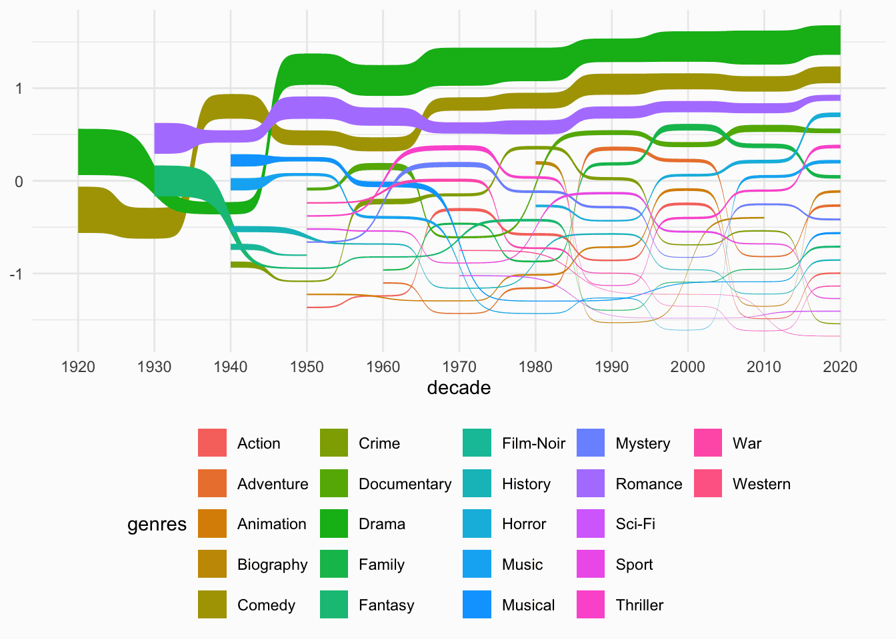
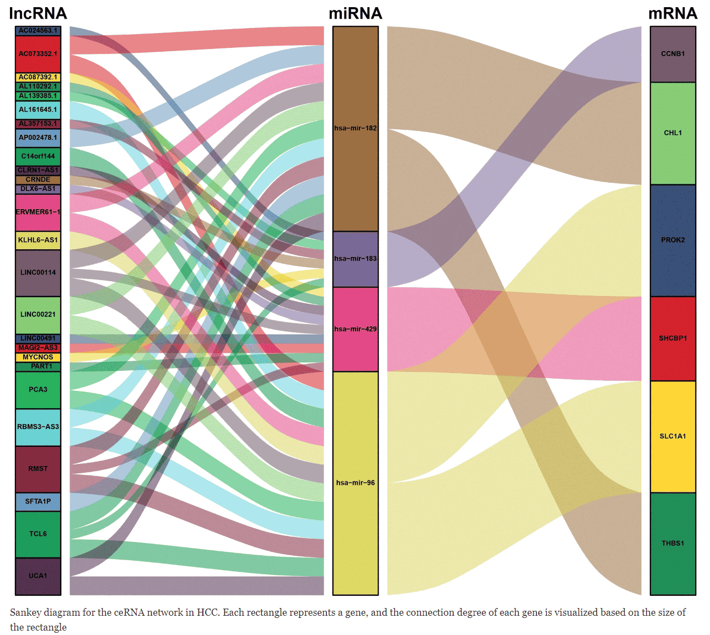

[桑基图](https://www.data-to-viz.com/graph/sankey.html)允许研究流量。实体（节点）由矩形或文本表示，箭头或弧线用于显示它们之间的流量，宽度与流量的重要性成正比。在 `R` 中，`networkD3` 包是构建它们的最佳方式。

## 示例

{fig-alt="Sankey DEMO" fig-align="center" width="60%"}

这张图表使用桑基曲线图可视化了过去几十年**夏季档电影的类型分布情况**。它重点展示了三种最常见的类型（剧情片、喜剧片和爱情片），并显示了它们的比例随时间的变化。

## 环境配置

-   系统要求： 跨平台（Linux/MacOS/Windows）

-   编程语言：R

-   依赖包：`ggplot2`, `networkD3`, `dplyr`, `readxl`, `webshot`, `tidyverse`, `openxlsx`, `ggalluvial`

```{r packages setup, message=FALSE, warning=FALSE, output=FALSE}
# 安装包
if (!requireNamespace("ggplot2", quietly = TRUE)) {
  install.packages("ggplot2")
}
if (!requireNamespace("networkD3", quietly = TRUE)) {
  install.packages("networkD3")
}
if (!requireNamespace("dplyr", quietly = TRUE)) {
  install.packages("dplyr")
}
if (!requireNamespace("readxl", quietly = TRUE)) {
  install.packages("readxl")
}
if (!requireNamespace("webshot", quietly = TRUE)) {
  install.packages("webshot")
}
if (!requireNamespace("tidyverse", quietly = TRUE)) {
  install.packages("tidyverse")
}
if (!requireNamespace("openxlsx", quietly = TRUE)) {
  install.packages("openxlsx")
}
if (!requireNamespace("ggalluvial", quietly = TRUE)) {
  install.packages("ggalluvial")
}

# 加载包
library(ggplot2)   
library(networkD3)   
library(dplyr)  
library(readxl) 
library(webshot)   
library(tidyverse)   
library(openxlsx)
library(ggalluvial)
```

```{r}
sessioninfo::session_info("attached")
```

## 数据准备

以下是一个使用临床数据库中某种药物临床数据的简要教程。该数据集研究了药物对患者血糖水平的影响，血糖水平分为三个等级：低血糖（\<3.9 mmol/L）、正常血糖（3.9-6.1 mmol/L）和高血糖（\>6.1 mmol/L）。药物给药前后血糖水平变化的绝对值用“value”表示。本示例演示了如何加载和处理这些数据集。

```{r load data}
#| message: false

# 读取药物临床数据集
drugs <- read.csv("https://bizard-1301043367.cos.ap-guangzhou.myqcloud.com/drugs.csv", stringsAsFactors = FALSE)
# 创建一个节点数据框
nodes <- data.frame(
  name=c(as.character(drugs$source), 
         as.character(drugs$target)) %>% unique())
# 重新格式化
drugs$IDsource <- match(drugs$source, nodes$name)-1 
drugs$IDtarget <- match(drugs$target, nodes$name)-1


# 读取药物临床数据集
drug <- read.csv("https://bizard-1301043367.cos.ap-guangzhou.myqcloud.com/drug.csv", stringsAsFactors = FALSE)
levels(drug$`glucose（mmol/L）`) <- rev(levels(drug$`glucose（mmol/L）`))
```

## 可视化

### 1. 可视化

#### 1.1 基础桑基图

@fig-BasicSankeyDiagram 桑基图描述了患者在使用某种药物前后血糖水平的变化。

```{r}
#| label: fig-BasicSankeyDiagram
#| fig-cap: "基础桑基图"
#| out.width: "95%"
#| warning: false

# 基础桑基图
p1 <- sankeyNetwork(Links = drugs, Nodes = nodes,
              Source = "IDsource", Target = "IDtarget",
              Value = "value", NodeID = "name") 
              
p1
```

#### 1.2 自定义颜色

使用 `JavaScript` 调用

@fig-SettingSingleNodeColors 桑基图描述了患者在使用某种药物前后血糖水平的变化。

第一步是创建一个用于颜色映射的 JavaScript 对象。然后，为每个节点分配一个颜色。最后，在 networkD3 的 `colourScale` 参数中调用此对象。

```{r}
#| label: fig-SettingSingleNodeColors
#| fig-cap: "设置单个节点颜色"
#| out.width: "95%"
#| warning: false

# 准备颜色标度：为每个节点分配一种特定的颜色。
my_color <- 'd3.scaleOrdinal() .domain(["before-normal", "before-high","before-low", "after-high", "after-low", "after-normal"]) .range(["steelblue", "red" , "#69b3a2", "red", "#69b3a2", "steelblue"])'

p2_1 <- sankeyNetwork(Links = drugs, Nodes = nodes,
              Source = "IDsource", Target = "IDtarget",
              Value = "value", NodeID = "name", 
              colourScale=my_color,fontSize=15,nodePadding=20,nodeWidth=25)
p2_1
```

@fig-SettingLinkColors 这张桑基图显示了患者在使用某种药物前后血糖水平的变化。蓝色组表示血糖水平变化大于 1 mmol/L，绿色组表示变化小于 1 mmol/L。

```{r}
#| label: fig-SettingLinkColors
#| fig-cap: "设置链接颜色"
#| out.width: "95%"
#| warning: false

# 在每个链接中添加一个“组”列
drugs$group <- as.factor( c("type_a","type_a","type_b","type_b","type_b","type_b","type_a","type_b","type_b","type_b","type_a","type_a","type_a","type_b","type_a","type_a","type_a","type_a"))

# 为每个节点添加一个“分组”列。这里，所有节点都被放在同一个组中，使它们显示为灰色。
nodes$group <- as.factor(c("my_unique_group"))

# 给每个组分配颜色
my_color <- 'd3.scaleOrdinal() .domain(["type_a", "type_b", "my_unique_group"]) .range(["#69b3a2", "steelblue", "grey"])'

p2_3 <- sankeyNetwork(Links = drugs, Nodes = nodes,
              Source = "IDsource", Target = "IDtarget",
              Value = "value", NodeID = "name", 
              colourScale=my_color,LinkGroup="group", NodeGroup="group")
p2_3
```

### 2. 使用ggalluvial包

ggalluvial是ggplot2的扩展包，它遵循ggplot2的图层化语法，用于创建冲积图，与桑基图有相似之处，但是它是根据数据和一组参数唯一确定的。

#### 2.1 基础桑基图

@fig-BasicSankeyDiagram3 这张桑基图显示了患者在使用某种药物前后血糖水平的变化。

```{r}
#| label: fig-BasicSankeyDiagram3
#| fig-cap: "基础桑基图"
#| out.width: "95%"
#| warning: false

# 基础桑基图
p4_1 <- ggplot(drug,
       aes(x = time, stratum = level, alluvium = id,
           y = value,
           fill = level, label = level)) +
  scale_x_discrete(expand = c(.1, .1)) +
  geom_flow() +
  geom_stratum(alpha = .5) +
  geom_text(stat = "stratum", size = 3) +
  theme(legend.position = "none") 

p4_1
```

#### 2.2 改变线条类型

通过改变`curve_type`参数，有"linear","cubic", "quintic", "sine","arctangent", "sigmoid". "xspline"7种选项。

@fig-ChangingLineTypes 该桑基图显示了患者在使用某种药物前后血糖水平的变化。

```{r}
#| label: fig-ChangingLineTypes
#| fig-cap: "改变线条类型"
#| out.width: "95%"
#| warning: false

# Linear
p5_1 <- ggplot(drug,
       aes(x = time, stratum = level, alluvium = id,
           y = value,
           fill = level, label = level)) +
  scale_x_discrete(expand = c(.1, .1)) +
  geom_alluvium(curve_type = "linear")+
  geom_stratum(alpha = 1) +
  geom_text(stat = "stratum", aes(label = after_stat(stratum))) +
  theme(legend.position = "none") 

p5_1

```

@fig-ChangingLineTypes2 该桑基图显示了患者在使用某种药物前后血糖水平的变化。

```{r}
#| label: fig-ChangingLineTypes2
#| fig-cap: "改变线条类型"
#| out.width: "95%"
#| warning: false

# Sigmoid
p5_2 <- ggplot(drug,
       aes(x = time, stratum = level, alluvium = id,
           y = value,
           fill = level, label = level)) +
  scale_x_discrete(expand = c(.1, .1)) +
  geom_alluvium(curve_type = "sigmoid")+
  geom_stratum(alpha = 1) +
  geom_text(stat = "stratum", aes(label = after_stat(stratum))) +
  theme(legend.position = "none") 

p5_2
```

### 3. 三层桑基图：基因到突变类别到亚型

一个队列有多少注释就有多少身份：同一个突变样本同时是一个基因、一种突变类别和一个亚型。桑基形式 \[11\] 把这些层并排摆放，让层间流动自己说话——哪个基因的病例落入哪个亚型、经由哪种突变类别。`ggalluvial::to_lodes_form()` 把宽注释表转成 lode 格式，stratum 路线从第一层起逐层着墨：方块高度携带计数，流带携带交叉。

```{r}
#| label: fig-3.1ThreeLayerAlluvium
#| fig-cap: "模拟队列的三层桑基图：基因、突变类别与亚型为层；方块高度即计数，流带让基因-亚型的交叉一目了然。"
#| out.width: "90%"
#| warning: false
#| message: false
#| fig-width: 7.0
#| fig-height: 5.0

set.seed(7501)
n <- 420
genes <- c("TP53", "KRAS", "EGFR", "PIK3CA")
gprob <- c(0.34, 0.26, 0.22, 0.18)
mutlv <- c("Mis", "Non", "Fs", "Sil")
dfE <- data.frame(gene = sample(genes, n, replace = TRUE, prob = gprob),
                  stringsAsFactors = FALSE)
dfE$mutation <- ifelse(dfE$gene == "TP53",
                       sample(c("Mis", "Non", "Fs", "Sil"), n, replace = TRUE, prob = c(.5, .2, .2, .1)),
                       sample(mutlv, n, replace = TRUE, prob = c(.4, .25, .2, .15)))
dfE$subtype <- ifelse(dfE$gene %in% c("TP53"),
                      sample(c("Basal", "Luminal", "Normal"), n, replace = TRUE, prob = c(.5, .3, .2)),
                      sample(c("Basal", "Luminal", "Normal"), n, replace = TRUE, prob = c(.2, .5, .3)))
loE <- to_lodes_form(dfE[, c("gene", "mutation", "subtype")], key = "Gene", axes = 1:3, id = "Cohort")
stopifnot(sum(is.na(loE$stratum)) == 0 && nrow(loE) > 0)
mycol <- rep(c("#223D6C", "#D20A13", "#FFD121", "#088247", "#11AA4D", "#58CDD9",
               "#7A142C", "#5D90BA", "#029149", "#431A3D", "#91612D", "#6E568C",
               "#E0367A", "#D8D155", "#64495D", "#7CC767"), 2)
p_e <- ggplot(loE, aes(x = Gene, stratum = stratum, alluvium = Cohort,
                       fill = stratum, label = stratum)) +
  scale_x_discrete(expand = c(0, 0)) +
  geom_flow(width = 1 / 9) +
  geom_stratum(alpha = 0.92, width = 1 / 11) +
  geom_text(stat = "stratum", size = 2.5, colour = "black") +
  scale_fill_manual(values = mycol, guide = "none") +
  labs(x = NULL, y = NULL) +
  theme_void(base_size = 11) +
  theme(panel.grid = element_blank(), axis.line = element_blank(),
        axis.ticks = element_blank(), axis.text = element_blank())
print(p_e)
# gate: every gene reaches >= 2 subtypes - the crossing the alluvium exists to show
cross <- with(dfE, tapply(subtype, gene, function(z) length(unique(z))))
stopifnot(all(cross >= 2))
```

::: callout-tip
**实践要点**

-   `to_lodes_form()` 要求每观测一行；若表已聚合为计数，请改用 `aes(y = Freq, axis1 = ..., axis2 = ...)` 配 `geom_flow(stat = "alluvium")` 路线。
-   层本身是故事时给 stratum 着色；出发点是故事时按源层给流带上色——选一种编码，不要两种都要。
-   `geom_text(stat = "stratum")` 身兼层标签与计数两职——趁早删掉坐标轴，免得两者打架。
:::

## 应用场景

::: {#fig-SankeyApplications}
{fig-alt="SankeyApp1" fig-align="center" width="60%"}

桑基图应用场景
:::

在ceRNA相关的研究中，例如circRNA-miRNA-mRNA，或者lncRNA-miRNA-mRNA的靶向关系图谱，一般通过网络图呈现。 \[1\]

## 参考文献

\[1\] Long J, Bai Y, Yang X, Lin J, Yang X, Wang D, He L, Zheng Y, Zhao H. Construction and comprehensive analysis of a ceRNA network to reveal potential prognostic biomarkers for hepatocellular carcinoma. Cancer Cell Int. 2019 Apr 11;19:90. doi: 10.1186/s12935-019-0817-y. PMID: 31007608; PMCID: PMC6458652.

\[2\] The R Graph Gallery – Help and inspiration for R charts (r-graph-gallery.com)

\[3\] Gandrud, Christopher, et al. networkD3: D3 JavaScript Network Graphs from R. Version 0.4, 2017. [https://CRAN.R-project.org/package=networkD3](https://cran.r-project.org/package=networkD3).

\[4\] Wickham, H., & François, R. (2016). dplyr: A Grammar of Data Manipulation \[Computer software\]. Retrieved from [https://CRAN.R-project.org/package=dplyr](https://cran.r-project.org/package=dplyr)

\[5\] Wickham, H. (2009). ggplot2: Elegant Graphics for Data Analysis. Springer-Verlag New York. [https://ggplot2.tidyverse.org](https://ggplot2.tidyverse.org/)

\[6\] Allaire, J. J., & Xie, Y. (2018). webshot: Save Web Content as an Image File \[Computer software\]. Retrieved from [https://CRAN.R-project.org/package=webshot](https://cran.r-project.org/package=webshot)

\[7\] Wickham, H., Averick, M., Bryan, J., Chang, W., McGowan, L. D., François, R., ... Yutani, H. (2019). tidyverse: Easily Install and Load the 'Tidyverse' (Version 1.2.1) \[Computer software\]. Retrieved from [https://CRAN.R-project.org/package=tidyverse](https://cran.r-project.org/package=tidyverse)

\[8\] Wickham, H., Averick, M., Bryan, J., Chang, W., McGowan, L. D., François, R., ... Yutani, H. (2019). tidyverse: Easily Install and Load the 'Tidyverse' (Version 1.2.1) \[Computer software\]. Retrieved from [https://CRAN.R-project.org/package=tidyverse](https://cran.r-project.org/package=tidyverse)

\[9\] Kassambara, W. (2020). ggsankey: Create Sankey Diagrams with 'ggplot2' \[Computer software\]. Retrieved from [https://CRAN.R-project.org/package=ggsankey](https://cran.r-project.org/package=ggsankey)

\[10\] Brunson JC, Read QD. ggalluvial: Alluvial Plots in 'ggplot2'. R package version 0.12.5. 2023. [https://CRAN.R-project.org/package=ggalluvial](https://cran.r-project.org/package=ggalluvial)

\[11\] Xiaofan Lu, et al. FigureYa: A Standardized Visualization Framework for Enhancing Biomedical Data Interpretation and Research Efficiency. iMetaMed. 2025. doi:10.1002/imm3.70005
