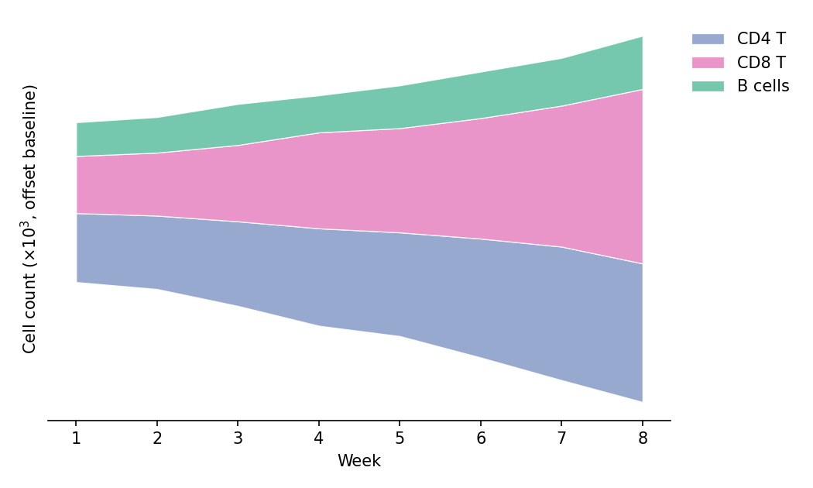

Area charts emphasize the magnitude of one or more quantities over an ordered axis by filling the region under the line; stacked variants decompose a total into layers, and a streamgraph stacks layers around a wobbling baseline for a smooth composition-over-time view. In biomedical research they fit immune-population dynamics, sequencing output over runs, or cohort accrual. `matplotlib` provides `fill_between` and `stackplot`.

## Example

{fig-align="center" width="80%"}

## Setup

- System Requirements: Cross-platform (Linux/MacOS/Windows)
- Programming Language: **Python**
- Dependencies: `matplotlib`, `pandas`, `numpy`

```{python}
#| label: packages-setup
#| output: false
import matplotlib.pyplot as plt
import pandas as pd
import numpy as np
```

## Data Preparation

We simulate weekly flow-cytometry counts of three lymphocyte populations across an 8-week vaccination study.

```{python}
#| label: data-prep
np.random.seed(71)

weeks = np.arange(1, 9)
populations = {
    'CD4 T': 400 * np.exp(0.10 * weeks) + np.random.normal(0, 25, 8),
    'CD8 T': 300 * np.exp(0.16 * weeks) + np.random.normal(0, 22, 8),
    'B cells': 200 * np.exp(0.06 * weeks) + np.random.normal(0, 15, 8),
}
counts = pd.DataFrame(populations, index=weeks)
counts.index.name = 'Week'
colors = ['#8da0cb', '#e78ac3', '#66c2a5']
```

## Visualization

### Single Area Chart

`fill_between` shades the region between a curve and a baseline — the minimal emphasis form for one series.

```{python}
#| label: fig-py-area-single
#| fig-cap: "CD8 T-cell counts over the vaccination course"
#| width: 70%
#| fig-align: center
fig, ax = plt.subplots(figsize=(6.2, 4))
ax.fill_between(counts.index, counts['CD8 T'], color='#e78ac3', alpha=0.45)
ax.plot(counts.index, counts['CD8 T'], color='#d05fa2', linewidth=1.8)
ax.set_xlabel('Week')
ax.set_ylabel('Cell count (×10$^3$)')
ax.spines[['top', 'right']].set_visible(False)
plt.tight_layout()
plt.show()
```

### Stacked Area Chart

`stackplot` layers the populations so the envelope reads as the total while the bands show each contribution.

```{python}
#| label: fig-py-area-stacked
#| fig-cap: "Stacked lymphocyte counts across the study weeks"
#| width: 72%
#| fig-align: center
fig, ax = plt.subplots(figsize=(6.5, 4.2))
ax.stackplot(counts.index, [counts[c] for c in counts.columns],
             labels=counts.columns, colors=colors, alpha=0.85,
             edgecolor='white', linewidth=0.6)
ax.set_xlabel('Week')
ax.set_ylabel('Cell count (×10$^3$)')
ax.legend(frameon=False, loc='upper left')
ax.spines[['top', 'right']].set_visible(False)
plt.tight_layout()
plt.show()
```

### Streamgraph

A streamgraph ("wiggle" baseline) centers the stack so the eye follows the shape of each band rather than a zero line — attractive for composition-over-time posters and covers.

```{python}
#| label: fig-py-area-stream
#| fig-cap: "Streamgraph of lymphocyte composition (wiggle baseline)"
#| width: 78%
#| fig-align: center
fig, ax = plt.subplots(figsize=(7, 4.2))
ax.stackplot(counts.index, [counts[c] for c in counts.columns],
             labels=counts.columns, colors=colors, alpha=0.9,
             baseline='wiggle', edgecolor='white', linewidth=0.6)
ax.set_xlabel('Week')
ax.set_ylabel('Cell count (×10$^3$, offset baseline)')
ax.spines[['top', 'right', 'left']].set_visible(False)
ax.set_yticks([])
ax.legend(frameon=False, loc='upper left', bbox_to_anchor=(1.01, 1.0))
plt.tight_layout()
plt.show()
```

## References

1. Hunter, J. D. (2007). Matplotlib: A 2D graphics environment. *Computing in Science & Engineering*, 9(3), 90-95.
2. From Data to Viz. Stacked area chart. https://www.data-to-viz.com/graph/stackedarea.html
