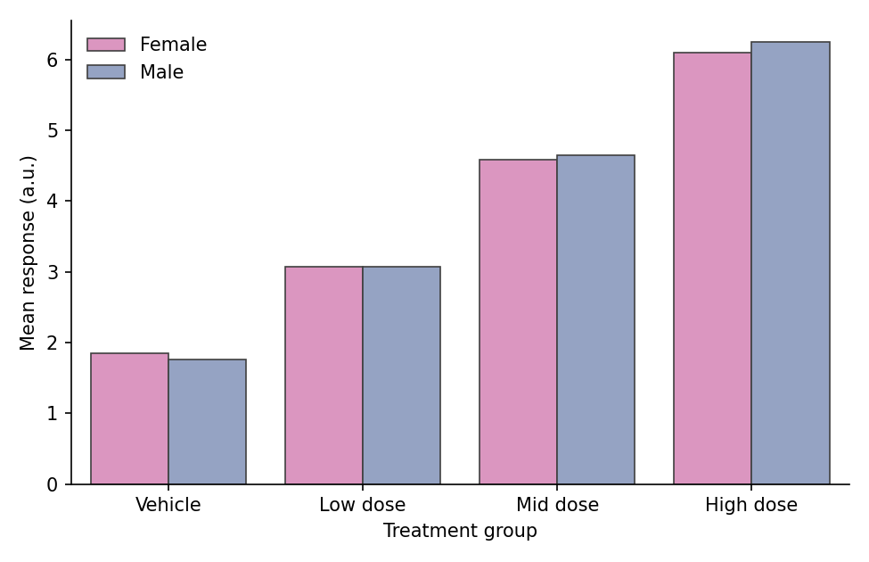

A bar plot compares quantities across discrete categories by their height. In biomedical research, bar plots are ubiquitous for reporting mean responses across treatment groups, cell-type composition per sample, and cohort summaries. Python's `matplotlib` and `seaborn` libraries provide grouped, stacked, and percentage-stacked variants with publication-quality output.

## Example

{fig-align="center" width="80%"}

## Setup

- System Requirements: Cross-platform (Linux/MacOS/Windows)
- Programming Language: **Python**
- Dependencies: `matplotlib`, `seaborn`, `pandas`, `numpy`

```{python}
#| label: packages-setup
#| output: false
import matplotlib.pyplot as plt
import seaborn as sns
import pandas as pd
import numpy as np
```

## Data Preparation

We simulate a drug-dose response experiment (four groups, replicate measurements) and a cell-type composition matrix (six samples profiled by flow cytometry).

```{python}
#| label: data-prep
np.random.seed(42)

# Dose-response: raw replicate values per group
groups = ['Vehicle', 'Low dose', 'Mid dose', 'High dose']
raw = pd.DataFrame({
    'Group': pd.Categorical(np.repeat(groups, 40), categories=groups, ordered=True),
    'Response': np.concatenate([
        np.random.normal(2.0, 0.9, 40),
        np.random.normal(3.1, 0.9, 40),
        np.random.normal(4.6, 0.9, 40),
        np.random.normal(6.2, 0.9, 40),
    ])
})

# Cell-type composition per sample (rows sum to 1)
samples = [f'S{i}' for i in range(1, 7)]
cell_types = ['T cells', 'B cells', 'Macrophages', 'NK cells']
composition = pd.DataFrame(
    np.random.dirichlet([2, 1.5, 1, 0.8], size=6),
    index=samples, columns=cell_types
)
composition.index.name = 'Sample'
```

## Visualization

### Basic Bar Plot with Error Bars

When bar heights summarize grouped measurements, always attach an error bar (SEM or 95% CI) — `seaborn` computes both the mean and the interval automatically.

```{python}
#| label: fig-py-bar-basic
#| fig-cap: "Bar plot of mean response by dose group with SEM error bars"
#| width: 70%
#| fig-align: center
plt.figure(figsize=(6, 4.2))
ax = sns.barplot(data=raw, x='Group', y='Response',
                 errorbar=('se', 1), capsize=0.15,
                 color='#8da0cb', edgecolor='0.25', linewidth=0.8)
ax.set_xlabel('Treatment group')
ax.set_ylabel('Mean response (a.u.)')
ax.spines[['top', 'right']].set_visible(False)
plt.tight_layout()
plt.show()
```

### Grouped Bar Plot

A second factor (e.g., sex or batch) is mapped to `hue`, producing side-by-side bars within each category.

```{python}
#| label: fig-py-bar-grouped
#| fig-cap: "Grouped bar plot with a second experimental factor"
#| width: 75%
#| fig-align: center
grouped = raw.copy()
grouped['Sex'] = np.tile(np.repeat(['Female', 'Male'], 20), 4)
summary = grouped.groupby(['Group', 'Sex'], observed=True)['Response'].mean().reset_index()

plt.figure(figsize=(6.5, 4.2))
ax = sns.barplot(data=summary, x='Group', y='Response', hue='Sex',
                 palette={'Female': '#e78ac3', 'Male': '#8da0cb'},
                 edgecolor='0.25', linewidth=0.8)
ax.set_xlabel('Treatment group')
ax.set_ylabel('Mean response (a.u.)')
ax.legend(frameon=False, title=None)
ax.spines[['top', 'right']].set_visible(False)
plt.tight_layout()
plt.show()
```

### Stacked Bar Plot

Stacked bars show composition per category. With `pandas`, the composition matrix plots directly via `plot.bar(stacked=True)`.

```{python}
#| label: fig-py-bar-stacked
#| fig-cap: "Stacked bar plot of cell-type composition per sample"
#| width: 75%
#| fig-align: center
colors = ['#66c2a5', '#8da0cb', '#e78ac3', '#a6d854']
ax = composition.plot.bar(stacked=True, color=colors,
                          edgecolor='0.25', linewidth=0.6,
                          figsize=(6.5, 4.2), rot=0)
ax.set_xlabel('Sample')
ax.set_ylabel('Cell fraction')
ax.legend(frameon=False, bbox_to_anchor=(1.02, 0.75))
ax.spines[['top', 'right']].set_visible(False)
plt.tight_layout()
plt.show()
```

### 100% Stacked Bar Plot

Normalizing each bar to 100% makes composition comparable across samples with unequal totals.

```{python}
#| label: fig-py-bar-stacked100
#| fig-cap: "100% stacked bar plot of relative cell-type composition"
#| width: 75%
#| fig-align: center
composition_pct = composition.div(composition.sum(axis=1), axis=0) * 100

ax = composition_pct.plot.bar(stacked=True, color=colors,
                              edgecolor='0.25', linewidth=0.6,
                              figsize=(6.5, 4.2), rot=0)
ax.set_xlabel('Sample')
ax.set_ylabel('Composition (%)')
ax.legend(frameon=False, bbox_to_anchor=(1.02, 0.75))
ax.spines[['top', 'right']].set_visible(False)
plt.tight_layout()
plt.show()
```

## References

1. Hunter, J. D. (2007). Matplotlib: A 2D graphics environment. *Computing in Science & Engineering*, 9(3), 90-95.
2. Waskom, M. L. (2021). seaborn: statistical data visualization. *Journal of Open Source Software*, 6(60), 3021.
3. Weissgerber, T. L., et al. (2015). Beyond Bar and Line Graphs: Time for a New Data Presentation Paradigm. *PLoS Biology*, 13(4), e1002128.
