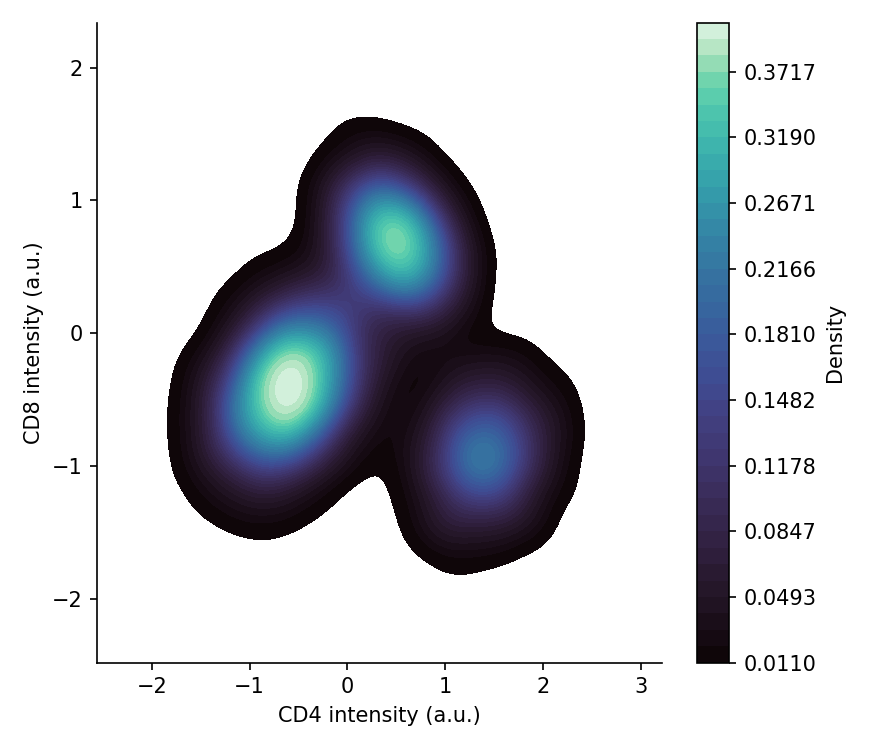

当散点达到数千点时，过绘会毁掉整张图；二维密度展示用估计密度（填充 KDE 或等高线）或分箱计数（hexbin）替代散点。在生物医学研究中，这是密集流式面板、嵌入图和 QC 指标云的日常答案。`seaborn.kdeplot` 与 `matplotlib.hexbin` 覆盖两类需求。

## 示例

{fig-align="center" width="80%"}

## 环境配置

- 系统要求：跨平台（Linux/MacOS/Windows）
- 编程语言：**Python**
- 依赖包：`matplotlib`、`seaborn`、`pandas`、`numpy`

```{python}
#| label: packages-setup
#| output: false
import matplotlib.pyplot as plt
import seaborn as sns
import pandas as pd
import numpy as np
```

## 数据准备

我们模拟一份 20,000 细胞的双标志物流式检测数据，三个淋巴群体的分离只有在密度形式下才可见。

```{python}
#| label: data-prep
np.random.seed(111)

n = 20000
sub = np.random.choice(3, n, p=[0.5, 0.3, 0.2])
centers = [(-0.6, -0.4), (0.5, 0.7), (1.4, -0.9)]
covs = [np.array([[0.18, 0.05], [0.05, 0.15]]),
        np.array([[0.12, -0.03], [-0.03, 0.10]]),
        np.array([[0.15, 0.02], [0.02, 0.12]])]
xy = np.stack([rng for rng in
               [np.random.multivariate_normal(centers[s], covs[s]) for s in sub]])
cells = pd.DataFrame(xy, columns=['CD4', 'CD8'])
```

## 可视化

### 填充二维核密度

填充核密度估计平滑地呈现群体形状；调高 `thresh` 可以去掉只添噪声的最外层稀薄尾部。

```{python}
#| label: fig-py-bidensity-kde
#| fig-cap: "20,000 细胞流式样本的填充二维密度"
#| width: 68%
#| fig-align: center
fig, ax = plt.subplots(figsize=(5.8, 5))
sns.kdeplot(data=cells, x='CD4', y='CD8', fill=True, thresh=0.02,
            levels=40, cmap='mako', cbar=True,
            cbar_kws=dict(label='Density'), ax=ax)
ax.set_xlabel('CD4 intensity (a.u.)')
ax.set_ylabel('CD8 intensity (a.u.)')
ax.spines[['top', 'right']].set_visible(False)
plt.tight_layout()
plt.show()
```

### 六边形分箱图

六边形分箱直接对点计数——无平滑假设，且色标保持映射诚实。合适的 `gridsize` 在分辨率与空箱之间取得平衡。

```{python}
#| label: fig-py-bidensity-hexbin
#| fig-cap: "同一样本的六边形分箱计数"
#| width: 68%
#| fig-align: center
fig, ax = plt.subplots(figsize=(5.8, 5))
hb = ax.hexbin(cells['CD4'], cells['CD8'], gridsize=60, cmap='viridis',
               mincnt=1, linewidths=0.1)
cb = fig.colorbar(hb, ax=ax, shrink=0.85)
cb.set_label('Cell count')
ax.set_xlabel('CD4 intensity (a.u.)')
ax.set_ylabel('CD8 intensity (a.u.)')
ax.spines[['top', 'right']].set_visible(False)
plt.tight_layout()
plt.show()
```

### 等高线叠加稀疏散点

对设门的亚群，逐群体绘制填充等高线并叠加轻量散点抽样——设门保持可读，同时完整密度仍然可见。

```{python}
#| label: fig-py-bidensity-contour
#| fig-cap: "逐群体等高线叠加 2% 散点抽样"
#| width: 68%
#| fig-align: center
cells['Population'] = np.array(['P1', 'P2', 'P3'])[sub]
palette = {'P1': '#66c2a5', 'P2': '#8da0cb', 'P3': '#e63946'}

fig, ax = plt.subplots(figsize=(5.8, 5))
sns.kdeplot(data=cells, x='CD4', y='CD8', hue='Population', palette=palette,
            fill=False, levels=6, linewidths=1.6, thresh=0.03, ax=ax)
sub_sample = cells.sample(frac=0.02, random_state=0)
sns.scatterplot(data=sub_sample, x='CD4', y='CD8', hue='Population',
                palette=palette, s=8, alpha=0.5, legend=False, ax=ax)
ax.set_xlabel('CD4 intensity (a.u.)')
ax.set_ylabel('CD8 intensity (a.u.)')
ax.spines[['top', 'right']].set_visible(False)
plt.tight_layout()
plt.show()
```

## 参考文献

1. Waskom, M. L. (2021). seaborn: statistical data visualization. *Journal of Open Source Software*, 6(60), 3021.
2. Hunter, J. D. (2007). Matplotlib: A 2D graphics environment. *Computing in Science & Engineering*, 9(3), 90-95.
