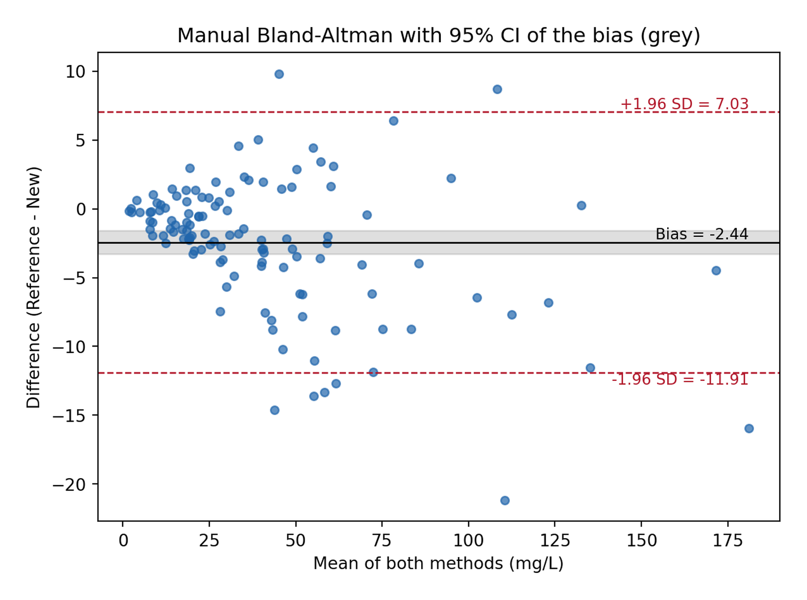
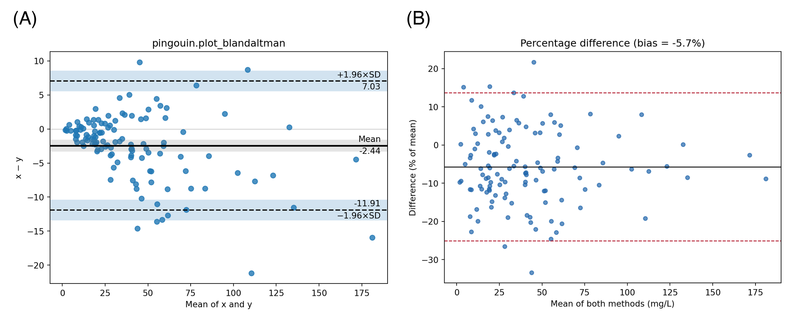

The Python counterpart of [Bland-Altman Plot](../Clinics/BlandAltmanPlot.html) — method-agreement analysis for two quantitative measurements of the same quantity (reference assay vs point-of-care device, wearable vs clinic blood pressure) \[1\]. Each subject is measured twice; the plot shows the *difference* against the *average*, anchored by the mean difference (**bias**) and the **95% limits of agreement** (bias ± 1.96 × SD of the differences). A large Pearson correlation does not imply agreement: correlation measures linear association, which a consistently inflated method shows as strongly as a perfect one.

Python offers two ready-made implementations — `pingouin.plot_blandaltman()` \[2\] and `statsmodels.graphics.agreement.mean_diff_plot()` \[3\] — plus the fully transparent matplotlib construction. This tutorial covers all three routes and the percentage-difference variant for proportional bias.

This tutorial covers four workflows:

1. `pingouin.plot_blandaltman()` with confidence intervals;
2. A hand-built Bland-Altman plot with the exact CI of the bias;
3. `statsmodels.mean_diff_plot()` (Tukey mean-difference);
4. The percentage-difference plot for heteroscedastic (proportional-bias) data.

## Example

{fig-align="center" width="60%"}

## Setup

- System Requirements: Cross-platform (Linux/MacOS/Windows)
- Programming Language: **Python**
- Dependencies: `matplotlib`, `numpy`, `pandas`, `pingouin`, `statsmodels`

```{python}
#| label: packages-setup
#| output: false
import matplotlib.pyplot as plt
import numpy as np
import pandas as pd
import pingouin as pg
from statsmodels.graphics.agreement import mean_diff_plot
```

## Data Preparation

We simulate the same method-comparison study as the R tutorial: $n = 120$ serum samples assayed for a biomarker (mg/L) by a reference method and a new point-of-care method with a +6% proportional over-read and concentration-dependent error. The funnel shape this produces motivates Section 4.

```{python}
#| label: data-prep
rng = np.random.default_rng(2026)

n = 120
true_conc = rng.gamma(shape=2, scale=20, size=n)      # right-skewed biomarker
ref = true_conc * (1 + rng.normal(0, 0.05, n))        # reference method, ~5% CV
new = true_conc * (1 + rng.normal(0.06, 0.09, n))     # new method: +6% bias, ~9% CV

avg = (ref + new) / 2      # best estimate of the true value
diff = ref - new
methods = pd.DataFrame({"ref": ref, "new": new, "avg": avg, "diff": diff})
methods.head()
```

## Visualization

### 1. pingouin One-Liner

```{python}
#| label: fig-py-ba-pingouin
#| fig-cap: "pingouin draws the Bland-Altman plot with bootstrap confidence intervals around the bias and both limits; the mean difference and limits are printed in the figure."
#| fig-width: 6.5
#| fig-height: 4.8

fig, ax = plt.subplots(figsize=(6.5, 4.8))
pg.plot_blandaltman(ref, new, ax=ax)
ax.set_title("pingouin.plot_blandaltman")
fig.tight_layout()
plt.show()
```

### 2. Hand-Built Plot with the Exact CI of the Bias

The confidence interval of the bias uses $\mathrm{SE} = s/\sqrt{n}$; the limits of agreement carry their own uncertainty, $\mathrm{SE}_{LoA} = \sqrt{s^2(1/n + 1.96^2/(2(n-1)))}$ \[1\] — quote them in small studies.

```{python}
#| label: fig-py-ba-manual
#| fig-cap: "Hand-built Bland-Altman plot: grey band = 95% CI of the bias; dashed lines = 95% limits of agreement. The scatter widens with concentration (proportional bias)."
#| fig-width: 6.5
#| fig-height: 4.8

bias, sd = diff.mean(), diff.std(ddof=1)
loa = (bias - 1.96 * sd, bias + 1.96 * sd)
se_bias = sd / np.sqrt(n)
se_loa = np.sqrt(sd**2 * (1 / n + 1.96**2 / (2 * (n - 1))))

fig, ax = plt.subplots(figsize=(6.5, 4.8))
ax.axhspan(bias - 1.96 * se_bias, bias + 1.96 * se_bias, color="grey", alpha=0.25)
ax.axhline(bias, color="black", lw=1)
ax.axhline(loa[0], color="#B2182B", ls="--", lw=1)
ax.axhline(loa[1], color="#B2182B", ls="--", lw=1)
ax.scatter(avg, diff, s=22, color="#2166AC", alpha=0.7)
ax.text(avg.max(), bias, f"  Bias = {bias:.2f}", va="bottom", ha="right", fontsize=9)
ax.text(avg.max(), loa[1], f"  +1.96 SD = {loa[1]:.2f}",
        va="bottom", ha="right", fontsize=9, color="#B2182B")
ax.text(avg.max(), loa[0], f"  -1.96 SD = {loa[0]:.2f}",
        va="top", ha="right", fontsize=9, color="#B2182B")
ax.set_xlabel("Mean of both methods (mg/L)")
ax.set_ylabel("Difference (Reference - New)")
ax.set_title("Manual Bland-Altman with 95% CI of the bias (grey)")
fig.tight_layout()
plt.show()
```

The average difference of about −2.4 mg/L is the bias: the new method reads higher than the reference on average. Whether the limits of agreement (±12 mg/L) are acceptable is a clinical judgement tied to the decision threshold, not a statistical one.

### 3. statsmodels Mean-Difference Plot

```{python}
#| label: fig-py-ba-statsmodels
#| fig-cap: "statsmodels' Tukey mean-difference plot: same geometry, with percentage-difference annotation built in."
#| fig-width: 6.5
#| fig-height: 4.8

fig, ax = plt.subplots(figsize=(6.5, 4.8))
mean_diff_plot(ref, new, ax=ax)
ax.set_title("statsmodels.graphics.agreement.mean_diff_plot")
fig.tight_layout()
plt.show()
```

### 4. Percentage Differences for Proportional Bias

The funnel in Sections 1–3 says the error spread grows with concentration. Expressing the difference as a percentage of the average restores a constant spread, and one bias/one pair of limits becomes valid across the whole range — the same remedy as log-transforming both measurements.

```{python}
#| label: fig-py-ba-pct
#| fig-cap: "Percentage difference plot: the funnel disappears, giving a single bias (-5.7%) and one pair of limits valid at every concentration."
#| fig-width: 6.5
#| fig-height: 4.8

pct = diff / avg * 100
pbias, psd = pct.mean(), pct.std(ddof=1)

fig, ax = plt.subplots(figsize=(6.5, 4.8))
ax.axhline(pbias, color="black", lw=1)
ax.axhline(pbias - 1.96 * psd, color="#B2182B", ls="--", lw=1)
ax.axhline(pbias + 1.96 * psd, color="#B2182B", ls="--", lw=1)
ax.scatter(avg, pct, s=22, color="#2166AC", alpha=0.7)
ax.set_xlabel("Mean of both methods (mg/L)")
ax.set_ylabel("Difference (% of mean)")
ax.set_title(f"Percentage difference (bias = {pbias:.1f}%)")
fig.tight_layout()
plt.show()
```

::: callout-tip
## Practice tips

-   Plot the difference against the *average* of the two methods — against a single method induces spurious correlation into the differences.
-   `pingouin` and `statsmodels` differ in default annotation; neither quotes the CI of the limits of agreement — compute Section 2's formulas when reviewers ask.
-   A paired t-test is not an agreement analysis; report the plot plus bias/LoA, and check the funnel shape before quoting raw-unit limits.
-   For reproducibility use `numpy.random.default_rng(seed)` — the legacy `np.random.seed` global state is not shared across libraries.
:::

## Application

Method-comparison panels appear whenever a laboratory or clinic replaces an instrument or device: chemistry analyzers, point-of-care glucose/ketone meters, wearable versus catheter blood pressure. The panel below mirrors a typical publication layout: (A) the hand-built plot with CI of the bias and (B) the percentage-difference variant for proportional bias.

{fig-align="center" width="60%"}

## Reference

\[1\] Bland JM, Altman DG. Measuring agreement in method comparison studies. Stat Methods Med Res. 1999;8(2):135-160. doi:10.1177/096228029900800204

\[2\] Vallat R. Pingouin: statistics in Python. J Open Source Softw. 2018;3(31):1026. doi:10.21105/joss.01026

\[3\] Seabold S, Perktold J. statsmodels: econometric and statistical modeling with Python. Proc 9th Python Sci Conf. 2010:92-96. doi:10.25080/Majora-92bf1922-011
