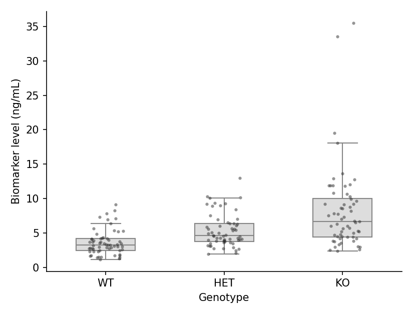

A box plot summarizes the distribution of a numeric variable through its median, quartiles, and outliers. In biomedical research, box plots are the standard compact display for comparing biomarker levels across genotypes, batches, or treatment arms. Python's `seaborn` builds directly on `matplotlib` to provide notched, grouped, and point-overlay variants suitable for publication figures.

## Example

{fig-align="center" width="80%"}

## Setup

- System Requirements: Cross-platform (Linux/MacOS/Windows)
- Programming Language: **Python**
- Dependencies: `matplotlib`, `seaborn`, `pandas`, `numpy`

```{python}
#| label: packages-setup
#| output: false
import matplotlib.pyplot as plt
import seaborn as sns
import pandas as pd
import numpy as np
```

## Data Preparation

We simulate a serum biomarker assay across three genotypes (WT, HET, KO), with a sex factor for the grouped variant and enough replicates (n = 60 per genotype) for stable quartile estimates.

```{python}
#| label: data-prep
np.random.seed(7)

genotypes = ['WT', 'HET', 'KO']
n_per_genotype = 60
df = pd.DataFrame({
    'Genotype': np.repeat(genotypes, n_per_genotype),
    'Sex': np.tile(np.repeat(['Female', 'Male'], n_per_genotype // 2), 3),
    'Biomarker': np.concatenate([
        np.random.lognormal(1.2, 0.45, n_per_genotype),
        np.random.lognormal(1.55, 0.45, n_per_genotype),
        np.random.lognormal(1.95, 0.55, n_per_genotype),
    ])
})
# Inject a few extreme values in KO to demonstrate outlier display
df.loc[df.index[-3:], 'Biomarker'] *= 3.5
```

## Visualization

### Basic Box Plot

The box spans the interquartile range (IQR), the line marks the median, and whiskers extend to 1.5 × IQR; points beyond are drawn as fliers (outliers).

```{python}
#| label: fig-py-box-basic
#| fig-cap: "Box plot of serum biomarker across genotypes"
#| width: 65%
#| fig-align: center
plt.figure(figsize=(5.5, 4.2))
ax = sns.boxplot(data=df, x='Genotype', y='Biomarker',
                 color='#8da0cb', width=0.5, linewidth=1.0,
                 fliersize=3, flierprops=dict(markerfacecolor='0.4'))
ax.set_xlabel('Genotype')
ax.set_ylabel('Biomarker level (ng/mL)')
ax.spines[['top', 'right']].set_visible(False)
plt.tight_layout()
plt.show()
```

### Box Plot with Jittered Points

Because a box hides the raw data, overlaying the individual observations is the publication-recommended style: set `showfliers=False` and add a `stripplot` layer.

```{python}
#| label: fig-py-box-points
#| fig-cap: "Box plot overlaid with individual data points"
#| width: 65%
#| fig-align: center
plt.figure(figsize=(5.5, 4.2))
ax = sns.boxplot(data=df, x='Genotype', y='Biomarker',
                 color='#dddddd', width=0.5, linewidth=1.0,
                 showfliers=False)
sns.stripplot(data=df, x='Genotype', y='Biomarker',
              color='#2b2b2b', size=3, alpha=0.5, jitter=0.15, ax=ax)
ax.set_xlabel('Genotype')
ax.set_ylabel('Biomarker level (ng/mL)')
ax.spines[['top', 'right']].set_visible(False)
plt.tight_layout()
plt.show()
```

### Grouped Box Plot

A second factor is mapped to `hue`, producing paired boxes within each category — the typical pre/post or two-cohort comparison.

```{python}
#| label: fig-py-box-grouped
#| fig-cap: "Grouped box plot with a sex factor"
#| width: 75%
#| fig-align: center
plt.figure(figsize=(6.5, 4.2))
ax = sns.boxplot(data=df, x='Genotype', y='Biomarker', hue='Sex',
                 palette={'Female': '#e78ac3', 'Male': '#8da0cb'},
                 width=0.6, linewidth=1.0, fliersize=2.5)
ax.set_xlabel('Genotype')
ax.set_ylabel('Biomarker level (ng/mL)')
ax.legend(frameon=False, title=None)
ax.spines[['top', 'right']].set_visible(False)
plt.tight_layout()
plt.show()
```

### Notched Box Plot

The notch approximates a 95% confidence interval around the median; non-overlapping notches between two boxes are informal evidence of different medians.

```{python}
#| label: fig-py-box-notched
#| fig-cap: "Notched box plot; notches approximate the median 95% CI"
#| width: 65%
#| fig-align: center
plt.figure(figsize=(5.5, 4.2))
ax = sns.boxplot(data=df, x='Genotype', y='Biomarker',
                 color='#a6d854', width=0.5, linewidth=1.0,
                 notch=True, fliersize=3)
ax.set_xlabel('Genotype')
ax.set_ylabel('Biomarker level (ng/mL)')
ax.spines[['top', 'right']].set_visible(False)
plt.tight_layout()
plt.show()
```

## References

1. Hunter, J. D. (2007). Matplotlib: A 2D graphics environment. *Computing in Science & Engineering*, 9(3), 90-95.
2. Waskom, M. L. (2021). seaborn: statistical data visualization. *Journal of Open Source Software*, 6(60), 3021.
3. Spitzer, M., Wildenhain, J., Rappsilber, J., & Tyers, M. (2014). BoxPlotR: a web tool for generation of box plots. *Nature Methods*, 11(2), 121-122.
