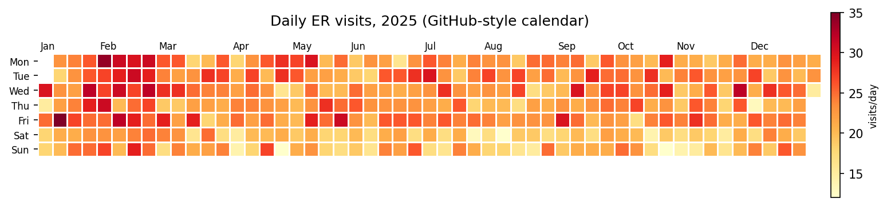
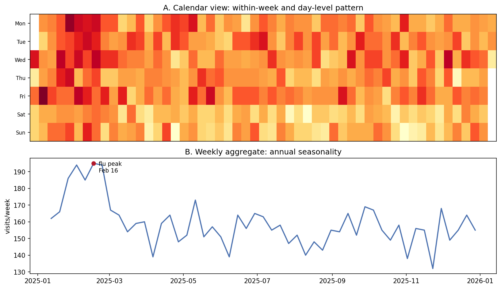

The Python counterpart of [Calendar Heatmap](../Evolution/CalendarHeatmap.html) — a calendar heatmap tiles one year of daily values into a week × weekday grid (GitHub-contribution style) or a month × day-of-month grid, so seasonality, weekday effects, and single-day outbreaks are all visible in one picture. In biomedical settings it is the natural summary for daily hospital admissions, symptom diaries, device adherence, and pharmacovigilance report streams.

The whole chart is a `matplotlib` `pcolormesh` on a masked 2-D array \[1\] — no extra package required. The one non-obvious piece is the *week-offset algorithm*: the grid column of a date is its offset from the first week's start, aligned so that each column is one calendar week and weekend rows stay aligned across the year.

This tutorial covers two workflows:

1. A GitHub-style week × weekday calendar for one year;
2. A month × day-of-month grid built with `pcolormesh`.

## Example

{fig-align="center" width="90%"}

## Setup

- System Requirements: Cross-platform (Linux/MacOS/Windows)
- Programming Language: **Python**
- Dependencies: `matplotlib`, `numpy`, `pandas`

```{python}
#| label: packages-setup
#| output: false
import calendar
import matplotlib.pyplot as plt
import numpy as np
import pandas as pd
```

## Data Preparation

We simulate one year of daily emergency-department visits with a winter influenza spike, a weekend dip, and observation noise. The weekly rhythm and the seasonal wave are the two patterns a calendar heatmap should expose immediately.

```{python}
#| label: data-prep
rng = np.random.default_rng(3)
days = pd.date_range("2025-01-01", "2025-12-31", freq="D")
dayofyear = days.day_of_year.to_numpy()
weekday_row = days.day_of_week.to_numpy()        # Mon=0 .. Sun=6
season = 6 * np.exp(-((dayofyear - 40) / 25) ** 2)   # flu spike
dow = np.where(weekday_row >= 5, -3, 1)
visits = np.clip(22 + season + dow + rng.normal(0, 3.2, len(days)),
                 2, None).round()
df = pd.DataFrame({"date": days, "visits": visits})

# Week-offset algorithm: column = whole weeks since the Monday of the week
# containing Jan 1. Rows stay aligned as calendar weekdays across the year.
first_monday = days[0] - pd.Timedelta(days=int(days[0].day_of_week))
week_idx = np.array([(d - first_monday).days // 7 for d in days])
df.head()
```

## Visualization

### 1. GitHub-Style Calendar

```{python}
#| label: fig-py-calendar-year
#| fig-cap: "One year of daily ED visits on a GitHub-style calendar: the February influenza spike and the lighter weekend columns are both readable at a glance."
#| fig-align: center

grid = np.full((7, week_idx.max() + 1), np.nan)
for w, d, v in zip(week_idx, weekday_row, df.visits):
    grid[d, w] = v

fig, ax = plt.subplots(figsize=(11.5, 3))
im = ax.pcolormesh(np.arange(grid.shape[1] + 1), np.arange(8),
                   np.ma.masked_invalid(grid), cmap="YlOrRd",
                   edgecolors="white", lw=0.5)
ax.set_yticks(np.arange(7) + 0.5)
ax.set_yticklabels(["Mon", "Tue", "Wed", "Thu", "Fri", "Sat", "Sun"],
                   fontsize=8)
ax.invert_yaxis()
for d in df.date[df.date.dt.day == 1]:        # month labels at week columns
    w = (d - first_monday).days // 7
    ax.text(w + 0.2, -0.3, d.strftime("%b"), fontsize=8)
ax.set_title("Daily ER visits, 2025 (GitHub-style calendar)", pad=24)
ax.set_xticks([]); ax.set_aspect("equal")
for s in ax.spines.values():
    s.set_visible(False)
cb = fig.colorbar(im, ax=ax, shrink=0.8, pad=0.01)
cb.set_label("visits/day", fontsize=8)
fig.tight_layout()
plt.show()
```

### 2. Month x Day Grid with pcolormesh

```{python}
#| label: fig-py-calendar-month
#| fig-cap: "The same year as a month x day-of-month grid: months share an x-axis, missing days (Feb 29-31, 30-day months) are masked white, and day-of-month effects stand out vertically."
#| fig-align: center

grid2 = np.full((12, 31), np.nan)
for _, r in df.iterrows():
    grid2[r.date.month - 1, r.date.day - 1] = r.visits

fig, ax = plt.subplots(figsize=(11.5, 4.6))
im = ax.pcolormesh(np.arange(32), np.arange(13),
                   np.ma.masked_invalid(grid2), cmap="YlOrRd",
                   edgecolors="white", lw=0.4)
ax.set_yticks(np.arange(12) + 0.5)
ax.set_yticklabels([calendar.month_abbr[m] for m in range(1, 13)],
                   fontsize=9)
ax.invert_yaxis()
ax.set_xticks(np.arange(1, 31, 2))
ax.set_xlabel("Day of month")
ax.set_title("Daily ER visits, 2025 (month x day grid)")
cb = fig.colorbar(im, ax=ax, shrink=0.85, pad=0.01)
cb.set_label("visits/day", fontsize=8)
fig.tight_layout()
plt.show()
```

::: callout-tip
## Practice tips

-   Mask non-existent days (`np.ma.masked_invalid`) instead of filling zeros — a filled zero reads as "zero visits" and corrupts the color scale.
-   State the week convention (ISO weeks vs first-week-offset); mixing them misaligns weekend rows by one cell at year boundaries.
-   Keep one color scale per figure; two calendars with independent scales cannot be compared.
-   For skewed counts (admissions, adverse-event reports), pass `norm=matplotlib.colors.LogNorm()` or bin into quantiles so the spike does not flatten everything else.
-   One calendar per row (per site, per year) stacked vertically turns the plot into a small-multiples panel.
:::

## Application

The QC pairing puts the calendar (A: within-week and day-level pattern) above the weekly aggregate (B: annual seasonality with the peak annotated). The calendar catches "which Tuesday", the aggregate catches "which month" — surveillance reports need both readings.

{fig-align="center" width="90%"}

## Reference

\[1\] Hunter JD. Matplotlib: a 2D graphics environment. Comput Sci Eng. 2007;9(3):90-95. doi:10.1109/MCSE.2007.55
