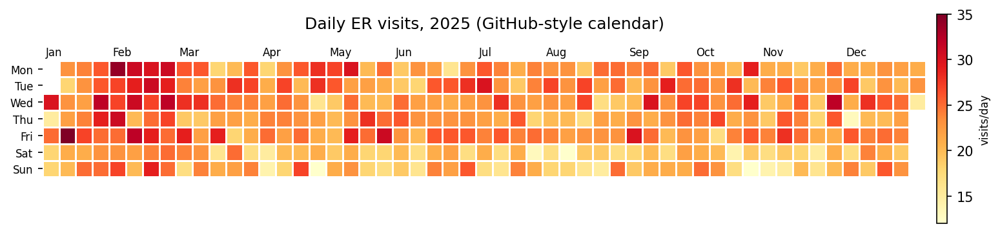
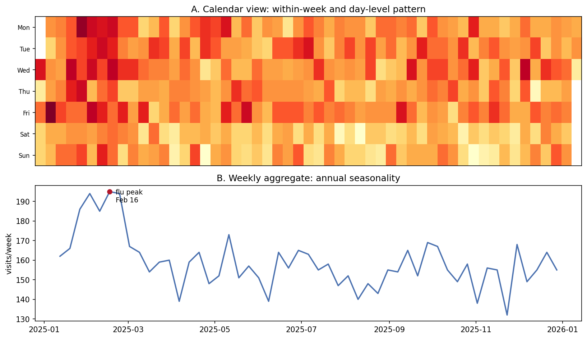

[日历热图](../zh/Evolution/CalendarHeatmap.html)的 Python 对应版本——日历热图把一年的每日取值平铺到"周 × 星期"网格（GitHub 贡献图风格）或"月 × 日"网格，季节性、星期效应与单日爆发在同一张图中可见。在生物医学场景中，它是每日住院量、症状日记、设备依从性、药物警戒报告流等数据的天然汇总图。

整张图就是 `matplotlib` 在带掩码二维数组上的一次 `pcolormesh` \[1\]，无需任何额外包。唯一不直观的部分是*周偏移算法*：日期的网格列号 = 它相对第一周起始的偏移，对齐后每一列恰好是一个日历周，周末行在整年中保持对齐。

本教程涵盖两种工作流：

1. 一年的 GitHub 风格"周 × 星期"日历；
2. 用 `pcolormesh` 构建"月 × 日"网格。

## Example

{fig-align="center" width="90%"}

## Setup

- 系统要求：跨平台（Linux/MacOS/Windows）
- 编程语言：**Python**
- 依赖包：`matplotlib`、`numpy`、`pandas`

```{python}
#| label: packages-setup
#| output: false
import calendar
import matplotlib.pyplot as plt
import numpy as np
import pandas as pd
```

## Data Preparation

我们模拟一年的每日急诊量：包含冬季流感高峰、周末回落与观测噪声。周节律与季节波正是日历热图应能立刻暴露的两个模式。

```{python}
#| label: data-prep
rng = np.random.default_rng(3)
days = pd.date_range("2025-01-01", "2025-12-31", freq="D")
dayofyear = days.day_of_year.to_numpy()
weekday_row = days.day_of_week.to_numpy()        # Mon=0 .. Sun=6
season = 6 * np.exp(-((dayofyear - 40) / 25) ** 2)   # 流感高峰
dow = np.where(weekday_row >= 5, -3, 1)
visits = np.clip(22 + season + dow + rng.normal(0, 3.2, len(days)),
                 2, None).round()
df = pd.DataFrame({"date": days, "visits": visits})

# 周偏移算法：列号 = 日期相对 1 月 1 日所在周的周一起的整周数。
# 对齐后各行在整年中始终是同一个日历星期。
first_monday = days[0] - pd.Timedelta(days=int(days[0].day_of_week))
week_idx = np.array([(d - first_monday).days // 7 for d in days])
df.head()
```

## Visualization

### 1. GitHub 风格日历

```{python}
#| label: fig-py-calendar-year
#| fig-cap: "一年急诊量的 GitHub 风格日历：2 月流感高峰与更浅的周末两列一目了然。"
#| fig-align: center

grid = np.full((7, week_idx.max() + 1), np.nan)
for w, d, v in zip(week_idx, weekday_row, df.visits):
    grid[d, w] = v

fig, ax = plt.subplots(figsize=(11.5, 3))
im = ax.pcolormesh(np.arange(grid.shape[1] + 1), np.arange(8),
                   np.ma.masked_invalid(grid), cmap="YlOrRd",
                   edgecolors="white", lw=0.5)
ax.set_yticks(np.arange(7) + 0.5)
ax.set_yticklabels(["Mon", "Tue", "Wed", "Thu", "Fri", "Sat", "Sun"],
                   fontsize=8)
ax.invert_yaxis()
for d in df.date[df.date.dt.day == 1]:        # month labels at week columns
    w = (d - first_monday).days // 7
    ax.text(w + 0.2, -0.3, d.strftime("%b"), fontsize=8)
ax.set_title("Daily ER visits, 2025 (GitHub-style calendar)", pad=24)
ax.set_xticks([]); ax.set_aspect("equal")
for s in ax.spines.values():
    s.set_visible(False)
cb = fig.colorbar(im, ax=ax, shrink=0.8, pad=0.01)
cb.set_label("visits/day", fontsize=8)
fig.tight_layout()
plt.show()
```

### 2. 用 pcolormesh 构建"月 × 日"网格

```{python}
#| label: fig-py-calendar-month
#| fig-cap: "同一年的月 × 日网格：各月共用一条 x 轴，不存在的日期（2 月 29-31、30 天月的 31 日）被掩码为白色，日期效应沿纵向凸显。"
#| fig-align: center

grid2 = np.full((12, 31), np.nan)
for _, r in df.iterrows():
    grid2[r.date.month - 1, r.date.day - 1] = r.visits

fig, ax = plt.subplots(figsize=(11.5, 4.6))
im = ax.pcolormesh(np.arange(32), np.arange(13),
                   np.ma.masked_invalid(grid2), cmap="YlOrRd",
                   edgecolors="white", lw=0.4)
ax.set_yticks(np.arange(12) + 0.5)
ax.set_yticklabels([calendar.month_abbr[m] for m in range(1, 13)],
                   fontsize=9)
ax.invert_yaxis()
ax.set_xticks(np.arange(1, 31, 2))
ax.set_xlabel("Day of month")
ax.set_title("Daily ER visits, 2025 (month x day grid)")
cb = fig.colorbar(im, ax=ax, shrink=0.85, pad=0.01)
cb.set_label("visits/day", fontsize=8)
fig.tight_layout()
plt.show()
```

::: callout-tip
## 实践要点

-   不存在的日期用掩码（`np.ma.masked_invalid`），不要填 0——填 0 会被读成"零就诊"，还会破坏色标。
-   注明周的约定（ISO 周 vs 首周偏移）；混用会让年末边界处的周末行错位一格。
-   一张图一个色标；各自独立色标的两张日历之间无法比较。
-   计数偏态（住院、不良事件报告）时，传 `norm=matplotlib.colors.LogNorm()` 或按分位数离散化，否则峰值会把其余部分压平。
-   每行一个日历（按院区、按年份纵向堆叠），同一张图就变成 small-multiples 面板。
:::

## Application

QC 搭配把日历（A：周内与单日模式）放在周聚合（B：年季节性，峰值已标注）上方。日历回答"哪个周二"，聚合回答"哪个月"——监测报告两种读法都需要。

{fig-align="center" width="90%"}

## Reference

\[1\] Hunter JD. Matplotlib: a 2D graphics environment. Comput Sci Eng. 2007;9(3):90-95. doi:10.1109/MCSE.2007.55
