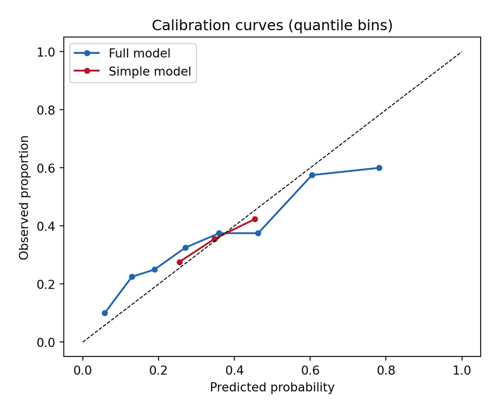
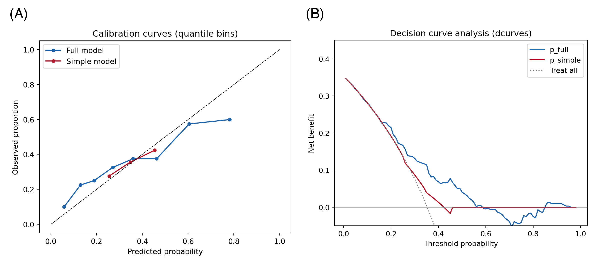

The Python counterpart of the clinical model-evaluation suite (ROC in [ROC & PR (Python)](../Python/RocPrPlot.html); calibration and DCA in R [here](../Clinics/CalibrationPlot.html) and [here](../Clinics/DCAPlot.html)). Discrimination (AUC) says a model *ranks* patients correctly; **calibration** says its probabilities can be trusted — among patients predicted 30%, do ~30% actually have the event? **Decision curve analysis (DCA)** then asks the clinical question: at which risk threshold does acting on the model help more patients than it harms, compared with treating everyone or no one \[1\]? TRIPOD-style reporting expects all three.

This tutorial covers two workflows:

1. Calibration curves for two logistic models with `sklearn.calibration.calibration_curve()`;
2. Net-benefit decision curves with the `dcurves` package — the MSKCC implementation of Vickers' DCA \[2\] — plus the treat-all/treat-none references.

## Example

{fig-align="center" width="60%"}

## Setup

- System Requirements: Cross-platform (Linux/MacOS/Windows)
- Programming Language: **Python**
- Dependencies: `matplotlib`, `numpy`, `pandas`, `scikit-learn`, `dcurves`

```{python}
#| label: packages-setup
#| output: false
import matplotlib.pyplot as plt
import numpy as np
import pandas as pd
from sklearn.calibration import calibration_curve
from sklearn.linear_model import LogisticRegression
from sklearn.model_selection import train_test_split
from dcurves.dca import dca
```

## Data Preparation

We simulate an 800-patient cohort with a binary 1-year endpoint and three predictors, fit a full and a simple logistic model on a training split, and evaluate on a held-out 40% — calibration must be judged on data the model did not fit.

```{python}
#| label: data-prep
rng = np.random.default_rng(418)

m = 800
age = rng.normal(60, 12, m)
ecog = rng.integers(0, 3, m)
marker = rng.normal(0, 1, m)
lp = -1.2 + 0.03 * (age - 60) + 0.5 * ecog + 0.8 * marker
y1y = rng.binomial(1, 1 / (1 + np.exp(-lp)))

df = pd.DataFrame({"age": age, "ecog": ecog, "marker": marker, "y": y1y})
tr, te = train_test_split(df, test_size=0.4, random_state=251, stratify=df.y)

m_full = LogisticRegression().fit(tr[["age", "ecog", "marker"]], tr.y)
m_simple = LogisticRegression().fit(tr[["ecog"]], tr.y)
te = te.assign(p_full=m_full.predict_proba(te[["age", "ecog", "marker"]])[:, 1],
               p_simple=m_simple.predict_proba(te[["ecog"]])[:, 1])
te.y.mean().round(3)
```

## Visualization

### 1. Calibration Curves

```{python}
#| label: fig-py-calibration
#| fig-cap: "Calibration curves on the held-out split (quantile bins): both models over-predict at low risks and the full model drifts under the diagonal above 0.5 — a mild miscalibration invisible to AUC."
#| fig-width: 9
#| fig-height: 4.6

fig, ax = plt.subplots(figsize=(5.6, 4.6))
for name, col, c in [("Full model", "p_full", "#2166AC"),
                     ("Simple model", "p_simple", "#B2182B")]:
    prob_true, prob_pred = calibration_curve(te.y, te[col], n_bins=8,
                                             strategy="quantile")
    ax.plot(prob_pred, prob_true, "o-", color=c, label=name, markersize=4)
ax.plot([0, 1], [0, 1], "k--", lw=0.8)
ax.set_xlabel("Predicted probability")
ax.set_ylabel("Observed proportion")
ax.set_title("Calibration curves (quantile bins)")
ax.legend(loc="upper left")
fig.tight_layout()
plt.show()
```

Points below the diagonal mean the model over-predicts. `strategy="quantile"` keeps every bin populated (equal-width bins go empty in the tails); report the number of bins, and remember the Brier score summarizes the same information as one number.

### 2. Decision Curve Analysis

```{python}
#| label: fig-py-dca
#| fig-cap: "Net-benefit decision curves: the full model (blue) beats both the treat-all strategy (dotted) and treat-none (0) across thresholds 0.1-0.55; the simple model catches up only at high thresholds."
#| fig-width: 5.8
#| fig-height: 4.6

d = dca(data=te, outcome="y", modelnames=["p_full", "p_simple"],
        thresholds=np.arange(0.01, 0.99, 0.01))
net = d  # tidy frame: model / threshold / net_benefit / net_intervention_avoided

fig, ax = plt.subplots(figsize=(5.8, 4.6))
for label, c in [("p_full", "#2166AC"), ("p_simple", "#B2182B")]:
    sub = net[net.model == label]
    ax.plot(sub.threshold, sub.net_benefit, color=c, label=label)
ax.axhline(0, color="grey", lw=0.8)
allpos = net[net.model == "all"]
ax.plot(allpos.threshold, allpos.net_benefit, color="grey", ls=":", label="Treat all")
ax.set_xlabel("Threshold probability")
ax.set_ylabel("Net benefit")
ax.set_title("Decision curve analysis (dcurves)")
ax.set_ylim(-0.05, 0.45)
ax.legend()
fig.tight_layout()
plt.show()
```

Net benefit = (true positives − false positives × odds of the threshold) / n: it prices a false positive in units of forgone true positives at each clinical threshold. The model is *useful* wherever its curve sits above both the treat-all and treat-none lines — here roughly between 10% and 55%.

::: callout-tip
## Practice tips

-   `dca()` returns a tidy data frame whose columns include `model`, `threshold`, `net_benefit`, and `net_intervention_avoided` — plot from it directly instead of the package's built-in matplotlib backend when journal styling is needed.
-   "Treat all" (`model == "all"`) and treat-none (net benefit 0) are the two mandatory reference strategies; a model that never beats them adds no decision value regardless of AUC.
-   Calibration on the training split is optimistic — always evaluate on held-out data or with cross-validated predictions (`sklearn.model_selection.cross_val_predict`).
-   For survival endpoints `dcurves.dca` accepts `time`/`time_in_censor` arguments; see the package vignette before mixing binary and time-to-event curves in one figure.
:::

## Application

Calibration + DCA pairs appear in clinical prediction-model papers next to the ROC curve, in ML-for-medicine abstracts (TRIPOD-AI asks for both), and in model-selection memos where the operating threshold is a policy choice. The panel below mirrors a typical publication layout: (A) calibration curves and (B) net-benefit decision curves.

{fig-align="center" width="60%"}

## Reference

\[1\] Vickers AJ, Elkin EB. Decision curve analysis: a novel method for evaluating prediction models. Med Decis Making. 2006;26(6):565-574. doi:10.1177/0272989X06295361

\[2\] Vickers AJ, van Calster B, Steyerberg EW. A simple, step-by-step guide to interpreting decision curve analysis. Diagn Progn Res. 2019;3:18. doi:10.1186/s41512-019-0064-7

\[3\] Van Calster B, McLernon DJ, van Smeden M, et al. Calibration: the Achilles heel of predictive analytics. BMC Med. 2019;17:230. doi:10.1186/s12916-019-1466-7
