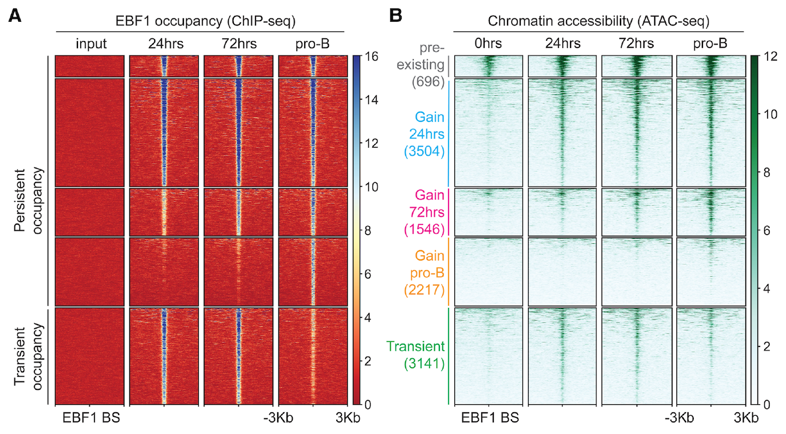

The deepTools aggregate heatmap is the standard display for ChIP-seq/ATAC-seq enrichment over a set of genomic regions: every region is aligned on its peak centre, signal is averaged across regions into a **profile** (left panel), and the per-region matrix is drawn as a heatmap (right panel) with rows grouped by clusters — k-means over the signal matrix in the reference workflow, or an external grouping (e.g. expression clusters) when the question is how chromatin state tracks a separate classification \[1\]. `deepTools` itself is a conda-channel command-line suite (`computeMatrix` + `plotHeatmap`) and is not in this repository's lockfile; the layout — reference-point matrix, per-cluster profile curves, cluster separators, shared colour scale — is re-implemented in-page with numpy + matplotlib on simulated signal so every panel is reproducible offline.

## Example

{fig-alt="ChIP/ATAC aggregate heatmap DEMO" fig-align="center" width="85%"}

## Setup

-   System Requirements: Cross-platform (Linux/MacOS/Windows)

-   Programming language: Python

-   Dependent packages: `numpy`; `matplotlib`

```{python}
#| label: packages-setup
#| output: false
import numpy as np
import matplotlib.pyplot as plt
from matplotlib.gridspec import GridSpec
```

## Data Preparation

300 regions × 4 signal tracks (a time-course: 0 h / 24 h / 72 h / pro-B, as in the reference) over ±3 kb around each region centre in 61 bins. Five planted region classes with distinct enrichment dynamics (acute peak at 0 h, delayed peak at 72 h, flat background, ...); each region's matrix rows are Gaussian bumps centred on the middle bin with class-specific amplitude per sample plus noise:

```{python}
#| label: data-prep
rng = np.random.default_rng(107)
n_bin, half_kb = 61, 3.0
bins = np.linspace(-half_kb, half_kb, n_bin)
samples = ['0hrs', '24hrs', '72hrs', 'pro-B']
classes = ['acute-0h', 'acute-24h', 'delayed-72h', 'pro-B-strong', 'flat']
class_amp = np.array([          # amplitude per class per sample
    [3.0, 0.7, 0.4, 0.5],       # acute-0h
    [0.5, 3.2, 0.8, 0.6],       # acute-24h
    [0.4, 0.6, 3.0, 0.7],       # delayed-72h
    [0.6, 0.8, 1.0, 3.4],       # pro-B-strong
    [0.25, 0.25, 0.25, 0.25],   # flat background
])
n_per_class = 60
region_class = np.repeat(np.arange(5), n_per_class)
gauss = np.exp(-0.5 * (bins / 0.55) ** 2)
M = np.stack([                              # regions x samples x bins
    class_amp[c, s] * gauss * rng.uniform(0.6, 1.4)
    + rng.normal(0.15, 0.05, n_bin)
    for c in region_class
    for s in range(4)]).reshape(-1, 4, n_bin).transpose(0, 2, 1)
## per-sample global gain (as when later time points are sequenced deeper) so
## the aggregate profiles separate instead of hiding under one another
M = M * np.array([1.0, 1.3, 1.6, 2.0])[None, None, :]
```

## Visualization

### deepTools-Style Aggregate Heatmap

The layout `plotHeatmap` produces by default: the left panel overlays each sample's mean profile, then one signal panel per sample draws the region × bin matrix with rows ordered by cluster, thin separators between clusters, and cluster labels at the right edge. A single `vmax` (the `--zMax` safeguard) stops one hot region from flattening the colour scale for everyone:

```{python}
#| label: fig-py-chip-heatmap
#| fig-cap: "deepTools-style aggregate view: mean profiles per sample (left), then one signal panel per sample with regions grouped into 5 k-means-like classes, shared colour scale capped at zMax"
#| out-width: "100%"
#| fig-width: 9
#| fig-height: 5.6
cmap = plt.get_cmap('YlGnBu')
vmax = np.percentile(M, 99)                 # the --zMax safeguard
sample_colors = ['#1b9e77', '#d95f02', '#7570b3', '#e7298a']
row_order = np.concatenate([np.arange(c * n_per_class, (c + 1) * n_per_class)
                            for c in range(5)])

fig = plt.figure(figsize=(9, 5.6))
# top row: profile + colour bar; bottom row: 4 sample heatmaps + label gutter
gs = GridSpec(2, 6, width_ratios=[1, 1.1, 1.1, 1.1, 1.1, 0.22],
              height_ratios=[1.4, 6], hspace=0.55, wspace=0.1)
ax_prof = fig.add_subplot(gs[0, 0])
ax_cb = fig.add_subplot(gs[0, 2:4])
for s in range(4):
    ax = fig.add_subplot(gs[1, 1 + s])
    im = ax.imshow(M[row_order][:, :, s], aspect='auto', cmap=cmap,
                   vmin=0, vmax=vmax, interpolation='nearest')
    ax.set_title(samples[s], fontsize=9, color=sample_colors[s])
    ax.set_xticks([0, 30, 60])
    ax.set_xticklabels(['-3kb', 'center', '+3kb'] if s == 0
                       else ['', '', ''], fontsize=7.5)
    ax.tick_params(labelsize=7)
    for k in range(1, 5):
        ax.axhline(k * n_per_class - 0.5, color='black', lw=0.8)
    if s == 0:
        ax.set_ylabel('regions (grouped)', fontsize=8.5)
    else:
        ax.set_yticks([])
# cluster names at the right edge of the last heatmap
ax_lab = fig.add_subplot(gs[1, 5]); ax_lab.axis('off')
for k in range(5):
    ax_lab.text(0.05, 1 - (k + 0.5) / 5, classes[k], fontsize=7.5,
                va='center', ha='left', transform=ax_lab.transAxes)

profs = {}
for s, (col, lab) in enumerate(zip(sample_colors, samples)):
    profs[lab] = M[:, :, s].mean(axis=0)
    ax_prof.plot(bins, profs[lab], color=col, lw=1.4, label=lab)
ax_prof.set_ylim(0, max(p.max() for p in profs.values()) * 1.3)
## legend goes into the empty top-row cell to the right — it must not share
## space with the curves
ax_prof.legend(frameon=False, fontsize=6.5, loc='upper left',
               bbox_to_anchor=(1.05, 1.0))
ax_prof.tick_params(labelsize=7)
ax_prof.set_xticks([])

cbar = fig.colorbar(im, cax=ax_cb, orientation='horizontal')
cbar.ax.tick_params(labelsize=7)
cbar.set_label('signal (capped at zMax)', fontsize=7.5)
plt.show()
```

Two implementation details matter as much as the layout. First, **cap the colour scale** (`--zMax` in deepTools): with heavy-tailed ChIP signal one outlier region otherwise compresses every other row into the bottom of the colour bar. Second, keep one shared scale across panels when samples are compared — per-panel autoscaling manufactures differences.

### Rows Ordered by an External Grouping

The second reference workflow (FigureYa108RNAseqChIP) discards the profile panel (`--whatToShow "heatmap and colorbar"`) and orders rows by an **external** grouping — expression clusters D1-D4 from the matched RNA-seq data — with one heatmap panel per sample side by side, so the question "does the chromatin landscape differ across expression clusters?" is answered by comparing columns of panels \[2\]:

```{python}
#| label: fig-py-chip-clustered
#| fig-cap: "External-grouping layout: rows sorted by RNA-seq expression cluster (D1-D4), one signal panel per sample, heatmap + colour bar only"
#| out-width: "100%"
#| fig-width: 8
#| fig-height: 4.6
expr_cluster = rng.choice(['D1', 'D2', 'D3', 'D4'], size=300)
peak_sample = {'D1': 0, 'D2': 1, 'D3': 2, 'D4': 3}   # which sample peaks
M2 = M.copy()
for cl, si in peak_sample.items():
    mask = expr_cluster == cl
    idx = np.where(mask)[0]
    M2[mask, :, si] *= 1.8
    other = [j for j in range(4) if j != si]
    M2[np.ix_(idx, np.arange(n_bin), other)] *= 0.55

cl_rank = {c: i for i, c in enumerate(['D1', 'D2', 'D3', 'D4'])}
order = np.argsort([cl_rank[c] for c in expr_cluster], kind='stable')
counts = [sum(expr_cluster[c] == c2 for c in order)
          for c2 in ['D1', 'D2', 'D3', 'D4']]
bounds = np.cumsum(counts)[:-1]
centers = np.cumsum(counts) - np.array(counts) / 2

fig = plt.figure(figsize=(8, 4.6))
gs2 = GridSpec(1, 5, width_ratios=[1.3, 1.3, 1.3, 1.3, 0.14],
               wspace=0.35)
vmax2 = np.percentile(M2, 99)
ax_last = None
for s in range(4):
    ax = fig.add_subplot(gs2[0, s])
    ax.imshow(M2[order], aspect='auto', cmap=cmap, vmin=0, vmax=vmax2,
              interpolation='nearest')
    ax.set_title(samples[s], fontsize=9)
    ax.set_xticks([0, 30, 60])
    ax.set_xticklabels(['-3kb', '', '+3kb'] if s == 0 else ['', '', ''],
                       fontsize=7)
    ax.tick_params(labelsize=7)
    ax.set_yticks(centers)
    ax.set_yticklabels(['D1', 'D2', 'D3', 'D4'], fontsize=8)
    if s > 0:
        ax.set_yticklabels([])
    for b in bounds:
        ax.axhline(b - 0.5, color='black', lw=0.7)
    ax_last = ax
ax_cb2 = fig.add_subplot(gs2[0, 4])
cbar2 = fig.colorbar(im, cax=ax_cb2)
cbar2.ax.tick_params(labelsize=7)
plt.show()
```

The real `computeMatrix`/`plotHeatmap` equivalents: `computeMatrix reference-point --referencePoint center -b 3000 -a 3000` builds exactly this ±3 kb matrix; the external grouping replaces `--kmeans`, and `--sortRegions keep` preserves the submitted row order. The reproduction here is layout-faithful — the matrices come from the simulation, not from bigWig files, which keeps the page runnable without bioconda.

::: callout-tip
**Practice tips**

-   Align on the **feature centre** (peak summit, TSS), not the region start — reference-point matrices only make sense when all rows share a biological anchor.
-   Always set a fixed colour ceiling (`--zMax` / `vmax` percentile cap) and reuse it across every panel in the figure.
-   k-means on the signal matrix (`--kmeans 5`) is an *exploration* device: drop noise clusters and re-run before the figure goes into a paper, as the reference does; for publication claims prefer the external, biologically defined grouping.
-   When combining ChIP and ATAC heatmaps for the same regions, compute the row order once and pass `--sortRegions keep` to both calls — independently sorted panels cannot be compared row by row.
:::

## Application

::: {#fig-ChIPHeatmapApplications1}
{fig-alt="ChIP/ATAC aggregate heatmap" fig-align="center" width="85%"}

deepTools aggregate heatmap of EBF1 ChIP-seq time-course signal over peak centres
:::

Aggregate enrichment heatmaps apply wherever a set of genomic regions meets one or more signal tracks: TF binding over enhancer clusters, histone marks over gene TSSs grouped by expression, ATAC accessibility over binding sites across a differentiation time-course — the two-panel layout carries the average and the per-region detail in one figure.

## Reference

\[1\] Ramirez, F., Ryan, D. P., Grüning, B., et al. (2016). deepTools2: a next generation web server for deep-sequencing data analysis. *Nucleic Acids Research*, 44(W1), W160-W165.

\[2\] Xiaofan Lu, et al. FigureYa: A Standardized Visualization Framework for Enhancing Biomedical Data Interpretation and Research Efficiency. iMetaMed. 2025. doi:10.1002/imm3.70005. FigureYapy sources: [FigureYa107ChIPheatmap](https://github.com/ying-ge/FigureYapy/tree/main/FigureYa107ChIPheatmap), [FigureYa108RNAseqChIP](https://github.com/ying-ge/FigureYapy/tree/main/FigureYa108RNAseqChIP).
