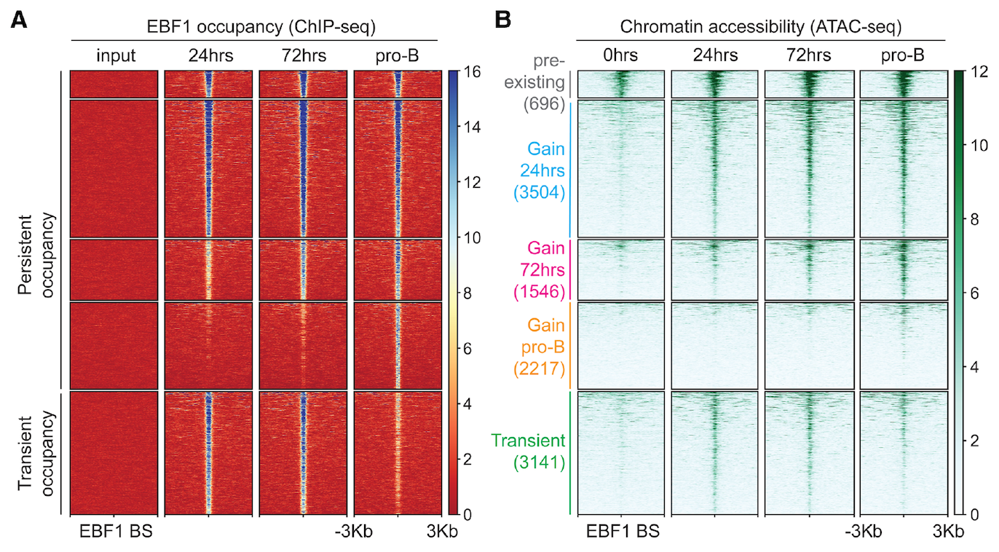

deepTools 聚合热图是 ChIP-seq/ATAC-seq 富集在一组基因组区域上的标准展示：每个区域按峰中心对齐，信号在区域间平均得到 **profile**（左面板），逐区域矩阵画成热图（右面板），行按簇分组——参考流程里是信号矩阵的 k-means，也可以用外部分组（如表达聚类）回答"染色质状态如何跟随另一分类"的问题 \[1\]。`deepTools` 本体是 conda 渠道的命令行套件（`computeMatrix` + `plotHeatmap`），不在本仓库 lockfile 内；本页用 numpy + matplotlib 在模拟信号上复刻版式——参考点矩阵、逐簇 profile 曲线、簇分隔线、统一色标——所有面板均可离线复现。

## 示例

{fig-alt="ChIP/ATAC 聚合热图 DEMO" fig-align="center" width="85%"}

## 环境配置

-   系统要求：跨平台（Linux/MacOS/Windows）

-   编程语言：Python

-   依赖包：`numpy`; `matplotlib`

```{python}
#| label: packages-setup
#| output: false
import numpy as np
import matplotlib.pyplot as plt
from matplotlib.gridspec import GridSpec
```

## 数据准备

300 个区域 × 4 条信号轨道（时间序列：0 h / 24 h / 72 h / pro-B，与参考一致），窗口为峰中心 ±3 kb 共 61 个 bin。植入 5 类区域、各自有不同的富集动力学（0 h 急峰、72 h 延迟峰、平坦背景等）；每个区域的矩阵行是以中间 bin 为中心的高斯峰，幅度按"类别 × 样本"设定并加噪声：

```{python}
#| label: data-prep
rng = np.random.default_rng(107)
n_bin, half_kb = 61, 3.0
bins = np.linspace(-half_kb, half_kb, n_bin)
samples = ['0hrs', '24hrs', '72hrs', 'pro-B']
classes = ['acute-0h', 'acute-24h', 'delayed-72h', 'pro-B-strong', 'flat']
class_amp = np.array([          # 每类每样本的幅度
    [3.0, 0.7, 0.4, 0.5],       # acute-0h
    [0.5, 3.2, 0.8, 0.6],       # acute-24h
    [0.4, 0.6, 3.0, 0.7],       # delayed-72h
    [0.6, 0.8, 1.0, 3.4],       # pro-B-strong
    [0.25, 0.25, 0.25, 0.25],   # flat background
])
n_per_class = 60
region_class = np.repeat(np.arange(5), n_per_class)
gauss = np.exp(-0.5 * (bins / 0.55) ** 2)
M = np.stack([                              # 区域 x 样本 x bin
    class_amp[c, s] * gauss * rng.uniform(0.6, 1.4)
    + rng.normal(0.15, 0.05, n_bin)
    for c in region_class
    for s in range(4)]).reshape(-1, 4, n_bin).transpose(0, 2, 1)
## per-sample global gain (as when later time points are sequenced deeper) so
## the aggregate profiles separate instead of hiding under one another
M = M * np.array([1.0, 1.3, 1.6, 2.0])[None, None, :]
```

## 可视化

### deepTools 式聚合热图

`plotHeatmap` 默认产出的版式：左面板叠加每个样本的均值 profile，随后每样本一个信号面板画区域 × bin 矩阵，行按簇排序、簇间细分隔线、簇名标注在右缘。统一的 `vmax`（对应 `--zMax` 保护）避免单个过热区域压扁所有人的色标：

```{python}
#| label: fig-py-chip-heatmap
#| fig-cap: "deepTools 式聚合视图：各样本均值 profile（左）、随后每样本一个信号面板、区域按 5 个 k-means 类分组，封顶 zMax 的统一色标"
#| out-width: "100%"
#| fig-width: 9
#| fig-height: 5.6
cmap = plt.get_cmap('YlGnBu')
vmax = np.percentile(M, 99)                 # --zMax 保护
sample_colors = ['#1b9e77', '#d95f02', '#7570b3', '#e7298a']
row_order = np.concatenate([np.arange(c * n_per_class, (c + 1) * n_per_class)
                            for c in range(5)])

fig = plt.figure(figsize=(9, 5.6))
# 顶行：profile + 色标；底行：4 个样本热图 + 标签槽
gs = GridSpec(2, 6, width_ratios=[1, 1.1, 1.1, 1.1, 1.1, 0.22],
              height_ratios=[1.4, 6], hspace=0.55, wspace=0.1)
ax_prof = fig.add_subplot(gs[0, 0])
ax_cb = fig.add_subplot(gs[0, 2:4])
for s in range(4):
    ax = fig.add_subplot(gs[1, 1 + s])
    im = ax.imshow(M[row_order][:, :, s], aspect='auto', cmap=cmap,
                   vmin=0, vmax=vmax, interpolation='nearest')
    ax.set_title(samples[s], fontsize=9, color=sample_colors[s])
    ax.set_xticks([0, 30, 60])
    ax.set_xticklabels(['-3kb', 'center', '+3kb'] if s == 0
                       else ['', '', ''], fontsize=7.5)
    ax.tick_params(labelsize=7)
    for k in range(1, 5):
        ax.axhline(k * n_per_class - 0.5, color='black', lw=0.8)
    if s == 0:
        ax.set_ylabel('regions (grouped)', fontsize=8.5)
    else:
        ax.set_yticks([])
# 簇名放在最后一块热图右缘
ax_lab = fig.add_subplot(gs[1, 5]); ax_lab.axis('off')
for k in range(5):
    ax_lab.text(0.05, 1 - (k + 0.5) / 5, classes[k], fontsize=7.5,
                va='center', ha='left', transform=ax_lab.transAxes)

profs = {}
for s, (col, lab) in enumerate(zip(sample_colors, samples)):
    profs[lab] = M[:, :, s].mean(axis=0)
    ax_prof.plot(bins, profs[lab], color=col, lw=1.4, label=lab)
ax_prof.set_ylim(0, max(p.max() for p in profs.values()) * 1.3)
## legend goes into the empty top-row cell to the right — it must not share
## space with the curves
ax_prof.legend(frameon=False, fontsize=6.5, loc='upper left',
               bbox_to_anchor=(1.05, 1.0))
ax_prof.tick_params(labelsize=7)
ax_prof.set_xticks([])

cbar = fig.colorbar(im, cax=ax_cb, orientation='horizontal')
cbar.ax.tick_params(labelsize=7)
cbar.set_label('signal (capped at zMax)', fontsize=7.5)
plt.show()
```

两个实现细节与版式同等重要。其一，**封顶色标**（deepTools 的 `--zMax`）：重尾的 ChIP 信号里只要有一个离群区域，其余行就会被压到色标底部。其二，样本间比较时所有面板**共用一个色标**——各面板自动缩放会制造出并不存在的差异。

### 按外部分组排序的行

第二个参考流程（FigureYa108RNAseqChIP）去掉 profile 面板（`--whatToShow "heatmap and colorbar"`），行按**外部**分组排序——来自匹配 RNA-seq 的表达聚类 D1-D4——每个样本并排一个热图面板，"不同表达簇的染色质景观是否不同"这一问题通过比较面板的列来回答 \[2\]：

```{python}
#| label: fig-py-chip-clustered
#| fig-cap: "外部分组版式：行按 RNA-seq 表达聚类（D1-D4）排序，每样本一个信号面板，仅热图 + 色标"
#| out-width: "100%"
#| fig-width: 8
#| fig-height: 4.6
expr_cluster = rng.choice(['D1', 'D2', 'D3', 'D4'], size=300)
peak_sample = {'D1': 0, 'D2': 1, 'D3': 2, 'D4': 3}   # 每簇在哪条样本轨道出峰
M2 = M.copy()
for cl, si in peak_sample.items():
    mask = expr_cluster == cl
    idx = np.where(mask)[0]
    M2[mask, :, si] *= 1.8
    other = [j for j in range(4) if j != si]
    M2[np.ix_(idx, np.arange(n_bin), other)] *= 0.55

cl_rank = {c: i for i, c in enumerate(['D1', 'D2', 'D3', 'D4'])}
order = np.argsort([cl_rank[c] for c in expr_cluster], kind='stable')
counts = [sum(expr_cluster[c] == c2 for c in order)
          for c2 in ['D1', 'D2', 'D3', 'D4']]
bounds = np.cumsum(counts)[:-1]
centers = np.cumsum(counts) - np.array(counts) / 2

fig = plt.figure(figsize=(8, 4.6))
gs2 = GridSpec(1, 5, width_ratios=[1.3, 1.3, 1.3, 1.3, 0.14],
               wspace=0.35)
vmax2 = np.percentile(M2, 99)
for s in range(4):
    ax = fig.add_subplot(gs2[0, s])
    ax.imshow(M2[order], aspect='auto', cmap=cmap, vmin=0, vmax=vmax2,
              interpolation='nearest')
    ax.set_title(samples[s], fontsize=9)
    ax.set_xticks([0, 30, 60])
    ax.set_xticklabels(['-3kb', '', '+3kb'] if s == 0 else ['', '', ''],
                       fontsize=7)
    ax.tick_params(labelsize=7)
    ax.set_yticks(centers)
    ax.set_yticklabels(['D1', 'D2', 'D3', 'D4'], fontsize=8)
    if s > 0:
        ax.set_yticklabels([])
    for b in bounds:
        ax.axhline(b - 0.5, color='black', lw=0.7)
ax_cb2 = fig.add_subplot(gs2[0, 4])
cbar2 = fig.colorbar(im, cax=ax_cb2)
cbar2.ax.tick_params(labelsize=7)
plt.show()
```

真实的 `computeMatrix`/`plotHeatmap` 等价物：`computeMatrix reference-point --referencePoint center -b 3000 -a 3000` 构建的正是这个 ±3 kb 矩阵；外部分组替代 `--kmeans`，`--sortRegions keep` 保持提交的行序。本页复刻忠实于版式——矩阵来自模拟而非 bigWig 文件，因此不需要 bioconda 即可运行。

::: callout-tip
**实践要点**

-   对齐在**特征中心**（峰顶、TSS）而非区域起点——参考点矩阵只有在所有行共享生物学锚点时才有意义。
-   始终设定固定色标上限（`--zMax` / 百分位封顶的 `vmax`），并在图内所有面板复用。
-   信号矩阵上的 k-means（`--kmeans 5`）是**探索**手段：论文出图前按参考做法剔除噪声簇再重跑；用于发表结论时优先使用外部、生物学定义的分组。
-   对同一组区域合并 ChIP 与 ATAC 热图时，行序只算一次并给两次调用都传 `--sortRegions keep`——各自独立排序的面板无法逐行比较。
:::

## 应用场景

::: {#fig-ChIPHeatmapApplications1}
{fig-alt="ChIP/ATAC 聚合热图" fig-align="center" width="85%"}

EBF1 ChIP-seq 时间序列信号在峰中心上的 deepTools 聚合热图
:::

聚合富集热图适用于一切"基因组区域集合 × 信号轨道"的场景：增强子簇上的转录因子结合、按表达分组的基因 TSS 上的组蛋白修饰、分化时间序列中结合位点的 ATAC 可及性——双面板版式把均值与逐区域细节装进同一张图。

## 参考文献

\[1\] Ramirez, F., Ryan, D. P., Grüning, B., et al. (2016). deepTools2: a next generation web server for deep-sequencing data analysis. *Nucleic Acids Research*, 44(W1), W160-W165.

\[2\] Xiaofan Lu, et al. FigureYa: A Standardized Visualization Framework for Enhancing Biomedical Data Interpretation and Research Efficiency. iMetaMed. 2025. doi:10.1002/imm3.70005. FigureYapy 源码：[FigureYa107ChIPheatmap](https://github.com/ying-ge/FigureYapy/tree/main/FigureYa107ChIPheatmap)、[FigureYa108RNAseqChIP](https://github.com/ying-ge/FigureYapy/tree/main/FigureYa108RNAseqChIP)。
