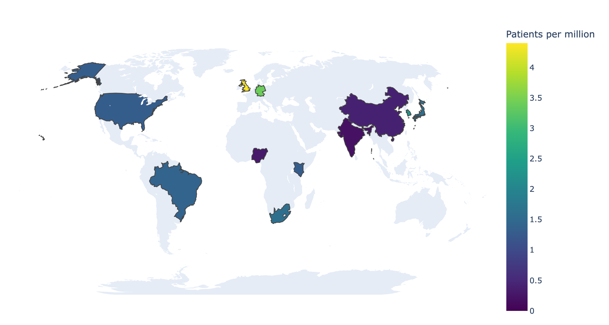

A choropleth map shades geographic regions by a value — incidence rates, cohort coverage, sequencing capacity — making spatial inequality the first thing a reader sees. `plotly.express.choropleth` ships built-in country geometry, so a public-health map needs no GIS stack and no shapefile downloads.

## Example

{fig-align="center" width="80%"}

## Setup

- System Requirements: Cross-platform (Linux/MacOS/Windows)
- Programming Language: **Python**
- Dependencies: `pandas`, `numpy`, `plotly`

```{python}
#| label: packages-setup
#| output: false
import pandas as pd
import numpy as np
import plotly.express as px
```

## Data Preparation

We summarize a multi-country observational study: participating countries with enrolled patients and per-million incidence — the two columns a choropleth needs, keyed by ISO-3 codes (built into plotly's geometry).

```{python}
#| label: data-prep
study = pd.DataFrame({
    'ISO': ['BRA', 'CHN', 'DEU', 'GBR', 'IND', 'JPN', 'KEN', 'KOR',
            'NGA', 'USA', 'ZAF'],
    'Country': ['Brazil', 'China', 'Germany', 'United Kingdom', 'India',
                'Japan', 'Kenya', 'South Korea', 'Nigeria', 'United States',
                'South Africa'],
    'Patients': [312, 540, 288, 301, 265, 198, 74, 121, 66, 430, 96],
})
pop_m = dict(BRA=216, CHN=1412, DEU=84, GBR=68, IND=1428, JPN=124,
             KEN=55, KOR=52, NGA=223, USA=335, ZAF=60)
study['PerMillion'] = (study.Patients / study.ISO.map(pop_m)).round(1)
```

## Visualization

### Enrolment Intensity Map

`locations` takes the ISO-3 codes and `color` the value; a perceptually uniform scale and an explicit `range_color` keep two figures comparable.

```{python}
#| label: fig-py-choropleth
#| fig-cap: "Study enrolment per million population by country"
#| width: 88%
#| fig-align: center
fig = px.choropleth(
    study, locations='ISO', color='PerMillion',
    hover_name='Country',
    hover_data={'Patients': True, 'PerMillion': ':.1f', 'ISO': False},
    color_continuous_scale='Viridis',
    range_color=(0, study.PerMillion.max()),
    labels={'PerMillion': 'Patients per million'})
fig.update_layout(geo=dict(showframe=False, showcoastlines=False,
                           projection_type='natural earth'),
                  width=860, height=460, font_size=11,
                  margin=dict(l=10, r=10, t=30, b=10))
fig.show()
```

### Highlighting Non-Participating Countries

Setting the non-participating countries' value to `NaN` greys them out, turning absence itself into visible information — often the honest choice for coverage maps.

```{python}
#| label: fig-py-choropleth-gap
#| fig-cap: "Participating countries shaded; non-participants left grey"
#| width: 88%
#| fig-align: center
all_iso = ['BRA', 'CHN', 'DEU', 'GBR', 'IND', 'JPN', 'KEN', 'KOR',
           'NGA', 'USA', 'ZAF', 'AUS', 'CAN', 'FRA', 'MEX', 'SWE']
coverage = study.set_index('ISO').reindex(all_iso)

fig = px.choropleth(
    coverage.reset_index(), locations='ISO', color='PerMillion',
    hover_name='ISO', color_continuous_scale='Viridis',
    labels={'ISO': 'Country', 'PerMillion': 'Patients per million'})
fig.update_traces(marker_line_color='#737373', marker_line_width=0.5)
fig.update_layout(geo=dict(showframe=False, showcoastlines=False,
                           landcolor='#eeeeee',
                           projection_type='natural earth'),
                  width=860, height=460, font_size=11,
                  margin=dict(l=10, r=10, t=30, b=10))
fig.show()
```

## References

1. Plotly Technologies Inc. Choropleth map in Python. https://plotly.com/python/choropleth-maps/
2. Crameri, F., Shephard, G. E., & Heron, P. J. (2020). The misuse of colour in science communication. *Nature Communications*, 11, 5444.
