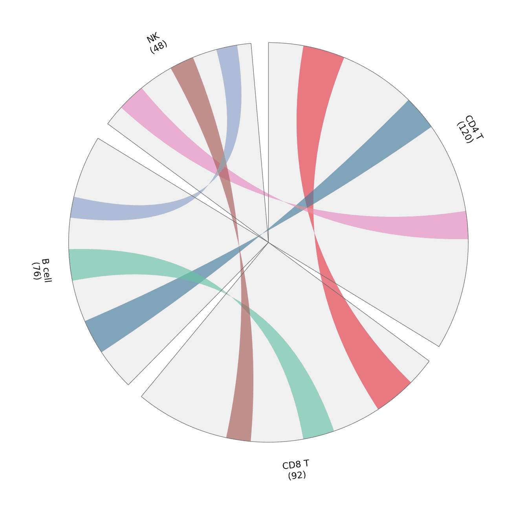

Circos layouts arrange sectors on a circle; chord diagrams connect sectors with arcs whose widths encode flow volume. In biomedical research they summarize gene sharing between cell types, cohort overlaps, or genome-scale rearrangements in one dense-but-readable figure. `pyCirclize` builds both from a sector dictionary plus link tuples — the same API also drives genomic-feature tracks.

## Example

{fig-align="center" width="80%"}

## Setup

- System Requirements: Cross-platform (Linux/MacOS/Windows)
- Programming Language: **Python**
- Dependencies: `matplotlib`, `pyCirclize`

```{python}
#| label: packages-setup
#| output: false
import matplotlib.pyplot as plt
import numpy as np
from matplotlib.patches import Patch
from pycirclize import Circos
```

## Data Preparation

We count marker-gene sharing between four immune cell types; each sector's size is the cell type's marker count, and each link's width is the number of shared markers.

```{python}
#| label: data-prep
marker_counts = {'CD4 T': 120, 'CD8 T': 92, 'B cell': 76, 'NK': 48}
shared = [
    (('CD4 T', 10, 22), ('CD8 T', 8, 20)),     # 12 shared markers
    (('CD4 T', 44, 54), ('B cell', 12, 22)),   # 10 shared markers
    (('CD8 T', 34, 43), ('B cell', 34, 43)),   # 9 shared markers
    (('CD4 T', 80, 88), ('NK', 6, 14)),        # 8 shared markers
    (('CD8 T', 58, 65), ('NK', 24, 31)),       # 7 shared markers
    (('B cell', 52, 58), ('NK', 38, 44)),      # 6 shared markers
]
link_colors = ['#e63946', '#457b9d', '#66c2a5', '#e78ac3', '#a65d57', '#8da0cb']
```

## Visualization

### Chord Diagram of Shared Markers

Sector size shows how many markers each cell type contributes; ribbon width and colour show pairwise sharing — legend the colours, because arc geometry alone is hard to read.

```{python}
#| label: fig-py-circos-chord
#| fig-cap: "Marker sharing between three immune cell types as a chord diagram"
#| width: 62%
#| fig-align: center
circos = Circos(marker_counts, space=5)
for sector in circos.sectors:
    sector.axis(fc='#f0f0f0', ec='0.4', lw=0.6)
    sector.text(f'{sector.name}\n({sector.size})', r=110, size=11)
for (src, dst), color in zip(shared, link_colors):
    circos.link(src, dst, color=color, alpha=0.65)

fig = circos.plotfig()
plt.tight_layout()
plt.show()
```

### Sector Tracks with a Genomic-Style Layout

The same sector framework also hosts stacked tracks (heatmaps, bars, points) — here a simple bar track shows per-cell-type marker density along its sector.

```{python}
#| label: fig-py-circos-tracks
#| fig-cap: "Circos sectors with a per-sector bar track"
#| width: 62%
#| fig-align: center
rng = np.random.default_rng(191)
bar_values = {name: rng.integers(20, 100, 8) for name in marker_counts}

circos = Circos(marker_counts, space=5)
for sector in circos.sectors:
    sector.axis(fc='#f7f7f7', ec='0.4', lw=0.6)
    sector.text(f'{sector.name} ({sector.size})', r=118, size=11)
    track = sector.add_track((78, 96))
    track.axis(fc='#efefef')
    positions = np.linspace(sector.start + 1, sector.end - 1, 8)
    track.bar(positions, bar_values[sector.name],
              width=positions[1] - positions[0] * 0.7, color='#8da0cb')

fig = circos.plotfig()
plt.tight_layout()
plt.show()
```

### Genome Map with Gene and Composition Tracks

A compact bacterial-genome view packs four layers into one ring: arrow glyphs on two radii encode forward and reverse genes, a line tracks GC content, and a filled band tracks GC skew around its zero baseline. Keeping the scale ring outermost makes coordinates readable without a separate axis.

```{python}
#| label: fig-py-circos-genome-tracks
#| fig-cap: "Genome map of a 50 kb contig with strand-specific genes, GC content, and GC skew"
#| width: 66%
#| fig-align: center
rng = np.random.default_rng(43523)
genome_size = 50_000


def make_genes(n, strand):
    starts = np.sort(rng.integers(200, genome_size - 1200, n))
    return [(int(s), int(s + rng.integers(300, 900)), strand) for s in starts]


fwd = make_genes(34, "+")
rev = make_genes(22, "-")

win = np.arange(0, genome_size, 1000)
gc = 0.48 + 0.10 * np.exp(-((win - 34000) ** 2) / (2 * 4000 ** 2))
gc = gc + rng.normal(0, 0.012, len(win))
skew = 0.06 * np.sin(win / 7000) + rng.normal(0, 0.01, len(win))

circos = Circos({"genome": genome_size}, space=2)
sector = circos.sectors[0]

scale = sector.add_track((98, 100))
scale.axis(fc="white", ec="none")
scale.xticks_by_interval(5000, label_size=7, label_margin=1,
                         show_endlabel=False,
                         label_formatter=lambda v: f"{v / 1000:.0f} kb")

fwd_tr = sector.add_track((89, 96))
for s, e, _ in fwd:
    fwd_tr.arrow(s, e, r_lim=(89, 96), color="#4c72b0", ec="none",
                 head_length=120)
rev_tr = sector.add_track((81, 88))
for s, e, _ in rev:
    rev_tr.arrow(e, s, r_lim=(81, 88), color="#dd8452", ec="none",
                 head_length=120)

gc_tr = sector.add_track((68, 77))
gc_tr.axis(fc="#eef4fa", ec="#c6dbef", lw=0.4)
gc_tr.line(win + 500, gc, vmin=0.30, vmax=0.62, color="#2c7bb6", lw=1.0)

sk_tr = sector.add_track((56, 65))
sk_tr.axis(fc="#fdf0f0", ec="#f4c2c2", lw=0.4)
sk_tr.fill_between(win + 500, skew, 0, vmin=-0.12, vmax=0.12,
                   color="#c44e52", alpha=0.7)

sector.text("50 kb genome", r=48, size=11, fontweight="bold")
circos.text("GC content", r=108, deg=60, size=8, color="#2c7bb6")
circos.text("GC skew", r=108, deg=290, size=8, color="#c44e52")

fig = circos.plotfig()
fig.legend(handles=[Patch(fc="#4c72b0", label="forward strand"),
                    Patch(fc="#dd8452", label="reverse strand")],
           loc="lower left", frameon=False, fontsize=8, handlelength=1.2)
plt.tight_layout()
plt.show()
```

### Synteny Rings Across Three Genomes

For comparative genomics, the same engine draws each genome as an outer sector and links orthologous blocks through the centre. Here G2 carries an inversion of block D (marked `D*`, red dashed ribbon) and G3 has lost block E, so conserved colinearity and rearrangement can be separated at a glance.

```{python}
#| label: fig-py-circos-multi-genome
#| fig-cap: "Three-genome synteny rings; block D is inverted in G2 (D*) and block E is absent from G3"
#| width: 66%
#| fig-align: center
blocks = ["A", "B", "C", "D", "E", "F", "G"]
blen = dict(A=120, B=85, C=60, D=95, E=45, F=70, G=55)
bcol = dict(A="#4c78a8", B="#59a14f", C="#b07aa1", D="#f2a93b",
            E="#76b7b2", F="#edc948", G="#8c6d31")
orders = {
    "G1": [("A", "+"), ("B", "+"), ("C", "+"), ("D", "+"),
           ("E", "+"), ("F", "+"), ("G", "+")],
    "G2": [("A", "+"), ("B", "+"), ("C", "+"), ("D", "-"),
           ("E", "+"), ("F", "+"), ("G", "+")],
    "G3": [("A", "+"), ("B", "+"), ("C", "+"), ("D", "+"),
           ("F", "+"), ("G", "+")],
}
sizes = {g: sum(blen[b] for b, _ in o) for g, o in orders.items()}
gnames = {"G1": "G1 (reference)", "G2": "G2 (D inverted)",
          "G3": "G3 (E deleted)"}

circos = Circos(sizes, space=6)
pos = {}
for g, order in orders.items():
    sector = circos.get_sector(g)
    track = sector.add_track((78, 100))
    track.axis(fc="#f7f7f7", ec="#999999", lw=0.4)
    offset = 0
    pos[g] = {}
    for block, orient in order:
        start, end = offset, offset + blen[block]
        track.rect(start, end, r_lim=(78, 100), color=bcol[block],
                   ec="white", lw=1.0, alpha=0.85)
        label = block + ("*" if orient == "-" else "")
        track.text(label, (start + end) / 2, r=89, size=7,
                   color="black", fontweight="bold")
        pos[g][block] = (start, end, orient)
        offset = end
    sector.text(gnames[g], r=112, size=10, fontweight="bold")

for block in blocks:
    if block in pos["G1"] and block in pos["G2"]:
        s1, e1, o1 = pos["G1"][block]
        s2, e2, o2 = pos["G2"][block]
        inverted = o1 != o2
        circos.link(("G1", s1, e1), ("G2", s2, e2),
                    color="#d62728" if inverted else bcol[block],
                    alpha=0.55 if inverted else 0.28, height_ratio=0.45,
                    ec="#d62728" if inverted else "none",
                    lw=0.8 if inverted else 0, ls="--" if inverted else "-")

for block in blocks:
    if block in pos["G2"] and block in pos["G3"]:
        s1, e1, _ = pos["G2"][block]
        s2, e2, _ = pos["G3"][block]
        circos.link(("G2", s1, e1), ("G3", s2, e2), color=bcol[block],
                    alpha=0.22, height_ratio=0.45)

fig = circos.plotfig()
fig.legend(handles=[Patch(fc="#9e9e9e", alpha=0.45, label="collinear block"),
                    Patch(fc="#d62728", alpha=0.55, ec="#d62728", ls="--",
                          label="inverted block")],
           loc="lower left", frameon=False, fontsize=8, handlelength=1.2)
plt.tight_layout()
plt.show()
```

## Implementations deliberately not used here

This page draws its figures with the project's base stack on purpose. Of the tools that the issue-435 inventory maps onto Python/CircosPlot, 5 were marked **skipped** and are used only as layout references, not as dependencies: 3 that have gone more than five years without an operational commit (cutoff 2021-11-07) and 2 whose dependency closure is too heavy to justify for one static figure. Keeping an abandoned tool would mean pinning code that no longer builds; installing a heavy one would pull a whole analysis framework into a documentation build. The figure conventions were read off those tools, then re-implemented here so each panel can be inspected line by line.

| Tool | Last commit | Status | Why it is skipped |
| --- | --- | --- | --- |
| circularMT | 2026-07-15 | heavy dependency | framework-scale dependency closure is too heavy for one static figure |
| DNAPlotLib | 2024-03-20 | heavy dependency | framework-scale dependency closure is too heavy for one static figure |
| cgplot | 2019-05-19 | stale | >5 years without maintenance |
| Cvit.js | 2021-01-15 | stale | >5 years without maintenance |
| GenomeProjector | 2020-09-28 | stale | >5 years without maintenance |

## References

1. Moshi4. pyCirclize: Circular visualization in Python. https://github.com/moshi4/pyCirclize
2. Krzywinski, M., et al. (2009). Circos: An Information Aesthetic for Comparative Genomics. *Genome Research*, 19(9), 1639-1645.
