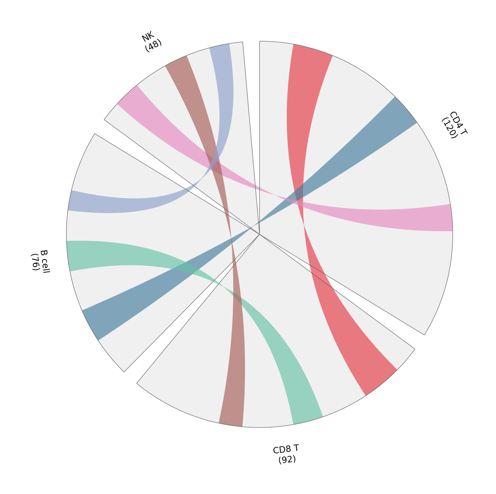

Circos 布局把扇区排列在圆周上；弦图用弧带连接扇区，弧带宽度编码流量大小。在生物医学研究中，它们把细胞类型间基因共享、队列重叠或基因组重排浓缩进一张密而可读的图。`pyCirclize` 从扇区字典加连接元组构建两者——同一 API 也驱动基因组特征轨道。

## 示例

{fig-align="center" width="80%"}

## 环境配置

- 系统要求：跨平台（Linux/MacOS/Windows）
- 编程语言：**Python**
- 依赖包：`matplotlib`、`numpy`、`pyCirclize`

```{python}
#| label: packages-setup
#| output: false
import matplotlib.pyplot as plt
import numpy as np
from pycirclize import Circos
```

## 数据准备

我们统计四种免疫细胞类型之间标志基因的共享情况：每个扇区大小为该细胞类型的标志基因数，每条弧带宽度为共享的标志基因数。

```{python}
#| label: data-prep
marker_counts = {'CD4 T': 120, 'CD8 T': 92, 'B cell': 76, 'NK': 48}
shared = [
    (('CD4 T', 10, 22), ('CD8 T', 8, 20)),     # 共享 12 个标志基因
    (('CD4 T', 44, 54), ('B cell', 12, 22)),   # 共享 10 个
    (('CD8 T', 34, 43), ('B cell', 34, 43)),   # 共享 9 个
    (('CD4 T', 80, 88), ('NK', 6, 14)),        # 共享 8 个
    (('CD8 T', 58, 65), ('NK', 24, 31)),       # 共享 7 个
    (('B cell', 52, 58), ('NK', 38, 44)),      # 共享 6 个
]
link_colors = ['#e63946', '#457b9d', '#66c2a5', '#e78ac3', '#a65d57', '#8da0cb']
```

## 可视化

### 标志基因共享弦图

扇区大小表示各细胞类型贡献的标志基因数；弧带宽度与颜色表示两两共享——颜色务必配图例，仅靠弧的几何形状难以阅读。

```{python}
#| label: fig-py-circos-chord
#| fig-cap: "三种免疫细胞类型标志基因共享的弦图"
#| width: 62%
#| fig-align: center
circos = Circos(marker_counts, space=5)
for sector in circos.sectors:
    sector.axis(fc='#f0f0f0', ec='0.4', lw=0.6)
    sector.text(f'{sector.name}\n({sector.size})', r=110, size=11)
for (src, dst), color in zip(shared, link_colors):
    circos.link(src, dst, color=color, alpha=0.65)

fig = circos.plotfig()
plt.tight_layout()
plt.show()
```

### 基因组风格布局的扇区轨道

同一扇区框架也可承载堆叠轨道（热图、柱、点）——这里用一条简单柱轨道展示各细胞类型扇区内的标志基因密度。

```{python}
#| label: fig-py-circos-tracks
#| fig-cap: "带逐扇区柱轨道的 Circos 扇区"
#| width: 62%
#| fig-align: center
rng = np.random.default_rng(191)
bar_values = {name: rng.integers(20, 100, 8) for name in marker_counts}

circos = Circos(marker_counts, space=5)
for sector in circos.sectors:
    sector.axis(fc='#f7f7f7', ec='0.4', lw=0.6)
    sector.text(f'{sector.name} ({sector.size})', r=118, size=11)
    track = sector.add_track((78, 96))
    track.axis(fc='#efefef')
    positions = np.linspace(sector.start + 1, sector.end - 1, 8)
    track.bar(positions, bar_values[sector.name],
              width=positions[1] - positions[0] * 0.7, color='#8da0cb')

fig = circos.plotfig()
plt.tight_layout()
plt.show()
```

## 参考文献

1. Moshi4. pyCirclize: Circular visualization in Python. https://github.com/moshi4/pyCirclize
2. Krzywinski, M., et al. (2009). Circos: An Information Aesthetic for Comparative Genomics. *Genome Research*, 19(9), 1639-1645.
