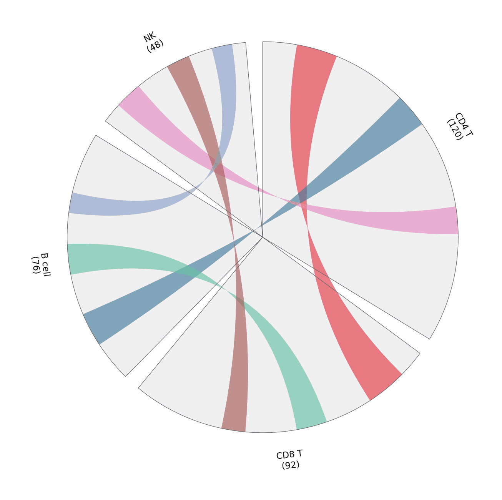

Circos 布局把扇区排列在圆周上；弦图用弧带连接扇区，弧带宽度编码流量大小。在生物医学研究中，它们把细胞类型间基因共享、队列重叠或基因组重排浓缩进一张密而可读的图。`pyCirclize` 从扇区字典加连接元组构建两者——同一 API 也驱动基因组特征轨道。

## 示例

{fig-align="center" width="80%"}

## 环境配置

- 系统要求：跨平台（Linux/MacOS/Windows）
- 编程语言：**Python**
- 依赖包：`matplotlib`、`numpy`、`pyCirclize`

```{python}
#| label: packages-setup
#| output: false
import matplotlib.pyplot as plt
import numpy as np
from matplotlib.patches import Patch
from pycirclize import Circos
```

## 数据准备

我们统计四种免疫细胞类型之间标志基因的共享情况：每个扇区大小为该细胞类型的标志基因数，每条弧带宽度为共享的标志基因数。

```{python}
#| label: data-prep
marker_counts = {'CD4 T': 120, 'CD8 T': 92, 'B cell': 76, 'NK': 48}
shared = [
    (('CD4 T', 10, 22), ('CD8 T', 8, 20)),     # 共享 12 个标志基因
    (('CD4 T', 44, 54), ('B cell', 12, 22)),   # 共享 10 个
    (('CD8 T', 34, 43), ('B cell', 34, 43)),   # 共享 9 个
    (('CD4 T', 80, 88), ('NK', 6, 14)),        # 共享 8 个
    (('CD8 T', 58, 65), ('NK', 24, 31)),       # 共享 7 个
    (('B cell', 52, 58), ('NK', 38, 44)),      # 共享 6 个
]
link_colors = ['#e63946', '#457b9d', '#66c2a5', '#e78ac3', '#a65d57', '#8da0cb']
```

## 可视化

### 标志基因共享弦图

扇区大小表示各细胞类型贡献的标志基因数；弧带宽度与颜色表示两两共享——颜色务必配图例，仅靠弧的几何形状难以阅读。

```{python}
#| label: fig-py-circos-chord
#| fig-cap: "三种免疫细胞类型标志基因共享的弦图"
#| width: 62%
#| fig-align: center
circos = Circos(marker_counts, space=5)
for sector in circos.sectors:
    sector.axis(fc='#f0f0f0', ec='0.4', lw=0.6)
    sector.text(f'{sector.name}\n({sector.size})', r=110, size=11)
for (src, dst), color in zip(shared, link_colors):
    circos.link(src, dst, color=color, alpha=0.65)

fig = circos.plotfig()
plt.tight_layout()
plt.show()
```

### 基因组风格布局的扇区轨道

同一扇区框架也可承载堆叠轨道（热图、柱、点）——这里用一条简单柱轨道展示各细胞类型扇区内的标志基因密度。

```{python}
#| label: fig-py-circos-tracks
#| fig-cap: "带逐扇区柱轨道的 Circos 扇区"
#| width: 62%
#| fig-align: center
rng = np.random.default_rng(191)
bar_values = {name: rng.integers(20, 100, 8) for name in marker_counts}

circos = Circos(marker_counts, space=5)
for sector in circos.sectors:
    sector.axis(fc='#f7f7f7', ec='0.4', lw=0.6)
    sector.text(f'{sector.name} ({sector.size})', r=118, size=11)
    track = sector.add_track((78, 96))
    track.axis(fc='#efefef')
    positions = np.linspace(sector.start + 1, sector.end - 1, 8)
    track.bar(positions, bar_values[sector.name],
              width=positions[1] - positions[0] * 0.7, color='#8da0cb')

fig = circos.plotfig()
plt.tight_layout()
plt.show()
```

### 基因与组成轨道的基因组图

紧凑的细菌基因组视图把四层信息收进一个圆环：两条半径上的箭头分别编码正链与负链基因，折线表示 GC 含量，填充带表示围绕零基线的 GC skew。把刻度环放在最外层，无需额外坐标轴即可读出位置。

```{python}
#| label: fig-py-circos-genome-tracks
#| fig-cap: "Genome map of a 50 kb contig with strand-specific genes, GC content, and GC skew"
#| width: 66%
#| fig-align: center
rng = np.random.default_rng(43523)
genome_size = 50_000


def make_genes(n, strand):
    starts = np.sort(rng.integers(200, genome_size - 1200, n))
    return [(int(s), int(s + rng.integers(300, 900)), strand) for s in starts]


fwd = make_genes(34, "+")
rev = make_genes(22, "-")

win = np.arange(0, genome_size, 1000)
gc = 0.48 + 0.10 * np.exp(-((win - 34000) ** 2) / (2 * 4000 ** 2))
gc = gc + rng.normal(0, 0.012, len(win))
skew = 0.06 * np.sin(win / 7000) + rng.normal(0, 0.01, len(win))

circos = Circos({"genome": genome_size}, space=2)
sector = circos.sectors[0]

scale = sector.add_track((98, 100))
scale.axis(fc="white", ec="none")
scale.xticks_by_interval(5000, label_size=7, label_margin=1,
                         show_endlabel=False,
                         label_formatter=lambda v: f"{v / 1000:.0f} kb")

fwd_tr = sector.add_track((89, 96))
for s, e, _ in fwd:
    fwd_tr.arrow(s, e, r_lim=(89, 96), color="#4c72b0", ec="none",
                 head_length=120)
rev_tr = sector.add_track((81, 88))
for s, e, _ in rev:
    rev_tr.arrow(e, s, r_lim=(81, 88), color="#dd8452", ec="none",
                 head_length=120)

gc_tr = sector.add_track((68, 77))
gc_tr.axis(fc="#eef4fa", ec="#c6dbef", lw=0.4)
gc_tr.line(win + 500, gc, vmin=0.30, vmax=0.62, color="#2c7bb6", lw=1.0)

sk_tr = sector.add_track((56, 65))
sk_tr.axis(fc="#fdf0f0", ec="#f4c2c2", lw=0.4)
sk_tr.fill_between(win + 500, skew, 0, vmin=-0.12, vmax=0.12,
                   color="#c44e52", alpha=0.7)

sector.text("50 kb genome", r=48, size=11, fontweight="bold")
circos.text("GC content", r=108, deg=60, size=8, color="#2c7bb6")
circos.text("GC skew", r=108, deg=290, size=8, color="#c44e52")

fig = circos.plotfig()
fig.legend(handles=[Patch(fc="#4c72b0", label="forward strand"),
                    Patch(fc="#dd8452", label="reverse strand")],
           loc="lower left", frameon=False, fontsize=8, handlelength=1.2)
plt.tight_layout()
plt.show()
```

### 三个基因组的共线性环图

比较基因组学中，同一引擎把每个基因组画成一个外侧扇区，并将直系同源区块通过中心连接。这里 G2 的区块 D 发生倒位（标为 `D*`，红色虚线弧带），G3 丢失了区块 E，因此保守共线性与重排可以一眼区分。

有两条对齐规则决定了这个环是否可读，写进图注是必要的。第一，每个扇区都从 12 点方向起、顺时针展开，因此各基因组的区块 A 都从同一角度开始；扇区尺寸**不**与基因组长度等比，区块弧长按区块自身长度绘制，而不是共享同一绝对标尺。第二，坐标**按基因组归一化**——每个基因组的区块首尾相接再缩放填满自己的扇区——所以读者可以比较基因组间区块的顺序与方向，但不能把跨基因组的弧长读成绝对碱基距离。同一基因组内部，弧长之间是可以相互比较的。

```{python}
#| label: fig-py-circos-multi-genome
#| fig-cap: "Three-genome synteny rings; block D is inverted in G2 (D*) and block E is absent from G3"
#| width: 66%
#| fig-align: center
blocks = ["A", "B", "C", "D", "E", "F", "G"]
blen = dict(A=120, B=85, C=60, D=95, E=45, F=70, G=55)
bcol = dict(A="#4c78a8", B="#59a14f", C="#b07aa1", D="#f2a93b",
            E="#76b7b2", F="#edc948", G="#8c6d31")
orders = {
    "G1": [("A", "+"), ("B", "+"), ("C", "+"), ("D", "+"),
           ("E", "+"), ("F", "+"), ("G", "+")],
    "G2": [("A", "+"), ("B", "+"), ("C", "+"), ("D", "-"),
           ("E", "+"), ("F", "+"), ("G", "+")],
    "G3": [("A", "+"), ("B", "+"), ("C", "+"), ("D", "+"),
           ("F", "+"), ("G", "+")],
}
sizes = {g: sum(blen[b] for b, _ in o) for g, o in orders.items()}
gnames = {"G1": "G1 (reference)", "G2": "G2 (D inverted)",
          "G3": "G3 (E deleted)"}

circos = Circos(sizes, space=6)
pos = {}
for g, order in orders.items():
    sector = circos.get_sector(g)
    track = sector.add_track((78, 100))
    track.axis(fc="#f7f7f7", ec="#999999", lw=0.4)
    offset = 0
    pos[g] = {}
    for block, orient in order:
        start, end = offset, offset + blen[block]
        track.rect(start, end, r_lim=(78, 100), color=bcol[block],
                   ec="white", lw=1.0, alpha=0.85)
        label = block + ("*" if orient == "-" else "")
        track.text(label, (start + end) / 2, r=89, size=7,
                   color="black", fontweight="bold")
        pos[g][block] = (start, end, orient)
        offset = end
    sector.text(gnames[g], r=112, size=10, fontweight="bold")

for block in blocks:
    if block in pos["G1"] and block in pos["G2"]:
        s1, e1, o1 = pos["G1"][block]
        s2, e2, o2 = pos["G2"][block]
        inverted = o1 != o2
        circos.link(("G1", s1, e1), ("G2", s2, e2),
                    color="#d62728" if inverted else bcol[block],
                    alpha=0.55 if inverted else 0.28, height_ratio=0.45,
                    ec="#d62728" if inverted else "none",
                    lw=0.8 if inverted else 0, ls="--" if inverted else "-")

for block in blocks:
    if block in pos["G2"] and block in pos["G3"]:
        s1, e1, _ = pos["G2"][block]
        s2, e2, _ = pos["G3"][block]
        circos.link(("G2", s1, e1), ("G3", s2, e2), color=bcol[block],
                    alpha=0.22, height_ratio=0.45)

fig = circos.plotfig()
fig.legend(handles=[Patch(fc="#9e9e9e", alpha=0.45, label="collinear block"),
                    Patch(fc="#d62728", alpha=0.55, ec="#d62728", ls="--",
                          label="inverted block")],
           loc="lower left", frameon=False, fontsize=8, handlelength=1.2)
plt.tight_layout()
plt.show()
```

## 关于本页跳过的实现

本页刻意只用基础图形自行绘制。在 issue-435 清单中归到 Python/CircosPlot 的工具里，有 5 条被标记为**跳过**，仅作为版式参考、不作为依赖：其中 3 条超过 5 年无运维更新（截止日 2021-11-07），2 条依赖闭包过重，不值得为一张静态图引入。沿用这些工具，等于锁定已废弃的代码；安装另一批，则要把整套分析框架拖进文档构建。本页先把这些工具的图形约定读懂，再自行重画，以便逐行核验每个面板。

| 工具 | 最近提交 | 状态 | 跳过原因 |
| --- | --- | --- | --- |
| circularMT | 2026-07-15 | 依赖过重 | 框架级依赖闭包过重，不值得为一张静态图引入 |
| DNAPlotLib | 2024-03-20 | 依赖过重 | 框架级依赖闭包过重，不值得为一张静态图引入 |
| cgplot | 2019-05-19 | 陈旧 | 超过 5 年无运维更新 |
| Cvit.js | 2021-01-15 | 陈旧 | 超过 5 年无运维更新 |
| GenomeProjector | 2020-09-28 | 陈旧 | 超过 5 年无运维更新 |

## 参考文献

1. Moshi4. pyCirclize: Circular visualization in Python. https://github.com/moshi4/pyCirclize
2. Krzywinski, M., et al. (2009). Circos: An Information Aesthetic for Comparative Genomics. *Genome Research*, 19(9), 1639-1645.
