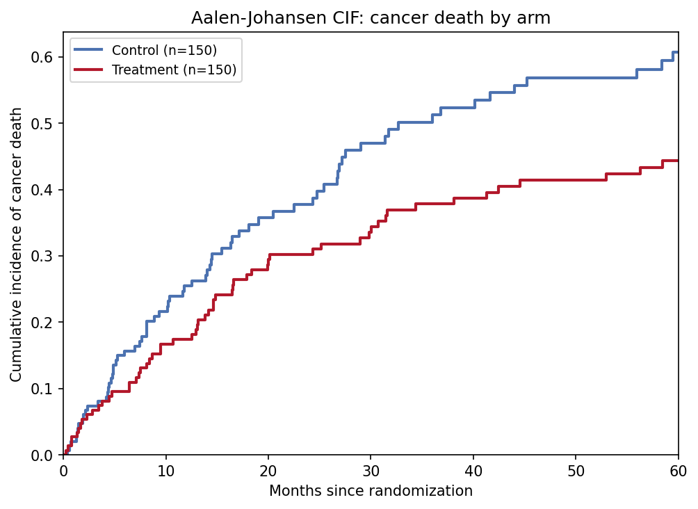
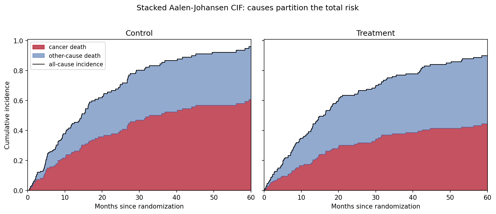

The Python counterpart of [Competing Risk Plot](../Clinics/CompetingRiskPlot.html) — when a subject can fail from more than one event type and one prevents the other (cancer death vs other-cause death, local vs distant recurrence), the probability of failing from cause $k$ by time $t$ is the **cumulative incidence function** (CIF), estimated by the Aalen-Johansen estimator \[1\]. In oncology and cardiology studies this is the correct endpoint summary whenever competing events carry a non-trivial share of subjects.

`lifelines` has no competing-risk estimator \[2\] and `scikit-survival` is a heavy CI dependency, so this tutorial implements the Aalen-Johansen estimator from scratch in ~20 lines of numpy — fully transparent and testable (its causes must sum to $1 - \hat{S}(t)$, the all-cause KM). Gray's test \[3\] compares CIF curves between arms; it is available in R `cmprsk` and `scikit-survival` and is the standard inference companion for the plot below.

This tutorial covers two workflows:

1. Aalen-Johansen CIF of cancer death by treatment arm;
2. The classic pitfall panel: naive 1-KM vs Aalen-Johansen.

## Example

{fig-align="center" width="70%"}

## Setup

- System Requirements: Cross-platform (Linux/MacOS/Windows)
- Programming Language: **Python**
- Dependencies: `numpy`, `pandas`, `matplotlib`

```{python}
#| label: packages-setup
#| output: false
import matplotlib.pyplot as plt
import numpy as np
import pandas as pd
```

## Data Preparation

We simulate a two-arm cohort (n = 150 per arm): time to cancer death, other-cause death, loss to follow-up, and administrative censoring at 60 months, whichever comes first (`cause` 1/2/0). The treatment arm halves the cancer-death hazard while other-cause death is unchanged — the setup Gray's test targets.

```{python}
#| label: data-prep
rng = np.random.default_rng(9)
n_per_arm = 150
arm = np.repeat(["Control", "Treatment"], n_per_arm)

def simulate_arm(n, lam_cancer, lam_other, lam_cens, horizon):
    t_cancer = rng.exponential(1 / lam_cancer, n)
    t_other = rng.exponential(1 / lam_other, n)
    t_censor = rng.exponential(1 / lam_cens, n)
    t_admin = np.full(n, horizon)
    time = np.minimum.reduce([t_cancer, t_other, t_censor, t_admin])
    cause = np.where(time == t_cancer, 1,
             np.where(time == t_other, 2, 0))   # 0 = censored
    return time, cause

t_ctl, c_ctl = simulate_arm(n_per_arm, 0.030, 0.020, 0.012, 60)
t_trt, c_trt = simulate_arm(n_per_arm, 0.018, 0.020, 0.012, 60)
cr = pd.DataFrame({"time": np.concatenate([t_ctl, t_trt]),
                   "cause": np.concatenate([c_ctl, c_trt]),
                   "arm": arm})

def aalen_johansen(time, cause, max_cause=2):
    """Aalen-Johansen CIF per cause. Invariant: sum_k CIF_k = 1 - KM."""
    utime = np.unique(time[time > 0])
    at_risk = np.array([(time >= t).sum() for t in utime], dtype=float)
    d_all = np.array([((time == t) & (cause > 0)).sum() for t in utime],
                     dtype=float)
    surv_prev = surv = 1.0
    cif = {k: np.zeros(len(utime)) for k in range(1, max_cause + 1)}
    for i in range(len(utime)):
        if at_risk[i] == 0:
            continue
        if d_all[i] > 0:                  # all-cause KM step
            surv_prev = surv
            surv *= 1 - d_all[i] / at_risk[i]
        for k in range(1, max_cause + 1):
            d_k = ((time == utime[i]) & (cause == k)).sum()
            if d_k:                        # jump: S(t-) * hazard of cause k
                cif[k][i:] += surv_prev * d_k / at_risk[i]
    return utime, cif

res = {a: aalen_johansen(g.time.values, g.cause.values)
       for a, g in cr.groupby("arm")}
```

## Visualization

### 1. CIF by Treatment Arm

```{python}
#| label: fig-py-cr-aj
#| fig-cap: "Aalen-Johansen cumulative incidence of cancer death by arm: the treatment curve flattens near 44% versus 61% in the control arm as other-cause deaths absorb subjects."
#| fig-align: center

colors = {"Control": "#4C72B0", "Treatment": "#B2182B"}
fig, ax = plt.subplots(figsize=(6.8, 5))
for a in ["Control", "Treatment"]:
    utime, cif = res[a]
    ax.step(utime, cif[1], where="post", color=colors[a], lw=2,
            label=f"{a} (n={(cr.arm == a).sum()})")
ax.set_xlim(0, 60); ax.set_ylim(0, None)
ax.set_xlabel("Months since randomization")
ax.set_ylabel("Cumulative incidence of cancer death")
ax.legend(fontsize=9)
ax.set_title("Aalen-Johansen CIF: cancer death by arm")
fig.tight_layout()
plt.show()
```

### 2. Why 1-KM Overestimates

```{python}
#| label: fig-py-cr-wrongkm
#| fig-cap: "Control arm: the naive 1-KM (dashed) treats other-cause deaths as censored and overstates cancer-death risk by ~30 percentage points at 5 years; the all-cause 1-KM (dotted) is higher still; the Aalen-Johansen CIF (solid) is the interpretable curve."
#| fig-align: center

def one_minus_km(time, event_flag):
    utime = np.unique(time[event_flag])
    surv, out_t, out_s = 1.0, [0.0], [1.0]
    for t in utime:
        y = (time >= t).sum()
        d = ((time == t) & event_flag).sum()
        if d:
            surv *= 1 - d / y
        out_t.append(t); out_s.append(surv)
    return np.array(out_t), 1 - np.array(out_s)

utime, cif = res["Control"]
t1, s1 = one_minus_km(cr[cr.arm == "Control"].time.values,
                      (cr[cr.arm == "Control"].cause == 1).values)

fig, ax = plt.subplots(figsize=(6.8, 5))
ax.step(utime, cif[1], where="post", color="#1B7837", lw=2.2,
        label="Aalen-Johansen CIF (correct)")
ax.step(t1, s1, where="post", color="#B2182B", lw=2, ls="--",
        label="1 - KM, competing events censored (overestimates)")
t2, s2 = one_minus_km(cr[cr.arm == "Control"].time.values,
                      (cr[cr.arm == "Control"].cause != 0).values)
ax.step(t2, s2, where="post", color="#7f7f7f", lw=1.6, ls=":",
        label="1 - KM (all-cause, not cause-specific)")
gap = s1[-1] - np.interp(t1[-1], utime, cif[1])
ax.annotate(f"overestimation\nat {t1[-1]:.0f} mo: {gap * 100:.1f} pp",
            xy=(t1[-1], s1[-1]), xytext=(-120, -30),
            textcoords="offset points", fontsize=9,
            arrowprops=dict(arrowstyle="->"))
ax.set_xlim(0, 60); ax.set_ylim(0, None)
ax.set_xlabel("Months since randomization")
ax.set_ylabel("Incidence of cancer death")
ax.legend(fontsize=9, loc="upper left")
ax.set_title("Why 1-KM overestimates under competing risks (Control arm)")
fig.tight_layout()
plt.show()
```

::: callout-tip
## Practice tips

-   Report CIFs, not 1-KM, whenever competing events exceed a few percent of subjects — the gap grows with the competing-event rate.
-   Sanity-check any hand-rolled or borrowed AJ code with the identity $\sum_k \mathrm{CIF}_k(t) = 1 - \hat{S}(t)$; it must hold exactly at every $t$.
-   Use Gray's test \[3\] for the between-arm comparison of a cause-specific CIF — the log-rank test answers a different (censoring-assuming) question.
-   Distinguish cause-specific hazards (model each cause with the rest censored) from subdistribution hazards (Fine-Gray): they answer different clinical questions and can disagree in direction.
-   Show both causes stacked (Application panel) so readers see that one cause's risk falls because the other absorbs the risk set.
:::

## Application

The stacked panel makes the accounting explicit: cancer death (red) plus other-cause death (blue) equals the all-cause incidence (black line) at every time point. Treatment shifts the partition — less cancer death, relatively more other-cause death — without changing the total much, a reading invisible to any single-cause summary.

{fig-align="center" width="85%"}

## Reference

\[1\] Aalen O. Nonparametric inference for a family of counting processes. Ann Stat. 1978;6(4):701-726. doi:10.1214/aos/1176344248

\[2\] Davidson-Pilon C. lifelines: survival analysis in Python. J Open Source Softw. 2019;4(40):1317. doi:10.21105/joss.01317

\[3\] Gray RJ. A class of K-sample tests for comparing the cumulative incidence of a competing risk. Ann Stat. 1988;16(3):1141-1154. doi:10.1214/aos/1176350951
