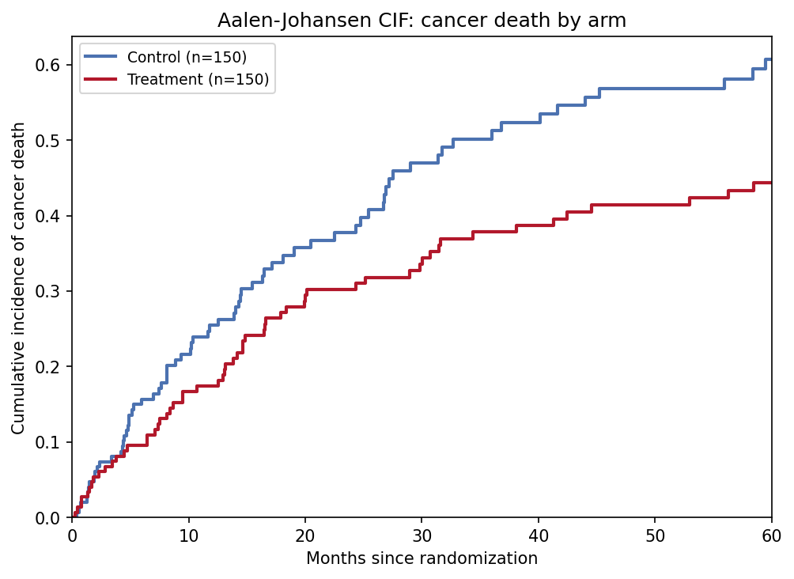
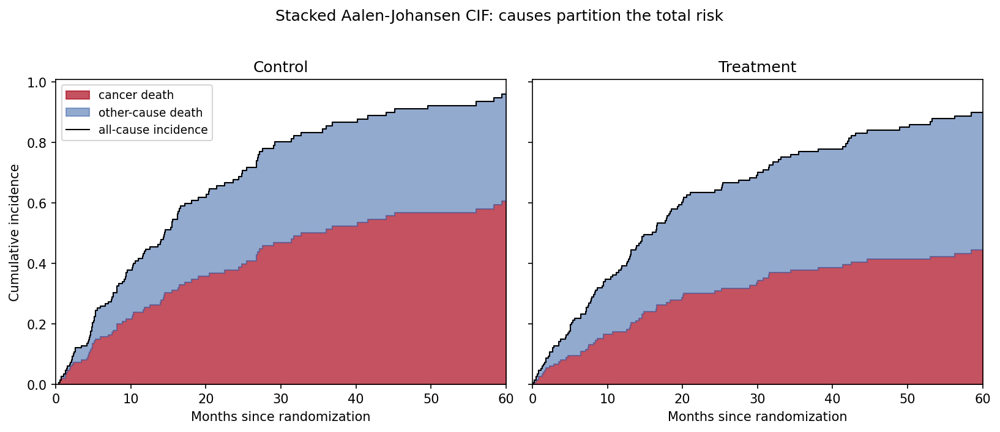

[竞争风险图](../zh/Clinics/CompetingRiskPlot.html)的 Python 对应版本——当受试者可能发生多种互斥事件（癌症死亡 vs 其他原因死亡、局部复发 vs 远处复发）时，到时刻 $t$ 因原因 $k$ 失效的概率是**累积发生函数**（CIF），由 Aalen-Johansen 估计量估计 \[1\]。在肿瘤学与心脏病学研究中，只要竞争事件占据不可忽略的比例，这就是正确的终点汇总方式。

`lifelines` 没有竞争风险估计器 \[2\]，`scikit-survival` 的 CI 依赖较重，因此本教程用约 20 行 numpy 从零实现 Aalen-Johansen 估计量——完全透明且可检验（各原因 CIF 之和必须等于全因 KM 的 $1 - \hat{S}(t)$）。Gray 检验 \[3\] 比较两组间的 CIF 曲线，可在 R `cmprsk` 与 `scikit-survival` 中获得，是下图的推断标配。

本教程涵盖两种工作流：

1. 按治疗臂分组绘制癌症死亡的 Aalen-Johansen CIF；
2. 经典陷阱面板：朴素 1-KM 与 Aalen-Johansen 对比。

## Example

{fig-align="center" width="70%"}

## Setup

- 系统要求：跨平台（Linux/MacOS/Windows）
- 编程语言：**Python**
- 依赖包：`numpy`、`pandas`、`matplotlib`

```{python}
#| label: packages-setup
#| output: false
import matplotlib.pyplot as plt
import numpy as np
import pandas as pd
```

## Data Preparation

我们模拟一个两臂队列（每臂 n = 150）：分别生成癌症死亡、其他原因死亡、失访与 60 个月管理性删失的时间，取最先发生者（`cause` 为 1/2/0）。治疗臂把癌症死亡风险减半而其他原因死亡不变——这正是 Gray 检验针对的场景。

```{python}
#| label: data-prep
rng = np.random.default_rng(9)
n_per_arm = 150
arm = np.repeat(["Control", "Treatment"], n_per_arm)

def simulate_arm(n, lam_cancer, lam_other, lam_cens, horizon):
    t_cancer = rng.exponential(1 / lam_cancer, n)
    t_other = rng.exponential(1 / lam_other, n)
    t_censor = rng.exponential(1 / lam_cens, n)
    t_admin = np.full(n, horizon)
    time = np.minimum.reduce([t_cancer, t_other, t_censor, t_admin])
    cause = np.where(time == t_cancer, 1,
             np.where(time == t_other, 2, 0))   # 0 = 删失
    return time, cause

t_ctl, c_ctl = simulate_arm(n_per_arm, 0.030, 0.020, 0.012, 60)
t_trt, c_trt = simulate_arm(n_per_arm, 0.018, 0.020, 0.012, 60)
cr = pd.DataFrame({"time": np.concatenate([t_ctl, t_trt]),
                   "cause": np.concatenate([c_ctl, c_trt]),
                   "arm": arm})

def aalen_johansen(time, cause, max_cause=2):
    """各原因的 Aalen-Johansen CIF。恒等式：sum_k CIF_k = 1 - KM。"""
    utime = np.unique(time[time > 0])
    at_risk = np.array([(time >= t).sum() for t in utime], dtype=float)
    d_all = np.array([((time == t) & (cause > 0)).sum() for t in utime],
                     dtype=float)
    surv_prev = surv = 1.0
    cif = {k: np.zeros(len(utime)) for k in range(1, max_cause + 1)}
    for i in range(len(utime)):
        if at_risk[i] == 0:
            continue
        if d_all[i] > 0:                  # 全因 KM 下降
            surv_prev = surv
            surv *= 1 - d_all[i] / at_risk[i]
        for k in range(1, max_cause + 1):
            d_k = ((time == utime[i]) & (cause == k)).sum()
            if d_k:                        # 跳跃：S(t-) × 原因 k 风险
                cif[k][i:] += surv_prev * d_k / at_risk[i]
    return utime, cif

res = {a: aalen_johansen(g.time.values, g.cause.values)
       for a, g in cr.groupby("arm")}
```

## Visualization

### 1. 分臂 CIF 曲线

```{python}
#| label: fig-py-cr-aj
#| fig-cap: "癌症死亡的 Aalen-Johansen 累积发生曲线：治疗臂在约 44% 处趋平，而对照臂升至 61%，其余受试者被其他原因死亡吸收。"
#| fig-align: center

colors = {"Control": "#4C72B0", "Treatment": "#B2182B"}
fig, ax = plt.subplots(figsize=(6.8, 5))
for a in ["Control", "Treatment"]:
    utime, cif = res[a]
    ax.step(utime, cif[1], where="post", color=colors[a], lw=2,
            label=f"{a} (n={(cr.arm == a).sum()})")
ax.set_xlim(0, 60); ax.set_ylim(0, None)
ax.set_xlabel("Months since randomization")
ax.set_ylabel("Cumulative incidence of cancer death")
ax.legend(fontsize=9)
ax.set_title("Aalen-Johansen CIF: cancer death by arm")
fig.tight_layout()
plt.show()
```

### 2. 为什么 1-KM 会高估

```{python}
#| label: fig-py-cr-wrongkm
#| fig-cap: "对照臂：朴素 1-KM（虚线）把其他原因死亡当作删失，5 年癌症死亡风险被高估约 30 个百分点；全因 1-KM（点线）更高；Aalen-Johansen CIF（实线）才是可解释的曲线。"
#| fig-align: center

def one_minus_km(time, event_flag):
    utime = np.unique(time[event_flag])
    surv, out_t, out_s = 1.0, [0.0], [1.0]
    for t in utime:
        y = (time >= t).sum()
        d = ((time == t) & event_flag).sum()
        if d:
            surv *= 1 - d / y
        out_t.append(t); out_s.append(surv)
    return np.array(out_t), 1 - np.array(out_s)

utime, cif = res["Control"]
t1, s1 = one_minus_km(cr[cr.arm == "Control"].time.values,
                      (cr[cr.arm == "Control"].cause == 1).values)

fig, ax = plt.subplots(figsize=(6.8, 5))
ax.step(utime, cif[1], where="post", color="#1B7837", lw=2.2,
        label="Aalen-Johansen CIF (correct)")
ax.step(t1, s1, where="post", color="#B2182B", lw=2, ls="--",
        label="1 - KM, competing events censored (overestimates)")
t2, s2 = one_minus_km(cr[cr.arm == "Control"].time.values,
                      (cr[cr.arm == "Control"].cause != 0).values)
ax.step(t2, s2, where="post", color="#7f7f7f", lw=1.6, ls=":",
        label="1 - KM (all-cause, not cause-specific)")
gap = s1[-1] - np.interp(t1[-1], utime, cif[1])
ax.annotate(f"overestimation\nat {t1[-1]:.0f} mo: {gap * 100:.1f} pp",
            xy=(t1[-1], s1[-1]), xytext=(-120, -30),
            textcoords="offset points", fontsize=9,
            arrowprops=dict(arrowstyle="->"))
ax.set_xlim(0, 60); ax.set_ylim(0, None)
ax.set_xlabel("Months since randomization")
ax.set_ylabel("Incidence of cancer death")
ax.legend(fontsize=9, loc="upper left")
ax.set_title("Why 1-KM overestimates under competing risks (Control arm)")
fig.tight_layout()
plt.show()
```

::: callout-tip
## 实践要点

-   只要竞争事件超过受试者的百分之几，就报告 CIF 而非 1-KM——竞争事件率越高，偏差越大。
-   用恒等式 $\sum_k \mathrm{CIF}_k(t) = 1 - \hat{S}(t)$ 检验任何手写或借用的 AJ 代码；它必须在每个 $t$ 精确成立。
-   组间比较某原因的 CIF 用 Gray 检验 \[3\]——log-rank 检验回答的是另一个（假设无竞争删失）的问题。
-   区分原因特异风险（把其余原因当删失分别建模）与子分布风险（Fine-Gray）：二者回答不同临床问题，方向甚至可能相反。
-   展示两原因堆叠（Application 面板），让读者看到某一原因风险下降是因为风险集被另一原因吸收。
:::

## Application

堆叠面板把"账目"摆明：癌症死亡（红）加其他原因死亡（蓝）在任意时刻都等于全因发生率（黑线）。治疗改变了划分——癌症死亡更少、其他原因死亡相对更多——而总量变化不大，任何单一原因的汇总图都读不出这一点。

{fig-align="center" width="85%"}

## Reference

\[1\] Aalen O. Nonparametric inference for a family of counting processes. Ann Stat. 1978;6(4):701-726. doi:10.1214/aos/1176344248

\[2\] Davidson-Pilon C. lifelines: survival analysis in Python. J Open Source Softw. 2019;4(40):1317. doi:10.21105/joss.01317

\[3\] Gray RJ. A class of K-sample tests for comparing the cumulative incidence of a competing risk. Ann Stat. 1988;16(3):1141-1154. doi:10.1214/aos/1176350951
