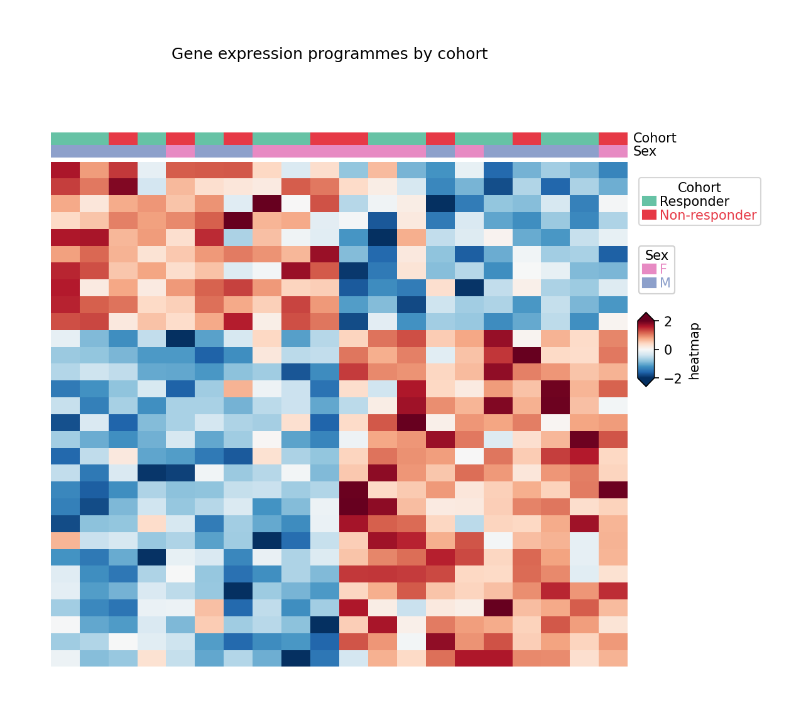

复杂热图对矩阵聚类并在旁堆叠注释层（队列、性别、亚型），把表达表变成一张自含的完整图形。`seaborn.clustermap` 覆盖基础；`PyComplexHeatmap` 提供组学论文常用的出版级注释系统——类别轨道、逐轨道图例与分割聚类。

## 示例

{fig-align="center" width="80%"}

## 环境配置

- 系统要求：跨平台（Linux/MacOS/Windows）
- 编程语言：**Python**
- 依赖包：`matplotlib`、`pandas`、`numpy`、`PyComplexHeatmap`

```{python}
#| label: packages-setup
#| output: false
import matplotlib.pyplot as plt
import pandas as pd
import numpy as np
from PyComplexHeatmap import ClusterMapPlotter, HeatmapAnnotation, anno_simple
```

## 数据准备

我们模拟一个 30 基因 × 20 样本的表达矩阵（两个表达程序 + 队列/性别样本注释），并按基因 z 标准化。

```{python}
#| label: data-prep
np.random.seed(181)

genes = [f'GENE{i:02d}' for i in range(1, 31)]
samples = [f'S{i:02d}' for i in range(1, 21)]
cohort = np.random.choice(['Responder', 'Non-responder'], 20, p=[0.5, 0.5])
sex = np.random.choice(['F', 'M'], 20)

prog1 = np.outer(np.r_[np.ones(10), np.zeros(20)],
                 np.r_[np.full(10, 1.4), np.zeros(10)])
prog2 = np.outer(np.r_[np.zeros(10), np.ones(20)],
                 np.r_[np.zeros(10), np.full(10, 1.2)])
expr = prog1 + prog2 + np.random.normal(0, 0.5, (30, 20))
expr = (expr - expr.mean(axis=1, keepdims=True)) / expr.std(axis=1, keepdims=True)

mat = pd.DataFrame(expr, index=genes, columns=samples)
col_meta = pd.DataFrame({'Cohort': cohort, 'Sex': sex}, index=samples)
```

## 可视化

### 带样本注释的聚类热图

`HeatmapAnnotation` 在矩阵上方堆叠类别轨道；`ClusterMapPlotter` 对行列聚类并自动生成逐轨道图例。注意 `anno_simple` 接收 pandas Series 而非裸数组。

```{python}
#| label: fig-py-cm-annotated
#| fig-cap: "带队列与性别注释的聚类表达热图"
#| width: 82%
#| fig-align: center
col_ha = HeatmapAnnotation(
    Cohort=anno_simple(col_meta.Cohort, colors={'Responder': '#66c2a5',
                                                'Non-responder': '#e63946'}),
    Sex=anno_simple(col_meta.Sex, colors={'F': '#e78ac3', 'M': '#8da0cb'}),
    axis=1, verbose=0)

plt.figure(figsize=(8, 6.5))
cm = ClusterMapPlotter(data=mat, top_annotation=col_ha,
                       col_cluster=True, row_cluster=True,
                       show_colnames=False, show_rownames=False,
                       cmap='RdBu_r', vmin=-2, vmax=2, center=0,
                       xticklabels=False, yticklabels=False,
                       rasterized=True, verbose=0)
plt.suptitle('Gene expression programmes by cohort', y=1.02, fontsize=12)
plt.show()
```

### 带基因行标签

30 行时用紧凑字号即可让每个基因名保持可读，两个表达程序以注释分隔的区块清晰可见。

```{python}
#| label: fig-py-cm-split
#| fig-cap: "带逐基因行标签的聚类热图"
#| width: 82%
#| fig-align: center
plt.figure(figsize=(8, 6.5))
cm = ClusterMapPlotter(data=mat, top_annotation=col_ha,
                       col_cluster=True, row_cluster=True,
                       show_colnames=False, show_rownames=True,
                       row_names_side='right',
                       yticklabels_kws=dict(labelsize=7),
                       cmap='RdBu_r', vmin=-2, vmax=2, center=0,
                       rasterized=True, verbose=0)
plt.show()
```

## 参考文献

1. Zhang, W. (2023). PyComplexHeatmap: A Python package to visualize complex heatmaps. https://ding-lab.github.io/PyComplexHeatmap/
2. Gu, Z., Eils, R., & Schlesner, M. (2016). Complex heatmaps reveal patterns and correlations in multidimensional genomic data. *Bioinformatics*, 32(18), 2847-2849.
