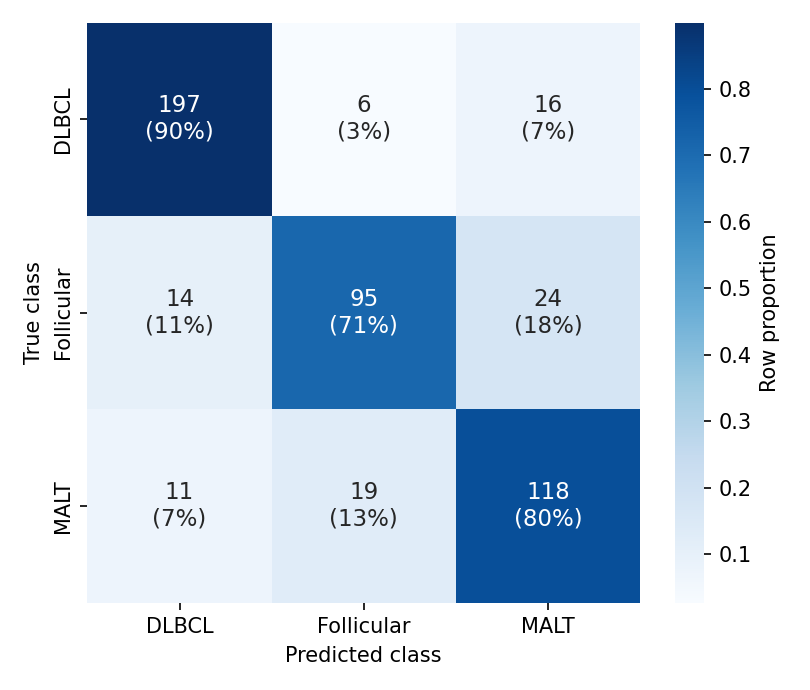

A confusion matrix cross-tabulates true against predicted classes, exposing which error direction a classifier makes — malignant-to-benign and benign-to-malignant are not equally costly. Row-normalizing makes per-class accuracy comparable under class imbalance, and annotating both counts and shares keeps the matrix auditable. `scikit-learn` computes it; `seaborn.heatmap` renders it.

## Example

{fig-align="center" width="80%"}

## Setup

- System Requirements: Cross-platform (Linux/MacOS/Windows)
- Programming Language: **Python**
- Dependencies: `matplotlib`, `seaborn`, `numpy`, `scikit-learn`

```{python}
#| label: packages-setup
#| output: false
import matplotlib.pyplot as plt
import seaborn as sns
import numpy as np
from sklearn.metrics import confusion_matrix
```

## Data Preparation

We simulate predictions of a three-class lymphoma classifier (500 validation cases) with realistic confusions: follicular lymphoma mistaken for MALT lymphoma more often than the reverse.

```{python}
#| label: data-prep
np.random.seed(171)

classes = ['DLBCL', 'Follicular', 'MALT']
truth = np.random.choice(classes, 500, p=[0.45, 0.30, 0.25])
pred = []
for t in truth:
    if t == 'DLBCL':
        pred.append(np.random.choice(classes, p=[0.90, 0.04, 0.06]))
    elif t == 'Follicular':
        pred.append(np.random.choice(classes, p=[0.08, 0.74, 0.18]))
    else:
        pred.append(np.random.choice(classes, p=[0.07, 0.10, 0.83]))
pred = np.array(pred)

cm = confusion_matrix(truth, pred, labels=classes)
cm_norm = cm / cm.sum(axis=1, keepdims=True)
```

## Visualization

### Annotated Count Matrix

Raw counts first — every downstream metric is reconstructible from them.

```{python}
#| label: fig-py-cm-counts
#| fig-cap: "Confusion matrix of the three-class lymphoma classifier (counts)"
#| width: 60%
#| fig-align: center
fig, ax = plt.subplots(figsize=(5.2, 4.4))
sns.heatmap(cm, annot=True, fmt='d', cmap='Blues', cbar=False,
            xticklabels=classes, yticklabels=classes, ax=ax,
            annot_kws=dict(fontsize=13))
ax.set_xlabel('Predicted class')
ax.set_ylabel('True class')
ax.tick_params(axis='x', rotation=0)
plt.tight_layout()
plt.show()
```

### Row-Normalized Matrix with Both Readings

One colour scale cannot serve counts and shares; annotate each cell with the count and its row share while colouring by the normalized value.

```{python}
#| label: fig-py-cm-normalized
#| fig-cap: "Row-normalized confusion matrix annotated with counts and shares"
#| width: 60%
#| fig-align: center
fig, ax = plt.subplots(figsize=(5.4, 4.6))
labels = np.array([[f'{c}\n({s:.0%})' for c, s in zip(row_c, row_n)]
                   for row_c, row_n in zip(cm, cm_norm)])
sns.heatmap(cm_norm, annot=labels, fmt='', cmap='Blues', cbar=True,
            cbar_kws=dict(label='Row proportion'),
            xticklabels=classes, yticklabels=classes, ax=ax,
            annot_kws=dict(fontsize=11))
ax.set_xlabel('Predicted class')
ax.set_ylabel('True class')
ax.tick_params(axis='x', rotation=0)
plt.tight_layout()
plt.show()
```

## References

1. Pedregosa, F., et al. (2011). Scikit-learn: Machine Learning in Python. *Journal of Machine Learning Research*, 12, 2825-2830.
2. Waskom, M. L. (2021). seaborn: statistical data visualization. *Journal of Open Source Software*, 6(60), 3021.
