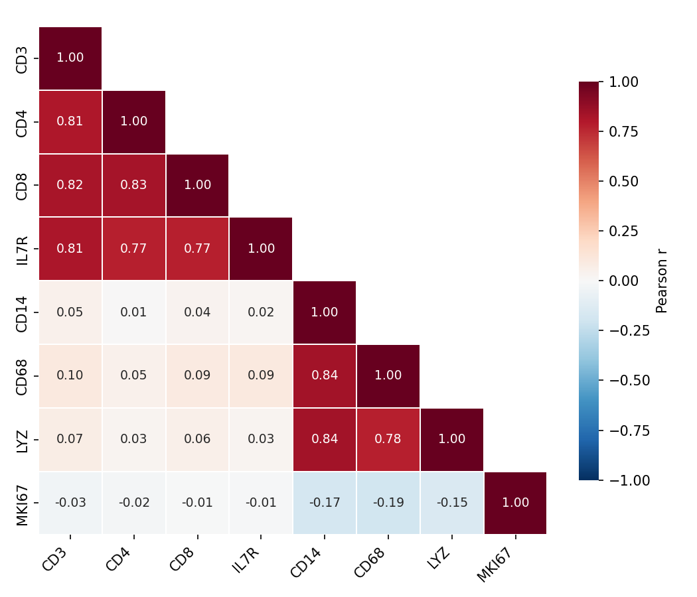

A correlogram (correlation matrix heatmap) encodes every pairwise correlation of a feature panel as a colored matrix cell, giving an instant read on co-expression blocks, redundant biomarkers, and clusters of related variables. In biomedical research it is routine QC for marker panels and omics features. `seaborn.heatmap` draws it; `clustermap` adds hierarchical ordering.

## Example

{fig-align="center" width="80%"}

## Setup

- System Requirements: Cross-platform (Linux/MacOS/Windows)
- Programming Language: **Python**
- Dependencies: `matplotlib`, `seaborn`, `pandas`, `numpy`

```{python}
#| label: packages-setup
#| output: false
import matplotlib.pyplot as plt
import seaborn as sns
import pandas as pd
import numpy as np
```

## Data Preparation

We simulate an 8-marker immune panel with two correlated blocks (T-cell markers and myeloid markers) plus a weakly related proliferation score.

```{python}
#| label: data-prep
np.random.seed(101)

n = 250
latent_t = np.random.normal(0, 1, n)
latent_m = np.random.normal(0, 1, n)
markers = pd.DataFrame({
    'CD3':  latent_t + np.random.normal(0, .4, n),
    'CD4':  latent_t + np.random.normal(0, .5, n),
    'CD8':  latent_t + np.random.normal(0, .5, n),
    'IL7R': latent_t + np.random.normal(0, .6, n),
    'CD14': latent_m + np.random.normal(0, .4, n),
    'CD68': latent_m + np.random.normal(0, .5, n),
    'LYZ':  latent_m + np.random.normal(0, .5, n),
    'MKI67': np.random.normal(0, 1, n),
})
corr = markers.corr()
```

## Visualization

### Masked Correlation Heatmap

A diverging colormap centred at zero and a mask over the mirrored upper triangle halve the ink and remove redundancy; annotate the coefficients when precision matters.

```{python}
#| label: fig-py-corr-masked
#| fig-cap: "Marker-panel correlogram (lower triangle, annotated coefficients)"
#| width: 78%
#| fig-align: center
mask = np.triu(np.ones_like(corr, dtype=bool), k=1)

fig, ax = plt.subplots(figsize=(7, 6))
sns.heatmap(corr, mask=mask, annot=True, fmt='.2f', ax=ax,
            cmap='RdBu_r', vmin=-1, vmax=1, center=0,
            square=True, linewidths=0.8, linecolor='white',
            annot_kws=dict(fontsize=9),
            cbar_kws=dict(shrink=0.75, label='Pearson r'))
ax.tick_params(axis='x', rotation=45)
for t in ax.get_xticklabels():
    t.set_ha('right')
plt.tight_layout()
plt.show()
```

### Cluster-Ordered Correlogram

`clustermap` reorders rows and columns by hierarchical clustering so correlated blocks become contiguous — the structure behind the panel becomes visible even without reading the numbers.

```{python}
#| label: fig-py-corr-cluster
#| fig-cap: "Cluster-ordered correlogram of the marker panel"
#| width: 80%
#| fig-align: center
g = sns.clustermap(corr, cmap='RdBu_r', vmin=-1, vmax=1, center=0,
                   figsize=(6.5, 6.5), linewidths=0.6, linecolor='white',
                   cbar_pos=(0.02, 0.83, 0.05, 0.16),
                   cbar_kws=dict(label='Pearson r'))
g.tick_params(axis='x', rotation=45)
g.tick_params(axis='y', rotation=0)
plt.show()
```

## References

1. Waskom, M. L. (2021). seaborn: statistical data visualization. *Journal of Open Source Software*, 6(60), 3021.
2. Hunter, J. D. (2007). Matplotlib: A 2D graphics environment. *Computing in Science & Engineering*, 9(3), 90-95.
