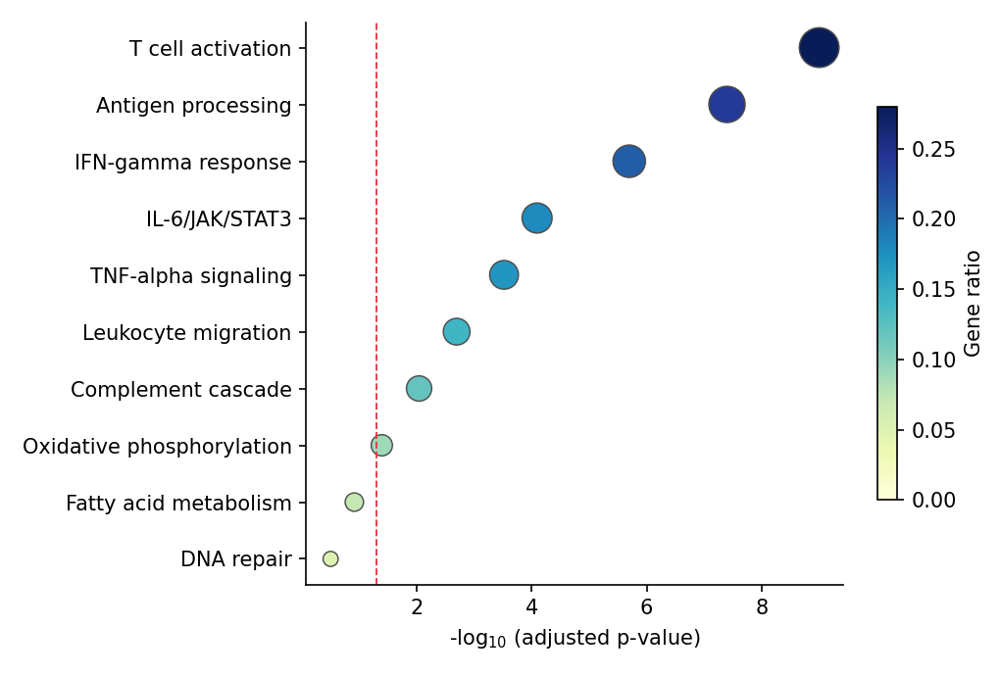

Enrichment results (GO/KEGG/reactome) are read through two standard displays: a ranked bar chart of −log10 adjusted p-values, and a dot plot that additionally encodes the gene ratio by dot size. Both are plain `matplotlib`/`seaborn` layers over the result table — the same recipe works on any tool's output (gseapy, clusterProfiler exports, ReactomePA).

## Example

{fig-align="center" width="80%"}

## Setup

- System Requirements: Cross-platform (Linux/MacOS/Windows)
- Programming Language: **Python**
- Dependencies: `matplotlib`, `seaborn`, `pandas`, `numpy`

```{python}
#| label: packages-setup
#| output: false
import matplotlib.pyplot as plt
import seaborn as sns
import pandas as pd
import numpy as np
```

## Data Preparation

We simulate a ten-term enrichment table: pathway names, gene counts, ratios and adjusted p-values, ordered by significance — the columns every enrichment tool exports.

```{python}
#| label: data-prep
enrich = pd.DataFrame({
    'Pathway': ['T cell activation', 'Antigen processing', 'IFN-gamma response',
                'IL-6/JAK/STAT3', 'TNF-alpha signaling', 'Leukocyte migration',
                'Complement cascade', 'Oxidative phosphorylation',
                'Fatty acid metabolism', 'DNA repair'],
    'Count': [42, 35, 28, 24, 22, 19, 17, 12, 9, 6],
    'GeneRatio': [0.28, 0.24, 0.21, 0.18, 0.17, 0.14, 0.12, 0.09, 0.07, 0.05],
    'padj': [1e-9, 4e-8, 2e-6, 8e-5, 3e-4, 2e-3, 9e-3, 0.04, 0.12, 0.31],
})
enrich['NegLogP'] = -np.log10(enrich.padj)
```

## Visualization

### Ranked Bar Chart

Horizontal bars sorted by −log10 padj with a significance threshold line; value labels make the figure self-contained.

```{python}
#| label: fig-py-enrich-bar
#| fig-cap: "Enriched pathways ranked by -log10 adjusted p-value"
#| width: 76%
#| fig-align: center
top = enrich.sort_values('NegLogP')

fig, ax = plt.subplots(figsize=(6.8, 4.4))
ax.barh(top.Pathway, top.NegLogP, color='#8da0cb',
        edgecolor='0.25', linewidth=0.6)
for y, v in enumerate(top.NegLogP):
    ax.text(v + 0.06, y, f'{v:.1f}', va='center', fontsize=8.5, color='0.25')
ax.axvline(-np.log10(0.05), color='#e63946', linewidth=0.9, linestyle='--')
ax.text(-np.log10(0.05) + 0.06, -0.55, 'padj = 0.05', fontsize=8.5,
        color='#e63946')
ax.set_xlabel('-log$_{10}$ (adjusted p-value)')
ax.spines[['top', 'right']].set_visible(False)
plt.tight_layout()
plt.show()
```

### Dot Plot with Gene Ratio

The dot plot adds a third variable: dot size for the gene count, colour for the ratio — the format popularized by clusterProfiler.

```{python}
#| label: fig-py-enrich-dot
#| fig-cap: "Enrichment dot plot: ratio by colour, count by size"
#| width: 74%
#| fig-align: center
top = enrich.sort_values('NegLogP')

fig, ax = plt.subplots(figsize=(6.8, 4.6))
sc = ax.scatter(top.NegLogP, top.Pathway, s=top.Count * 9,
                c=top.GeneRatio, cmap='YlGnBu', edgecolor='0.3',
                linewidth=0.7, vmin=0, vmax=top.GeneRatio.max())
cb = fig.colorbar(sc, ax=ax, shrink=0.7)
cb.set_label('Gene ratio')
ax.axvline(-np.log10(0.05), color='#e63946', linewidth=0.9, linestyle='--')
ax.set_xlabel('-log$_{10}$ (adjusted p-value)')
ax.spines[['top', 'right']].set_visible(False)
plt.tight_layout()
plt.show()
```

## References

1. Yu, G., Wang, L. G., Han, Y., & He, Q. Y. (2012). clusterProfiler: an R package for comparing biological themes among gene clusters. *OMICS*, 16(5), 284-287.
2. Hunter, J. D. (2007). Matplotlib: A 2D graphics environment. *Computing in Science & Engineering*, 9(3), 90-95.
