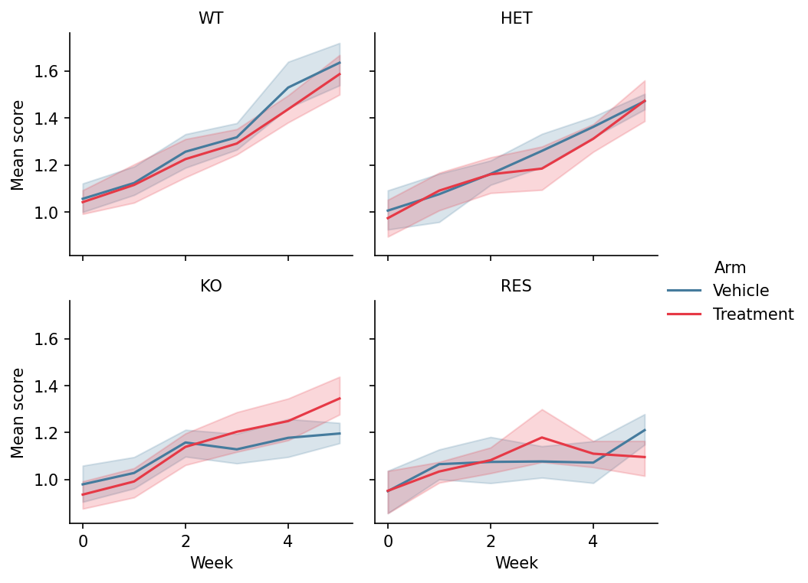

Faceting splits one dataset into a grid of panels by categorical variables, holding every panel on identical axes so differences between groups read as differences in shape, not scale. It replaces the most error-prone figure type in biomedical papers — hand-assembled panel grids. `seaborn` provides the figure-level functions (`relplot`, `catplot`, `displot`) and the composable `FacetGrid`.

## Example

{fig-align="center" width="80%"}

## Setup

- System Requirements: Cross-platform (Linux/MacOS/Windows)
- Programming Language: **Python**
- Dependencies: `matplotlib`, `seaborn`, `pandas`, `numpy`

```{python}
#| label: packages-setup
#| output: false
import matplotlib.pyplot as plt
import seaborn as sns
import pandas as pd
import numpy as np
```

## Data Preparation

We simulate a longitudinal treatment study in long format — 4 genotypes × 2 arms × 6 weekly measurements — the shape `seaborn`'s figure-level functions expect (one row per observation).

```{python}
#| label: data-prep
np.random.seed(201)

genotypes = ['WT', 'HET', 'KO', 'RES']
rows = []
for gi, geno in enumerate(genotypes):
    for arm, rate in [('Vehicle', 0.10), ('Treatment', 0.10 + 0.08 * (3 - gi))]:
        for mouse in range(8):
            for week in range(0, 6):
                rows.append({
                    'Genotype': geno, 'Arm': arm, 'Week': week,
                    'Mouse': f'{geno}_{arm[:2]}_{mouse}',
                    'Score': 1 + 0.35 * (0.10 + 0.08 * (3 - gi)) * week
                             + np.random.normal(0, 0.12)})
long = pd.DataFrame(rows)
```

## Visualization

### Relational Facets (relplot)

`col` lays panels out left-to-right and `col_wrap` controls the grid; identical y-limits across panels are what make the genotype contrast legitimate.

```{python}
#| label: fig-py-facet-rel
#| fig-cap: "Response trajectories faceted by genotype, coloured by arm"
#| width: 88%
#| fig-align: center
g = sns.relplot(data=long, x='Week', y='Score', hue='Arm',
                col='Genotype', col_wrap=2,
                kind='line', estimator='mean', errorbar=('ci', 95),
                palette={'Vehicle': '#457b9d', 'Treatment': '#e63946'},
                height=2.6, aspect=1.15, facet_kws=dict(sharey=True))
g.set_titles('{col_name}')
g.set_axis_labels('Week', 'Mean score')
g.legend.set_frame_on(False)
plt.show()
```

### Categorical Facets (catplot)

`catplot` swaps the per-panel plot type via `kind`; box plots per week expose the within-genotype spread that means hide.

```{python}
#| label: fig-py-facet-cat
#| fig-cap: "Score distributions by week, faceted by genotype"
#| width: 88%
#| fig-align: center
g = sns.catplot(data=long[long.Arm == 'Treatment'], x='Week', y='Score',
                col='Genotype', col_wrap=2, kind='box',
                color='#8da0cb', width=0.55, linewidth=0.9,
                height=2.6, aspect=1.15)
g.set_titles('{col_name}')
g.set_axis_labels('Week', 'Score')
plt.show()
```

### Custom Panels with FacetGrid

`FacetGrid.map_dataframe` puts any plotting function in every panel — here the per-genotype score distribution with rugs, the pattern for bespoke panel functions.

```{python}
#| label: fig-py-facet-grid
#| fig-cap: "FacetGrid mapping a custom histogram+KDE panel function"
#| width: 88%
#| fig-align: center
def hist_kde(data, color, **kwargs):
    ax = plt.gca()
    sns.histplot(data.Score, kde=True, stat='density',
                 color=color, alpha=0.45, bins=14, ax=ax)
    ax.axvline(data.Score.median(), color='0.25', linewidth=0.9,
               linestyle='--')

g = sns.FacetGrid(long, col='Genotype', col_wrap=2, hue='Genotype',
                  palette='Set2', height=2.6, aspect=1.15)
g.map_dataframe(hist_kde)
g.set_titles('{col_name}')
g.set_axis_labels('Score', 'Density')
plt.show()
```

## References

1. Waskom, M. L. (2021). seaborn: statistical data visualization. *Journal of Open Source Software*, 6(60), 3021.
2. Hunter, J. D. (2007). Matplotlib: A 2D graphics environment. *Computing in Science & Engineering*, 9(3), 90-95.
