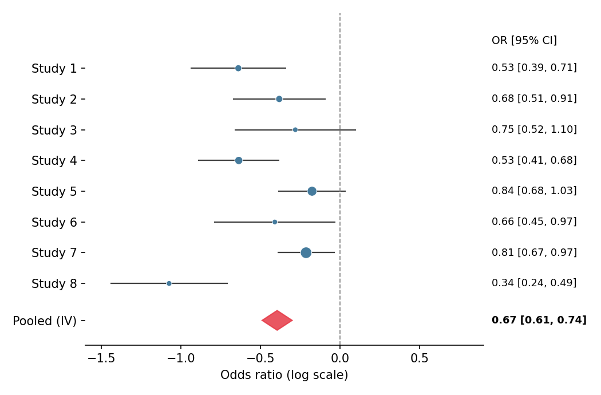

A forest plot places each study's effect estimate as a marker with its confidence interval, sized by precision, above a pooled diamond — the standard display for meta-analysis and for regression tables with many predictors. It is built from `hlines`/`scatter`/`Polygon` primitives in `matplotlib`, which keeps every element (log scale, null line, weights) explicit.

## Example

{fig-align="center" width="80%"}

## Setup

- System Requirements: Cross-platform (Linux/MacOS/Windows)
- Programming Language: **Python**
- Dependencies: `matplotlib`, `pandas`, `numpy`

```{python}
#| label: packages-setup
#| output: false
import matplotlib.pyplot as plt
from matplotlib.patches import Polygon
import pandas as pd
import numpy as np
```

## Data Preparation

We simulate eight studies in a meta-analysis of a binary endpoint: log-odds-ratios scattered around −0.5 with study-specific standard errors, plus an inverse-variance pooled estimate.

```{python}
#| label: data-prep
np.random.seed(151)

studies = pd.DataFrame({
    'Study': [f'Study {i}' for i in range(1, 9)],
    'logOR': np.random.normal(-0.5, 0.22, 8),
    'SE': np.random.uniform(0.08, 0.20, 8),
})
studies['CI_low'] = studies.logOR - 1.96 * studies.SE
studies['CI_high'] = studies.logOR + 1.96 * studies.SE
studies['Weight'] = 1 / studies.SE ** 2
pooled = pd.Series({
    'logOR': np.average(studies.logOR, weights=studies.Weight),
    'SE': np.sqrt(1 / studies.Weight.sum()),
})
pooled['CI_low'] = pooled.logOR - 1.96 * pooled.SE
pooled['CI_high'] = pooled.logOR + 1.96 * pooled.SE
```

## Visualization

### Forest Plot with Pooled Diamond

Marker area scales with inverse-variance weight; the null (OR = 1) line and a right-hand column of effect values complete the clinical layout.

```{python}
#| label: fig-py-forest-basic
#| fig-cap: "Meta-analysis forest plot with inverse-variance pooled diamond"
#| width: 72%
#| fig-align: center
y = np.arange(len(studies))[::-1]

fig, ax = plt.subplots(figsize=(7, 4.6))
ax.hlines(y, studies.CI_low, studies.CI_high, color='0.25', linewidth=1.1)
ax.scatter(studies.logOR, y, s=studies.Weight * 90 / studies.Weight.max(),
           color='#457b9d', zorder=3, edgecolor='white', linewidth=0.5)
diamond_y = -1.2
diamond = Polygon([[pooled.CI_low, diamond_y], [pooled.logOR, diamond_y + 0.32],
                   [pooled.CI_high, diamond_y], [pooled.logOR, diamond_y - 0.32]],
                  closed=True, color='#e63946', alpha=0.85)
ax.add_patch(diamond)
ax.axvline(0, color='0.55', linewidth=0.9, linestyle='--')
ax.set_yticks(list(y) + [diamond_y], list(studies.Study) + ['Pooled (IV)'])
ax.text(1.02, y.max() + 0.9, 'OR [95% CI]', transform=ax.get_yaxis_transform(),
        fontsize=9, va='center')
ax.set_ylim(-2, len(studies) + 0.8)
for yi, (_, row) in zip(y, studies.iterrows()):
    ax.text(1.02, yi, f'{np.exp(row.logOR):.2f} '
            f'[{np.exp(row.CI_low):.2f}, {np.exp(row.CI_high):.2f}]',
            transform=ax.get_yaxis_transform(), fontsize=8.5, va='center')
ax.text(1.02, diamond_y, f'{np.exp(pooled.logOR):.2f} '
        f'[{np.exp(pooled.CI_low):.2f}, {np.exp(pooled.CI_high):.2f}]',
        transform=ax.get_yaxis_transform(), fontsize=8.5, va='center',
        fontweight='bold')
ax.set_xlabel('Odds ratio (log scale)')
ax.set_xlim(-1.6, 0.9)
ax.spines[['top', 'right', 'left']].set_visible(False)
plt.tight_layout()
plt.show()
```

### Subgrouped Forest Plot

Inserting subgroup headers and indenting their studies keeps heterogeneous evidence organized without a second figure.

```{python}
#| label: fig-py-forest-subgroup
#| fig-cap: "Forest plot with subgroup headers"
#| width: 72%
#| fig-align: center
studies['Subgroup'] = ['Retrospective'] * 4 + ['Prospective'] * 4

fig, ax = plt.subplots(figsize=(7, 5))
row = 0
yticks, ylabels = [], []
for subgroup, sub in studies.groupby('Subgroup', sort=False):
    ax.text(0, row, subgroup, fontsize=10, fontweight='bold', va='center')
    yticks.append(row); ylabels.append('')
    row -= 1
    for _, s in sub.iterrows():
        lo, hi = s.CI_low, s.CI_high
        ax.hlines(row, lo, hi, color='0.25', linewidth=1.1)
        ax.scatter(s.logOR, row, s=70, color='#457b9d',
                   zorder=3, edgecolor='white', linewidth=0.5)
        ax.text(1.02, row, f'{np.exp(s.logOR):.2f} '
                f'[{np.exp(lo):.2f}, {np.exp(hi):.2f}]',
                transform=ax.get_yaxis_transform(), fontsize=8.5, va='center')
        yticks.append(row); ylabels.append(s.Study)
        row -= 1
    row -= 0.6

diamond = Polygon([[pooled.CI_low, row], [pooled.logOR, row + 0.3],
                   [pooled.CI_high, row], [pooled.logOR, row - 0.3]],
                  closed=True, color='#e63946', alpha=0.85)
ax.add_patch(diamond)
ax.text(0, row, 'Pooled (IV)', fontsize=10, fontweight='bold', va='center')
ax.text(1.02, row, f'{np.exp(pooled.logOR):.2f} '
        f'[{np.exp(pooled.CI_low):.2f}, {np.exp(pooled.CI_high):.2f}]',
        transform=ax.get_yaxis_transform(), fontsize=8.5, va='center',
        fontweight='bold')
yticks.append(row); ylabels.append('')
ax.axvline(0, color='0.55', linewidth=0.9, linestyle='--')
ax.set_yticks(yticks, ylabels)
ax.set_xlabel('Odds ratio (log scale)')
ax.set_xlim(-1.6, 0.9)
ax.spines[['top', 'right', 'left']].set_visible(False)
plt.tight_layout()
plt.show()
```

## References

1. Bax, L., Yu, L. M., Ikeda, N., Tsuruta, H., & Moons, K. G. (2006). Development and validation of MIX: comprehensive free software for meta-analysis of causal research data. *BMC Medical Research Methodology*, 6, 50.
2. Hunter, J. D. (2007). Matplotlib: A 2D graphics environment. *Computing in Science & Engineering*, 9(3), 90-95.
