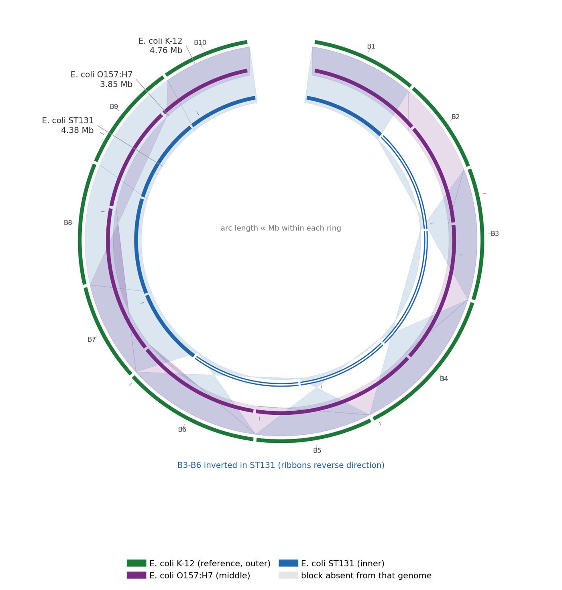

比较完成图不是两两之间的问题：当基因组达到三个或更多时，真正要回答的是"哪些区段为所有基因组共有"、"哪些区段只属于其中一个"，以及"这些共有区段是何种方向"。**多基因组比较 Circos 图**一次同时回答这三个问题：每个组装各占一个环，同源块以带（ribbon）在环间相连，带的颜色编码它所连接的目标基因组，方向则编码在带的端点顺序里。

本页仅用 `matplotlib` 重建 `pyGenomeViz` 风格的多基因组 Circos 版式 \[1\]\[2\]：环是 `ax.plot` 画出的弧段，每条带是一个显式 `Polygon`，其两条边分别贴着来源弧与目标弧，极坐标由手工计算，几何可以逐行核对。

## 示例

{fig-alt="多基因组比较 Circos 图（Python）DEMO" fig-align="center" width="85%"}

三个大肠杆菌组装、十个共线区块的多基因组比较 Circos 图，色带按目标基因组着色。ST131 中 2.13 Mb 的倒位（B3-B6）使其色带交叉；在 O157:H7 或 ST131 中缺失的区块则标在各自的环上，因此缺失与重排不会被混为一谈。

## Setup

-   系统要求：跨平台（Linux/MacOS/Windows）

-   编程语言：Python

-   依赖包：`matplotlib`；`numpy`

```{python}
#| label: packages-setup
#| output: false
import matplotlib.pyplot as plt
import numpy as np
from matplotlib.path import Path
from matplotlib.patches import PathPatch
```

本页刻意**不**引入 `pyGenomeViz`：它为了本图所需的几条弧和一组带，会拖入沉重的比对/可视化依赖闭包（`matplotlib`、`biopython`、`pandas`、pygenomeviz 的比对助手与内置 MUMmer 接口）。同一论证适用于该图型家族的 `MCScanX`、`SyMap` 与 `jcvi`。因此本页只使用项目的基础依赖。

## 数据准备

比较三个*埃希菌属*组装：一个实验室参考株、一个携带质粒的分离株，以及一个含大片段倒位的临床分离株。每个基因组切分为十个同源块；块编号、长度与方向是唯一输入，正是 `MCScanX`/`SyRI` 共线性表提供的列。

```{python}
#| label: data-prep
np.random.seed(43519)

genomes = ["E. coli K-12", "E. coli O157:H7", "E. coli ST131"]
block_colours = ["#1b7837", "#762a83", "#2166ac"]

## Ten syntenic blocks; lengths in kb. The clinical isolate carries a
## 2.13 Mb inversion covering blocks 3-6, so those ribbons cross.
block_len = np.array([420, 380, 520, 610, 460, 540, 390, 480, 430, 350])
shared = np.ones((3, 10), dtype=bool)
shared[1, [7, 8]] = False          # plasmid isolate: two unique blocks
shared[2, [1]] = False             # clinical isolate: one unique block
orientation = np.ones((3, 10))
orientation[2, 2:6] = -1           # inversion

## PAD_KB 是环上块与块之间的空白，属于排版而非序列，因此不计入环标所报的长。
PAD_KB = 180
genome_len = np.array([(block_len * shared[i]).sum() + PAD_KB for i in range(3)])
seq_len = np.array([(block_len * shared[i]).sum() for i in range(3)])
seq_len
```

```{python}
#| label: data-table
#| output: false
import pandas as pd

blocks = pd.DataFrame({
    "genome": np.repeat(genomes, 10),
    "block": np.tile(np.arange(1, 11), 3),
    "length_kb": np.tile(block_len, 3),
    "shared": shared.flatten(),
    "orientation": orientation.flatten(),
})
blocks = blocks[blocks["shared"]]
blocks.head(8)
```

## 可视化

### 1. 三环基因组比较与带方向

每个环承载一个组装，环外每 1 Mb 有一条不标数值的刻度线。同源块从参考环画到每个比较环；倒位会立刻显现，因为色带从一个环顺时针出发、落到另一个环时反向。独有块标在各自的环上。这里 "B3-B6" 指四个块的闭区间，长度之和为 520 + 610 + 460 + 540 kb = 2.13 Mb。

```{python}
#| label: fig-1.1MultiGenomeCircos
#| fig-cap: "三个模拟大肠杆菌样组装（真实菌株名、虚构长度）的多基因组比较 Circos 图，共十个同源块，带按所连接的目标基因组着色；ST131 中 2.13 Mb 的倒位（B3-B6）使其带发生交叉，倒位块在环上叠加白色芯线，O157:H7 缺失的 B8-B9 与 ST131 缺失的 B2 在各自环上以浅色短弧表示。"
#| fig-width: 8.2
#| fig-height: 8.2
#| fig-dpi: 300
#| fig-align: center

GENOMES = ["E. coli K-12", "E. coli O157:H7", "E. coli ST131"]
RING_R = [1.00, 0.86, 0.72]          # radius, outermost = reference
RING_W = 0.052                        # ring band thickness
GAP_DEG = 5.0                         # gap at 12 o'clock (start/end marker)
BLOCK_GAP = 0.9                       # degrees between adjacent blocks

def ring_angle(frac):
    """Map a 0..1 position along a ring to degrees, running clockwise."""
    return 90 - GAP_DEG / 2 - frac * (360 - GAP_DEG)

def xy(r, deg):
    t = np.deg2rad(deg)
    return np.array([r * np.cos(t), r * np.sin(t)])

def block_fractions(gi, bi):
    lens = block_len * shared[gi]
    cum = np.concatenate([[0], np.cumsum(lens)])
    pad = 90.0
    return ((pad + cum[bi]) / genome_len[gi],
            (pad + cum[bi + 1]) / genome_len[gi])

fig, ax = plt.subplots(figsize=(8.2, 8.2))
ax.set_aspect("equal")
ax.axis("off")

## ---- ring bands, split per block so presence is visible ----------------
for gi, radius in enumerate(RING_R):
    for bi in range(10):
        f0, f1 = block_fractions(gi, bi)
        d0, d1 = ring_angle(f0), ring_angle(f1)
        theta = np.linspace(np.deg2rad(d0 - BLOCK_GAP / 2),
                            np.deg2rad(d1 + BLOCK_GAP / 2), 60)
        if shared[gi, bi]:
            colour, lw, style = block_colours[gi], RING_W * 72, "-"
        else:
            colour, lw, style = "#e6e6e6", RING_W * 30, "-"
        ax.plot(np.cos(theta) * radius, np.sin(theta) * radius,
                color=colour, lw=lw, solid_capstyle="butt", zorder=3)
        if shared[gi, bi] and orientation[gi, bi] < 0:
            ## Inverted blocks get a white core: the ring is always split by
            ## presence first (colour) and by orientation second (fill).
            inner = radius
            ax.plot(np.cos(theta) * inner, np.sin(theta) * inner,
                    color="white", lw=RING_W * 26, solid_capstyle="butt",
                    zorder=4)
    ## Ring label outside the whole circle: the leader runs radially out
    ## through the outer rings so every label sits in clear white space.
    lab_deg = [116, 132, 148][gi]
    p0 = xy(radius - RING_W / 2, lab_deg)
    p1 = xy(1.075, lab_deg)
    ax.plot([p0[0], p1[0]], [p0[1], p1[1]], color="#9e9e9e", lw=0.6, zorder=4)
    name = GENOMES[gi]
    ax.text(p1[0] + (0.018 if p1[0] >= 0 else -0.018), p1[1],
            f"{name}\n{seq_len[gi] / 1000:.2f} Mb",
            ha="left" if p1[0] >= 0 else "right", va="center",
            fontsize=8.0, color="#333333", linespacing=1.35, zorder=5)
    ## 1 Mb ticks on the ring.
    for mb in range(1, int(np.ceil(genome_len[gi] / 1000)) + 1):
        if mb * 1000 >= genome_len[gi]:
            continue
        deg = ring_angle(mb * 1000 / genome_len[gi])
        a = xy(radius + RING_W / 2, deg)
        b = xy(radius + RING_W / 2 + 0.018, deg)
        ax.plot([a[0], b[0]], [a[1], b[1]], color="#7a7a7a", lw=0.5, zorder=4)

## ---- ribbons from the reference block to each comparison block --------
def ribbon(gi, bi):
    s0, s1 = block_fractions(0, bi)
    t0, t1 = block_fractions(gi, bi)
    if orientation[gi, bi] < 0:
        t0, t1 = t1, t0
    n = 30
    src = [xy(RING_R[0] - RING_W / 2, ring_angle(f)) for f in np.linspace(s0, s1, n)]
    dst = [xy(RING_R[gi] - RING_W / 2, ring_angle(f)) for f in np.linspace(t0, t1, n)]
    return src + dst[::-1]

for bi in range(10):
    for gi in (1, 2):
        if not shared[gi, bi]:
            continue
        poly = np.array(ribbon(gi, bi))
        ax.add_patch(plt.Polygon(poly, closed=True, facecolor=block_colours[gi],
                                 alpha=0.16, edgecolor=block_colours[gi],
                                 lw=0.4, zorder=1))

## ---- block numbering on the reference ring ----------------------------
for bi in range(10):
    f0, f1 = block_fractions(0, bi)
    mid = ring_angle((f0 + f1) / 2)
    p = xy(RING_R[0] + RING_W / 2 + 0.036, mid)
    ax.text(p[0], p[1], f"B{bi + 1}", ha="center", va="center",
            fontsize=6.6, color="#444444", rotation=0, zorder=6)
    ## A tick joins the number to its block.
    q = xy(RING_R[0] + RING_W / 2 + 0.006, mid)
    ax.plot([q[0], p[0]], [q[1], p[1]], color="#9e9e9e", lw=0.5, zorder=5)
from matplotlib.lines import Line2D
handles = [
    Line2D([], [], color=block_colours[0], lw=7, label="E. coli K-12 (reference, outer)"),
    Line2D([], [], color=block_colours[1], lw=7, label="E. coli O157:H7 (middle)"),
    Line2D([], [], color=block_colours[2], lw=7, label="E. coli ST131 (inner)"),
    Line2D([], [], color="#e6e6e6", lw=7, label="block absent from that genome"),
]
ax.legend(handles=handles, loc="lower center", bbox_to_anchor=(0.5, -0.045),
          frameon=False, fontsize=8.2, ncol=2, handlelength=1.5,
          columnspacing=1.4, labelspacing=0.55)
## The inversion is a geometric statement, so say it in words rather than
## encoding it a fourth time in the legend.
ax.text(0, -1.12, "ST131: B3-B6 inverted (ribbons reverse)",
        ha="center", va="center", fontsize=8.0, color="#2166ac")
ax.text(0, 0.06, "arc length \u221d Mb within each ring", ha="center",
        va="center", fontsize=7.4, color="#7a7a7a")
ax.set_xlim(-1.36, 1.36)
ax.set_ylim(-1.60, 1.16)
plt.tight_layout()
plt.show()
```

::: callout-tip
**实践要点**

-   环序是一个论证，不是装饰：把参考序列放在最外环，使每条带都能读作"参考 → 比较"，并在图注中写明。
-   带宽必须与*来源*基因组上的块长成比例。为画面整齐而压缩长块，会在无声中改变比较结果。
-   方向应通过带的交叉（或显式箭头）编码，而不是再加第三个颜色通道——颜色已用于区分目标基因组。
-   独有/缺失块的标注保留在它所属的环上；用统一的 "unique" 图例会掩盖该块属于哪个组装。
-   必须声明坐标是绝对长度还是长度归一化。这里各环跨越自身基因组，因此外环的 4.58 Mb 与内环的 4.20 Mb 在每 Mb 的弧长上*并不*相同；一条在内环上看起来很宽的带，未必在生物学上更宽。
:::

### 2. 与环形图配套的保守块矩阵

环形视图展示顺序，矩阵展示存在与否。 Pairing them answers the question readers actually ask — "is this block conserved everywhere or only in two of the three genomes?" — without counting ribbons.

```{python}
#| label: fig-1.2BlockPresence
#| fig-cap: "同一组十个同源块的存在矩阵：实心圆点 = 同向保守，实心圆点加白色左三角 = 倒位保守，虚线空圈加叉 = 缺失。B8-B9（O157:H7）与 B2（ST131）在其余共享骨架中形成明显的空洞，而 ST131 的 B3-B6 全部带倒位标记。"
#| fig-width: 8.2
#| fig-height: 3.0
#| fig-dpi: 300

fig, ax = plt.subplots(figsize=(8.2, 3.0))
for gi in range(3):
    for bi in range(10):
        present = shared[gi, bi]
        inverted = present and orientation[gi, bi] < 0
        y = 2 - gi
        if present:
            ax.scatter(bi, y, s=380, facecolor=block_colours[gi],
                       edgecolor="white", linewidth=1.2, zorder=3)
            ax.text(bi - (0.13 if inverted else 0), y, f"B{bi + 1}",
                    ha="center", va="center", fontsize=7.0, color="white",
                    fontweight="bold", zorder=5)
            if inverted:
                ## A left-pointing arrow is the matrix's orientation glyph;
                ## it is visually different from the "absent" dashed ring.
                ax.scatter(bi + 0.17, y, marker="<", s=55, facecolor="white",
                           edgecolor="none", zorder=5)
        else:
            ax.scatter(bi, y, s=380, facecolor="white",
                       edgecolor="#cccccc", linewidth=1.3,
                       linestyle=(0, (2, 1.6)), zorder=3)
            ax.plot([bi - 0.11, bi + 0.11], [y - 0.11, y + 0.11],
                    color="#cccccc", lw=1.1, zorder=4)
            ax.plot([bi - 0.11, bi + 0.11], [y + 0.11, y - 0.11],
                    color="#cccccc", lw=1.1, zorder=4)

ax.set_yticks([2, 1, 0], genomes)
ax.set_xticks(range(10), [f"B{i + 1}" for i in range(10)])
ax.set_xlim(-0.6, 9.6)
ax.set_ylim(-0.6, 2.6)
ax.grid(axis="x", color="#eeeeee", lw=0.6, zorder=0)
ax.set_axisbelow(True)
for spine in ("top", "right", "left"):
    ax.spines[spine].set_visible(False)
ax.tick_params(length=0, labelsize=8.4)
ax.set_xlabel("syntenic block (reference order)", fontsize=9)
ax.text(9.55, 2.70, "filled = forward · ◀ = inverted · ⊘ = absent",
        ha="right", va="bottom", fontsize=7.8, color="#666666")
plt.tight_layout()
plt.show()
```

::: callout-tip
**实践要点**

-   只要比较超过两个基因组，就应把环形图与存在矩阵配对：环显示*顺序*，矩阵显示*存在性*，任一单独都不足以回答两者。
-   矩阵中同样要标记倒位（此处用左向箭头）。存在但倒位的单元与同向保守的单元不是一回事，不可共用同一字形。
-   矩阵列按参考顺序而非字母顺序排列，使空洞与环形图的标签对齐。
:::

## 关于本页跳过的实现

本页的图由 matplotlib and pyCirclize 直接绘制，而不安装这些被跳过的工具。在 issue-435 清单中归到 Python/GenomeComparisonCircos.qmd 的工具里，1 条被标记为**跳过**，仅作为版式参考、不作为依赖：1 条依赖闭包过重，不值得为一张静态图引入。本页先把这些工具的图形约定读懂，再自行重画，以便逐行核验每个面板。

| 工具 | 最近提交 | 状态 | 跳过原因 |
| --- | --- | --- | --- |
| pyGenomeViz | 2026-06-14 | 依赖过重 | 框架级依赖闭包过重，不值得为一张静态图引入 |

## 应用

多基因组 Circos 图是细菌泛基因组与真核共线性研究的标准总览：一眼可见哪些附属区段为该致病型独有、大片段倒位位于何处，以及质粒基因内容是否与染色体共享。同一构造可通过缩小环厚度、对近缘基因组使用同一色相梯度扩展到十个以上环。

本页两种版式是同一分析互补的两份交付物：环形面板作为论文主图，矩阵作为可审计的补充材料表。

## 参考文献

\[1\] Shimoyama Y. pyGenomeViz: a genome visualization python package for comparative genomics. 2023. https://github.com/moshi4/pyGenomeViz

\[2\] Shimoyama Y. pyCirclize: circular visualization in Python. 2023. https://github.com/moshi4/pyCirclize

\[3\] Wang Y, Tang H, Debarry JD, et al. MCScanX: a toolkit for detection and evolutionary analysis of gene synteny and collinearity. Nucleic Acids Res. 2012;40(7):e49. doi:10.1093/nar/gkr1293

\[4\] Goel M, Sun H, Jiao WB, Schneeberger K. SyRI: finding genomic rearrangements and local sequence differences from whole-genome assemblies. Genome Biol. 2019;20:277. doi:10.1186/s13059-019-1911-0
