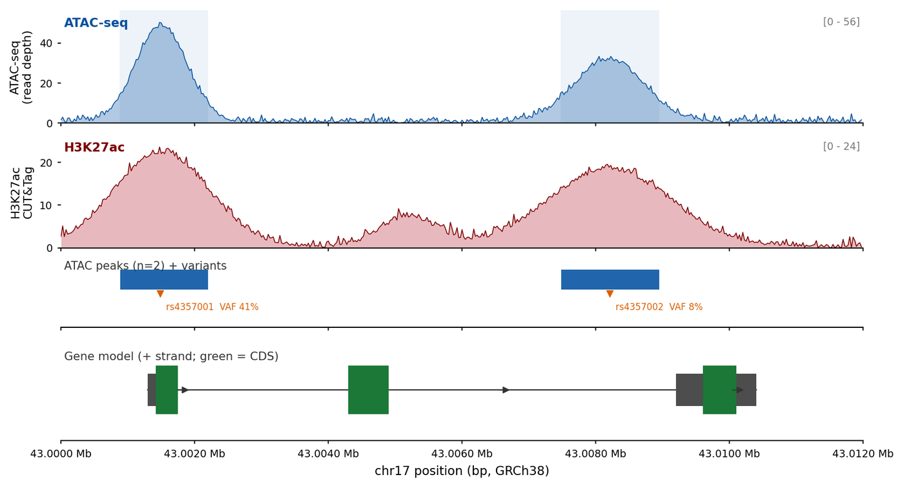

A genome browser screenshot is a figure when it is assembled from tracks: coverage, variant allele fraction, gene models and chromatin signal, all sharing one coordinate axis. The publication-grade version of that layout is what **pyGenomeTracks** \[1\] and **trackplot** \[2\] produce — same content as a browser, but bordered by a stated coordinate range instead of by a screenshot.

This page builds the four-track layout with plain `matplotlib`, so every track is a function of one coordinate array. pyGenomeTracks and figeno are **not** dependencies here: both are heavy (pyBigWig, deeptools, h5py, a CLI plus INI configuration), and the figure needs four axes and a shared x scale.

## Example

{fig-alt="Genome Track Plot (Python) DEMO" fig-align="center" width="85%"}

A four-track genome browser view of a 12 kb window on chr17 (GRCh38): ATAC-seq coverage, H3K27ac signal, called ATAC peaks and the gene model, all sharing one coordinate axis. The promoter peak carries an eQTL at 41% variant allele fraction and the weaker enhancer peak is marked as a candidate regulatory element.

## Setup

-   System Requirements: Cross-platform (Linux/MacOS/Windows)

-   Programming language: Python

-   Dependent packages: `matplotlib`; `numpy`; `pandas`

```{python}
#| label: packages-setup
#| output: false
import matplotlib.pyplot as plt
import numpy as np
import pandas as pd
```

## Data Preparation

One 12 kb window on chr17 around a gene with three exons. The tracks are: ATAC-seq coverage (accessibility), H3K27ac signal (activity), the called peak intervals, and the gene model. These are the four columns a multi-track browser plot always carries, and every one of them is derivable from a sorted BAM plus a BED/GFF.

```{python}
#| label: data-prep
rng = np.random.default_rng(4357)

window_start, window_end = 43_000_000, 43_012_000
pos = np.arange(window_start, window_end, 25)
rel = pos - window_start

def gaussian_sum(centres, heights, widths):
    out = np.zeros_like(rel, dtype=float)
    for c, h, w in zip(centres, heights, widths):
        out += h * np.exp(-0.5 * ((rel - c) / w) ** 2)
    return out

## Two ATAC-seq signal domains: a promoter-proximal peak and an enhancer.
atac = gaussian_sum([1500, 8200], [48, 31], [380, 520])
atac += np.abs(rng.normal(0, 1.6, rel.size))
atac = np.clip(atac, 0, None)

h3k27ac = gaussian_sum([1500, 8200, 5200], [22, 18, 7], [700, 900, 420])
h3k27ac += np.abs(rng.normal(0, 0.9, rel.size))
h3k27ac = np.clip(h3k27ac, 0, None)

## Peaks are called where the ATAC signal exceeds a threshold for >= 200 bp.
above = atac > 12
edges = np.flatnonzero(np.diff(np.r_[0, above.astype(int), 0]))
peaks = pd.DataFrame({
    "start": window_start + rel[edges[0::2]],
    "end": window_start + rel[np.minimum(edges[1::2], rel.size - 1)],
})
peaks["width"] = peaks["end"] - peaks["start"]
peaks = peaks[peaks["width"] >= 200].reset_index(drop=True)

## An eQTL SNP in the promoter peak, with allele fractions from tumour RNA.
variants = pd.DataFrame({
    "pos": [window_start + 1480, window_start + 8210],
    "name": ["rs4357001", "rs4357002"],
    "vaf": [0.41, 0.08],
    "depth": [84, 97],
})

exons = pd.DataFrame({
    "exon": [1, 2, 3],
    "start": [window_start + 1300, window_start + 4300, window_start + 9200],
    "end": [window_start + 1750, window_start + 4900, window_start + 10400],
    "cds_start": [window_start + 1420, window_start + 4300, window_start + 9600],
    "cds_end": [window_start + 1750, window_start + 4900, window_start + 10100],
})

pd.DataFrame({
    "track": ["ATAC-seq", "H3K27ac"],
    "max": [atac.max(), h3k27ac.max()],
    "mean": [atac.mean(), h3k27ac.mean()],
}).round(2)
```

## Visualization

### 1. Four-Track Browser View on One Coordinate Axis

The defining property of a correct multi-track plot is that all tracks share the *same* x axis and the vertical ordering encodes nothing but track identity. Signal tracks get independent y limits (declared on the axis), interval tracks get a fixed band, and the gene model gets strand arrows.

```{python}
#| label: fig-1.1TrackView
#| fig-cap: "Four-track genome browser view of a 12 kb window on chr17 (GRCh38): ATAC-seq coverage, H3K27ac signal, called ATAC peaks, and the gene model. All four tracks share one coordinate axis; the promoter peak carries an eQTL at 41% variant allele fraction, and the weaker enhancer peak is marked as a candidate regulatory element."
#| fig-width: 10
#| fig-height: 5.4
#| fig-dpi: 300

fig, axes = plt.subplots(
    4, 1, figsize=(10, 5.4), sharex=True,
    gridspec_kw={"height_ratios": [1.0, 1.0, 0.60, 0.9], "hspace": 0.12}
)

## ---- track 1: ATAC-seq coverage ---------------------------------------
ax = axes[0]
ax.fill_between(pos, atac, color="#2166ac", alpha=0.35, linewidth=0)
ax.plot(pos, atac, color="#08519c", linewidth=0.6)
for _, p in peaks.iterrows():
    ax.axvspan(p["start"], p["end"], color="#2166ac", alpha=0.08, linewidth=0)
ax.set_ylabel("ATAC-seq\n(read depth)", fontsize=8.2)
ax.set_ylim(0, atac.max() * 1.12)
ax.text(0.004, 0.94, "ATAC-seq", transform=ax.transAxes, fontsize=8.6,
        fontweight="bold", va="top", color="#08519c")
ax.text(0.996, 0.94, f"[0 - {int(atac.max() * 1.12)}]", transform=ax.transAxes,
        fontsize=7, ha="right", va="top", color="#777777")

## ---- track 2: H3K27ac -------------------------------------------------
ax = axes[1]
ax.fill_between(pos, h3k27ac, color="#b2182b", alpha=0.30, linewidth=0)
ax.plot(pos, h3k27ac, color="#7f0000", linewidth=0.6)
ax.set_ylabel("H3K27ac\nCUT&Tag", fontsize=8.2)
ax.set_ylim(0, h3k27ac.max() * 1.12)
ax.text(0.004, 0.94, "H3K27ac", transform=ax.transAxes, fontsize=8.6,
        fontweight="bold", va="top", color="#7f0000")
ax.text(0.996, 0.94, f"[0 - {int(h3k27ac.max() * 1.12)}]", transform=ax.transAxes,
        fontsize=7, ha="right", va="top", color="#777777")

## ---- track 3: peaks ---------------------------------------------------
ax = axes[2]
## Peaks occupy the top half of this track; the variant row lives below
## them, so the two never overlap.
for _, p in peaks.iterrows():
    ax.add_patch(plt.Rectangle((p["start"], 0.56), p["width"], 0.30,
                               facecolor="#2166ac", edgecolor="white",
                               linewidth=0.4))
ax.set_ylim(0, 1)
ax.set_yticks([])
ax.text(0.004, 0.98, f"ATAC peaks (n={len(peaks)}) + variants",
        transform=ax.transAxes, fontsize=7.8, va="top", color="#333333")
for _, v in variants.iterrows():
    ax.plot([v["pos"]], [0.50], marker="v", markersize=4.0, color="#d95f02")
    ax.text(v["pos"] + 90, 0.30, f"{v['name']}  VAF {v['vaf']:.0%}",
            ha="left", va="center", fontsize=6.2, color="#d95f02")

## The weaker H3K27ac/ATAC peak at 8.2 kb is the candidate enhancer named in
## the caption. Mark the actual peak interval and attach the label to it, so
## the callout is a property of the data rather than margin prose. Pick the
## peak whose centre is nearest 8.2 kb, so the box and the label agree.
peak_centre = peaks["start"] + peaks["width"] / 2
enhancer_peak = peaks.loc[(peak_centre - (window_start + 8200)).abs().idxmin()]
axes[0].annotate(
    "candidate\nregulatory element",
    xy=(enhancer_peak["start"] + enhancer_peak["width"] / 2,
        atac.max() * 0.42),
    xytext=(enhancer_peak["start"] + enhancer_peak["width"] / 2,
            atac.max() * 0.82),
    ha="center", va="bottom", fontsize=5.8, color="#b2182b",
    arrowprops=dict(arrowstyle="-", color="#b2182b", lw=0.6),
)
axes[0].add_patch(plt.Rectangle(
    (enhancer_peak["start"], 0), enhancer_peak["width"], atac.max() * 0.42,
    facecolor="none", edgecolor="#b2182b", linewidth=0.7, linestyle="--"))

## ---- track 4: gene model ----------------------------------------------
ax = axes[3]
y = 0.5
ax.plot([exons["start"].min(), exons["end"].max()], [y, y], color="#333333",
        linewidth=0.9, zorder=1)
for _, e in exons.iterrows():
    ax.add_patch(plt.Rectangle((e["start"], y - 0.16),
                               e["end"] - e["start"], 0.32,
                               facecolor="#4d4d4d", edgecolor="none", zorder=2))
    ax.add_patch(plt.Rectangle((e["cds_start"], y - 0.24),
                               e["cds_end"] - e["cds_start"], 0.48,
                               facecolor="#1b7837", edgecolor="none", zorder=3))
## Strand evidence: the CDS starts march rightwards across the three exons
## (1420 -> 4300 -> 9600), which is what defines the + strand. The arrows sit
## in introns between exons, never inside an exon or a UTR.
for x_arrow in (window_start + 3000, window_start + 6500,
                window_start + 11000):
    ax.annotate("", xy=(x_arrow + 260, y), xytext=(x_arrow, y),
                arrowprops=dict(arrowstyle="-|>", color="#333333", lw=0.7))
ax.set_ylim(0, 1)
ax.set_yticks([])
ax.text(0.004, 0.88, "Gene model (+ strand; green = CDS)", transform=ax.transAxes,
        fontsize=8.0, va="top", color="#333333")

## ---- shared cosmetics -------------------------------------------------
for ax in axes:
    for side in ("top", "right", "left"):
        ax.spines[side].set_visible(False)
    ax.tick_params(axis="both", labelsize=7.2, length=2.4)
    ax.set_xlim(window_start, window_end)
axes[-1].set_xlabel("chr17 position (bp, GRCh38)", fontsize=8.6)
axes[-1].xaxis.set_major_formatter(
    plt.FuncFormatter(lambda v, _: f"{v / 1e6:.4f} Mb"))
plt.show()
```

::: callout-tip
**Practice tips**

-   Share the x axis, never re-scale a track independently. The whole point of a browser layout is that a vertical line means the same base pair on every track.
-   Declare each signal track's y range on the axis (here `[0 - 54]`); an auto-scaled ATAC track and a fixed-scale one look identical but support different claims about peak height.
-   Keep track order physical: signal, intervals, model. Moving the gene model to the top forces the eye to travel down and back up to link a peak to its gene.
-   Mark the variants with their VAF on the interval track; a peak without a variant is descriptive, while a peak plus a 41% eQTL is a mechanism.
-   State the genome and the exact window in the caption; a browser figure without coordinates is a screenshot.
:::

### 2. Stacked Signal Summary Across Conditions

A browser view shows one sample; papers usually need two or three. Horizontal panels would triple the vertical space, so the same window is repeated with a shared axis and a difference track, which is how a condition-specific gain is shown.

```{python}
#| label: fig-1.2ConditionStack
#| fig-cap: "ATAC-seq in two conditions on the same window: wild-type and a knockdown, with the wild-type minus knockdown difference track below. The enhancer peak at 8.2 kb loses almost all accessibility while the promoter peak is unchanged, which the difference track makes explicit."
#| fig-width: 10
#| fig-height: 4.4
#| fig-dpi: 300

## A second condition: the enhancer collapses, the promoter does not.
atac_kd = atac * np.where(rel > 6000, 0.22, 0.98)
atac_kd = np.clip(atac_kd + np.abs(rng.normal(0, 1.2, rel.size)), 0, None)
diff = atac - atac_kd

fig, axes = plt.subplots(3, 1, figsize=(10, 4.4), sharex=True,
                         gridspec_kw={"height_ratios": [1, 1, 0.7],
                                      "hspace": 0.14})

for ax, sig, label, colour in [
    (axes[0], atac, "Wild type", "#2166ac"),
    (axes[1], atac_kd, "Knockdown", "#2166ac"),
]:
    ax.fill_between(pos, sig, color=colour, alpha=0.32, linewidth=0)
    ax.plot(pos, sig, color=colour, linewidth=0.6)
    ax.set_ylim(0, atac.max() * 1.12)
    ax.set_ylabel("ATAC-seq", fontsize=8.2)
    ax.text(0.004, 0.93, label, transform=ax.transAxes, fontsize=8.4,
            fontweight="bold", va="top", color=colour)
    for side in ("top", "right", "left"):
        ax.spines[side].set_visible(False)
    ax.tick_params(labelsize=7.2, length=2.4)

ax = axes[2]
ax.fill_between(pos, diff, where=diff >= 0, color="#2166ac", alpha=0.45,
                linewidth=0)
ax.fill_between(pos, diff, where=diff < 0, color="#b2182b", alpha=0.45,
                linewidth=0)
ax.plot(pos, diff, color="#333333", linewidth=0.5)
ax.axhline(0, color="#999999", linewidth=0.4)
ax.set_ylim(-atac.max() * 0.55, atac.max() * 0.55)
ax.set_ylabel("WT - KD", fontsize=8.2)
ax.text(0.004, 0.92, "difference", transform=ax.transAxes, fontsize=8.4,
        fontweight="bold", va="top", color="#333333")
for side in ("top", "right", "left"):
    ax.spines[side].set_visible(False)
ax.tick_params(labelsize=7.2, length=2.4)
ax.set_xlim(window_start, window_end)
ax.set_xlabel("chr17 position (bp, GRCh38)", fontsize=8.6)
ax.xaxis.set_major_formatter(
    plt.FuncFormatter(lambda v, _: f"{v / 1e6:.4f} Mb"))
plt.show()
```

::: callout-tip
**Practice tips**

-   Share the y range across conditions *before* computing the difference; separately normalised panels make an artefactual difference.
-   A difference track needs a symmetric y axis around zero, or a colour-coded gain/loss reads as a second signal track.
-   Say which comparison is drawn (WT − KD, not "fold change") in the axis label; subtraction and log-ratio differ by more than a transform.
-   Three stacked panels is the practical limit; beyond that, merge conditions with a small-multiples facet so the shared x axis is not stretched beyond printing width.
:::

## Implementations deliberately not used here

This page draws its figures with matplotlib rather than installing the skipped tools. Of the tools that the issue-435 inventory maps onto Python/GenomeTrackPlot.qmd, 3 are marked **skipped** here and used only as layout references, not as dependencies: 3 whose dependency closure is too heavy to justify for one static figure. Reproducing whatever still works would mean pinning abandoned code; installing the rest would mean pulling a whole analysis framework into a documentation build. The figure conventions were read off those tools, then re-implemented here so each panel can be inspected line by line.

| Tool | Last commit | Status | Why it is skipped |
| --- | --- | --- | --- |
| CoolBox | — | heavy dependency | framework-scale dependency closure is too heavy for one static figure |
| figeno | 2025-12-12 | heavy dependency | framework-scale dependency closure is too heavy for one static figure |
| pyGenomeTracks | 2026-10-03 | heavy dependency | framework-scale dependency closure is too heavy for one static figure |

## Application

Multi-track browser plots are the shared vocabulary of regulatory genomics: they justify a peak call, connect a variant to a gene, or show that a chromatin domain is lost under a treatment. Building the layout in matplotlib rather than exporting a browser screenshot means the colours, scales and track order are reproducible across papers and reviewers can read a track's y range from the axis.

The same four-track skeleton serves ATAC-seq/CUT&Tag, ChIP-seq, Bisulfite coverage, RNA-seq coverages and Hi-C sub-matrices (substituting a heatmap track for the signal track), which is why pyGenomeTracks and figeno converge on this layout.

## Reference

\[1\] Lopez-Delisle L, Rabbani L, Wolff J, et al. pyGenomeTracks: reproducible plots for multivariate genomic datasets. Bioinformatics. 2021;37(3):422-423. doi:10.1093/bioinformatics/btaa692

\[2\] Zhang Y, Zhou R, Liu L, Chen L, Wang Y. trackplot: a flexible toolkit for combinatorial analysis of genomic data. PLoS Comput Biol. 2023;19(9):e1011477. doi:10.1371/journal.pcbi.1011477

\[3\] Ramírez F, Ryan DP, Grüning B, et al. deepTools2: a next generation web server for deep-sequencing data analysis. Nucleic Acids Res. 2016;44(W1):W160-W165. doi:10.1093/nar/gkw257
