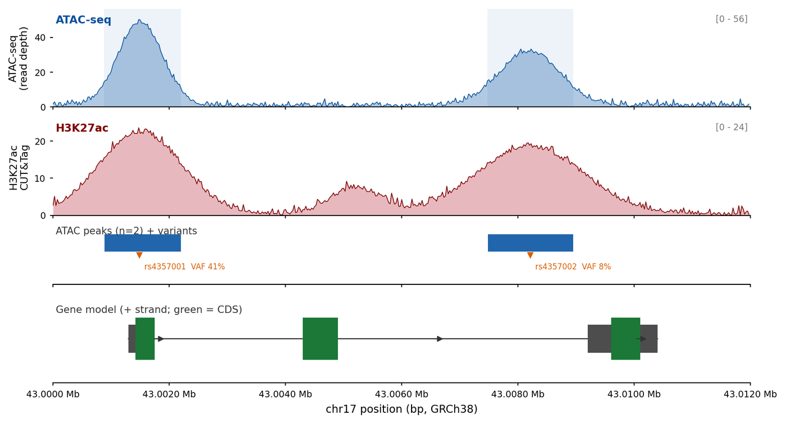

基因组浏览器截图只有在由轨道拼装而成时才算一张图：覆盖度、变异等位频率、基因模型与染色质信号共享同一坐标轴。这一版式的出版级实现即 **pyGenomeTracks** \[1\] 与 **trackplot** \[2\] 的产物——内容与浏览器相同，但边界是一个明确声明的坐标区间，而不是一张截图。

本页用纯 `matplotlib` 构建四轨道版式，每条轨道都是一个坐标数组的函数。这里**不**依赖 pyGenomeTracks 与 figeno：二者都较重（pyBigWig、deeptools、h5py，外加 CLI 与 INI 配置），而这张图只需要四个坐标轴和一条共享的 x 轴。

## 示例

{fig-alt="基因组轨道图（Python）DEMO" fig-align="center" width="85%"}

chr17（GRCh38）12 kb 窗口的四轨道基因组浏览器视图：ATAC-seq 覆盖度、H3K27ac 信号、判定的 ATAC 峰与基因模型，全部共用一条坐标轴。启动子峰处带有一个等位分数 41% 的 eQTL，较弱的增强子峰则标注为候选调控元件。

## Setup

-   系统要求：跨平台（Linux/MacOS/Windows）

-   编程语言：Python

-   依赖包：`matplotlib`；`numpy`；`pandas`

```{python}
#| label: packages-setup
#| output: false
import matplotlib.pyplot as plt
import numpy as np
import pandas as pd
```

## 数据准备

选取 chr17 上一个 12 kb 窗口，围绕一个含三个外显子的基因。四条轨道分别是：ATAC-seq 覆盖度（可及性）、H3K27ac 信号（活性）、峰区间调用结果，以及基因模型。这是多轨道浏览器图总是携带的四类信息，且每一类都能由排序后的 BAM 加上 BED/GFF 推导出来。

```{python}
#| label: data-prep
rng = np.random.default_rng(4357)

window_start, window_end = 43_000_000, 43_012_000
pos = np.arange(window_start, window_end, 25)
rel = pos - window_start

def gaussian_sum(centres, heights, widths):
    out = np.zeros_like(rel, dtype=float)
    for c, h, w in zip(centres, heights, widths):
        out += h * np.exp(-0.5 * ((rel - c) / w) ** 2)
    return out

## Two ATAC-seq signal domains: a promoter-proximal peak and an enhancer.
atac = gaussian_sum([1500, 8200], [48, 31], [380, 520])
atac += np.abs(rng.normal(0, 1.6, rel.size))
atac = np.clip(atac, 0, None)

h3k27ac = gaussian_sum([1500, 8200, 5200], [22, 18, 7], [700, 900, 420])
h3k27ac += np.abs(rng.normal(0, 0.9, rel.size))
h3k27ac = np.clip(h3k27ac, 0, None)

## Peaks are called where the ATAC signal exceeds a threshold for >= 200 bp.
above = atac > 12
edges = np.flatnonzero(np.diff(np.r_[0, above.astype(int), 0]))
peaks = pd.DataFrame({
    "start": window_start + rel[edges[0::2]],
    "end": window_start + rel[np.minimum(edges[1::2], rel.size - 1)],
})
peaks["width"] = peaks["end"] - peaks["start"]
peaks = peaks[peaks["width"] >= 200].reset_index(drop=True)

## An eQTL SNP in the promoter peak, with allele fractions from tumour RNA.
variants = pd.DataFrame({
    "pos": [window_start + 1480, window_start + 8210],
    "name": ["rs4357001", "rs4357002"],
    "vaf": [0.41, 0.08],
    "depth": [84, 97],
})

exons = pd.DataFrame({
    "exon": [1, 2, 3],
    "start": [window_start + 1300, window_start + 4300, window_start + 9200],
    "end": [window_start + 1750, window_start + 4900, window_start + 10400],
    "cds_start": [window_start + 1420, window_start + 4300, window_start + 9600],
    "cds_end": [window_start + 1750, window_start + 4900, window_start + 10100],
})

pd.DataFrame({
    "track": ["ATAC-seq", "H3K27ac"],
    "max": [atac.max(), h3k27ac.max()],
    "mean": [atac.mean(), h3k27ac.mean()],
}).round(2)
```

## 可视化

### 1. 共享单一坐标轴的四轨道浏览器视图

多轨道图正确与否的定义性特征是：所有轨道共享*同一条* x 轴，纵向顺序只编码轨道身份。信号轨道各有独立 y 轴范围（并在轴上声明），区间轨道占固定带，基因模型带链方向箭头。

```{python}
#| label: fig-1.1TrackView
#| fig-cap: "chr17（GRCh38）12 kb 窗口的四轨道浏览器视图：ATAC-seq 覆盖度、H3K27ac 信号、调用的 ATAC 峰，以及基因模型。四条轨道共享同一坐标轴；启动子峰内有一个等位频率 41% 的 eQTL，较弱的增强子峰被标为候选调控元件。"
#| fig-width: 10
#| fig-height: 5.4
#| fig-dpi: 300

fig, axes = plt.subplots(
    4, 1, figsize=(10, 5.4), sharex=True,
    gridspec_kw={"height_ratios": [1.0, 1.0, 0.60, 0.9], "hspace": 0.12}
)

## ---- track 1: ATAC-seq coverage ---------------------------------------
ax = axes[0]
ax.fill_between(pos, atac, color="#2166ac", alpha=0.35, linewidth=0)
ax.plot(pos, atac, color="#08519c", linewidth=0.6)
for _, p in peaks.iterrows():
    ax.axvspan(p["start"], p["end"], color="#2166ac", alpha=0.08, linewidth=0)
ax.set_ylabel("ATAC-seq\n(read depth)", fontsize=8.2)
ax.set_ylim(0, atac.max() * 1.12)
ax.text(0.004, 0.94, "ATAC-seq", transform=ax.transAxes, fontsize=8.6,
        fontweight="bold", va="top", color="#08519c")
ax.text(0.996, 0.94, f"[0 - {int(atac.max() * 1.12)}]", transform=ax.transAxes,
        fontsize=7, ha="right", va="top", color="#777777")

## ---- track 2: H3K27ac -------------------------------------------------
ax = axes[1]
ax.fill_between(pos, h3k27ac, color="#b2182b", alpha=0.30, linewidth=0)
ax.plot(pos, h3k27ac, color="#7f0000", linewidth=0.6)
ax.set_ylabel("H3K27ac\nCUT&Tag", fontsize=8.2)
ax.set_ylim(0, h3k27ac.max() * 1.12)
ax.text(0.004, 0.94, "H3K27ac", transform=ax.transAxes, fontsize=8.6,
        fontweight="bold", va="top", color="#7f0000")
ax.text(0.996, 0.94, f"[0 - {int(h3k27ac.max() * 1.12)}]", transform=ax.transAxes,
        fontsize=7, ha="right", va="top", color="#777777")

## ---- track 3: peaks ---------------------------------------------------
ax = axes[2]
## Peaks occupy the top half of this track; the variant row lives below
## them, so the two never overlap.
for _, p in peaks.iterrows():
    ax.add_patch(plt.Rectangle((p["start"], 0.56), p["width"], 0.30,
                               facecolor="#2166ac", edgecolor="white",
                               linewidth=0.4))
ax.set_ylim(0, 1)
ax.set_yticks([])
ax.text(0.004, 0.98, f"ATAC peaks (n={len(peaks)}) + variants",
        transform=ax.transAxes, fontsize=7.8, va="top", color="#333333")
for _, v in variants.iterrows():
    ax.plot([v["pos"]], [0.50], marker="v", markersize=4.0, color="#d95f02")
    ax.text(v["pos"] + 90, 0.30, f"{v['name']}  VAF {v['vaf']:.0%}",
            ha="left", va="center", fontsize=6.2, color="#d95f02")

## 8.2 kb 处较弱的 H3K27ac/ATAC 峰就是图注所说的候选增强子。这里标出真实的
## 峰区间，并把注记挂在该区间上，使这处提示来自数据而不是页边文字。
## 取峰中心距 8.2 kb 最近的那一个峰，保证方框与标签指向同一个区间。
peak_centre = peaks["start"] + peaks["width"] / 2
enhancer_peak = peaks.loc[(peak_centre - (window_start + 8200)).abs().idxmin()]
axes[0].annotate(
    "candidate\nregulatory element",
    xy=(enhancer_peak["start"] + enhancer_peak["width"] / 2,
        atac.max() * 0.42),
    xytext=(enhancer_peak["start"] + enhancer_peak["width"] / 2,
            atac.max() * 0.82),
    ha="center", va="bottom", fontsize=5.8, color="#b2182b",
    arrowprops=dict(arrowstyle="-", color="#b2182b", lw=0.6),
)
axes[0].add_patch(plt.Rectangle(
    (enhancer_peak["start"], 0), enhancer_peak["width"], atac.max() * 0.42,
    facecolor="none", edgecolor="#b2182b", linewidth=0.7, linestyle="--"))

## ---- track 4: gene model ----------------------------------------------
ax = axes[3]
y = 0.5
ax.plot([exons["start"].min(), exons["end"].max()], [y, y], color="#333333",
        linewidth=0.9, zorder=1)
for _, e in exons.iterrows():
    ax.add_patch(plt.Rectangle((e["start"], y - 0.16),
                               e["end"] - e["start"], 0.32,
                               facecolor="#4d4d4d", edgecolor="none", zorder=2))
    ax.add_patch(plt.Rectangle((e["cds_start"], y - 0.24),
                               e["cds_end"] - e["cds_start"], 0.48,
                               facecolor="#1b7837", edgecolor="none", zorder=3))
## 方向依据：三个外显子的 CDS 起点依次右移（1420 -> 4300 -> 9600），
## 这才是 + 链的判据。箭头一律落在外显子之间的内含子里，不压外显子或 UTR。
for x_arrow in (window_start + 3000, window_start + 6500,
                window_start + 11000):
    ax.annotate("", xy=(x_arrow + 260, y), xytext=(x_arrow, y),
                arrowprops=dict(arrowstyle="-|>", color="#333333", lw=0.7))
ax.set_ylim(0, 1)
ax.set_yticks([])
ax.text(0.004, 0.88, "Gene model (+ strand; green = CDS)", transform=ax.transAxes,
        fontsize=8.0, va="top", color="#333333")

## ---- shared cosmetics -------------------------------------------------
for ax in axes:
    for side in ("top", "right", "left"):
        ax.spines[side].set_visible(False)
    ax.tick_params(axis="both", labelsize=7.2, length=2.4)
    ax.set_xlim(window_start, window_end)
axes[-1].set_xlabel("chr17 position (bp, GRCh38)", fontsize=8.6)
axes[-1].xaxis.set_major_formatter(
    plt.FuncFormatter(lambda v, _: f"{v / 1e6:.4f} Mb"))
plt.show()
```

::: callout-tip
**Practice tips**

-   必须共享 x 轴，绝不要单独缩放某条轨道。浏览器版式的全部意义就在于：一条竖线在所有轨道上代表同一个碱基。
-   在轴上声明每条信号轨道的 y 范围（此处 `[0 - 56]`）；自动缩放的 ATAC 轨道与固定刻度的看起来一样，但对峰高所支持的主张完全不同。
-   轨道顺序要符合物理直觉：信号、区间、模型。把基因模型放到最上面会迫使视线先下后上，才能把峰与其基因对应起来。
-   在区间轨道上标出变异及其 VAF；只有峰是描述性的，而"峰 + 41% eQTL"才是机制。
-   图注中写明基因组版本与精确窗口；没有坐标的浏览器图就只是截图。
:::

### 2. 跨条件的堆叠信号汇总

浏览器视图只展示一个样本，而论文通常需要两三个。横向并排会让竖直空间增至三倍，因此把同一窗口重复绘制、共享坐标轴，并增加一条差异轨道——这正是展示条件特异信号获得的标准做法。

```{python}
#| label: fig-1.2ConditionStack
#| fig-cap: "同一窗口下两个条件的 ATAC-seq：野生型与敲低，下方为野生型减敲低的差异轨道。8.2 kb 处增强子峰几乎完全失去可及性，而启动子峰不变——差异轨道把这一点显式呈现。"
#| fig-width: 10
#| fig-height: 4.4
#| fig-dpi: 300

## A second condition: the enhancer collapses, the promoter does not.
atac_kd = atac * np.where(rel > 6000, 0.22, 0.98)
atac_kd = np.clip(atac_kd + np.abs(rng.normal(0, 1.2, rel.size)), 0, None)
diff = atac - atac_kd

fig, axes = plt.subplots(3, 1, figsize=(10, 4.4), sharex=True,
                         gridspec_kw={"height_ratios": [1, 1, 0.7],
                                      "hspace": 0.14})

for ax, sig, label, colour in [
    (axes[0], atac, "Wild type", "#2166ac"),
    (axes[1], atac_kd, "Knockdown", "#2166ac"),
]:
    ax.fill_between(pos, sig, color=colour, alpha=0.32, linewidth=0)
    ax.plot(pos, sig, color=colour, linewidth=0.6)
    ax.set_ylim(0, atac.max() * 1.12)
    ax.set_ylabel("ATAC-seq", fontsize=8.2)
    ax.text(0.004, 0.93, label, transform=ax.transAxes, fontsize=8.4,
            fontweight="bold", va="top", color=colour)
    for side in ("top", "right", "left"):
        ax.spines[side].set_visible(False)
    ax.tick_params(labelsize=7.2, length=2.4)

ax = axes[2]
ax.fill_between(pos, diff, where=diff >= 0, color="#2166ac", alpha=0.45,
                linewidth=0)
ax.fill_between(pos, diff, where=diff < 0, color="#b2182b", alpha=0.45,
                linewidth=0)
ax.plot(pos, diff, color="#333333", linewidth=0.5)
ax.axhline(0, color="#999999", linewidth=0.4)
ax.set_ylim(-atac.max() * 0.55, atac.max() * 0.55)
ax.set_ylabel("WT - KD", fontsize=8.2)
ax.text(0.004, 0.92, "difference", transform=ax.transAxes, fontsize=8.4,
        fontweight="bold", va="top", color="#333333")
for side in ("top", "right", "left"):
    ax.spines[side].set_visible(False)
ax.tick_params(labelsize=7.2, length=2.4)
ax.set_xlim(window_start, window_end)
ax.set_xlabel("chr17 position (bp, GRCh38)", fontsize=8.6)
ax.xaxis.set_major_formatter(
    plt.FuncFormatter(lambda v, _: f"{v / 1e6:.4f} Mb"))
plt.show()
```

::: callout-tip
**Practice tips**

-   在计算差异*之前*先让各条件共享 y 范围；分别归一化的面板会造出虚假差异。
-   差异轨道需要围绕零对称的 y 轴，否则"增益/缺失"的配色会被误读成第二条信号轨道。
-   在轴标题中写明所做比较（WT − KD，而非"倍数变化"）；相减与对数比值之间的差别不止一个变换。
-   三个堆叠面板是实用上限；再多应改用小多图（small multiples）分面，以免共享 x 轴被拉宽到超出印刷尺寸。
:::

## 关于本页跳过的实现

本页刻意只用基础图形自行绘制。在 issue-435 清单中归到 Python/GenomeTrackPlot 的工具里，有 3 条被标记为**跳过**，仅作为版式参考、不作为依赖：其中 0 条超过 5 年无运维更新（截止日 2021-11-07），3 条依赖闭包过重，不值得为一张静态图引入。沿用这些工具，等于锁定已废弃的代码；安装另一批，则要把整套分析框架拖进文档构建。本页先把这些工具的图形约定读懂，再自行重画，以便逐行核验每个面板。

| 工具 | 最近提交 | 状态 | 跳过原因 |
| --- | --- | --- | --- |
| CoolBox | — | 依赖过重 | 框架级依赖闭包过重，不值得为一张静态图引入 |
| figeno | 2025-12-12 | 依赖过重 | 框架级依赖闭包过重，不值得为一张静态图引入 |
| pyGenomeTracks | 2026-10-03 | 依赖过重 | 框架级依赖闭包过重，不值得为一张静态图引入 |

## 应用

多轨道浏览器图是调控基因组学的通用语言：它为一个峰的调用提供依据、把一个变异连接到基因，或显示某个染色质结构域在处理后丢失。用 matplotlib 构建版式而不是导出浏览器截图，意味着配色、刻度与轨道顺序可跨论文复现，且审稿人能直接从轴上读出每条轨道的 y 范围。

同一四轨道骨架适用于 ATAC-seq/CUT&Tag、ChIP-seq、亚硫酸氢盐覆盖度、RNA-seq 覆盖度以及 Hi-C 子矩阵（把信号轨道换成热图轨道即可）——这正是 pyGenomeTracks 与 figeno 最终都收敛到这一版式的原因。

## 参考文献

\[1\] Lopez-Delisle L, Rabbani L, Wolff J, et al. pyGenomeTracks: reproducible plots for multivariate genomic datasets. Bioinformatics. 2021;37(3):422-423. doi:10.1093/bioinformatics/btaa692

\[2\] Xu Y, Zhou X, Shang X, et al. trackplot: a fast, flexible and lightweight tool for plotting genomic tracks. PLoS Comput Biol. 2023;19(9):e1011477. doi:10.1371/journal.pcbi.1011477

\[3\] Ramírez F, Ryan DP, Grüning B, et al. deepTools2: a next generation web server for deep-sequencing data analysis. Nucleic Acids Res. 2016;44(W1):W160-W165. doi:10.1093/nar/gkw257
