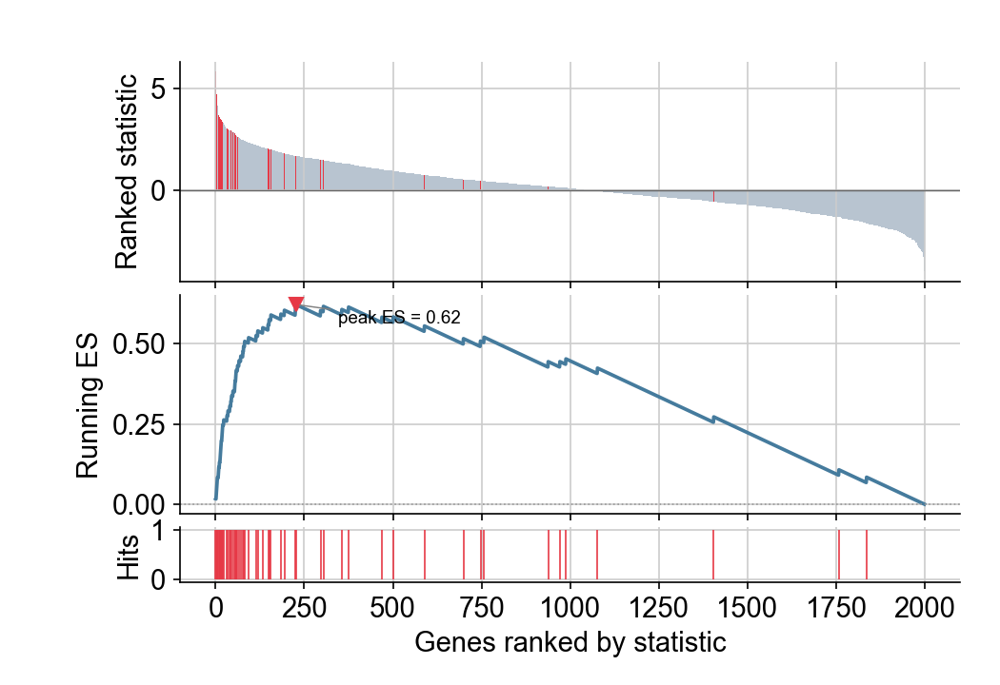

GSEA 运行分数图解释一个基因集**为什么**富集：排好序的基因列表（上）、在集合成员命中时上升、未命中时下降的行走富集分数（中）、以及集合成员地毯（下）。`gseapy` 等工具可以自动产出；用 `matplotlib` 图元手工构建则让统计量本身变得可读。

## 示例

{fig-align="center" width="80%"}

## 环境配置

- 系统要求：跨平台（Linux/MacOS/Windows）
- 编程语言：**Python**
- 依赖包：`matplotlib`、`seaborn`、`pandas`、`numpy`

```{python}
#| label: packages-setup
#| output: false
import matplotlib.pyplot as plt
import seaborn as sns
import pandas as pd
import numpy as np
```

## 数据准备

我们模拟一张排序基因表（2,000 个基因按 Wald 型统计量排序），并声明一个集中在前排的 60 基因集合——这正是产生高富集分数的配置。

```{python}
#| label: data-prep
np.random.seed(251)

n = 2000
stats = np.random.normal(0, 1.2, n)
set_members = np.zeros(n, dtype=bool)
set_members[5:65] = True                      # 60 个集合基因位于前排
stats[set_members] += np.random.normal(2.4, 0.8, 60)

ranked = pd.DataFrame({'Stat': stats},
                      index=[f'GENE{i:04d}' for i in range(1, n + 1)])
ranked = ranked.sort_values('Stat', ascending=False)

hit = set_members[np.argsort(-stats)]
# 行走分数：命中集合基因 +1/|集合|，其余 -1/(N-|集合|)
es = np.cumsum(np.where(hit, 1 / np.sum(hit), -1 / (n - np.sum(hit))))
peak = int(np.argmax(np.abs(es)))
```

## 可视化

### 双面板运行分数

经典布局：排序统计量条形（上）、带峰值标注的运行 ES 曲线（中）、集合成员地毯（下）——三个面板共享基因秩的 x 轴。

```{python}
#| label: fig-py-gsea
#| fig-cap: "GSEA 运行分数图：排序统计、ES 曲线与命中地毯"
#| width: 78%
#| fig-align: center
positions = np.arange(n)

fig, (ax_stat, ax_es, ax_hit) = plt.subplots(
    3, 1, figsize=(7, 4.8), sharex=True,
    gridspec_kw={'height_ratios': [2, 2, 0.5], 'hspace': 0.08})

ax_stat.bar(positions, ranked.Stat, color=np.where(hit, '#e63946', '#b8c4d0'),
            width=1.0, linewidth=0)
ax_stat.axhline(0, color='0.4', linewidth=0.7)
ax_stat.set_ylabel('Ranked statistic')

ax_es.plot(positions, es, color='#457b9d', linewidth=1.8)
ax_es.axhline(0, color='0.6', linewidth=0.8, linestyle=':')
ax_es.plot(peak, es[peak], marker='v', color='#e63946', markersize=7)
ax_es.annotate(f'peak ES = {es[peak]:.2f}', xy=(peak, es[peak]),
               xytext=(peak + 120, es[peak] - 0.06), fontsize=9,
               arrowprops=dict(arrowstyle='-', color='0.5', lw=0.7))
ax_es.set_ylabel('Running ES')

ax_hit.vlines(positions[hit], 0, 1, color='#e63946', linewidth=0.8)
ax_hit.set_ylabel('Hits')

for ax in (ax_stat, ax_es, ax_hit):
    ax.spines[['top', 'right']].set_visible(False)
ax_hit.set_xlabel('Genes ranked by statistic')
plt.tight_layout()
plt.show()
```

### 两个集合的对比

在同一排序上叠加两个基因集的运行分数，特异性对比一目了然；图例携带各自峰值 ES。

```{python}
#| label: fig-py-gsea-two
#| fig-cap: "同一排序上两个基因集的运行 ES"
#| width: 78%
#| fig-align: center
set2 = np.zeros(n, dtype=bool)
set2[800:900] = True
hit2 = set2[np.argsort(-stats)]
es2 = np.cumsum(np.where(hit2, 1 / 100, -1 / (n - 100)))

fig, ax = plt.subplots(figsize=(7, 3.6))
ax.plot(positions, es, color='#e63946', linewidth=1.8,
        label=f'Set 1 (peak {es[peak]:.2f})')
ax.plot(positions, es2, color='#457b9d', linewidth=1.8,
        label=f'Set 2 (peak {es2[np.argmax(np.abs(es2))]:.2f})')
ax.axhline(0, color='0.6', linewidth=0.8, linestyle=':')
ax.set_xlabel('Genes ranked by statistic')
ax.set_ylabel('Running ES')
ax.legend(frameon=False)
ax.spines[['top', 'right']].set_visible(False)
plt.tight_layout()
plt.show()
```

## 参考文献

1. Subramanian, A., et al. (2005). Gene Set Enrichment Analysis: A Knowledge-Based Approach for Interpreting Genome-Wide Expression Profiles. *PNAS*, 102(43), 15545-15550.
2. Korotkevich, G., et al. (2021). Fast gene set enrichment analysis. bioRxiv 060012.
