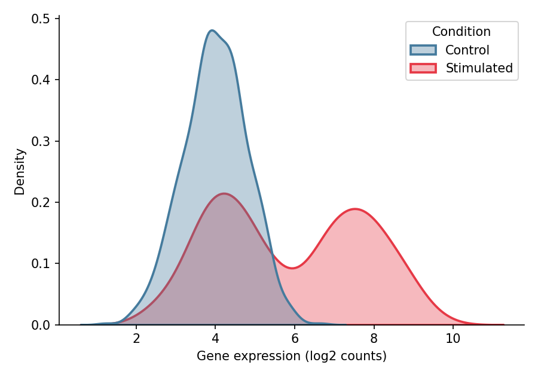

直方图与核密度估计（KDE）揭示分布的形状——众数、偏度和离散程度，这些是汇总统计量无法呈现的。在生物医学研究中，它们常用于在统计建模之前检查基因表达分布、荧光强度轮廓和质量控制指标。Python 的 `seaborn` 以统一的接口提供直方图、密度曲线和经验累积分布（ECDF）展示。

## 示例

{fig-align="center" width="80%"}

## 环境配置

- 系统要求：跨平台（Linux/MacOS/Windows）
- 编程语言：**Python**
- 依赖包：`matplotlib`、`seaborn`、`pandas`、`numpy`

```{python}
#| label: packages-setup
#| output: false
import matplotlib.pyplot as plt
import seaborn as sns
import pandas as pd
import numpy as np
```

## 数据准备

我们模拟一个基因在对照与刺激两种条件下的表达测量。刺激条件是两个细胞亚群的混合，产生直方图与 KDE 旨在揭示的双峰结构。

```{python}
#| label: data-prep
np.random.seed(11)

n = 800
expr = np.concatenate([
    np.random.normal(4.0, 0.8, n),        # 对照
    np.random.normal(4.2, 0.8, n // 2),   # 刺激，亚群 A
    np.random.normal(7.5, 0.9, n // 2),   # 刺激，亚群 B
])
df = pd.DataFrame({
    'Expression': expr,
    'Condition': np.repeat(['Control', 'Stimulated'], [n, n])
})
```

## 可视化

### 直方图

分箱宽度控制偏差–方差的权衡：分箱太少会隐藏结构，太多则放大噪声。拿不准时，可比较 `bins=15` 与更细的分箱设置。

```{python}
#| label: fig-py-hist-basic
#| fig-cap: "模拟表达值的直方图"
#| width: 70%
#| fig-align: center
plt.figure(figsize=(6, 4.2))
ax = sns.histplot(data=df, x='Expression', bins=30,
                  color='#8da0cb', edgecolor='white', linewidth=0.6)
ax.set_xlabel('Gene expression (log2 counts)')
ax.set_ylabel('Count')
ax.spines[['top', 'right']].set_visible(False)
plt.tight_layout()
plt.show()
```

### 直方图叠加核密度

在计数轴上叠加核密度曲线，既能勾勒分布轮廓，又保留了原始计数信息。

```{python}
#| label: fig-py-hist-kde
#| fig-cap: "直方图叠加核密度曲线"
#| width: 70%
#| fig-align: center
plt.figure(figsize=(6, 4.2))
ax = sns.histplot(data=df, x='Expression', bins=30, kde=True,
                  color='#66c2a5', edgecolor='white', linewidth=0.6,
                  line_kws=dict(linewidth=1.8))
ax.set_xlabel('Gene expression (log2 counts)')
ax.set_ylabel('Count')
ax.spines[['top', 'right']].set_visible(False)
plt.tight_layout()
plt.show()
```

### 分组密度曲线比较

对于两组或多组数据，按条件逐一叠加密度曲线，可直接看出刺激样本的双峰特征。

```{python}
#| label: fig-py-kde-groups
#| fig-cap: "对照与刺激条件的密度曲线叠加"
#| width: 70%
#| fig-align: center
plt.figure(figsize=(6, 4.2))
ax = sns.kdeplot(data=df, x='Expression', hue='Condition',
                 fill=True, common_norm=False, alpha=0.35,
                 palette={'Control': '#457b9d', 'Stimulated': '#e63946'},
                 linewidth=1.8)
ax.set_xlabel('Gene expression (log2 counts)')
ax.set_ylabel('Density')
ax.spines[['top', 'right']].set_visible(False)
plt.tight_layout()
plt.show()
```

### 经验累积分布函数

ECDF 无需分箱或平滑即可展示每个观测值，是审查队列间分布漂移的理想工具。

```{python}
#| label: fig-py-ecdf
#| fig-cap: "按条件分组经验累积分布函数"
#| width: 70%
#| fig-align: center
plt.figure(figsize=(6, 4.2))
ax = sns.ecdfplot(data=df, x='Expression', hue='Condition',
                  palette={'Control': '#457b9d', 'Stimulated': '#e63946'},
                  linewidth=1.8)
ax.set_xlabel('Gene expression (log2 counts)')
ax.set_ylabel('Proportion')
ax.spines[['top', 'right']].set_visible(False)
plt.tight_layout()
plt.show()
```

## 参考文献

1. Hunter, J. D. (2007). Matplotlib: A 2D graphics environment. *Computing in Science & Engineering*, 9(3), 90-95.
2. Waskom, M. L. (2021). seaborn: statistical data visualization. *Journal of Open Source Software*, 6(60), 3021.
