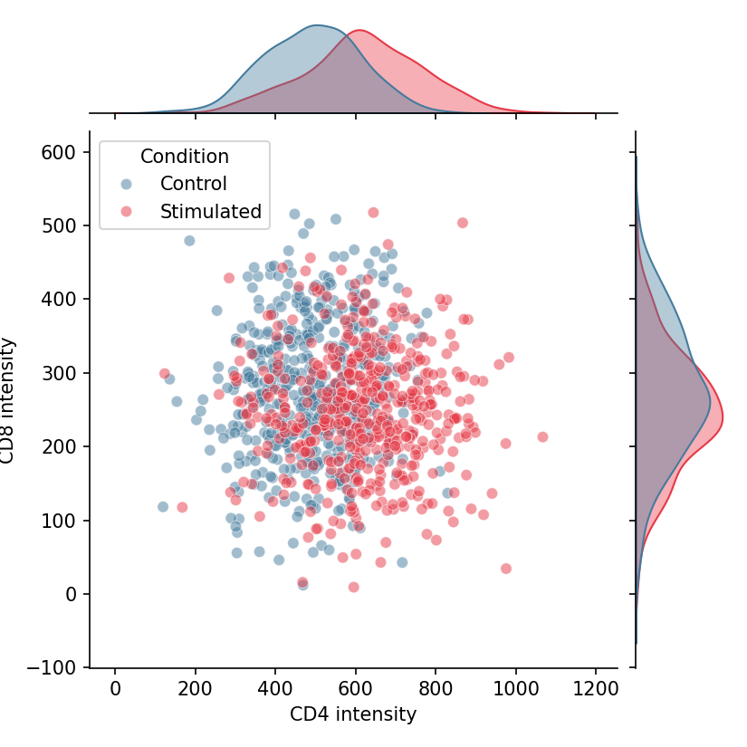

A joint plot pairs a bivariate display (scatter or KDE) with the marginal distributions of each variable along the axes; a pair plot extends this idea to every pairwise combination of variables in a matrix. In biomedical research they are the standard first look at how measurements co-vary — marker-to-marker correlations, biomarker panels, or multi-assay quality metrics. `seaborn` provides both through `jointplot` and `pairplot`.

## Example

{fig-align="center" width="80%"}

## Setup

- System Requirements: Cross-platform (Linux/MacOS/Windows)
- Programming Language: **Python**
- Dependencies: `matplotlib`, `seaborn`, `pandas`, `numpy`

```{python}
#| label: packages-setup
#| output: false
import matplotlib.pyplot as plt
import seaborn as sns
import pandas as pd
import numpy as np
```

## Data Preparation

We simulate a two-marker flow panel across stimulated and control cells, and load the classic `iris` measurements for the multi-variable pair plot.

```{python}
#| label: data-prep
np.random.seed(61)

n = 500
flow = pd.DataFrame({
    'CD4': np.concatenate([np.random.normal(500, 120, n),
                           np.random.normal(620, 140, n)]),
    'CD8': np.concatenate([np.random.normal(280, 90, n),
                           np.random.normal(250, 85, n)]),
    'Condition': np.repeat(['Control', 'Stimulated'], n)
})
```

## Visualization

### Joint Plot with Scatter and Marginals

`seaborn.jointplot` draws the central scatter plus marginal histograms; `hue` splits both the joint and marginal layers by condition.

```{python}
#| label: fig-py-joint-scatter
#| fig-cap: "Joint plot of CD4 vs CD8 with marginal distributions"
#| width: 75%
#| fig-align: center
g = sns.jointplot(data=flow, x='CD4', y='CD8', hue='Condition',
                  palette={'Control': '#457b9d', 'Stimulated': '#e63946'},
                  alpha=0.5, height=5.5, marginal_kws=dict(fill=True, alpha=0.4))
g.set_axis_labels('CD4 intensity', 'CD8 intensity')
plt.show()
```

### Joint Plot with KDE and Hexbin

For dense samples, switch the central layer: `kind='kde'` contours the bivariate density, while `kind='hex'` bins millions of points without overplotting.

```{python}
#| label: fig-py-joint-kde
#| fig-cap: "Joint plot with KDE contours and density marginals"
#| width: 75%
#| fig-align: center
g = sns.jointplot(data=flow, x='CD4', y='CD8', hue='Condition',
                  kind='kde',
                  palette={'Control': '#457b9d', 'Stimulated': '#e63946'},
                  height=5.5, marginal_kws=dict(fill=True, alpha=0.4),
                  joint_kws=dict(alpha=0.7))
g.set_axis_labels('CD4 intensity', 'CD8 intensity')
plt.show()
```

### Pair Plot Matrix

`seaborn.pairplot` builds the full scatterplot matrix with diagonals showing each variable's distribution; `corner=True` removes the redundant upper triangle.

```{python}
#| label: fig-py-pairplot
#| fig-cap: "Pair plot of iris measurements by species (corner layout)"
#| width: 85%
#| fig-align: center
iris = sns.load_dataset('iris')
g = sns.pairplot(iris, hue='species', corner=True,
                 palette='Set2',
                 plot_kws=dict(alpha=0.6, s=20),
                 diag_kws=dict(fill=True, alpha=0.4))
plt.show()
```

## References

1. Waskom, M. L. (2021). seaborn: statistical data visualization. *Journal of Open Source Software*, 6(60), 3021.
2. Hunter, J. D. (2007). Matplotlib: A 2D graphics environment. *Computing in Science & Engineering*, 9(3), 90-95.
