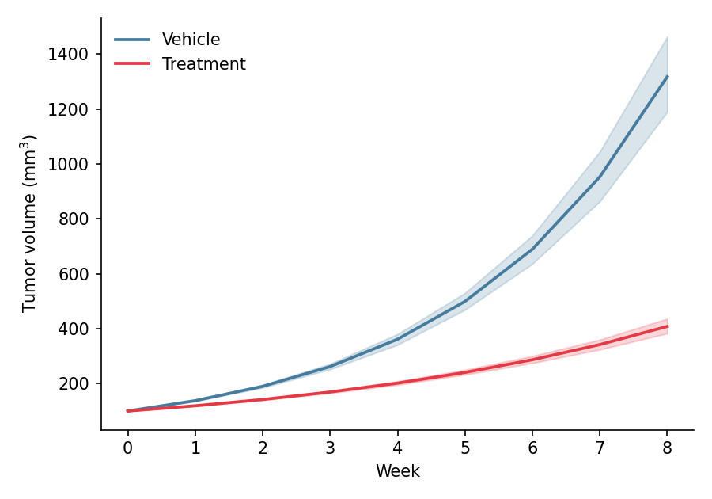

A line plot displays the trend of a continuous variable over an ordered axis such as time. In biomedical research, line plots are the standard figure for growth curves, pharmacokinetic profiles, and longitudinal omics time courses, usually with an uncertainty band around the group mean. Python's `seaborn` aggregates replicates into a mean line with a confidence band in a single call, while `matplotlib` provides fine-grained styling.

## Example

{fig-align="center" width="80%"}

## Setup

- System Requirements: Cross-platform (Linux/MacOS/Windows)
- Programming Language: **Python**
- Dependencies: `matplotlib`, `seaborn`, `pandas`, `numpy`

```{python}
#| label: packages-setup
#| output: false
import matplotlib.pyplot as plt
import seaborn as sns
import pandas as pd
import numpy as np
```

## Data Preparation

We simulate a preclinical tumor-growth study: 12 mice per arm (vehicle vs treatment) measured weekly for 8 weeks, using a two-phase exponential growth model with mouse-to-mouse variability.

```{python}
#| label: data-prep
np.random.seed(21)

weeks = np.arange(0, 9)
n_mice = 12
records = []
for arm, growth_rate in [('Vehicle', 0.32), ('Treatment', 0.18)]:
    for mouse in range(n_mice):
        size = 100 * np.exp(growth_rate * np.random.normal(1, 0.08) * weeks)
        records.append(pd.DataFrame({
            'Week': weeks,
            'Size': size,
            'Arm': arm,
            'Mouse': f'{arm[:2]}_{mouse:02d}'
        }))
tumor = pd.concat(records, ignore_index=True)
```

## Visualization

### Basic Line Plot

Aggregate first, then draw: one line per group with distinct markers keeps small summaries readable.

```{python}
#| label: fig-py-line-basic
#| fig-cap: "Mean tumor size per week for the two treatment arms"
#| width: 70%
#| fig-align: center
mean_size = tumor.groupby(['Arm', 'Week'], as_index=False)['Size'].mean()

plt.figure(figsize=(6, 4.2))
ax = sns.lineplot(data=mean_size, x='Week', y='Size', hue='Arm',
                  style='Arm', markers=['o', 's'], markersize=6,
                  palette={'Vehicle': '#457b9d', 'Treatment': '#e63946'},
                  linewidth=1.8)
ax.set_xlabel('Week')
ax.set_ylabel('Tumor volume (mm$^3$)')
ax.legend(frameon=False, title=None)
ax.spines[['top', 'right']].set_visible(False)
plt.tight_layout()
plt.show()
```

### Line Plot with Confidence Band

Passing the raw replicate measurements to `seaborn.lineplot` with `errorbar=('ci', 95)` bootstraps a 95% confidence band around each group mean — the default uncertainty display in preclinical figures.

```{python}
#| label: fig-py-line-ci
#| fig-cap: "Group mean with bootstrapped 95% confidence band"
#| width: 70%
#| fig-align: center
plt.figure(figsize=(6, 4.2))
ax = sns.lineplot(data=tumor, x='Week', y='Size', hue='Arm',
                  errorbar=('ci', 95), err_kws=dict(alpha=0.2),
                  palette={'Vehicle': '#457b9d', 'Treatment': '#e63946'},
                  linewidth=1.8)
ax.set_xlabel('Week')
ax.set_ylabel('Tumor volume (mm$^3$)')
ax.legend(frameon=False, title=None)
ax.spines[['top', 'right']].set_visible(False)
plt.tight_layout()
plt.show()
```

### Spaghetti Plot with Population Mean

Showing every subject as a thin line behind the bold group mean communicates both the trend and the animal-to-animal variability — preferred by many journals over a band alone.

```{python}
#| label: fig-py-line-spaghetti
#| fig-cap: "Individual growth curves (thin) with the group mean (bold)"
#| width: 70%
#| fig-align: center
fig, ax = plt.subplots(figsize=(6, 4.2))
sns.lineplot(data=tumor, x='Week', y='Size', hue='Arm', units='Mouse',
             estimator=None, alpha=0.25, linewidth=0.9, legend=False,
             palette={'Vehicle': '#457b9d', 'Treatment': '#e63946'}, ax=ax)
mean_size = tumor.groupby(['Arm', 'Week'], as_index=False)['Size'].mean()
sns.lineplot(data=mean_size, x='Week', y='Size', hue='Arm',
             palette={'Vehicle': '#457b9d', 'Treatment': '#e63946'},
             linewidth=2.4, ax=ax)
ax.set_xlabel('Week')
ax.set_ylabel('Tumor volume (mm$^3$)')
ax.legend(frameon=False, title=None)
ax.spines[['top', 'right']].set_visible(False)
plt.tight_layout()
plt.show()
```

## References

1. Hunter, J. D. (2007). Matplotlib: A 2D graphics environment. *Computing in Science & Engineering*, 9(3), 90-95.
2. Waskom, M. L. (2021). seaborn: statistical data visualization. *Journal of Open Source Software*, 6(60), 3021.
