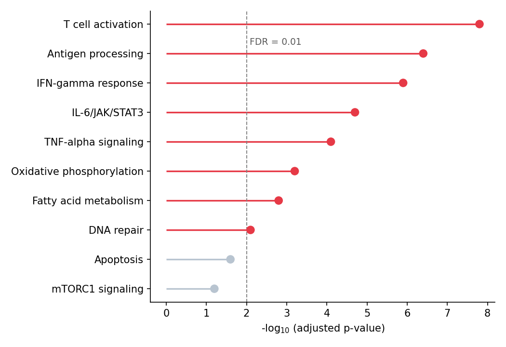

棒棒糖图用细线加端点的圆点替代条形图中的条形，在保持排序可读性的同时大幅削减图形墨量；哑铃图将每行两个圆点用线段连接，直观呈现两个条件间的变化。在生物医学研究中，棒棒糖图常用于富集条目或效应量的排序展示，哑铃图则用于逐特征比较两个队列、时间点或处理臂。二者均由 `matplotlib` 的基础线层与散点层组合而成。

## 示例

{fig-align="center" width="80%"}

## 环境配置

- 系统要求：跨平台（Linux/MacOS/Windows）
- 编程语言：**Python**
- 依赖包：`matplotlib`、`seaborn`、`pandas`、`numpy`

```{python}
#| label: packages-setup
#| output: false
import matplotlib.pyplot as plt
import seaborn as sns
import pandas as pd
import numpy as np
```

## 数据准备

我们模拟一个通路富集结果（基因集的 −log10 校正 p 值）和一张用于哑铃图的两条件差异表达表。

```{python}
#| label: data-prep
np.random.seed(51)

pathways = ['T cell activation', 'Antigen processing', 'IFN-gamma response',
            'IL-6/JAK/STAT3', 'TNF-alpha signaling', 'Oxidative phosphorylation',
            'Fatty acid metabolism', 'DNA repair', 'Apoptosis', 'mTORC1 signaling']
enrichment = pd.DataFrame({
    'Pathway': pathways,
    'NegLogFDR': np.array([7.8, 6.4, 5.9, 4.7, 4.1, 3.2, 2.8, 2.1, 1.6, 1.2])
}).sort_values('NegLogFDR')

deseq = pd.DataFrame({
    'Gene': ['CD274', 'IFIT1', 'CXCL10', 'MKI67', 'STAT1', 'IRF1',
             'TGFB1', 'BCL2', 'MYC', 'CD8A'],
    'log2FC_sham': np.array([-0.3, 2.1, 2.8, 0.5, 1.9, 1.6, -0.8, -1.1, 0.9, 0.4]),
    'log2FC_treat': np.array([1.4, 3.9, 4.6, -1.2, 3.3, 2.9, 0.3, -2.6, -1.8, 1.1])
})
```

## 可视化

### 横向棒棒糖图

排序棒棒糖图由 `hlines`（棒）与 `plot` 标记（糖）构成；显著条目可用颜色突出显示。

```{python}
#| label: fig-py-lollipop-basic
#| fig-cap: "通路富集的横向棒棒糖图排序"
#| width: 80%
#| fig-align: center
sig = enrichment['NegLogFDR'] >= 2  # -log10(FDR) >= 2  <=>  FDR <= 0.01
colors = np.where(sig, '#e63946', '#b8c4d0')

fig, ax = plt.subplots(figsize=(7, 4.8))
ax.hlines(enrichment['Pathway'], 0, enrichment['NegLogFDR'],
          color=colors, linewidth=1.6)
ax.scatter(enrichment['NegLogFDR'], enrichment['Pathway'],
           color=colors, s=55, zorder=3)
ax.axvline(2, color='0.5', linewidth=0.9, linestyle='--')
ax.text(2.08, 8.3, 'FDR = 0.01', color='0.35', fontsize=9)
ax.set_xlabel('-log$_{10}$ (adjusted p-value)')
ax.spines[['top', 'right']].set_visible(False)
plt.tight_layout()
plt.show()
```

### 纵向棒棒糖图

同样的构造用 `vlines` 旋转为纵向，适合标签较短或幻灯片场景。

```{python}
#| label: fig-py-lollipop-vertical
#| fig-cap: "富集分数的纵向棒棒糖图"
#| width: 80%
#| fig-align: center
top8 = enrichment.tail(8)

fig, ax = plt.subplots(figsize=(6.5, 4.4))
ax.vlines(top8['Pathway'], 0, top8['NegLogFDR'],
          color='#8da0cb', linewidth=1.6)
ax.scatter(top8['Pathway'], top8['NegLogFDR'],
           color='#8da0cb', s=55, zorder=3)
ax.set_ylabel('-log$_{10}$ (adjusted p-value)')
ax.tick_params(axis='x', rotation=45)
for label in ax.get_xticklabels():
    label.set_ha('right')
ax.spines[['top', 'right']].set_visible(False)
plt.tight_layout()
plt.show()
```

### 哑铃图

每个基因一条线段连接两个条件的倍数变化；两端圆点按条件着色，使变化的方向与幅度一目了然。

```{python}
#| label: fig-py-dumbbell
#| fig-cap: "比较两条件 log2 倍数变化的哑铃图"
#| width: 80%
#| fig-align: center
d = deseq.sort_values('log2FC_treat')

fig, ax = plt.subplots(figsize=(7, 4.8))
ax.hlines(d['Gene'], d['log2FC_sham'], d['log2FC_treat'],
          color='0.75', linewidth=2)
ax.scatter(d['log2FC_sham'], d['Gene'], color='#457b9d', s=55,
           label='Sham', zorder=3)
ax.scatter(d['log2FC_treat'], d['Gene'], color='#e63946', s=55,
           label='Treatment', zorder=3)
ax.axvline(0, color='0.4', linewidth=0.9)
ax.set_xlabel('log$_{2}$ fold change')
ax.legend(frameon=False, loc='lower right')
ax.spines[['top', 'right']].set_visible(False)
plt.tight_layout()
plt.show()
```

## 参考文献

1. Hunter, J. D. (2007). Matplotlib: A 2D graphics environment. *Computing in Science & Engineering*, 9(3), 90-95.
2. From Data to Viz. Lollipop plot. https://www.data-to-viz.com/graph/lollipop.html
