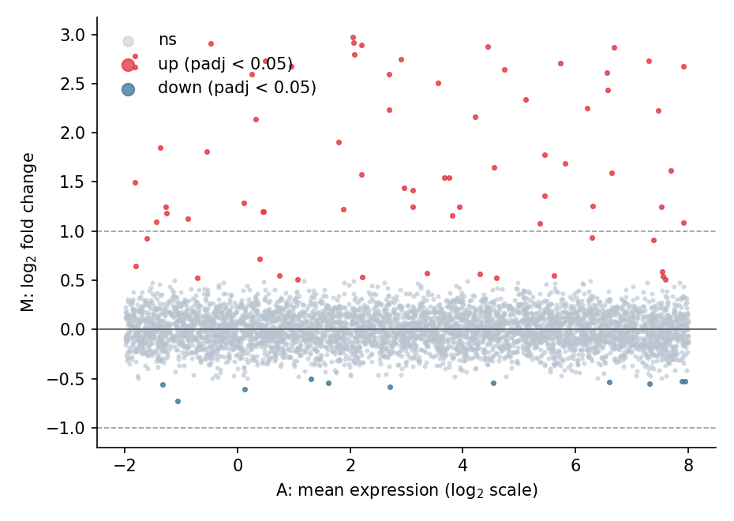

An MA plot places each feature at its average expression (A = mean of log-counts) against its log2 fold change (M), making the intensity-dependent bias of differential testing visible: well-behaved contrasts scatter around M = 0, while real signals lift off the baseline. It complements the volcano plot whenever a differential table is reviewed. The plot is a few matplotlib primitives on top of any DE frame.

## Example

{fig-align="center" width="80%"}

## Setup

- System Requirements: Cross-platform (Linux/MacOS/Windows)
- Programming Language: **Python**
- Dependencies: `matplotlib`, `pandas`, `numpy`

```{python}
#| label: packages-setup
#| output: false
import matplotlib.pyplot as plt
import pandas as pd
import numpy as np
```

## Data Preparation

We simulate a differential-expression table for 5,000 genes: a base expression range, small symmetric noise on the log2 fold change, and a injected set of 60 up-regulated genes (positive log2FC at various intensities).

```{python}
#| label: data-prep
np.random.seed(121)

n = 5000
de = pd.DataFrame({
    'baseMean_log': np.random.uniform(-2, 8, n),
})
de['log2FC'] = np.random.normal(0, 0.18, n)
de.loc[de.index[:60], 'log2FC'] = np.random.uniform(0.9, 3.0, 60)
de['padj'] = np.clip(
    10 ** (-np.abs(de.log2FC) * 9 - np.random.exponential(1.0, n)), 0, 1)
de.loc[de.log2FC.abs() < 0.5, 'padj'] = np.maximum(
    de.loc[de.log2FC.abs() < 0.5, 'padj'], 0.05)
de['sig'] = de.padj < 0.05
```

## Visualization

### Basic MA Plot

Symmetric log-like axes keep the A-range compact; reference lines at M = 0 and the |log2FC| = 1 thresholds give the eye a calibration.

```{python}
#| label: fig-py-ma-basic
#| fig-cap: "MA plot with significance colouring and fold-change guides"
#| width: 70%
#| fig-align: center
fig, ax = plt.subplots(figsize=(6.2, 4.4))
ax.scatter(de.loc[~de.sig, 'baseMean_log'], de.loc[~de.sig, 'log2FC'],
           s=4, color='#b8c4d0', alpha=0.5, label='ns', rasterized=True)
sig = de.sig & (de.log2FC > 0)
ax.scatter(de.loc[sig, 'baseMean_log'], de.loc[sig, 'log2FC'],
           s=6, color='#e63946', alpha=0.8, label='up (padj < 0.05)',
           rasterized=True)
sig_dn = de.sig & (de.log2FC < 0)
ax.scatter(de.loc[sig_dn, 'baseMean_log'], de.loc[sig_dn, 'log2FC'],
           s=6, color='#457b9d', alpha=0.8, label='down (padj < 0.05)',
           rasterized=True)
ax.axhline(0, color='0.4', linewidth=0.9)
for fc in (1, -1):
    ax.axhline(fc, color='0.6', linewidth=0.8, linestyle='--')
ax.set_xlabel('A: mean expression (log$_{2}$ scale)')
ax.set_ylabel('M: log$_{2}$ fold change')
ax.legend(frameon=False, markerscale=3, loc='upper left')
ax.spines[['top', 'right']].set_visible(False)
plt.tight_layout()
plt.show()
```

### MA Plot with Top Genes Labelled

Label the strongest hits so the plot doubles as a result summary; short, staggered offsets prevent the labels from colliding.

```{python}
#| label: fig-py-ma-labeled
#| fig-cap: "MA plot with the top-6 up-regulated genes labelled"
#| width: 70%
#| fig-align: center
top = de.nlargest(6, 'log2FC')

fig, ax = plt.subplots(figsize=(6.2, 4.4))
ax.scatter(de.baseMean_log, de.log2FC, s=4,
           color=np.where(de.sig, '#e63946', '#b8c4d0'),
           alpha=0.55, rasterized=True)
ax.axhline(0, color='0.4', linewidth=0.9)
for i, (_, row) in enumerate(top.iterrows()):
    ax.annotate(f'GENE{i+1}', xy=(row.baseMean_log, row.log2FC),
                xytext=(row.baseMean_log - 1.2, row.log2FC + 0.25 + 0.18 * (i % 3)),
                fontsize=8.5, color='0.15',
                arrowprops=dict(arrowstyle='-', color='0.5', lw=0.7))
ax.set_xlabel('A: mean expression (log$_{2}$ scale)')
ax.set_ylabel('M: log$_{2}$ fold change')
ax.spines[['top', 'right']].set_visible(False)
plt.tight_layout()
plt.show()
```

## References

1. Ritchie, M. E., et al. (2015). limma powers differential expression analyses for RNA-sequencing and microarray studies. *Nucleic Acids Research*, 43(7), e47.
2. Hunter, J. D. (2007). Matplotlib: A 2D graphics environment. *Computing in Science & Engineering*, 9(3), 90-95.
