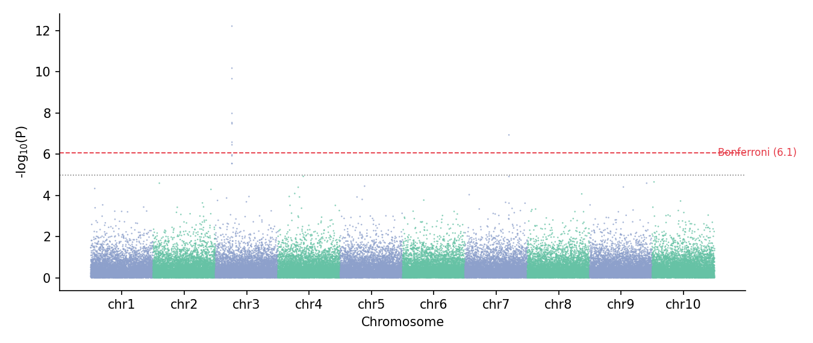

曼哈顿图把每个变异沿基因组排开（x = 染色体位置，y = −log10 p），关联峰从零假设的天际线中升起；配套的 QQ 图把观测 p 值分布与均匀期望比较，基因组膨胀因子 λ 概括混杂程度。二者都是 GWAS/QTL 的标准汇总图，在 `matplotlib` 中由散点图元组装。

## 示例

{fig-align="center" width="80%"}

## 环境配置

- 系统要求：跨平台（Linux/MacOS/Windows）
- 编程语言：**Python**
- 依赖包：`matplotlib`、`pandas`、`numpy`、`scipy`

```{python}
#| label: packages-setup
#| output: false
import matplotlib.pyplot as plt
import pandas as pd
import numpy as np
from scipy.stats import chi2
```

## 数据准备

我们在 10 条染色体上模拟 60,000 个零假设下的 SNP（χ²₁ p 值），并在 3 号染色体注入一个强关联峰、7 号染色体注入一个较小峰。

```{python}
#| label: data-prep
np.random.seed(131)

chr_sizes = np.full(10, 6_000)
rows = []
snp_id = 0
for chr_id in range(1, 11):
    pos = np.sort(np.random.uniform(1, chr_sizes[chr_id - 1], 6_000))
    chisq = np.random.chisquare(1, 6_000)
    if chr_id == 3:
        chisq[1500:1512] = np.random.chisquare(30, 12)      # 强关联峰
    if chr_id == 7:
        chisq[4200:4206] = np.random.chisquare(14, 6)       # 较小峰
    p = chi2.sf(chisq, 1)
    rows.append(pd.DataFrame({
        'CHR': chr_id, 'POS': pos, 'P': p,
        'SNP': [f'rs{snp_id + j}' for j in range(6_000)]}))
    snp_id += 6_000
gwas = pd.concat(rows, ignore_index=True)
gwas['minus_log_p'] = -np.log10(gwas.P)

# 基因组线性坐标的累计偏移
offsets = {c: i * chr_sizes[i] for i, c in enumerate(range(1, 11))}
gwas['POS_cum'] = gwas.POS + gwas.CHR.map(offsets)
tick_df = gwas.groupby('CHR').POS_cum.agg(['min', 'max'])
chr_ticks = (tick_df['min'] + tick_df['max']) / 2
BONF = -np.log10(0.05 / len(gwas))
SUGG = -np.log10(1e-5)
```

## 可视化

### 经典曼哈顿图

逐染色体交替配色区分相邻染色体；全基因组显著线与提示线作为水平参考。

```{python}
#| label: fig-py-manhattan
#| fig-cap: "模拟 GWAS 的曼哈顿图（含 Bonferroni 与提示线）"
#| width: 88%
#| fig-align: center
fig, ax = plt.subplots(figsize=(9, 3.8))
chr_colors = np.where(gwas.CHR % 2 == 1, '#8da0cb', '#66c2a5')
ax.scatter(gwas.POS_cum, gwas.minus_log_p, s=1.6, c=chr_colors,
           alpha=0.75, linewidths=0, rasterized=True)
ax.axhline(BONF, color='#e63946', linewidth=0.9, linestyle='--')
ax.axhline(SUGG, color='0.5', linewidth=0.8, linestyle=':')
ax.text(len(gwas) * 1.005, BONF, f'Bonferroni ({BONF:.1f})',
        va='center', fontsize=8, color='#e63946')
ax.set_xticks(chr_ticks, [f'chr{c}' for c in chr_ticks.index])
ax.set_xlabel('Chromosome')
ax.set_ylabel('-log$_{10}$(P)')
ax.spines[['top', 'right']].set_visible(False)
plt.tight_layout()
plt.show()
```

### 带膨胀因子的 QQ 图

观测 −log10 p 与期望均匀分位数按序对齐；λ（中位 χ² 比值）量化膨胀程度——本模拟 λ ≈ 1 表示无系统混杂。

```{python}
#| label: fig-py-qq
#| fig-cap: "GWAS p 值 QQ 图与基因组膨胀因子"
#| width: 55%
#| fig-align: center
obs = np.sort(gwas.minus_log_p)[::-1]
n = len(obs)
exp = -np.log10((np.arange(1, n + 1)) / (n + 1))
lam = np.median(chi2.ppf(1 - gwas.P, 1)) / chi2.median(1)

fig, ax = plt.subplots(figsize=(4.6, 4.6))
ax.scatter(exp, obs, s=3, color='#8da0cb', alpha=0.6, rasterized=True)
lim = max(exp.max(), obs.max()) * 1.05
ax.plot([0, lim], [0, lim], color='0.3', linewidth=0.9)
ax.set_xlabel(f'Expected -log$_{{10}}$(P)   (λ = {lam:.3f})')
ax.set_ylabel('Observed -log$_{10}$(P)')
ax.spines[['top', 'right']].set_visible(False)
plt.tight_layout()
plt.show()
```

## 参考文献

1. Turner, S., et al. (2011). Quality Control for Population Association Studies. *PLoS Currents*, 3, RRN1222.
2. Hunter, J. D. (2007). Matplotlib: A 2D graphics environment. *Computing in Science & Engineering*, 9(3), 90-95.
