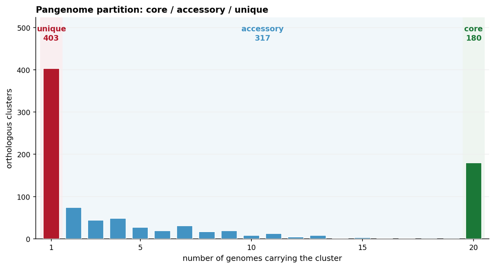

A microbial pangenome has two orthogonal structures, and papers usually need both: **which genes are core, accessory or unique**, and **which strains carry which accessory blocks**. The first is a frequency curve, the second is a presence/absence matrix ordered by phylogeny. Together they are the static, publication-grade residue of an Anvi'o \[1\] pangenome session or a Chromatiblock \[2\] comparison — the parts that survive after the interactive browser is closed.

This page builds both with `matplotlib`, `numpy` and `scipy` only. Anvi'o itself is **skipped** here (see the notes below): it is an interactive suite with a multi-gigabyte conda dependency closure, and it is not installed to produce this figure.

## Example

{fig-alt="Microbiome Genome Plot (Python) DEMO" fig-align="center" width="85%"}

A pangenome frequency curve for 900 orthologous clusters across 20 S. pneumoniae genomes: unique (present in one genome), accessory (2-19) and core (20) fractions, annotated with counts. The U-shaped curve is the realistic shape, with a small core plateau rather than a clean power law, and the axes match those of anvi-summarize's pangenome view.

## Setup

-   System Requirements: Cross-platform (Linux/MacOS/Windows)

-   Programming language: Python

-   Dependent packages: `matplotlib`; `numpy`; `scipy`

```{python}
#| label: packages-setup
#| output: false
import matplotlib.pyplot as plt
import numpy as np
from matplotlib.colors import LinearSegmentedColormap
from matplotlib.patches import Rectangle
```

## Data Preparation

Twenty *Streptococcus pneumoniae* genomes are clustered into 900 orthologous gene clusters. Each cluster is labelled core (present in all 20 genomes), accessory (2-19) or unique (exactly one genome). The presence/absence matrix that drives every panel below is the per-cluster genome membership table that `anvi-pan-genome` / `anvi-summarize` export.

```{python}
#| label: data-prep
np.random.seed(43520)

n_genomes, n_clusters = 20, 900
genome_names = [f"SP{i:02d}" for i in range(1, n_genomes + 1)]

## Cluster prevalence: a realistic U-shaped pangenome curve, with a small
## core plateau rather than a clean power law.
prevalence = np.clip(
    (np.random.beta(0.45, 2.6, n_clusters) * n_genomes).astype(int), 1, n_genomes
)
prevalence[np.random.choice(n_clusters, 180, replace=False)] = n_genomes

cluster_class = np.where(prevalence == n_genomes, "core",
                 np.where(prevalence == 1, "unique", "accessory"))

## Presence matrix. Core clusters are present everywhere. Accessory clusters
## are mostly clade-specific mobile elements: each is anchored in one of five
## clades, with a small rate of horizontal transfer into other strains. That
## mixture is what makes a phylogenetically ordered matrix show blocks.
clade_of_genome = np.repeat(np.arange(5), 4)          # 5 clades x 4 strains
clade_order = np.concatenate([np.arange(c * 4, c * 4 + 4) for c in range(5)])
present = np.zeros((n_genomes, n_clusters), dtype=bool)
for j in range(n_clusters):
    if prevalence[j] == n_genomes:
        present[:, j] = True
        continue
    anchor_clade = np.random.randint(5)
    clade_members = np.where(clade_of_genome == anchor_clade)[0]
    foreign = np.setdiff1d(np.arange(n_genomes), clade_members)
    ## Start from the anchored clade, then add sporadic carriers elsewhere.
    carriers = set(np.random.choice(clade_members,
                                    size=min(len(clade_members), prevalence[j]),
                                    replace=False).tolist())
    while len(carriers) < prevalence[j]:
        carriers.add(int(np.random.choice(foreign)))
    present[sorted(carriers), j] = True

present.sum(axis=0)[:12]
```

```{python}
#| label: data-table
#| output: false
import pandas as pd

summary = pd.DataFrame({
    "cluster": [f"C{j:04d}" for j in range(n_clusters)],
    "prevalence": prevalence,
    "class": cluster_class,
})
summary.groupby("class")["prevalence"].agg(["count", "median"])
```

## Visualization

### 1. Pangenome Frequency Curve

The frequency curve says how the pangenome is partitioned: the left spike is the unique, genome-specific fraction, the middle body is the accessory genome, and the isolated tall bar at 20 is the core. Only three of the four regions of a textbook U-shape are populated here — 900 clusters over 20 genomes is too small for a smooth right-hand wall — so read the core off the single bar, not off a plateau. The three regions are still the standard vocabulary of every pangenome paper and must be visible without reading the axis.

```{python}
#| label: fig-1.1PangenomeCurve
#| fig-cap: "Pangenome frequency curve for 900 orthologous clusters across 20 S. pneumoniae genomes: unique (present in one genome), accessory (2-19) and core (20) fractions, annotated with counts; the shape is the same axes used by anvi-summarize's pangenome view."
#| fig-width: 8.4
#| fig-height: 4.6
#| fig-dpi: 300

counts, _ = np.histogram(prevalence, bins=np.arange(0.5, n_genomes + 1.5, 1))
fig, ax = plt.subplots(figsize=(8.4, 4.6))

bar_colors = ["#b2182b"] + ["#4393c3"] * (n_genomes - 2) + ["#1b7837"]
ax.bar(np.arange(1, n_genomes + 1), counts, color=bar_colors,
       width=0.72, edgecolor="white", linewidth=0.8, zorder=3)

ylim_top = counts.max() * 1.30
for x0, x1, colour, label in [
    (0.5, 1.5, "#b2182b", f"unique\n{cluster_class.tolist().count('unique')}"),
    (1.5, 19.5, "#4393c3", f"accessory\n{cluster_class.tolist().count('accessory')}"),
    (19.5, 20.5, "#1b7837", f"core\n{cluster_class.tolist().count('core')}"),
]:
    ax.add_patch(Rectangle((x0, 0), x1 - x0, ylim_top,
                           facecolor=colour, alpha=0.07, edgecolor="none", zorder=0))
    ## Labels sit on one common baseline above the tallest bar, so none is
    ## ever obscured by a bar (the unique bar is the tallest by design).
    ax.text((x0 + x1) / 2, ylim_top * 0.965, label, ha="center", va="top",
            fontsize=9.2, color=colour, fontweight="bold", linespacing=1.3)

ax.set_xlim(0.3, 20.7)
ax.set_ylim(0, ylim_top)
ax.set_xticks([1, 5, 10, 15, 20])
ax.set_xlabel("number of genomes carrying the cluster", fontsize=9.5)
ax.set_ylabel("orthologous clusters", fontsize=9.5)
ax.set_title("Pangenome partition: core / accessory / unique", fontsize=10.5,
             loc="left", fontweight="bold")
ax.grid(axis="y", color="#eeeeee", lw=0.7, zorder=0)
ax.set_axisbelow(True)
for spine in ("top", "right"):
    ax.spines[spine].set_visible(False)
ax.tick_params(labelsize=8.6, length=3)
plt.tight_layout()
plt.show()
```

::: callout-tip
**Practice tips**

-   The core threshold is a decision, not a fact: `>= 95%` and `== 100%` give very different core sizes. This figure defines core as presence in all 20 genomes and writes that definition in the caption.
-   Use a log or square-root y axis if the unique spike dwarfs everything else — but say so, because it changes the visual weight of the three classes.
-   Order the x axis by prevalence, never alphabetically by cluster ID; the curve's shape is the message.
:::

### 2. Accessory-Genome Presence Matrix, Ordered by Phylogeny

The matrix shows *which* accessory clusters travel together. Ordering genomes by a hierarchical clustering of the Jaccard distances on presence/absence turns a salt-and-pepper heatmap into blocks, which then correspond to clades and to mobile elements.

```{python}
#| label: fig-1.2PresenceMatrix
#| fig-cap: "Presence matrix of 20 genomes x 900 orthologous clusters; rows are genomes ordered by hierarchical clustering of presence/absence alone, columns are clusters sorted by prevalence. Blue = cluster present; because the accessory clusters are anchored in clades, the matrix is blocky in both directions, and the 180 core clusters form the solid right-hand block."
#| fig-width: 8.6
#| fig-height: 5.4
#| fig-dpi: 300

from scipy.cluster.hierarchy import linkage, leaves_list
from scipy.spatial.distance import pdist

## Row order is recovered from presence/absence alone by Jaccard clustering;
## columns are sorted by prevalence.
order_rows = leaves_list(linkage(pdist(present.astype(float), metric="jaccard"),
                                 method="average"))
order_cols = np.argsort(prevalence, kind="stable")

mat = present[order_rows][:, order_cols]

fig, ax = plt.subplots(figsize=(8.6, 5.4))
ax.imshow(mat, aspect="auto", cmap=LinearSegmentedColormap.from_list(
    "presence", ["#f7f7f7", "#2166ac"]), interpolation="nearest")

## Core block boundary: the last `core_count` columns are 100% prevalent.
core_count = int((prevalence == n_genomes).sum())
ax.axvline(n_clusters - core_count - 0.5, color="#b2182b", lw=1.2, ls="--")
ax.text(n_clusters - core_count + 6, 0.9, f"core ({core_count})",
        ha="left", va="top", fontsize=8.6, color="#b2182b", fontweight="bold")
ax.text(8, 0.9, f"accessory + unique ({n_clusters - core_count})",
        ha="left", va="top", fontsize=8.6, color="#2166ac", fontweight="bold")

ax.set_yticks(range(n_genomes))
ax.set_yticklabels([genome_names[i] for i in order_rows], fontsize=7.4)
ax.set_xticks([0, 200, 400, 600, 800])
ax.set_xlabel("orthologous clusters (sorted by prevalence, then core)", fontsize=9)
ax.set_ylabel("genomes (Jaccard clustering)", fontsize=9)
ax.set_title("Accessory genome co-occurrence", fontsize=10.5, loc="left",
             fontweight="bold")
ax.tick_params(axis="both", length=2)
for spine in ax.spines.values():
    spine.set_linewidth(0.6)
    spine.set_color("#999999")
plt.tight_layout()
plt.show()
```

::: callout-tip
**Practice tips**

-   Cluster only on presence/absence (Jaccard), not on raw counts: the matrix's question is "who carries what", and abundance would mix in coverage depth.
-   Keep row labels in the clustered order and draw the dendrogram, or state the ordering method in the caption; an unordered matrix is unreadable at this density.
-   Split the matrix at the core boundary. The core block is trivially all-dark and would otherwise dominate the colour scale; a dashed line makes it an explicit reference, not a signal.
-   With more than ~40 genomes, rasterise the heatmap (or downsample columns) — a vector PDF of a 200 x 5000 mask is unusable.
:::

### 3. Core-Size Accumulation Curve

Pangenome papers also report how the core shrinks as genomes are added. The curve is the honest answer to "did we saturate the pangenome?", and it is the panel reviewers ask for when the sample count is small.

```{python}
#| label: fig-1.3Accumulation
#| fig-cap: "Core- and pan-genome accumulation over 20 genomes, both in orthologous clusters on a single shared y axis: the core declines toward its asymptotic size while the pan-genome keeps growing. No second y axis and no rescaling are used, so the gap between the two curves is the accessory genome itself."
#| fig-width: 8.4
#| fig-height: 4.2
#| fig-dpi: 300

rng = np.random.default_rng(43521)
order = rng.permutation(n_genomes)
core_sizes, pan_sizes = [], []
for k in range(1, n_genomes + 1):
    sub = present[order[:k]]
    core_sizes.append(int(sub.all(axis=0).sum()))
    pan_sizes.append(int(sub.any(axis=0).sum()))

k = np.arange(1, n_genomes + 1)
fig, ax = plt.subplots(figsize=(8.4, 4.2))
ax.plot(k, pan_sizes, "-o", color="#2166ac", ms=4.2, lw=1.7,
        label="pan-genome (any genome)")
ax.plot(k, core_sizes, "-o", color="#b2182b", ms=4.2, lw=1.7,
        label="core genome (all genomes)")
ax.fill_between(k, core_sizes, pan_sizes, color="#2166ac", alpha=0.06)
ax.annotate(f"core asymptote ≈ {core_sizes[-1]}", xy=(n_genomes, core_sizes[-1]),
            xytext=(n_genomes - 6.2, core_sizes[-1] + 60), fontsize=8.6,
            color="#b2182b", va="center",
            arrowprops=dict(arrowstyle="-", color="#b2182b", lw=0.8,
                            shrinkA=2, shrinkB=4))
ax.set_xlabel("genomes sampled (random order, seed 43521)", fontsize=9)
ax.set_ylabel("orthologous clusters", fontsize=9)
ax.set_title("Pangenome accumulation curve", fontsize=10.5, loc="left",
             fontweight="bold")
ax.set_xlim(0.6, n_genomes + 0.4)
ax.grid(color="#eeeeee", lw=0.7)
ax.set_axisbelow(True)
for spine in ("top", "right"):
    ax.spines[spine].set_visible(False)
ax.legend(loc="upper left", bbox_to_anchor=(0.02, 0.98),
          frameon=False, fontsize=8.8)
ax.tick_params(labelsize=8.6, length=3)
plt.tight_layout()
plt.show()
```

::: callout-tip
**Practice tips**

-   Randomise the genome order with a stated seed, then repeat the curve over several permutations (or plot the ribbon of all orders). One arbitrary order can make the core look stable when it is not.
-   Report the number of genomes at which the pan-genome curve's slope drops below a stated threshold; "saturated" without a threshold is not a result.
-   Do not plot pan and core on separate y axes to make both look flat; they are counts on the same scale, and the gap between them is the informative part.
:::

## Implementations deliberately not used here

This page draws its figures from base graphics on purpose. Of the tools that the issue-435 inventory maps onto Python/MicrobiomeGenomePlot, 1 were marked **skipped** and are used only as layout references, not as dependencies: 0 that have gone more than five years without an operational commit (cutoff 2021-11-07) and 1 whose dependency closure is too heavy to justify for one static figure. Reproducing whatever still works would mean pinning abandoned code; installing the rest would mean pulling a whole analysis framework into a documentation build. The figure conventions were read off those tools, then re-implemented here so each panel can be inspected line by line.

| Tool | Last commit | Status | Why it is skipped |
| --- | --- | --- | --- |
| Anvio | — | heavy dependency | framework-scale dependency closure is too heavy for one static figure |

## Application

These three panels are the standard static summary of a microbial pangenome: core/accessory/unique partitioning, the co-occurrence structure that identifies mobile elements and clades, and the accumulation curve that justifies the sample size. They are also the figures most often missing from methods sections that otherwise rely on an interactive Anvi'o session, which is why reproducing them in a plain matplotlib pipeline is the difference between a browsable result and a citable one.

The same code handles a eukaryotic gene-family matrix by swapping `present` for a family x species count matrix; the ordering and the three panels stay identical.

## Reference

\[1\] Eren AM, Esen ÖC, Quince C, et al. Anvi'o: an advanced analysis and visualization platform for 'omics data. PeerJ. 2015;3:e1319. doi:10.7717/peerj.1319

\[2\] Nusbaumer D, et al. Chromatiblock: scalable whole-genome visualization of structural differences in prokaryotes. J Open Source Softw. 2020;5(53):2451. doi:10.21105/joss.02451

\[3\] Tettelin H, Masignani V, Cieslewicz MJ, et al. Genome analysis of multiple pathogenic isolates of Streptococcus agalactiae: implications for the microbial "pan-genome". Proc Natl Acad Sci U S A. 2005;102(39):13950-13955. doi:10.1073/pnas.0506758102
