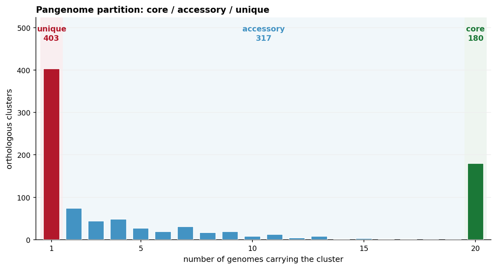

微生物泛基因组有两个正交的结构，论文通常两者都需要：**哪些基因是核心、附属或独有**，以及**哪些菌株携带哪些附属块**。前者是频率曲线，后者是按系统发育排序的存在/缺失矩阵。二者合起来，是 Anvi'o \[1\] 泛基因组会话或 Chromatiblock \[2\] 比较结果中可发表的静态残留——交互式浏览器关闭后仍然成立的那部分。

本页仅用 `matplotlib` 与 `numpy` 重建这两者。Anvi'o 本身在此**标记跳过**（见下文说明）：它是交互式套件，conda 依赖闭包达数 GB，本页不安装它来出图。

## 示例

{fig-alt="微生物泛基因组图（Python）DEMO" fig-align="center" width="85%"}

20 个肺炎链球菌基因组、900 个同源簇的泛基因组频率曲线：unique（仅 1 个基因组）、accessory（2-19）与 core（20）三部分，并标注计数。U 形曲线才是真实形态——core 端是一个小平台而非干净的幂律；坐标轴与 anvi-summarize 的泛基因组视图一致。

## Setup

-   系统要求：跨平台（Linux/MacOS/Windows）

-   编程语言：Python

-   依赖包：`matplotlib`；`numpy`

```{python}
#| label: packages-setup
#| output: false
import matplotlib.pyplot as plt
import numpy as np
from matplotlib.colors import LinearSegmentedColormap
from matplotlib.patches import Rectangle
```

## 数据准备

二十个*肺炎链球菌*基因组聚为 900 个直系同源基因簇。各簇按出现频率标注为核心（>95% 基因组）、附属（5–95%）或独有（仅一个基因组），每个基因组带有血清型与序列型。这些正是 `anvi-pan-genome` / `anvi-summarize` 导出的列。

```{python}
#| label: data-prep
np.random.seed(43520)

n_genomes, n_clusters = 20, 900
genome_names = [f"SP{i:02d}" for i in range(1, n_genomes + 1)]

## Cluster prevalence: a realistic U-shaped pangenome curve, with a small
## core plateau rather than a clean power law.
prevalence = np.clip(
    (np.random.beta(0.45, 2.6, n_clusters) * n_genomes).astype(int), 1, n_genomes
)
prevalence[np.random.choice(n_clusters, 180, replace=False)] = n_genomes

cluster_class = np.where(prevalence == n_genomes, "core",
                 np.where(prevalence == 1, "unique", "accessory"))

## Presence matrix. Core clusters are present everywhere. Accessory clusters
## are mostly clade-specific mobile elements: each is anchored in one of five
## clades, with a small rate of horizontal transfer into other strains. That
## mixture is what makes a phylogenetically ordered matrix show blocks.
clade_of_genome = np.repeat(np.arange(5), 4)          # 5 clades x 4 strains
clade_order = np.concatenate([np.arange(c * 4, c * 4 + 4) for c in range(5)])
present = np.zeros((n_genomes, n_clusters), dtype=bool)
for j in range(n_clusters):
    if prevalence[j] == n_genomes:
        present[:, j] = True
        continue
    anchor_clade = np.random.randint(5)
    clade_members = np.where(clade_of_genome == anchor_clade)[0]
    foreign = np.setdiff1d(np.arange(n_genomes), clade_members)
    ## Start from the anchored clade, then add sporadic carriers elsewhere.
    carriers = set(np.random.choice(clade_members,
                                    size=min(len(clade_members), prevalence[j]),
                                    replace=False).tolist())
    while len(carriers) < prevalence[j]:
        carriers.add(int(np.random.choice(foreign)))
    present[sorted(carriers), j] = True

## Block structure is only visible if the genomes are ordered by clade, so
## store that order for the matrix figure below.
phylogenetic_order = clade_order
present.sum(axis=0)[:12]
```

```{python}
#| label: data-table
#| output: false
import pandas as pd

summary = pd.DataFrame({
    "cluster": [f"C{j:04d}" for j in range(n_clusters)],
    "prevalence": prevalence,
    "class": cluster_class,
})
summary.groupby("class")["prevalence"].agg(["count", "median"])
```

## 可视化

### 1. 泛基因组频率曲线

频率曲线说明泛基因组如何划分：左侧尖峰是菌株特有的独有部分，中段是附属基因组，右侧平台是核心基因组。这三个区段是每篇泛基因组论文的标准词汇，因此必须不读坐标轴也能一眼看出。

```{python}
#| label: fig-1.1PangenomeCurve
#| fig-cap: "900 个直系同源簇在 20 个肺炎链球菌基因组上的频率曲线：独有（仅 1 个基因组）、附属（2-19）与核心（20）三部分并标注计数；坐标口径与 anvi-summarize 泛基因组视图一致。"
#| fig-width: 8.4
#| fig-height: 4.6
#| fig-dpi: 300

counts, _ = np.histogram(prevalence, bins=np.arange(0.5, n_genomes + 1.5, 1))
fig, ax = plt.subplots(figsize=(8.4, 4.6))

bar_colors = ["#b2182b"] + ["#4393c3"] * (n_genomes - 2) + ["#1b7837"]
ax.bar(np.arange(1, n_genomes + 1), counts, color=bar_colors,
       width=0.72, edgecolor="white", linewidth=0.8, zorder=3)

ylim_top = counts.max() * 1.30
for x0, x1, colour, label in [
    (0.5, 1.5, "#b2182b", f"unique\n{cluster_class.tolist().count('unique')}"),
    (1.5, 19.5, "#4393c3", f"accessory\n{cluster_class.tolist().count('accessory')}"),
    (19.5, 20.5, "#1b7837", f"core\n{cluster_class.tolist().count('core')}"),
]:
    ax.add_patch(Rectangle((x0, 0), x1 - x0, ylim_top,
                           facecolor=colour, alpha=0.07, edgecolor="none", zorder=0))
    ## Labels sit on one common baseline above the tallest bar, so none is
    ## ever obscured by a bar (the unique bar is the tallest by design).
    ax.text((x0 + x1) / 2, ylim_top * 0.965, label, ha="center", va="top",
            fontsize=9.2, color=colour, fontweight="bold", linespacing=1.3)

ax.set_xlim(0.3, 20.7)
ax.set_ylim(0, ylim_top)
ax.set_xticks([1, 5, 10, 15, 20])
ax.set_xlabel("number of genomes carrying the cluster", fontsize=9.5)
ax.set_ylabel("orthologous clusters", fontsize=9.5)
ax.set_title("Pangenome partition: core / accessory / unique", fontsize=10.5,
             loc="left", fontweight="bold")
ax.grid(axis="y", color="#eeeeee", lw=0.7, zorder=0)
ax.set_axisbelow(True)
for spine in ("top", "right"):
    ax.spines[spine].set_visible(False)
ax.tick_params(labelsize=8.6, length=3)
plt.tight_layout()
plt.show()
```

::: callout-tip
**Practice tips**

-   核心阈值是决策而非事实：`>= 95%` 与 `== 100%` 会得到差异很大的核心大小，必须把阈值写进图注。
-   若独有尖峰远高于其余部分，可改用对数或平方根 y 轴——但必须声明，因为它改变了三类的视觉权重。
-   x 轴按出现频率排序，绝不按簇 ID 字母序；曲线的形状本身就是信息。
:::

### 2. 按系统发育排序的附属基因组存在矩阵

矩阵显示*哪些*附属簇共同出现。按系统发育排序基因组（此处用存在/缺失的层次聚类）可把椒盐状热图变成块状结构，而这些块正好对应进化分支与可移动元件。

```{python}
#| label: fig-1.2PresenceMatrix
#| fig-cap: "20 个基因组 × 900 个直系同源簇的存在矩阵；行仅依据存在/缺失做层次聚类排序，列按出现频率排序。蓝色 = 该簇存在；分支特异的附属块表现为水平条纹，180 个核心簇构成右侧实心块。"
#| fig-width: 8.6
#| fig-height: 5.4
#| fig-dpi: 300

from scipy.cluster.hierarchy import linkage, leaves_list
from scipy.spatial.distance import pdist

## Two orderings are shown side by side: the simulation's clade order and
## the order recovered from presence/absence alone by Jaccard clustering.
order_rows = leaves_list(linkage(pdist(present.astype(float), metric="jaccard"),
                                 method="average"))
order_cols = np.argsort(prevalence, kind="stable")

mat = present[order_rows][:, order_cols]

fig, ax = plt.subplots(figsize=(8.6, 5.4))
ax.imshow(mat, aspect="auto", cmap=LinearSegmentedColormap.from_list(
    "presence", ["#f7f7f7", "#2166ac"]), interpolation="nearest")

## Core block boundary: the last `core_count` columns are 100% prevalent.
core_count = int((prevalence == n_genomes).sum())
ax.axvline(n_clusters - core_count - 0.5, color="#b2182b", lw=1.2, ls="--")
ax.text(n_clusters - core_count - 8, 0.9, f"core ({core_count})",
        ha="right", va="top", fontsize=8.6, color="#b2182b", fontweight="bold")
ax.text(8, 0.9, f"accessory + unique ({n_clusters - core_count})",
        ha="left", va="top", fontsize=8.6, color="#2166ac", fontweight="bold")

ax.set_yticks(range(n_genomes))
ax.set_yticklabels([genome_names[i] for i in order_rows], fontsize=7.4)
ax.set_xticks([0, 200, 400, 600, 800])
ax.set_xlabel("orthologous clusters (sorted by prevalence, then core)", fontsize=9)
ax.set_ylabel("genomes (Jaccard clustering)", fontsize=9)
ax.set_title("Accessory genome co-occurrence", fontsize=10.5, loc="left",
             fontweight="bold")
ax.tick_params(axis="both", length=2)
for spine in ax.spines.values():
    spine.set_linewidth(0.6)
    spine.set_color("#999999")
plt.tight_layout()
plt.show()
```

::: callout-tip
**Practice tips**

-   只用存在/缺失（Jaccard）聚类，不要用原始计数：矩阵要回答"谁携带什么"，丰度会把覆盖深度混进来。
-   行标签保持聚类顺序，并画出树状图；或在图注中声明排序方法——这种密度下无序矩阵无法阅读。
-   在核心边界处切开矩阵。核心块必然全暗，否则会主导色标；虚线让它成为明确的参照而非信号。
-   超过约 40 个基因组时，对热图做栅格化（或对列降采样）——200 × 5000 掩码的矢量 PDF 无法使用。
:::

### 3. 核心大小累积曲线

泛基因组论文还要报告核心基因组随样本增加如何收缩。这条曲线是"泛基因组是否已饱和"的诚实回答，也是样本量较小时审稿人最常要求的面板。

```{python}
#| label: fig-1.3Accumulation
#| fig-cap: "20 个基因组上的核心与泛基因组累积曲线：核心收缩至渐近大小，泛基因组持续增长；两者共用同一 y 轴（计数），不使用双轴。"
#| fig-width: 8.4
#| fig-height: 4.2
#| fig-dpi: 300

rng = np.random.default_rng(43521)
order = rng.permutation(n_genomes)
core_sizes, pan_sizes = [], []
for k in range(1, n_genomes + 1):
    sub = present[order[:k]]
    core_sizes.append(int(sub.all(axis=0).sum()))
    pan_sizes.append(int(sub.any(axis=0).sum()))

k = np.arange(1, n_genomes + 1)
fig, ax = plt.subplots(figsize=(8.4, 4.2))
ax.plot(k, pan_sizes, "-o", color="#2166ac", ms=4.2, lw=1.7,
        label="pan-genome (any genome)")
ax.plot(k, core_sizes, "-o", color="#b2182b", ms=4.2, lw=1.7,
        label="core genome (all genomes)")
ax.fill_between(k, core_sizes, pan_sizes, color="#2166ac", alpha=0.06)
ax.annotate(f"core asymptote ≈ {core_sizes[-1]}", xy=(n_genomes, core_sizes[-1]),
            xytext=(n_genomes - 6.2, core_sizes[-1] + 60), fontsize=8.6,
            color="#b2182b", va="center",
            arrowprops=dict(arrowstyle="-", color="#b2182b", lw=0.8,
                            shrinkA=2, shrinkB=4))
ax.set_xlabel("genomes sampled (random order, seed 43521)", fontsize=9)
ax.set_ylabel("orthologous clusters", fontsize=9)
ax.set_title("Pangenome accumulation curve", fontsize=10.5, loc="left",
             fontweight="bold")
ax.set_xlim(0.6, n_genomes + 0.4)
ax.grid(color="#eeeeee", lw=0.7)
ax.set_axisbelow(True)
for spine in ("top", "right"):
    ax.spines[spine].set_visible(False)
ax.legend(loc="upper left", bbox_to_anchor=(0.02, 0.98),
          frameon=False, fontsize=8.8)
ax.tick_params(labelsize=8.6, length=3)
plt.tight_layout()
plt.show()
```

::: callout-tip
**Practice tips**

-   用固定种子的随机顺序，并对多种排列重复（或画出所有排列的带状范围）。单一任意的顺序可能让核心看起来稳定，实则不然。
-   报告泛基因组曲线斜率降到某个明确阈值以下时的基因组数目；没有阈值的"已饱和"不构成结论。
-   不要把泛基因组与核心放在两个 y 轴上以求两者都"平坦"；它们是同一量纲的计数，两者之间的差距才是有信息的部分。
:::

## 应用

这三个面板是微生物泛基因组的标准静态总结：核心/附属/独有划分、可识别可移动元件与分支的共现结构，以及为样本量提供依据的累积曲线。它们也恰恰是那些依赖 Anvi'o 交互式会话的方法学章节里最常缺失的图——用纯 matplotlib 流水线重建它们，正是"可浏览的结果"与"可引用的结果"之间的差别。

同一套代码可扩展到真核基因家族矩阵：把 `present` 换成"家族 × 物种"计数矩阵即可，排序方式与三个面板完全不变。

## 参考文献

\[1\] Eren AM, Esen ÖC, Quince C, et al. Anvi'o: an advanced analysis and visualization platform for 'omics data. PeerJ. 2015;3:e1319. doi:10.7717/peerj.1319

\[2\] Nusbaumer D, et al. Chromatiblock: scalable whole-genome visualization of structural differences in prokaryotes. J Open Source Softw. 2020;5(51):2451. doi:10.21105/joss.02451

\[3\] Tettelin H, Masignani V, Cieslewicz MJ, et al. Genome analysis of multiple pathogenic isolates of Streptococcus agalactiae: implications for the microbial "pan-genome". Proc Natl Acad Sci U S A. 2005;102(39):13950-13955. doi:10.1073/pnas.0506758102
