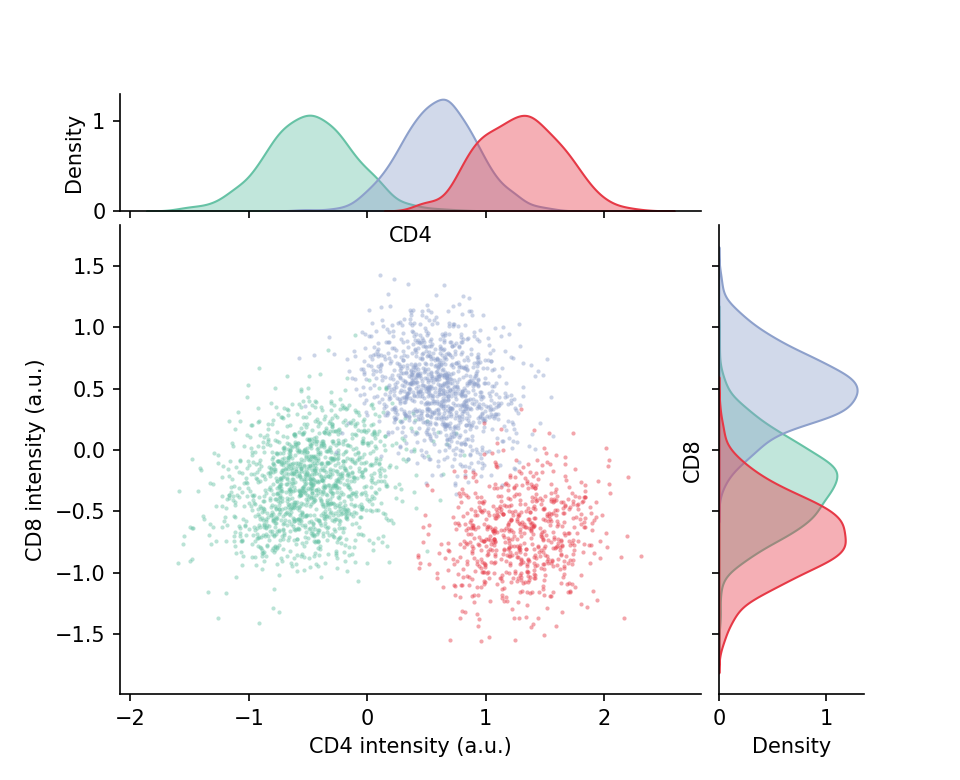

期刊图形是复合体：主面板加边缘分布，或带 (a)–(d) 字母标签的面板组装进一个导出文件。`matplotlib` 的 `GridSpec` 精确控制面板几何（含跨行跨列与内嵌轴），`subfigures` 把坐标轴分组使样式与标题按块共享——几乎所有 Nature 风格多面板图背后的两件工具。

## 示例

{fig-align="center" width="80%"}

## 环境配置

- 系统要求：跨平台（Linux/MacOS/Windows）
- 编程语言：**Python**
- 依赖包：`matplotlib`、`seaborn`、`pandas`、`numpy`

```{python}
#| label: packages-setup
#| output: false
import matplotlib.pyplot as plt
import seaborn as sns
import pandas as pd
import numpy as np
```

## 数据准备

我们模拟一份三细胞群的两标志物流式检测数据，在各种面板布局中复用。

```{python}
#| label: data-prep
np.random.seed(211)

n = 3000
pop = np.random.choice(3, n, p=[0.45, 0.33, 0.22])
centers = [(-0.5, -0.3), (0.6, 0.5), (1.3, -0.7)]
covs = [np.array([[0.14, 0.03], [0.03, 0.12]]),
        np.array([[0.10, -0.02], [-0.02, 0.09]]),
        np.array([[0.12, 0.01], [0.01, 0.10]])]
xy = np.stack([np.random.multivariate_normal(centers[s], covs[s]) for s in pop])
cells = pd.DataFrame(xy, columns=['CD4', 'CD8'])
cells['Population'] = np.array(['P1', 'P2', 'P3'])[pop]
```

## 可视化

### 带边缘分布的 GridSpec 组合

2×2 的 `GridSpec` 用 `width_ratios`/`height_ratios` 把主散点放左下、边缘直方图压缩到上侧与右侧——手工组装的经典「散点+边缘」结构。

```{python}
#| label: fig-py-grid-marginals
#| fig-cap: "GridSpec 组合：主散点加上下、右侧边缘分布"
#| width: 72%
#| fig-align: center
fig = plt.figure(figsize=(6.4, 5.2))
gs = fig.add_gridspec(2, 2, width_ratios=[4, 1], height_ratios=[1, 4],
                      hspace=0.05, wspace=0.05)
ax_main = fig.add_subplot(gs[1, 0])
ax_top = fig.add_subplot(gs[0, 0], sharex=ax_main)
ax_right = fig.add_subplot(gs[1, 1], sharey=ax_main)

palette = {'P1': '#66c2a5', 'P2': '#8da0cb', 'P3': '#e63946'}
for p_name, sub in cells.groupby('Population'):
    ax_main.scatter(sub.CD4, sub.CD8, s=4, alpha=0.45,
                    color=palette[p_name], linewidths=0)
    sns.kdeplot(x=sub.CD4, ax=ax_top, color=palette[p_name], fill=True,
                alpha=0.4, linewidth=1)
    sns.kdeplot(y=sub.CD8, ax=ax_right, color=palette[p_name], fill=True,
                alpha=0.4, linewidth=1)
ax_top.tick_params(labelbottom=False)
ax_right.tick_params(labelleft=False)
ax_main.set_xlabel('CD4 intensity (a.u.)')
ax_main.set_ylabel('CD8 intensity (a.u.)')
for ax in (ax_main, ax_top, ax_right):
    ax.spines[['top', 'right']].set_visible(False)
plt.show()
```

### 带字母标签的 subfigures

`subfigures` 为每个区块提供独立的标题空间；面板字母 `(a) (b)` 按期刊惯例放在图坐标的指定位置。

```{python}
#| label: fig-py-subfig-letters
#| fig-cap: "共享同一导出文件的两个字母标签子图块"
#| width: 82%
#| fig-align: center
fig = plt.figure(figsize=(8.6, 3.8))
subfigs = fig.subfigures(1, 2, wspace=0.08)

# (a) 标志物分布直方图
axA = subfigs[0].subplots(1, 2, sharey=True)
for ax, marker in zip(axA, ['CD4', 'CD8']):
    for p_name, sub in cells.groupby('Population'):
        sns.kdeplot(sub[marker], ax=ax, color=palette[p_name],
                    fill=True, alpha=0.35, linewidth=1.2)
    ax.set_title(marker, fontsize=10)
    ax.spines[['top', 'right']].set_visible(False)
subfigs[0].suptitle('(a) Marker distributions', x=0.02, ha='left',
                    fontweight='bold', fontsize=11)

# (b) 群体均值与 SEM
axB = subfigs[1].subplots(1, 1)
summary = cells.groupby('Population').agg(['mean', 'sem'])
for i, marker in enumerate(['CD4', 'CD8']):
    m, e = summary[(marker, 'mean')], summary[(marker, 'sem')]
    axB.errorbar(np.arange(3) + (i - 0.5) * 0.18, m, yerr=e * 1.96,
                 fmt='o', capsize=3, color=['#8da0cb', '#e63946'][i],
                 label=marker)
axB.set_xticks(range(3), ['P1', 'P2', 'P3'])
axB.set_ylabel('Mean intensity (a.u.)')
axB.legend(frameon=False, fontsize=9)
axB.spines[['top', 'right']].set_visible(False)
subfigs[1].suptitle('(b) Population means ± 95% CI', x=0.02, ha='left',
                    fontweight='bold', fontsize=11)

plt.show()
```

## 参考文献

1. Hunter, J. D. (2007). Matplotlib: A 2D graphics environment. *Computing in Science & Engineering*, 9(3), 90-95.
2. Griffin, E. matplotlib subfigures. https://matplotlib.org/stable/gallery/subplots_axes_and_figures/subfigures.html
