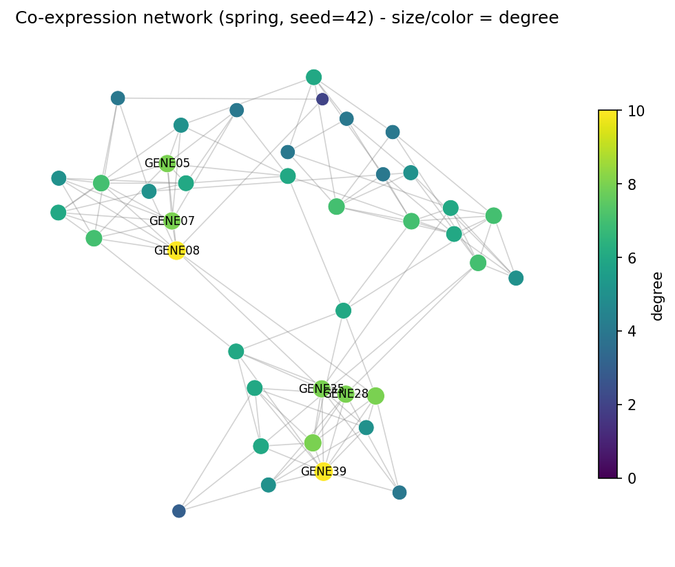
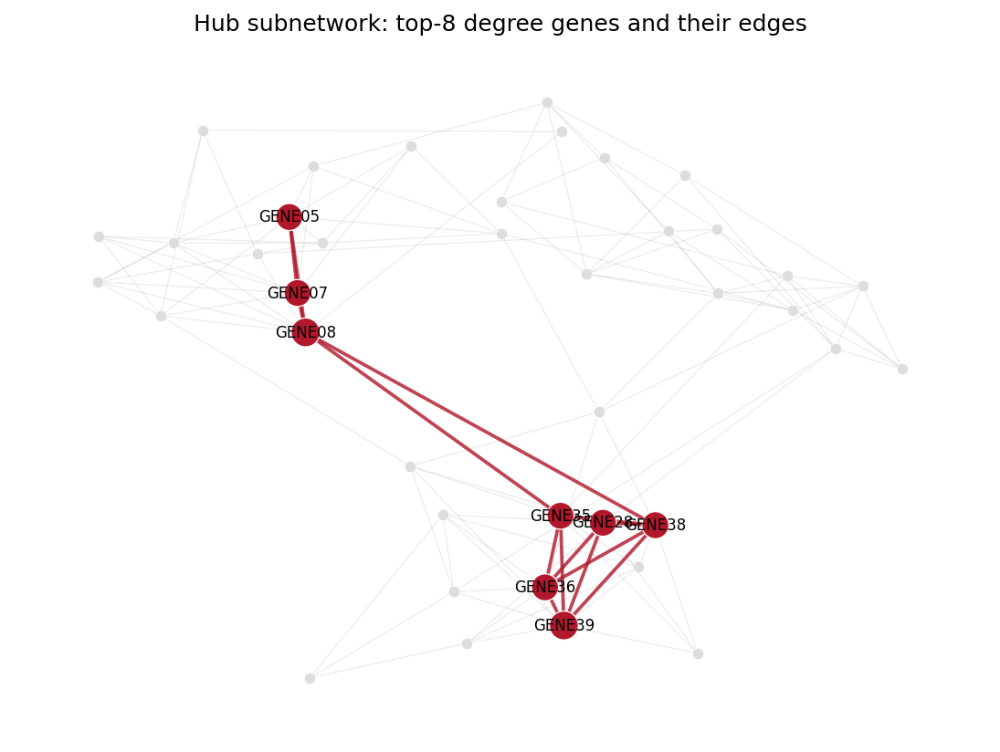

The Python counterpart of [Network Plot](../Omics/NetworkPlot.html) — a node-link diagram places genes, proteins, or cell types as nodes and their relationships (co-expression, physical binding, communication) as edges. In biomedical research, network plots expose module structure and hub genes in co-expression analyses \[1\], summarize protein-interaction evidence, and visualize ligand-receptor inference from single-cell data.

`networkx` builds the graph and computes layouts; matplotlib draws \[2\]. Two properties decide whether a network plot communicates or misleads: the *layout* (positions are an optimization result, not coordinates) and *visual encoding* (node degree, edge weight, and module membership must map to size, width, and color consistently).

This tutorial covers three workflows:

1. A spring-layout network with degree-coded node size and color;
2. Spring vs Kamada-Kawai layouts side by side;
3. Module-colored nodes with co-expression-weighted edges, plus a hub-subnetwork application panel.

## Example

{fig-align="center" width="70%"}

## Setup

- System Requirements: Cross-platform (Linux/MacOS/Windows)
- Programming Language: **Python**
- Dependencies: `networkx`, `matplotlib`, `numpy`

```{python}
#| label: packages-setup
#| output: false
import matplotlib.pyplot as plt
import networkx as nx
import numpy as np
```

## Data Preparation

We simulate a 40-gene co-expression module: three dense modules (14/13/13 genes) with strong within-module correlations, sparse inter-module bridges, and edge weights on a 0.3-0.95 scale. The same construction underlies real WGCNA-style exports \[1\].

```{python}
#| label: data-prep
rng = np.random.default_rng(7)
n_genes = 40
gene_names = [f"GENE{i:02d}" for i in range(1, n_genes + 1)]
modules = [(0, 14), (14, 27), (27, 40)]

G = nx.Graph()
G.add_nodes_from(gene_names)
for lo, hi in modules:                       # dense within-module edges
    for i in range(lo, hi):
        for j in range(i + 1, hi):
            if rng.random() < 0.45:
                G.add_edge(gene_names[i], gene_names[j],
                           weight=float(rng.uniform(0.55, 0.95)))
for i in range(n_genes):                     # sparse inter-module bridges
    for j in range(i + 1, n_genes):
        same = any(lo <= i < hi and lo <= j < hi for lo, hi in modules)
        if not same and rng.random() < 0.03:
            G.add_edge(gene_names[i], gene_names[j],
                       weight=float(rng.uniform(0.3, 0.5)))

degree = dict(G.degree())
# The layout is a randomized optimization: fix the seed or no two runs
# (and no two papers) look alike.
pos = nx.spring_layout(G, seed=42, k=0.6)
deg_arr = np.array([degree[g] for g in G.nodes()], dtype=float)
print(f"{G.number_of_nodes()} nodes, {G.number_of_edges()} edges, "
      f"max degree {int(deg_arr.max())}")
```

## Visualization

### 1. Degree-Coded Network

```{python}
#| label: fig-py-network-basic
#| fig-cap: "Co-expression network with a seeded spring layout: node size and color both encode degree, and the top-degree genes are labelled."
#| fig-align: center

fig, ax = plt.subplots(figsize=(7, 5.6))
nx.draw_networkx_edges(G, pos, ax=ax, alpha=0.35, edge_color="grey",
                       width=0.8)
nc = nx.draw_networkx_nodes(G, pos, ax=ax, node_size=60 + 12 * deg_arr,
                            node_color=plt.cm.viridis(deg_arr / deg_arr.max()),
                            linewidths=0.4, edgecolors="white")
top = sorted(degree, key=degree.get, reverse=True)[:6]
nx.draw_networkx_labels(G, pos, labels={g: g for g in top},
                        font_size=8, ax=ax)
ax.set_title("Co-expression network (spring, seed=42) - size/color = degree")
ax.axis("off")
sm = plt.cm.ScalarMappable(cmap="viridis",
                           norm=plt.Normalize(0, deg_arr.max()))
fig.colorbar(sm, ax=ax, shrink=0.7, label="degree")
fig.tight_layout()
plt.show()
```

### 2. Layout Comparison: spring vs Kamada-Kawai

The spring layout is stochastic (hence the seed); Kamada-Kawai is deterministic and optimizes graph-theoretic distances. Same graph, different reading — show the layout you used.

```{python}
#| label: fig-py-network-layouts
#| fig-cap: "The same co-expression network under two layouts: spring (seed=42) separates the modules differently from the deterministic Kamada-Kawai layout."
#| fig-align: center

pos_kk = nx.kamada_kawai_layout(G)
fig, axes = plt.subplots(1, 2, figsize=(11, 5))
for ax, (name, p) in zip(axes, [("spring_layout(seed=42)", pos),
                                ("kamada_kawai_layout", pos_kk)]):
    nx.draw_networkx_edges(G, p, ax=ax, alpha=0.3, edge_color="grey",
                           width=0.7)
    nx.draw_networkx_nodes(G, p, ax=ax, node_size=50 + 10 * deg_arr,
                           node_color="#4C72B0", linewidths=0.4,
                           edgecolors="white")
    ax.set_title(name); ax.axis("off")
fig.suptitle("Layout choice changes the reading", y=0.98)
fig.tight_layout()
plt.show()
```

### 3. Module Colors and Weighted Edges

```{python}
#| label: fig-py-network-weighted
#| fig-cap: "Nodes colored by co-expression module; edge width and darkness both encode the co-expression weight, so strong intra-module ties stand out from weak bridges."
#| fig-align: center

module_of = {}
for m, (lo, hi) in enumerate(modules):
    for i in range(lo, hi):
        module_of[gene_names[i]] = f"M{m + 1}"
mod_colors = {"M1": "#B2182B", "M2": "#2166AC", "M3": "#1B7837"}

fig, ax = plt.subplots(figsize=(7.4, 5.6))
edges, weights = zip(*[((u, v), d["weight"])
                       for u, v, d in G.edges(data=True)])
nx.draw_networkx_edges(G, pos, ax=ax, edgelist=edges,
                       width=[1 + 3.5 * w for w in weights],
                       edge_color=weights, edge_cmap=plt.cm.Greys,
                       edge_vmin=0.2, edge_vmax=1.0, alpha=0.75)
nx.draw_networkx_nodes(G, pos, ax=ax,
                       node_size=[60 + 12 * degree[g] for g in G.nodes()],
                       node_color=[mod_colors[module_of[g]] for g in G.nodes()],
                       linewidths=0.4, edgecolors="white")
nx.draw_networkx_labels(G, pos, labels={g: g for g in top},
                        font_size=8, ax=ax)
handles = [plt.Line2D([], [], marker="o", ls="", color=c, label=m)
           for m, c in mod_colors.items()]
ax.legend(handles=handles, loc="upper right", fontsize=9, title="module")
ax.set_title("Module-colored nodes; edge width/color = co-expression weight")
ax.axis("off")
fig.tight_layout()
plt.show()
```

::: callout-tip
## Practice tips

-   Always seed `spring_layout` (`seed=`) — an unseeded layout is not reproducible and reviewers cannot verify your figure.
-   Node degree in a thresholded network is a function of your cutoff; report the cutoff and prefer hub lists from the full weighted matrix.
-   Do not encode two unrelated quantities in one channel (e.g., size = degree AND color = degree is redundant but fine; size = degree AND color = p-value invites misreading).
-   Label only hub/annotated nodes — labelling all 40 nodes produces an unreadable wall of text.
-   For interactive exploration, export the same graph with `nx.write_graphml` and open it in Cytoscape \[2\].
:::

## Application

Hub analysis is the most common downstream readout: the panel below isolates the top-8 degree genes and the edges among them, turning a 40-node hairball into a testable hypothesis — hubs from different modules bridged by weak ties are candidates for experimental validation.

{fig-align="center" width="70%"}

## Reference

\[1\] Langfelder P, Horvath S. WGCNA: an R package for weighted correlation network analysis. BMC Bioinformatics. 2008;9:559. doi:10.1186/1471-2105-9-559

\[2\] Hagberg A, Schult D, Swart P. Exploring network structure, dynamics, and function using NetworkX. Proc 7th Python Sci Conf. 2008:11-15.
