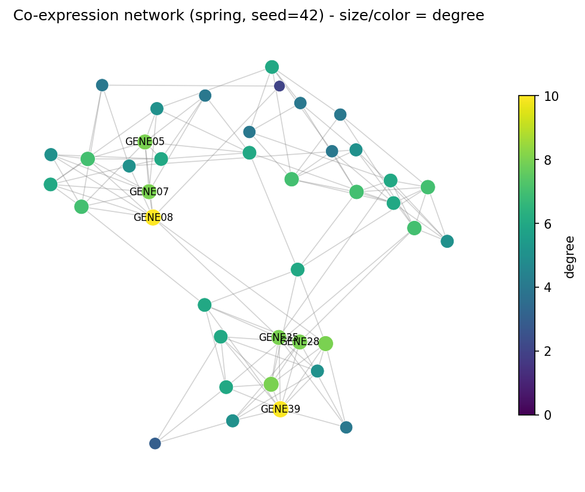
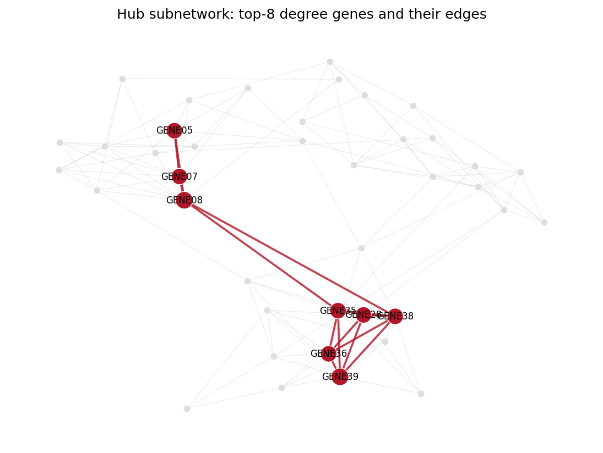

[网络图](../zh/Omics/NetworkPlot.html)的 Python 对应版本——节点-连线图把基因、蛋白或细胞类型画成节点，把关系（共表达、物理结合、通讯）画成边。在生物医学研究中，网络图揭示共表达分析中的模块结构与枢纽基因 \[1\]，汇总蛋白互作证据，也可可视化单细胞数据推断的配体-受体通讯。

`networkx` 负责图构建与布局计算，matplotlib 负责绘制 \[2\]。决定网络图是传达信息还是误导读者的两个关键：*布局*（坐标是优化结果，不是真实坐标）与*视觉编码*（节点度、边权重、模块归属必须一致地映射到大小、宽度、颜色）。

本教程涵盖三种工作流：

1. 弹簧布局网络图，节点大小与颜色共同编码度数；
2. 弹簧布局与 Kamada-Kawai 布局并排对比；
3. 模块着色节点 + 共表达权重边框，并给出枢纽子网络应用面板。

## Example

{fig-align="center" width="70%"}

## Setup

- 系统要求：跨平台（Linux/MacOS/Windows）
- 编程语言：**Python**
- 依赖包：`networkx`、`matplotlib`、`numpy`

```{python}
#| label: packages-setup
#| output: false
import matplotlib.pyplot as plt
import networkx as nx
import numpy as np
```

## Data Preparation

我们模拟一个 40 基因共表达模块：三个稠密模块（14/13/13 个基因），模块内强相关、模块间只有稀疏桥接边，边权重在 0.3-0.95 之间。真实 WGCNA 风格的导出结果与此同构 \[1\]。

```{python}
#| label: data-prep
rng = np.random.default_rng(7)
n_genes = 40
gene_names = [f"GENE{i:02d}" for i in range(1, n_genes + 1)]
modules = [(0, 14), (14, 27), (27, 40)]

G = nx.Graph()
G.add_nodes_from(gene_names)
for lo, hi in modules:                       # 模块内稠密边
    for i in range(lo, hi):
        for j in range(i + 1, hi):
            if rng.random() < 0.45:
                G.add_edge(gene_names[i], gene_names[j],
                           weight=float(rng.uniform(0.55, 0.95)))
for i in range(n_genes):                     # 模块间稀疏桥接
    for j in range(i + 1, n_genes):
        same = any(lo <= i < hi and lo <= j < hi for lo, hi in modules)
        if not same and rng.random() < 0.03:
            G.add_edge(gene_names[i], gene_names[j],
                       weight=float(rng.uniform(0.3, 0.5)))

degree = dict(G.degree())
# 布局是随机优化过程：必须固定 seed，否则每次运行（每篇论文）长得都不一样
pos = nx.spring_layout(G, seed=42, k=0.6)
deg_arr = np.array([degree[g] for g in G.nodes()], dtype=float)
print(f"{G.number_of_nodes()} nodes, {G.number_of_edges()} edges, "
      f"max degree {int(deg_arr.max())}")
```

## Visualization

### 1. 度数编码网络图

```{python}
#| label: fig-py-network-basic
#| fig-cap: "固定种子的弹簧布局共表达网络：节点大小与颜色都编码度数，并标注度数最高的基因。"
#| fig-align: center

fig, ax = plt.subplots(figsize=(7, 5.6))
nx.draw_networkx_edges(G, pos, ax=ax, alpha=0.35, edge_color="grey",
                       width=0.8)
nc = nx.draw_networkx_nodes(G, pos, ax=ax, node_size=60 + 12 * deg_arr,
                            node_color=plt.cm.viridis(deg_arr / deg_arr.max()),
                            linewidths=0.4, edgecolors="white")
top = sorted(degree, key=degree.get, reverse=True)[:6]
nx.draw_networkx_labels(G, pos, labels={g: g for g in top},
                        font_size=8, ax=ax)
ax.set_title("Co-expression network (spring, seed=42) - size/color = degree")
ax.axis("off")
sm = plt.cm.ScalarMappable(cmap="viridis",
                           norm=plt.Normalize(0, deg_arr.max()))
fig.colorbar(sm, ax=ax, shrink=0.7, label="degree")
fig.tight_layout()
plt.show()
```

### 2. 布局对比：spring vs Kamada-Kawai

弹簧布局是随机的（所以要给 seed）；Kamada-Kawai 确定性最优、以图论距离为目标。同一张图，读法不同——务必注明所用布局。

```{python}
#| label: fig-py-network-layouts
#| fig-cap: "同一共表达网络的两种布局：弹簧布局（seed=42）与确定性 Kamada-Kawai 布局对模块的分离方式不同。"
#| fig-align: center

pos_kk = nx.kamada_kawai_layout(G)
fig, axes = plt.subplots(1, 2, figsize=(11, 5))
for ax, (name, p) in zip(axes, [("spring_layout(seed=42)", pos),
                                ("kamada_kawai_layout", pos_kk)]):
    nx.draw_networkx_edges(G, p, ax=ax, alpha=0.3, edge_color="grey",
                           width=0.7)
    nx.draw_networkx_nodes(G, p, ax=ax, node_size=50 + 10 * deg_arr,
                           node_color="#4C72B0", linewidths=0.4,
                           edgecolors="white")
    ax.set_title(name); ax.axis("off")
fig.suptitle("Layout choice changes the reading", y=0.98)
fig.tight_layout()
plt.show()
```

### 3. 模块颜色与加权边

```{python}
#| label: fig-py-network-weighted
#| fig-cap: "节点按共表达模块着色；边宽与颜色深浅都编码共表达权重，模块内的强连接从弱的桥接边中凸显出来。"
#| fig-align: center

module_of = {}
for m, (lo, hi) in enumerate(modules):
    for i in range(lo, hi):
        module_of[gene_names[i]] = f"M{m + 1}"
mod_colors = {"M1": "#B2182B", "M2": "#2166AC", "M3": "#1B7837"}

fig, ax = plt.subplots(figsize=(7.4, 5.6))
edges, weights = zip(*[((u, v), d["weight"])
                       for u, v, d in G.edges(data=True)])
nx.draw_networkx_edges(G, pos, ax=ax, edgelist=edges,
                       width=[1 + 3.5 * w for w in weights],
                       edge_color=weights, edge_cmap=plt.cm.Greys,
                       edge_vmin=0.2, edge_vmax=1.0, alpha=0.75)
nx.draw_networkx_nodes(G, pos, ax=ax,
                       node_size=[60 + 12 * degree[g] for g in G.nodes()],
                       node_color=[mod_colors[module_of[g]] for g in G.nodes()],
                       linewidths=0.4, edgecolors="white")
nx.draw_networkx_labels(G, pos, labels={g: g for g in top},
                        font_size=8, ax=ax)
handles = [plt.Line2D([], [], marker="o", ls="", color=c, label=m)
           for m, c in mod_colors.items()]
ax.legend(handles=handles, loc="upper right", fontsize=9, title="module")
ax.set_title("Module-colored nodes; edge width/color = co-expression weight")
ax.axis("off")
fig.tight_layout()
plt.show()
```

::: callout-tip
## 实践要点

-   始终为 `spring_layout` 指定 `seed=`——未固定种子的布局不可复现，审稿人也无法验证你的图。
-   阈值化网络中的节点度是阈值的函数；报告阈值，并优先用完整加权矩阵定义枢纽。
-   不要把两个不相关的量编码进同一通道（大小=度且颜色=度是冗余但无害；大小=度且颜色=p 值会诱导误读）。
-   只标注枢纽/已注释节点——40 个节点全部标注只会得到一堵不可读的文字墙。
-   需要交互探索时，用 `nx.write_graphml` 导出并在 Cytoscape 中打开 \[2\]。
:::

## Application

枢纽分析是最常见的下游解读：下面的面板隔离出度数前 8 的基因及其之间的边，把 40 个节点的"毛线球"变成可检验的假设——来自不同模块、靠弱连接桥接的枢纽是实验验证的候选对象。

{fig-align="center" width="70%"}

## Reference

\[1\] Langfelder P, Horvath S. WGCNA: an R package for weighted correlation network analysis. BMC Bioinformatics. 2008;9:559. doi:10.1186/1471-2105-9-559

\[2\] Hagberg A, Schult D, Swart P. Exploring network structure, dynamics, and function using NetworkX. Proc 7th Python Sci Conf. 2008:11-15.
