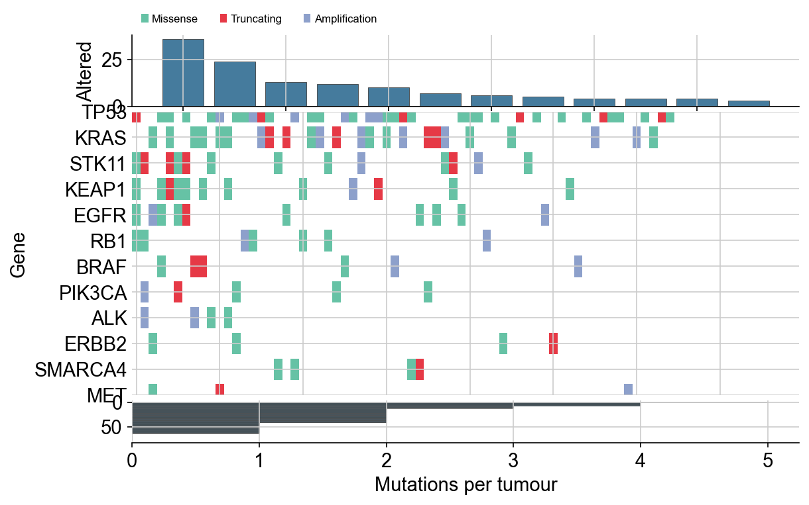

Oncoprint 把每个 alteration 以「基因（行）× 肿瘤样本（列）」着色瓦片呈现，侧翼条形分别量化基因突变频率与样本突变负荷——肿瘤基因组学论文的标志性图形。`matplotlib` 通过一次着色瓦片绘制加两个条形轴即可构建；手写版让每条排序规则都显式可控。

## 示例

{fig-align="center" width="80%"}

## 环境配置

- 系统要求：跨平台（Linux/MacOS/Windows）
- 编程语言：**Python**
- 依赖包：`matplotlib`、`seaborn`、`pandas`、`numpy`

```{python}
#| label: packages-setup
#| output: false
import matplotlib.pyplot as plt
import seaborn as sns
import pandas as pd
import numpy as np
```

## 数据准备

我们模拟 12 基因 × 80 肿瘤的 alter 表（错义、截断、扩增），频率符合真实偏斜——TP53 近普遍、驱动基因低频但复发——并附带每样本突变计数。

```{python}
#| label: data-prep
np.random.seed(261)

genes = ['TP53', 'KRAS', 'STK11', 'KEAP1', 'EGFR', 'BRAF',
         'PIK3CA', 'ALK', 'ERBB2', 'MET', 'RB1', 'SMARCA4']
freq = np.array([0.46, 0.30, 0.17, 0.15, 0.13, 0.08,
                 0.07, 0.05, 0.05, 0.04, 0.09, 0.06])
n_tumours = 80

alt_records = []
for gene, f in zip(genes, freq):
    for tumour in np.random.choice(n_tumours, size=int(f * n_tumours),
                                   replace=False):
        alt_records.append(
            (gene, tumour, np.random.choice(
                ['Missense', 'Truncating', 'Amplification'],
                p=[0.55, 0.2, 0.25])))
alts = pd.DataFrame(alt_records, columns=['Gene', 'Tumour', 'Type'])

type_colors = {'Missense': '#66c2a5', 'Truncating': '#e63946',
               'Amplification': '#8da0cb'}
alt_order = ['Truncating', 'Missense', 'Amplification']  # 绘制顺序
```

## 可视化

### 排序 Oncoprint 与侧翼条形

基因按突变频率排序（顶行 = 最高频），样本按总负荷排序（左列 = 载荷最高），两条侧翼条形分别量化这两个轴。

```{python}
#| label: fig-py-oncoprint
#| fig-cap: "80 例肿瘤中 12 个驱动基因的变异景观"
#| width: 88%
#| fig-align: center
gene_order = alts.Gene.value_counts().index.tolist()
burden = alts.groupby('Tumour').size().reindex(range(n_tumours), fill_value=0)
sample_order = burden.sort_values(ascending=False).index.tolist()

fig, (ax_top, ax_mat, ax_right) = plt.subplots(
    3, 1, figsize=(8.6, 5.4), sharex=False,
    gridspec_kw={'height_ratios': [1, 4, 0.6], 'hspace': 0.04})

counts = alts.Gene.value_counts().reindex(gene_order)
ax_top.bar(range(len(gene_order)), counts.values, color='#457b9d',
           edgecolor='0.25', linewidth=0.4)
ax_top.set_ylabel('Altered')
ax_top.spines[['top', 'right']].set_visible(False)

for y, gene in enumerate(gene_order):
    sub = alts[alts.Gene == gene]
    for _, row in sub.iterrows():
        x = sample_order.index(row.Tumour)
        ax_mat.add_patch(plt.Rectangle(
            (x - 0.5, y - 0.42), 1.0, 0.84,
            color=type_colors[row.Type], linewidth=0))
ax_mat.set_yticks(range(len(gene_order)), gene_order)
ax_mat.invert_yaxis()
ax_mat.set_xlim(-0.5, n_tumours - 0.5)
ax_mat.spines[['top', 'right', 'left', 'bottom']].set_visible(False)
ax_mat.tick_params(length=0)
ax_mat.set_ylabel('Gene')

ax_right.barh(range(len(sample_order)),
              burden.loc[sample_order].values, color='#457b9d',
              edgecolor='0.25', linewidth=0.3, height=0.8)
ax_right.invert_yaxis()
ax_right.set_xlabel('Mutations per tumour')
ax_right.spines[['top', 'right', 'left']].set_visible(False)

handles = [plt.Rectangle((0, 0), 1, 1, color=c) for c in type_colors.values()]
ax_top.legend(handles, type_colors, frameon=False, ncol=3,
              loc='lower left', bbox_to_anchor=(0.0, 1.02), fontsize=8)
plt.show()
```

### 高亮单一变异类型

非错义事件以细描边呈现，让主导变异类保持可读，同时仍显示截断事件的聚集位置。

```{python}
#| label: fig-py-oncoprint-outline
#| fig-cap: "强调截断变异的 Oncoprint"
#| width: 88%
#| fig-align: center
fig, (ax_top, ax_mat) = plt.subplots(
    2, 1, figsize=(8.6, 4.6), sharex=False,
    gridspec_kw={'height_ratios': [1, 4], 'hspace': 0.05})

ax_top.bar(range(len(gene_order)), counts.values, color='#457b9d',
           edgecolor='0.25', linewidth=0.4)
ax_top.set_ylabel('Altered')
ax_top.spines[['top', 'right']].set_visible(False)

for y, gene in enumerate(gene_order):
    sub = alts[alts.Gene == gene]
    for _, row in sub.iterrows():
        x = sample_order.index(row.Tumour)
        is_trunc = row.Type == 'Truncating'
        ax_mat.add_patch(plt.Rectangle(
            (x - 0.5, y - 0.42), 1.0, 0.84,
            facecolor=type_colors[row.Type] if is_trunc else '#d9dee6',
            edgecolor=type_colors[row.Type] if is_trunc else 'none',
            linewidth=1.2 if is_trunc else 0))
ax_mat.set_yticks(range(len(gene_order)), gene_order)
ax_mat.invert_yaxis()
ax_mat.set_xlim(-0.5, n_tumours - 0.5)
ax_mat.spines[['top', 'right', 'left', 'bottom']].set_visible(False)
ax_mat.tick_params(length=0)
ax_mat.set_ylabel('Gene')
plt.show()
```

## 参考文献

1. Gao, J., et al. (2013). Integrating genomics data into the cBioPortal. *Science Signaling*, 6(268), pl4.
2. Hunter, J. D. (2007). Matplotlib: A 2D graphics environment. *Computing in Science & Engineering*, 9(3), 90-95.
