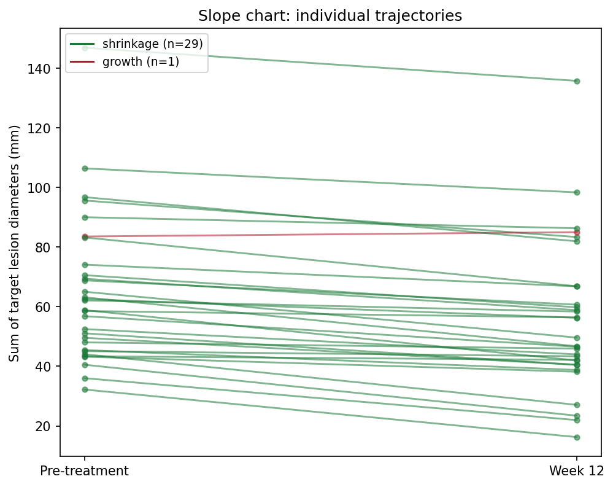
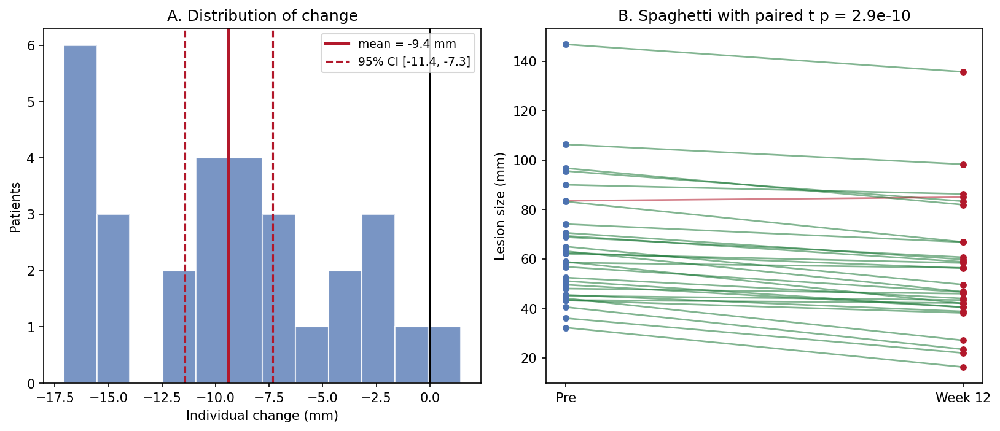

The Python counterpart of [Paired Plot](../Distribution/PairedPlot.html) — a paired before-after plot draws one line, arrow, or dumbbell per subject between the two time points, keeping the pairing visible. It is the honest alternative to two side-by-side boxplots for paired designs: baseline vs follow-up biomarker, pre vs post treatment lesion size (RECIST workflows), or within-patient case-control measurements.

matplotlib draws all three variants; `scipy.stats.ttest_rel` annotates the paired t-test \[1\]. The central design rule: the subject is the unit of analysis, so every subject must remain traceable in the figure — aggregates hide heterogeneity such as "half the cohort shrinks, half grows, mean unchanged".

This tutorial covers three workflows:

1. A slope chart with response-direction coloring;
2. An arrow plot annotated with the paired t-test;
3. A dumbbell chart sorted by individual change.

## Example

{fig-align="center" width="60%"}

## Setup

- System Requirements: Cross-platform (Linux/MacOS/Windows)
- Programming Language: **Python**
- Dependencies: `matplotlib`, `numpy`, `scipy`

```{python}
#| label: packages-setup
#| output: false
import matplotlib.pyplot as plt
import numpy as np
from scipy import stats
```

## Data Preparation

We simulate a Phase-II-style cohort: 30 patients with a sum of target lesion diameters measured at baseline and at week 12. The average effect is a ~9 mm shrinkage, but individual responses vary from strong shrinkage to modest growth — exactly the heterogeneity a paired plot must expose.

```{python}
#| label: data-prep
rng = np.random.default_rng(5)
n = 30
pre = rng.gamma(shape=4, scale=12, size=n) + 20       # baseline lesion size (mm)
effect = rng.normal(-8, 7, n)                          # individual change
post = np.clip(pre + effect, 8, None)
pid = [f"P{i:02d}" for i in range(1, n + 1)]

delta = post - pre
responders = delta < 0
colors = np.where(responders, "#1B7837", "#B2182B")
t_res = stats.ttest_rel(pre, post)                     # paired t-test
delta.mean(), t_res.pvalue
```

## Visualization

### 1. Slope Chart

```{python}
#| label: fig-py-paired-slope
#| fig-cap: "Slope chart of the 30 paired trajectories: green lines shrink and red lines grow, so the single growing patient is visible immediately instead of hiding inside a mean."
#| fig-align: center

fig, ax = plt.subplots(figsize=(6.8, 5.4))
for i in range(n):
    ax.plot([0, 1], [pre[i], post[i]], color=colors[i], alpha=0.6,
            linewidth=1.4, marker="o", markersize=4)
ax.set_xticks([0, 1]); ax.set_xticklabels(["Pre-treatment", "Week 12"])
ax.set_ylabel("Sum of target lesion diameters (mm)")
handles = [plt.Line2D([], [], color="#1B7837",
                      label=f"shrinkage (n={responders.sum()})"),
           plt.Line2D([], [], color="#B2182B",
                      label=f"growth (n={(~responders).sum()})")]
ax.legend(handles=handles, fontsize=9, loc="upper left")
ax.set_title("Slope chart: individual trajectories")
fig.tight_layout()
plt.show()
```

### 2. Arrow Plot with the Paired t-Test

```{python}
#| label: fig-py-paired-arrow
#| fig-cap: "Arrow plot: one arrow per patient, tail at pre and head at post; the paired t-test of the same differences is annotated on the panel."
#| fig-align: center

fig, ax = plt.subplots(figsize=(6.8, 5.4))
ax.scatter(np.zeros(n), pre, s=26, color="#4C72B0", zorder=3, label="pre")
ax.scatter(np.ones(n), post, s=26, color="#B2182B", zorder=3, label="post")
for i in range(n):
    ax.annotate("", xy=(1, post[i]), xytext=(0, pre[i]),
                arrowprops=dict(arrowstyle="->", color=colors[i],
                                alpha=0.65, lw=1.3))
ax.set_xlim(-0.35, 1.35)
ax.set_xticks([0, 1]); ax.set_xticklabels(["Pre", "Week 12"])
ax.set_ylabel("Sum of target lesion diameters (mm)")
ax.text(0.5, ax.get_ylim()[1] * 0.97,
        f"paired t = {t_res.statistic:.2f}, p = {t_res.pvalue:.1e}",
        ha="center", va="top", fontsize=10,
        bbox=dict(boxstyle="round,pad=0.3", fc="#FFF3E0", ec="#E65100"))
ax.legend(loc="lower left", fontsize=9)
ax.set_title("Arrow plot with paired t-test")
fig.tight_layout()
plt.show()
```

### 3. Dumbbell Chart Sorted by Change

```{python}
#| label: fig-py-paired-dumbbell
#| fig-cap: "Dumbbell chart sorted by individual change: each patient reads as a bar from pre (blue) to post (red); the sort turns 30 arrows into an effect-size ranking."
#| fig-align: center

order = np.argsort(delta)
fig, ax = plt.subplots(figsize=(6.8, 6.2))
y = np.arange(n)
for i, idx in enumerate(order):
    ax.plot([pre[idx], post[idx]], [y[i], y[i]], color=colors[idx],
            alpha=0.6, lw=2)
ax.scatter(pre[order], y, s=30, color="#4C72B0", zorder=3, label="pre")
ax.scatter(post[order], y, s=30, color="#B2182B", zorder=3, label="post")
ax.set_yticks(y); ax.set_yticklabels([pid[i] for i in order], fontsize=7)
ax.set_xlabel("Sum of target lesion diameters (mm)")
ax.axvline(pre.mean(), color="grey", ls=":", lw=1)
ax.legend(loc="lower right", fontsize=9)
ax.set_title("Dumbbell chart sorted by change")
fig.tight_layout()
plt.show()
```

::: callout-tip
## Practice tips

-   Use `scipy.stats.ttest_rel` — `ttest_ind` on paired data throws away the correlation between visits and usually overstates the p-value.
-   The paired t-test assumes approximately normal *differences*; check the change histogram (Application panel A) and switch to `wilcoxon` when it is skewed.
-   Never summarize a paired design with two unrelated boxplots — the pairing is the design.
-   Color by response direction, not by visit, so growth cases cannot disappear visually.
:::

## Application

The publication-style panel pairs the summary (A: distribution of individual change with mean and 95% CI) with the raw trajectories (B). The CI answers "is there an effect"; the spaghetti answers "is the effect consistent" — reviewers ask both.

{fig-align="center" width="80%"}

## Reference

\[1\] Virtanen P, Gommers R, Oliphant TE, et al. SciPy 1.0: fundamental algorithms for scientific computing in Python. Nat Methods. 2020;17:261-272. doi:10.1038/s41592-019-0686-2
