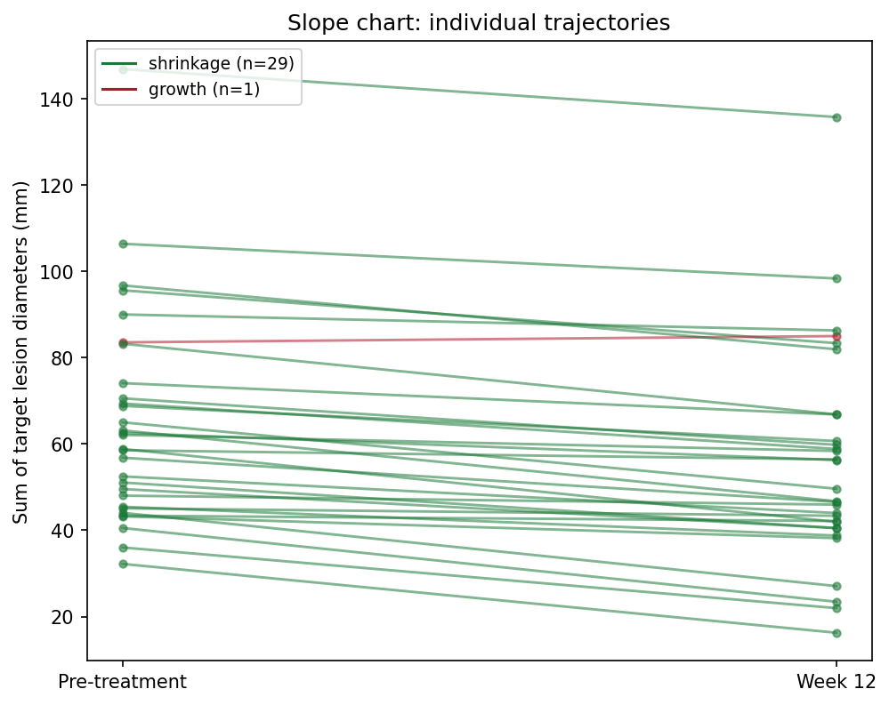
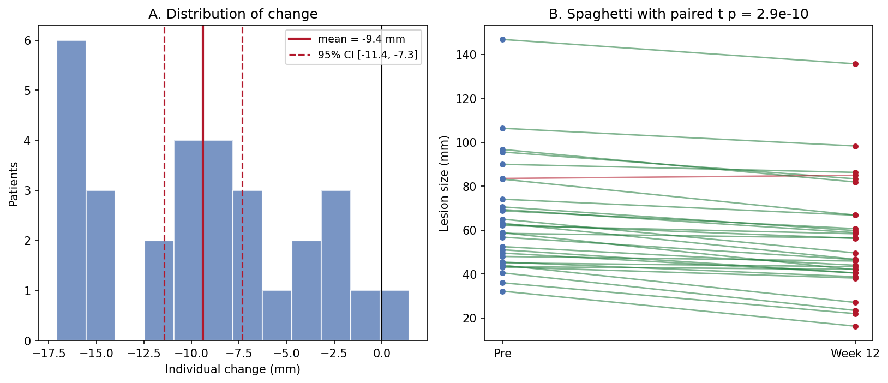

[配对图](../zh/Distribution/PairedPlot.html)的 Python 对应版本——配对前后对比图为每个受试者在两个时间点之间画一条线、一支箭头或一个哑铃，让配对关系保持可见。对配对设计而言，它是并排双箱线图的诚实替代：基线 vs 随访生物标志物、治疗前 vs 治疗后病灶大小（RECIST 流程）、或患者内病例-对照测量。

matplotlib 绘制全部三种变体；`scipy.stats.ttest_rel` 负责配对 t 检验注解 \[1\]核心设计原则：受试者是分析单位，因此图中必须能追踪到每个受试者——聚合会掩盖异质性，比如"一半患者缩小、一半增大、均值不变"。

本教程涵盖三种工作流：

1. 按反应方向着色的斜率图；
2. 带配对 t 检验注解的箭头图；
3. 按个体变化排序的哑铃图。

## Example

{fig-align="center" width="60%"}

## Setup

- 系统要求：跨平台（Linux/MacOS/Windows）
- 编程语言：**Python**
- 依赖包：`matplotlib`、`numpy`、`scipy`

```{python}
#| label: packages-setup
#| output: false
import matplotlib.pyplot as plt
import numpy as np
from scipy import stats
```

## Data Preparation

我们模拟一个 II 期研究风格的队列：30 名患者，分别测量基线与第 12 周的靶病灶直径之和。平均效应约缩小 9 mm，但个体反应从明显缩小到轻度增大不等——这正是配对图必须暴露的异质性。

```{python}
#| label: data-prep
rng = np.random.default_rng(5)
n = 30
pre = rng.gamma(shape=4, scale=12, size=n) + 20       # 基线病灶大小 (mm)
effect = rng.normal(-8, 7, n)                          # 个体变化
post = np.clip(pre + effect, 8, None)
pid = [f"P{i:02d}" for i in range(1, n + 1)]

delta = post - pre
responders = delta < 0
colors = np.where(responders, "#1B7837", "#B2182B")
t_res = stats.ttest_rel(pre, post)                     # 配对 t 检验
delta.mean(), t_res.pvalue
```

## Visualization

### 1. 斜率图

```{python}
#| label: fig-py-paired-slope
#| fig-cap: "30 条配对轨迹的斜率图：绿色线缩小、红色线增大，唯一的增大患者一眼可见，而不是藏进均值里。"
#| fig-align: center

fig, ax = plt.subplots(figsize=(6.8, 5.4))
for i in range(n):
    ax.plot([0, 1], [pre[i], post[i]], color=colors[i], alpha=0.6,
            linewidth=1.4, marker="o", markersize=4)
ax.set_xticks([0, 1]); ax.set_xticklabels(["Pre-treatment", "Week 12"])
ax.set_ylabel("Sum of target lesion diameters (mm)")
handles = [plt.Line2D([], [], color="#1B7837",
                      label=f"shrinkage (n={responders.sum()})"),
           plt.Line2D([], [], color="#B2182B",
                      label=f"growth (n={(~responders).sum()})")]
ax.legend(handles=handles, fontsize=9, loc="upper left")
ax.set_title("Slope chart: individual trajectories")
fig.tight_layout()
plt.show()
```

### 2. 带配对 t 检验的箭头图

```{python}
#| label: fig-py-paired-arrow
#| fig-cap: "箭头图：每名患者一支箭头，尾在治疗前、头在治疗后；同一组差值的配对 t 检验注解在面板上。"
#| fig-align: center

fig, ax = plt.subplots(figsize=(6.8, 5.4))
ax.scatter(np.zeros(n), pre, s=26, color="#4C72B0", zorder=3, label="pre")
ax.scatter(np.ones(n), post, s=26, color="#B2182B", zorder=3, label="post")
for i in range(n):
    ax.annotate("", xy=(1, post[i]), xytext=(0, pre[i]),
                arrowprops=dict(arrowstyle="->", color=colors[i],
                                alpha=0.65, lw=1.3))
ax.set_xlim(-0.35, 1.35)
ax.set_xticks([0, 1]); ax.set_xticklabels(["Pre", "Week 12"])
ax.set_ylabel("Sum of target lesion diameters (mm)")
ax.text(0.5, ax.get_ylim()[1] * 0.97,
        f"paired t = {t_res.statistic:.2f}, p = {t_res.pvalue:.1e}",
        ha="center", va="top", fontsize=10,
        bbox=dict(boxstyle="round,pad=0.3", fc="#FFF3E0", ec="#E65100"))
ax.legend(loc="lower left", fontsize=9)
ax.set_title("Arrow plot with paired t-test")
fig.tight_layout()
plt.show()
```

### 3. 按变化排序的哑铃图

```{python}
#| label: fig-py-paired-dumbbell
#| fig-cap: "按个体变化排序的哑铃图：每名患者读作从治疗前（蓝）到治疗后（红）的一条杠；排序把 30 支箭头变成效应量排名。"
#| fig-align: center

order = np.argsort(delta)
fig, ax = plt.subplots(figsize=(6.8, 6.2))
y = np.arange(n)
for i, idx in enumerate(order):
    ax.plot([pre[idx], post[idx]], [y[i], y[i]], color=colors[idx],
            alpha=0.6, lw=2)
ax.scatter(pre[order], y, s=30, color="#4C72B0", zorder=3, label="pre")
ax.scatter(post[order], y, s=30, color="#B2182B", zorder=3, label="post")
ax.set_yticks(y); ax.set_yticklabels([pid[i] for i in order], fontsize=7)
ax.set_xlabel("Sum of target lesion diameters (mm)")
ax.axvline(pre.mean(), color="grey", ls=":", lw=1)
ax.legend(loc="lower right", fontsize=9)
ax.set_title("Dumbbell chart sorted by change")
fig.tight_layout()
plt.show()
```

::: callout-tip
## 实践要点

-   使用 `scipy.stats.ttest_rel`——对配对数据用 `ttest_ind` 会丢弃两次测量间的相关性，通常夸大 p 值。
-   配对 t 检验假设*差值*近似正态；检查变化直方图（Application 面板 A），偏态时改用 `wilcoxon`。
-   永远不要用两张独立箱线图汇总配对设计——配对本身就是设计。
-   按反应方向（而非就诊时间）着色，增大的病例就不会从视觉上消失。
:::

## Application

出版风格的面板把汇总（A：个体变化的分布，含均值与 95% CI）与原始轨迹（B）并排。CI 回答"有没有效应"，spaghetti 回答"效应是否一致"——审稿人两个都要问。

{fig-align="center" width="80%"}

## Reference

\[1\] Virtanen P, Gommers R, Oliphant TE, et al. SciPy 1.0: fundamental algorithms for scientific computing in Python. Nat Methods. 2020;17:261-272. doi:10.1038/s41592-019-0686-2
