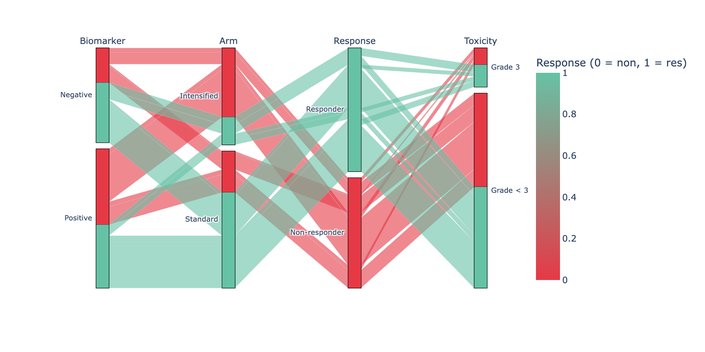

A parallel-categories (alluvial) plot shows how every individual observation flows across several categorical dimensions at once — the per-patient counterpart of a Sankey, which only shows aggregated volumes. Combinatorial trial data (genotype × treatment × response) is its home turf. `plotly.express.parallel_categories` builds it from a tidy frame, with counts encoded by ribbon thickness.

## Example

{fig-align="center" width="80%"}

## Setup

- System Requirements: Cross-platform (Linux/MacOS/Windows)
- Programming Language: **Python**
- Dependencies: `pandas`, `numpy`, `plotly`

```{python}
#| label: packages-setup
#| output: false
import pandas as pd
import numpy as np
import plotly.express as px
```

## Data Preparation

We simulate one row per patient (n = 420) across four categorical dimensions: biomarker status, treatment arm, response, and grade-3 toxicity — plus a colour signal (response) that carries through the ribbons.

```{python}
#| label: data-prep
np.random.seed(231)

n = 420
tri = pd.DataFrame({
    'Biomarker': np.random.choice(['Positive', 'Negative'], n, p=[0.55, 0.45]),
    'Arm': np.random.choice(['Standard', 'Intensified'], n, p=[0.6, 0.4]),
})
resp_p = np.where(
    (tri.Biomarker == 'Positive') & (tri.Arm == 'Intensified'), 0.75,
    np.where(tri.Arm == 'Intensified', 0.55, 0.35))
tri['Response'] = np.array(['Responder', 'Non-responder'])[
    (np.random.random(n) < resp_p).astype(int)]
tri['Toxicity'] = np.where(
    (tri.Arm == 'Intensified') & (tri.Response == 'Responder'),
    np.random.choice(['Grade < 3', 'Grade 3'], n, p=[0.6, 0.4]),
    np.random.choice(['Grade < 3', 'Grade 3'], n, p=[0.85, 0.15]))
# plotly 6 parallel_categories maps colour continuously: encode response 0/1
tri['ResponseCode'] = (tri.Response == 'Responder').astype(int)
```

## Visualization

### All Four Dimensions, Coloured by Response

Ribbon colour = response outcome, so the question "who responds?" is answered by following one colour across all axes; hovering any ribbon identifies the exact patient segment.

```{python}
#| label: fig-py-parcats
#| fig-cap: "Patient flows across biomarker, arm, response and toxicity"
#| width: 90%
#| fig-align: center
fig = px.parallel_categories(
    tri, dimensions=['Biomarker', 'Arm', 'Response', 'Toxicity'],
    color='ResponseCode',
    color_continuous_scale=['#e63946', '#66c2a5'],
    labels={'Biomarker': 'Biomarker', 'Arm': 'Arm',
            'ResponseCode': 'Response (0 = non, 1 = res)',
            'Response': 'Response', 'Toxicity': 'Toxicity'})
fig.update_layout(width=880, height=440, font_size=11)
fig.show()
```

### Counts on the Axes

Setting `counts` via `line.color` counts is plotly-internal; the simpler editorial alternative is sorting the frame so large ribbons render last, on top — and stating n in the title.

```{python}
#| label: fig-py-parcats-sorted
#| fig-cap: "Same flows ordered so the dominant paths draw last"
#| width: 90%
#| fig-align: center
order = (tri.groupby(['Biomarker', 'Arm', 'Response', 'Toxicity'])
            .size().sort_values().index)
tri_sorted = pd.concat(
    [tri[(tri.Biomarker == b) & (tri.Arm == a) &
         (tri.Response == r) & (tri.Toxicity == t)]
     for b, a, r, t in order])

fig = px.parallel_categories(
    tri_sorted, dimensions=['Biomarker', 'Arm', 'Response', 'Toxicity'],
    color='ResponseCode', color_continuous_scale=['#e63946', '#66c2a5'])
fig.update_layout(title_text=f'Patient flows (n = {n}), dominant paths on top',
                  width=880, height=440, font_size=11)
fig.show()
```

## References

1. Plotly Technologies Inc. Parallel categories diagram in Python. https://plotly.com/python/parallel-categories-diagram/
2. Kosara, R., & Bendix, F. (2006). Parallel Sets: Interactive Exploration and Visual Analysis of Categorical Data. *IEEE Transactions on Visualization and Computer Graphics*, 12(4), 558-568.
