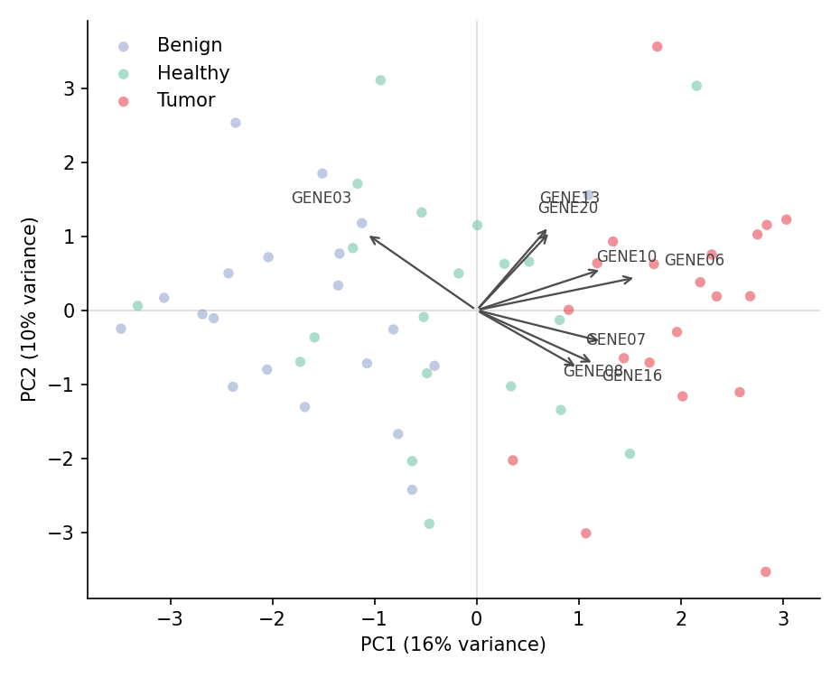

A PCA scores plot projects samples onto the top principal components, exposing batch structure, cluster separation, and outliers in high-dimensional data; the loadings tell you which features drive each axis. In biomedical research it is the standard first look at expression matrices, metabolomics panels, and any multi-feature cohort table. `scikit-learn` fits the decomposition, `matplotlib` draws the projections.

## Example

{fig-align="center" width="80%"}

## Setup

- System Requirements: Cross-platform (Linux/MacOS/Windows)
- Programming Language: **Python**
- Dependencies: `matplotlib`, `seaborn`, `pandas`, `numpy`, `scikit-learn`

```{python}
#| label: packages-setup
#| output: false
import matplotlib.pyplot as plt
import seaborn as sns
import pandas as pd
import numpy as np
from sklearn.decomposition import PCA
from sklearn.preprocessing import StandardScaler
```

## Data Preparation

We simulate a 60-sample expression matrix over 20 genes, drawn from three cohorts with distinct mean shifts, and z-scale the features before decomposition — PCA is variance-based, so scaling is mandatory whenever features live on different ranges.

```{python}
#| label: data-prep
np.random.seed(91)

cohorts = ['Healthy', 'Benign', 'Tumor']
n_per = 20
base = np.random.normal(0, 1, (n_per * 3, 20))
shifts = np.concatenate([
    np.zeros((n_per, 20)),
    np.tile(np.r_[np.full(5, 1.2), np.zeros(15)], (n_per, 1)),
    np.tile(np.r_[np.zeros(5), np.full(5, 1.6), np.full(10, 0.5)], (n_per, 1)),
])
expr = base + shifts + np.random.normal(0, 0.6, base.shape)

genes = [f'GENE{i:02d}' for i in range(1, 21)]
X = StandardScaler().fit_transform(expr)
df = pd.DataFrame(X, columns=genes)
df['Cohort'] = np.repeat(cohorts, n_per)

pca = PCA(n_components=5).fit(X)
scores = pd.DataFrame(pca.transform(X), columns=[f'PC{i+1}' for i in range(5)])
scores['Cohort'] = df['Cohort']
loadings = pca.components_.T * np.sqrt(pca.explained_variance_)
```

## Visualization

### Scores Plot with Variance Labels

The share of variance each component explains belongs in the axis labels — a PCA plot without them is uninterpretable.

```{python}
#| label: fig-py-pca-scores
#| fig-cap: "PCA scores of the three cohorts on the first two components"
#| width: 68%
#| fig-align: center
palette = {'Healthy': '#66c2a5', 'Benign': '#8da0cb', 'Tumor': '#e63946'}
pc1 = pca.explained_variance_ratio_[0] * 100
pc2 = pca.explained_variance_ratio_[1] * 100

fig, ax = plt.subplots(figsize=(5.8, 4.6))
for cohort, sub in scores.groupby('Cohort'):
    ax.scatter(sub['PC1'], sub['PC2'], s=42, alpha=0.85,
               color=palette[cohort], edgecolor='white', linewidth=0.5,
               label=cohort)
ax.axhline(0, color='0.85', linewidth=0.8, zorder=0)
ax.axvline(0, color='0.85', linewidth=0.8, zorder=0)
ax.set_xlabel(f'PC1 ({pc1:.0f}% variance)')
ax.set_ylabel(f'PC2 ({pc2:.0f}% variance)')
ax.legend(frameon=False)
ax.spines[['top', 'right']].set_visible(False)
plt.tight_layout()
plt.show()
```

### Biplot with Loadings

Arrows for the top-variance genes project the feature space onto the score plot — arrows pointing the same way as a cohort indicate marker genes up in that cohort.

```{python}
#| label: fig-py-pca-biplot
#| fig-cap: "PCA biplot: scores by cohort with the top-8 loading genes"
#| width: 72%
#| fig-align: center
top_genes = np.argsort(np.abs(loadings[:, :2]).sum(axis=1))[-8:]
scale = 2.2
radii = np.linspace(1.10, 1.40, len(top_genes))  # stagger labels along arrows

fig, ax = plt.subplots(figsize=(6.2, 5))
for cohort, sub in scores.groupby('Cohort'):
    ax.scatter(sub['PC1'], sub['PC2'], s=30, alpha=0.55,
               color=palette[cohort], edgecolor='none', label=cohort)
for j, i in enumerate(top_genes):
    ax.annotate('', xy=(loadings[i, 0] * scale, loadings[i, 1] * scale),
                xytext=(0, 0), arrowprops=dict(arrowstyle='->', color='0.3', lw=1.1))
    ax.text(loadings[i, 0] * scale * radii[j], loadings[i, 1] * scale * radii[j],
            genes[i], fontsize=8, color='0.25', ha='center')
ax.axhline(0, color='0.85', linewidth=0.8, zorder=0)
ax.axvline(0, color='0.85', linewidth=0.8, zorder=0)
ax.set_xlabel(f'PC1 ({pc1:.0f}% variance)')
ax.set_ylabel(f'PC2 ({pc2:.0f}% variance)')
ax.legend(frameon=False, loc='upper left')
ax.spines[['top', 'right']].set_visible(False)
plt.tight_layout()
plt.show()
```

### Scree Plot

The explained-variance profile justifies how many components to keep; the elbow (here after PC3) is the usual cut-off.

```{python}
#| label: fig-py-pca-scree
#| fig-cap: "Explained variance per component (bar) with cumulative share (line)"
#| width: 68%
#| fig-align: center
evr = pca.explained_variance_ratio_ * 100
comps = np.arange(1, len(evr) + 1)

fig, ax = plt.subplots(figsize=(5.8, 4))
ax.bar(comps, evr, color='#8da0cb', edgecolor='0.25', linewidth=0.6,
       label='Per component')
ax.plot(comps, np.cumsum(evr), color='#e63946', marker='o', markersize=5,
        linewidth=1.6, label='Cumulative')
ax.set_xlabel('Principal component')
ax.set_ylabel('Explained variance (%)')
ax.set_xticks(comps)
ax.legend(frameon=False)
ax.spines[['top', 'right']].set_visible(False)
plt.tight_layout()
plt.show()
```

## References

1. Pedregosa, F., et al. (2011). Scikit-learn: Machine Learning in Python. *Journal of Machine Learning Research*, 12, 2825-2830.
2. Hunter, J. D. (2007). Matplotlib: A 2D graphics environment. *Computing in Science & Engineering*, 9(3), 90-95.
